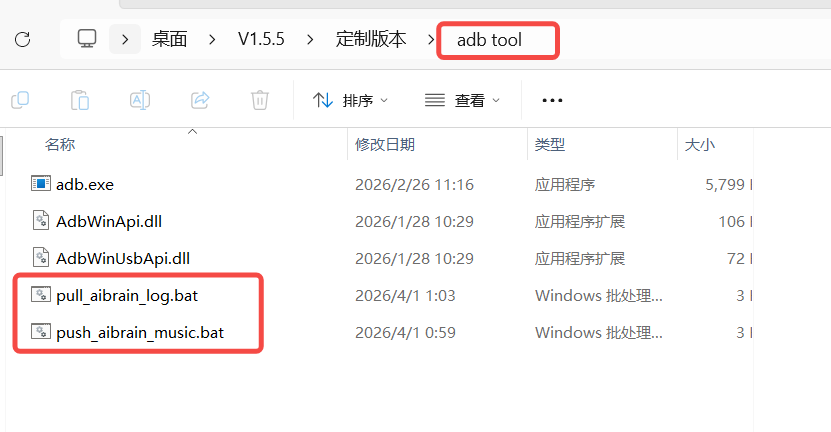
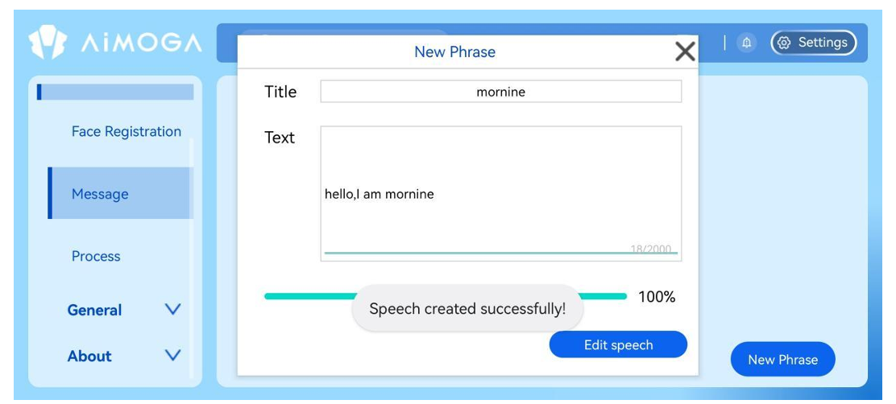
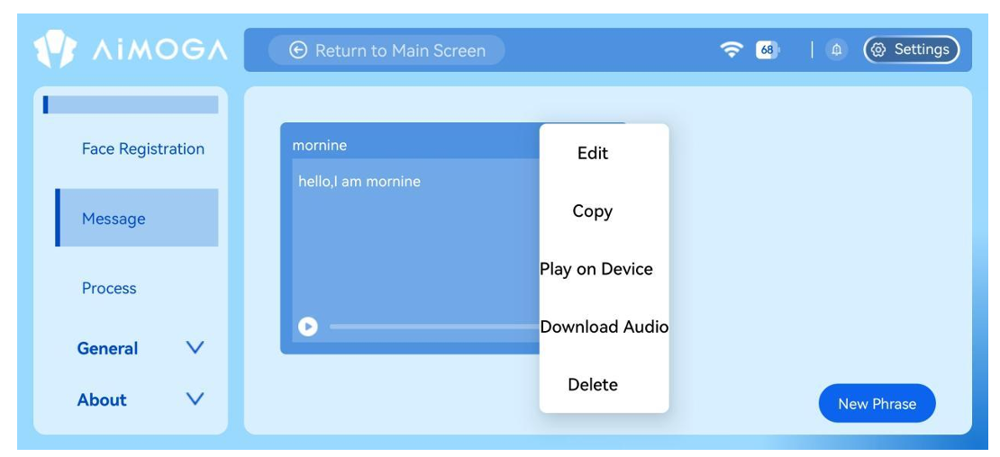
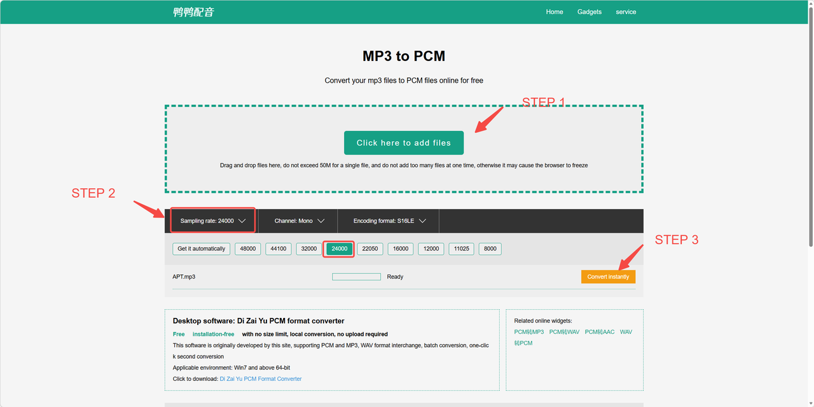
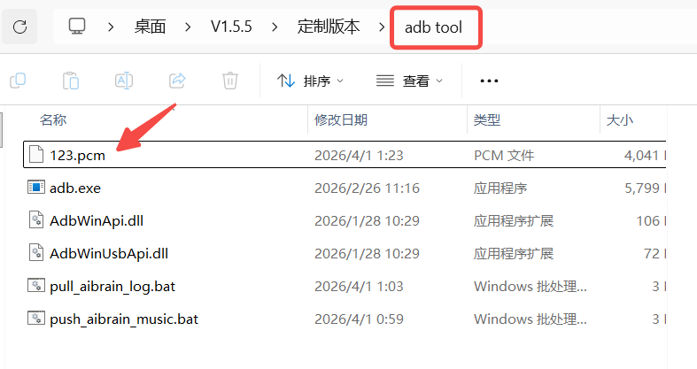
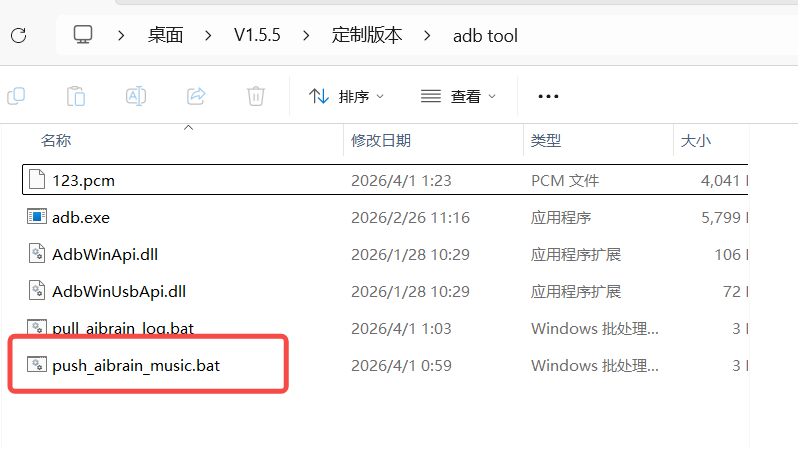
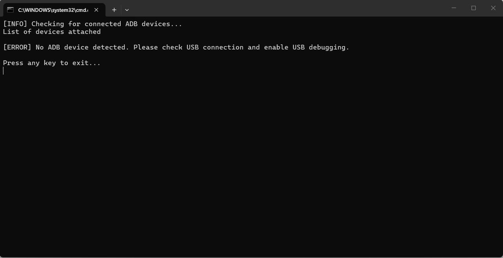
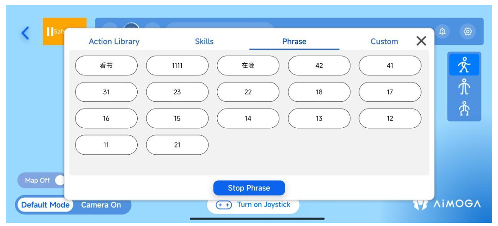

> **适用产品**：墨茵机器人 本文覆盖场景说明、准备工作，以及创建短语、转换音频格式、连接设备、推送音频文件与验证播放的操作步骤。

## 1 场景说明

当需要使用外部音频文件替换机器人合成好的话术语音时，可按本文步骤操作：在机器人 APP 中创建短语，并将转换后的 PCM 音频文件推送至机器人大脑，实现自定义语音的播放。

## 2 准备工作

### 2.1 机器人 APP

用于控制机器人的移动应用程序。

### 2.2 ADB 调试线

艾美佳专用的 ADB 调试线，用于连接机器人的大脑，不支持与其他线束配合使用。

>    src="/images/image-180.png"
>   alt="Image"
>   title="Image"
>   style={{ width:"46%" }}
> />

### 2.3 ADB 工具包

包含 ADB 可执行文件和音频推送脚本。

> [adb tool.rar](https://drive.weixin.qq.com/s?k=AHYAsQcTADcRvABmJZ)

> 

### 2.4 音频转换工具

用于转换 PCM 格式的在线网站或软件。

例：[https://www.yayapeiyin.com/mp3-to-pcm/](https://www.yayapeiyin.com/mp3-to-pcm/)

## 3 操作步骤

### 3.1 在 APP 中创建一个新短语

- 先打开机器人 APP，创建新短语，输入短语标题（例如 `123`），然后保存。

> 注意：请记住这个短语标题，因为后续的音频文件名必须与它完全相同。

> 
>
> 

### 3.2 转换音频格式

- 准备原始音频文件（MP3/WAV 等）。
- 使用在线转换工具并设置以下参数：
  - 输出格式：PCM。
  - 采样率：24000 Hz。
  - 声道：单声道。
- 转换完成后，将文件重命名为短语标题（例如 `123.pcm`）。

> 

### 3.3 连接设备

- 使用 ADB 调试线将机器人大脑连接到计算机。

>    src="/images/image-185.png"
>   alt="Image"
>   title="Image"
>   style={{ width:"50%" }}
> />
>
>    src="/images/image-186.png"
>   alt="Image"
>   title="Image"
>   style={{ width:"51%" }}
> />

### 3.4 推送音频文件

- 将转换后的 PCM 文件放入 ADB 工具包文件夹。

> 

- 双击运行文件夹中的音频推送脚本。

> 

- 等待脚本执行完成并确认推送成功。

> 

### 3.5 验证播放

- 返回机器人 APP，找到对应的短语内容，点击播放按钮，确认机器人正在播放新上传的自定义音频。

> 
