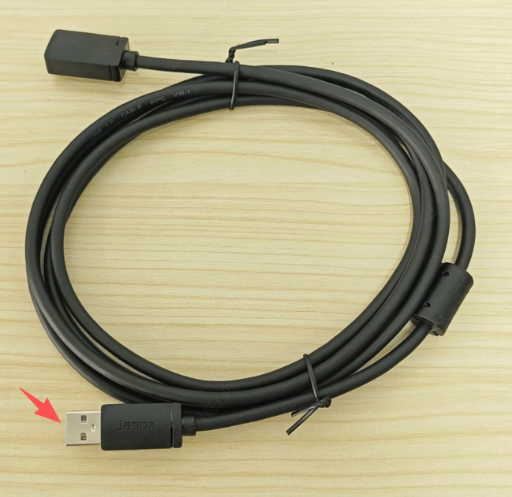
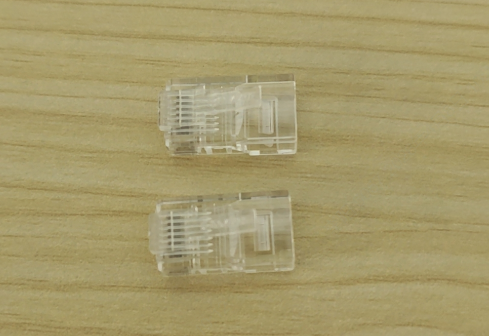
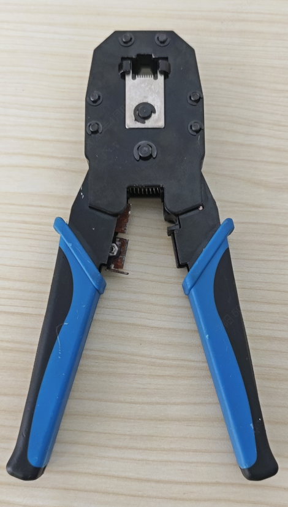
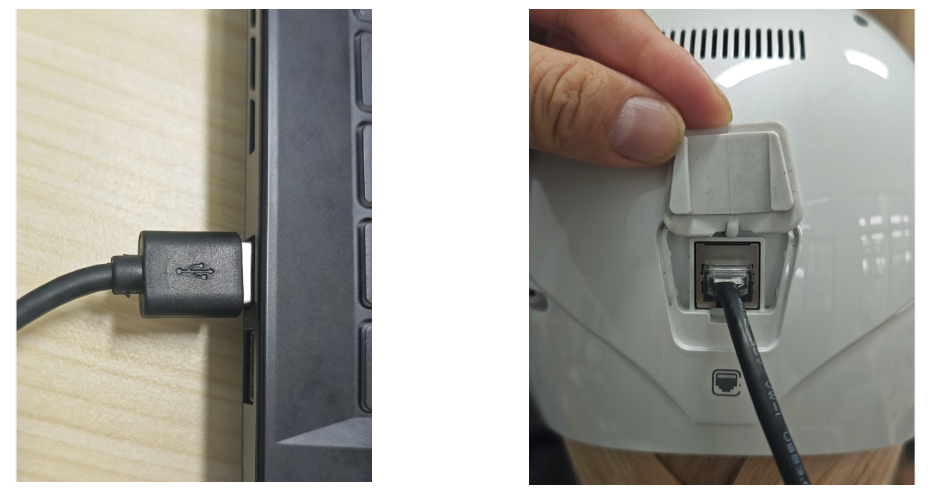
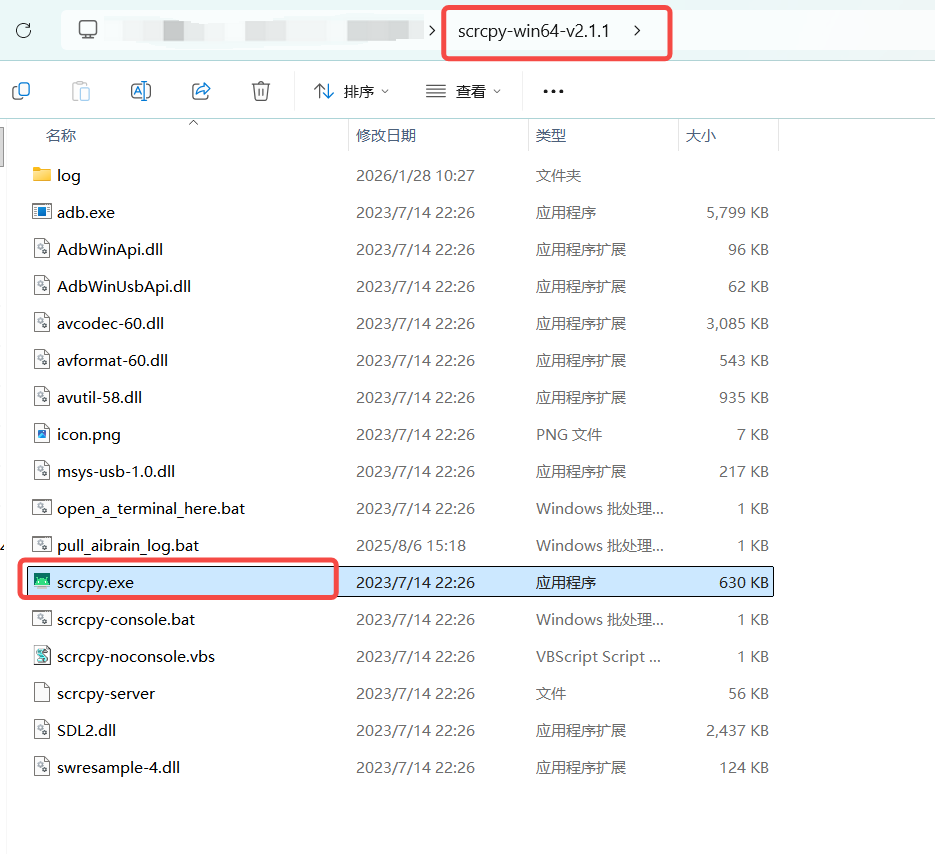
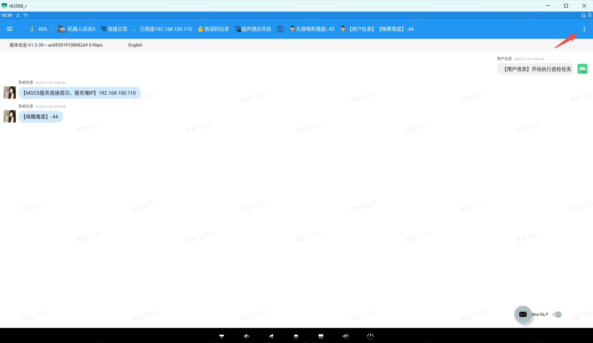

> **适用产品**：墨茵机器人 本文覆盖ADB功能说明、材料准备、制作步骤、测试验证与安全注意事项。

## 1 功能说明

<table>
  <colgroup>
    <col width="152" />
    <col width="430" />
  </colgroup>
  <thead>
    <tr>
      <th>项目</th>
      <th>说明</th>
    </tr>
  </thead>
  <tbody>
    <tr>
      <td>用途</td>
      <td>机器人大脑 ADB 调试专用</td>
    </tr>
    <tr>
      <td>接口类型</td>
      <td>USB 2.0 转 RJ45</td>
    </tr>
    <tr>
      <td>调试软件</td>
      <td>scrcpy（投屏测试）</td>
    </tr>
  </tbody>
</table>

<Warning>
  注意：专用调试线仅用于机器人大脑 ADB 调试；严禁作为网口插入其他设备，否则可能引起设备损坏。
</Warning>

## 2 材料准备

<table>
  <colgroup>
    <col width="163" />
    <col width="326" />
  </colgroup>
  <thead>
    <tr>
      <th>材料</th>
      <th>规格要求</th>
    </tr>
  </thead>
  <tbody>
    <tr>
      <td>USB 2.0 线束</td>
      <td>一端为 USB 公头</td>
    </tr>
    <tr>
      <td>RJ45 水晶头</td>
      <td>标准 8P8C</td>
    </tr>
    <tr>
      <td>网线钳</td>
      <td>用于压接 RJ45</td>
    </tr>
    <tr>
      <td>剥线工具</td>
      <td>用于剥离胶皮</td>
    </tr>
  </tbody>
</table>

## 3 制作步骤

### 3.1 处理线束

#### 3.1.1 剪断线束

- 在合适位置剪断 USB 2.0 线束。

>    src="/images/image-119.png"
>   alt="Image"
>   title="Image"
>   style={{ width:"57%" }}
> />

#### 3.1.2 剥离胶皮

- 剥离约 1.5 cm 胶皮。
- 保留白、绿、红、黑四根芯线。
- 其余线芯剪除。

>    src="/images/image-120.png"
>   alt="Image"
>   title="Image"
>   style={{ width:"60%" }}
> />

### 3.2 安装 RJ45 接头

#### 3.2.1 确认线序

- 将 RJ45 接头背面朝上。
- 按白、绿、红、空、空、黑、空、空顺序塞入。

>    src="/images/image-121.png"
>   alt="Image"
>   title="Image"
>   style={{ width:"85%" }}
> />

| 引脚 | 线芯 |
| --- | --- |
| 1 | 空 |
| 2 | 空 |
| 3 | 黑 |
| 4 | 空 |
| 5 | 空 |
| 6 | 红 |
| 7 | 绿 |
| 8 | 白 |

#### 3.2.2 压接水晶头

- 使用网线钳压紧 RJ45 水晶头。
- 确保线芯与金属片接触良好。

>    src="/images/image-122.png"
>   alt="Image"
>   title="Image"
>   style={{ width:"67%" }}
> />

## 4 测试验证

### 4.1 连接设备

- 将调试线 USB 公头连接电脑。

- RJ45 端连接机器人大脑调试口。

> 

### 4.2 投屏测试

- 打开 `scrcpy` 软件。
- 检查是否正常识别设备。
- 验证投屏功能是否正常。

> 
>
> 

## 5 安全注意事项

<Warning>
  注意：严禁将调试线作为网口插入交换机、路由器等网络设备；错误使用可能导致设备短路损坏。
</Warning>

<Note>
  说明：制作时确保线序正确，错序可能导致调试失败或设备异常；压接时确保线芯与金属片充分接触，避免虚接。
</Note>

<Note>
  说明：调试线仅用于 ADB 调试，不支持网络数据传输；使用前检查线材外观，破损时禁止使用。
</Note>
