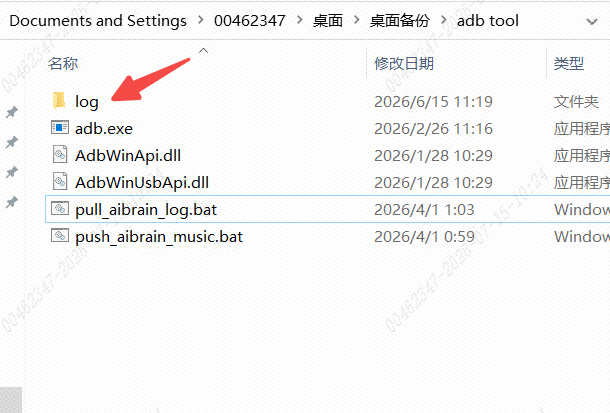
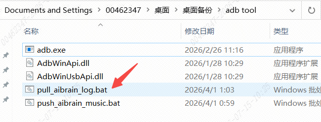
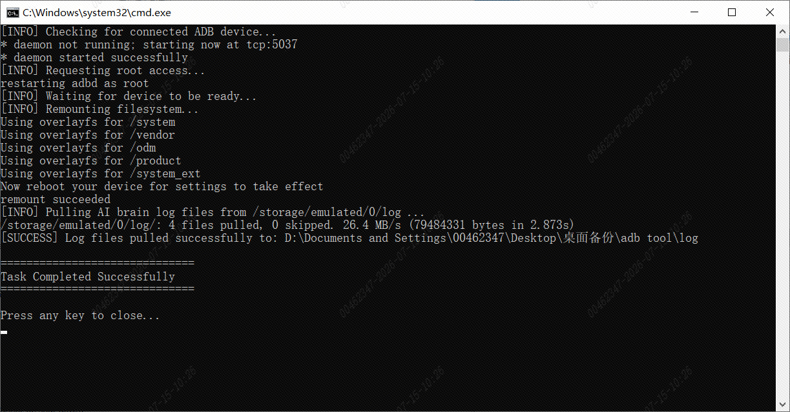
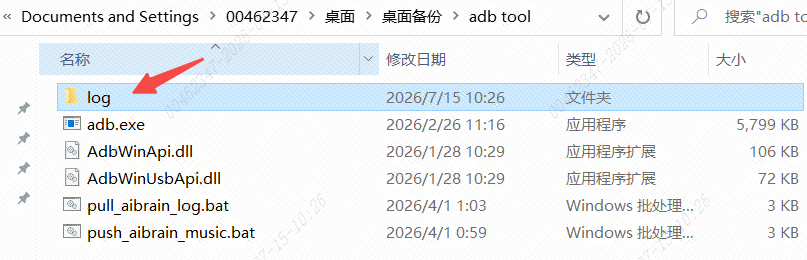
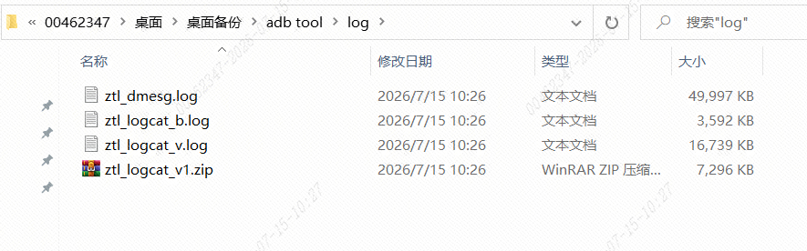

> **适用产品**：墨茵机器人<br />本文覆盖 AIBrain 日志导出的准备工作、操作步骤、异常处理与注意事项。

## 1 准备工作

- 硬件工具：大脑 ADB 专用调试线。
- 软件工具：[ADB Tool](https://drive.weixin.qq.com/s?k=AHYAsQcTADcj2jLnSa)（`adb tool.rar`）。
- 脚本文件：`pull_aibrain_log.bat`（日志拉取批处理脚本）。
- 目标设备：机器人大脑主机（已上电并处于待机或故障状态）。

## 2 操作步骤

### 2.1 连接调试线

- 将 ADB 专用调试线的一端插入机器人大脑的调试接口，另一端插入电脑的 USB 端口。
- 确保大脑主机已正常供电并启动。

>    src="/images/image-142.png"
>   alt="Image"
>   title="Image"
>   style={{ width:"60%" }}
> />

>    src="/images/image-143.png"
>   alt="Image"
>   title="Image"
>   style={{ width:"61%" }}
> />

### 2.2 清理旧日志（可选但建议）

- 手动删除大脑中已存在的旧日志文件夹，防止日志混叠。

> 

### 2.3 拉取日志

- 双击运行 `pull_aibrain_log.bat` 脚本。

> 

- 脚本会自动执行 ADB 命令，将大脑中的日志文件复制到电脑本地（通常保存在脚本同目录下的 `logs/` 文件夹中）。
- 等待脚本运行完毕，命令行提示“日志拉取完成”或类似信息。

> 

### 2.4 检查结果

- 打开脚本所在目录，查看是否生成新的日志文件夹，并确认其中包含 `aibrain.log` 或其他相关日志文件。
- 将导出的日志文件打包，发送给售后技术支持人员进行分析。

> 

> 

## 3 异常处理与排查

<table>
  <colgroup>
    <col width="249" />
    <col width="469" />
  </colgroup>
  <thead>
    <tr>
      <th>异常现象</th>
      <th>建议处理方式</th>
    </tr>
  </thead>
  <tbody>
    <tr>
      <td>ADB 连接失败<br />（`adb devices` 无设备列表）</td>
      <td>重新插拔调试线，确保接口接触良好；重启机器人大脑（关机再开机）；更换电脑 USB 端口。</td>
    </tr>
    <tr>
      <td>多次尝试仍无法连接</td>
      <td>可能涉及硬件连接故障（如调试线损坏、大脑调试接口异常），请联系我司售后技术支持，提供设备型号和故障现象，由专业工程师指导处理。</td>
    </tr>
  </tbody>
</table>

## 4 注意事项

- 请使用专用调试线，其他非专用线束可能导致设备端口硬件损坏。
- 拉取日志前建议关闭其他占用 ADB 的软件（如手机助手、模拟器等），避免端口冲突。

## 5 备注

原始抓取日志 ADB 命令如下：

```text
adb pull /storage/emulated/0/log
```
