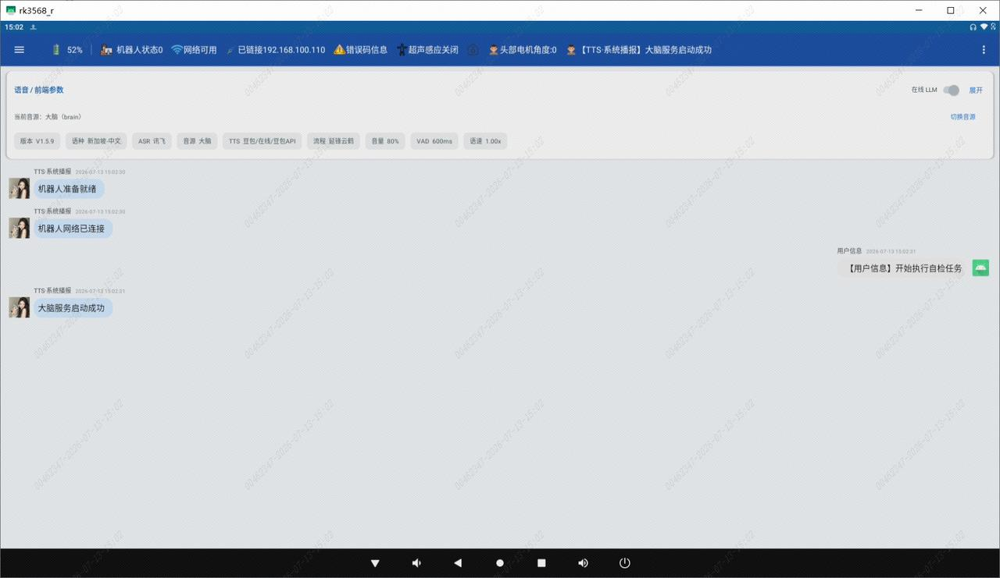
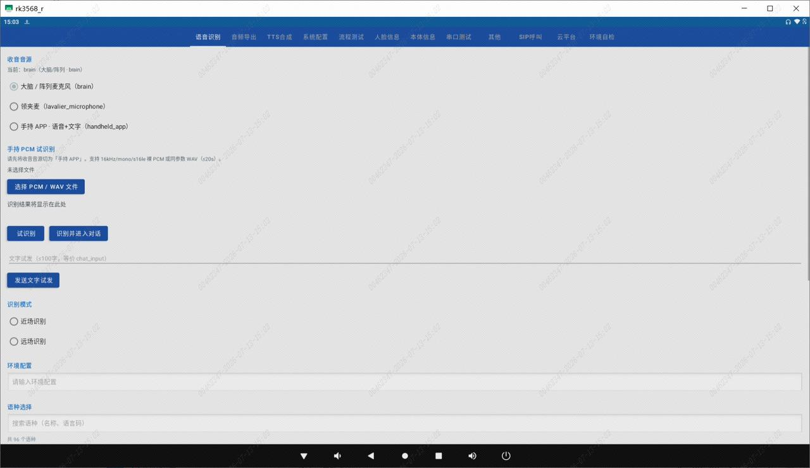
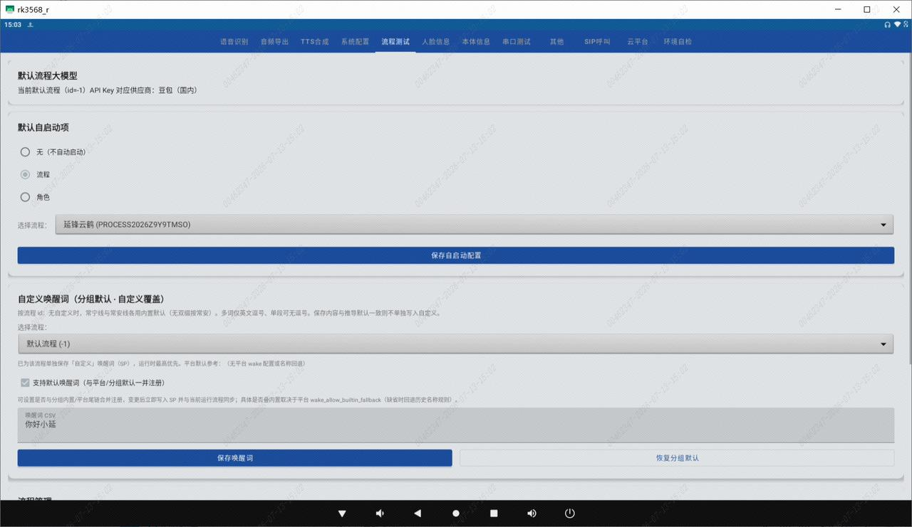
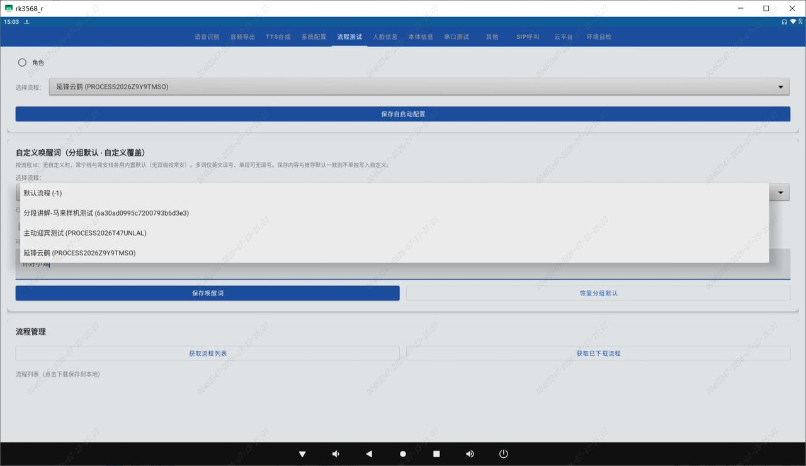
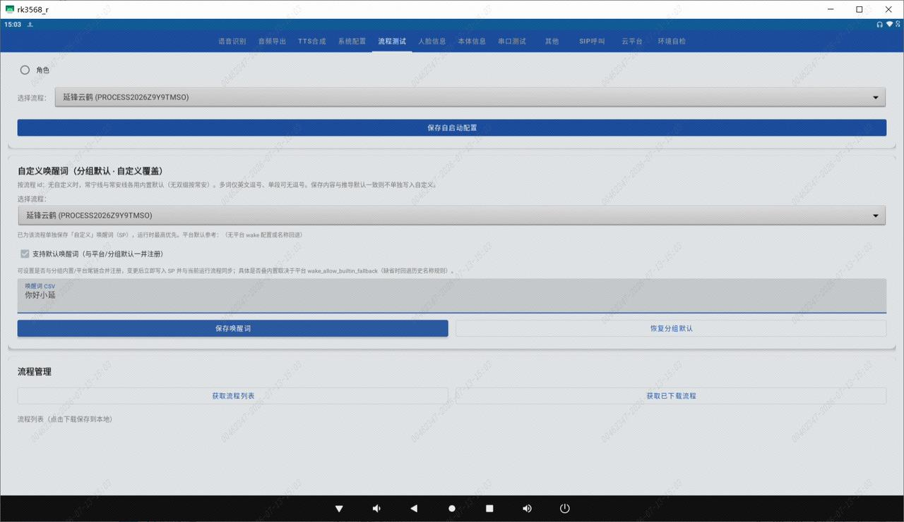

> **适用产品**：墨茵机器人 本文覆盖流程自定义唤醒词的适用条件、操作步骤及特别提醒。

## 1 适用条件

- 机器人软件版本 V2.0.6 及以上。
- 默认唤醒词：“嗨，墨茵”。
- 支持范围：当前仅支持为流程（默认流程、云平台流程、FASTGPT 流程）设置自定义唤醒词，暂不支持为“角色”设置。

## 2 操作步骤

### 2.1 在 APP 中选择流程

- 使用手机 APP 操作机器人，选中需要设置自定义唤醒词的对话流程。

### 2.2 连接机器人大脑

- 使用 ADB 投屏工具 `scrcpy`，连接至机器人大脑界面。

> 

### 2.3 进入流程测试菜单

- 打开 AIBrain，依次进入“设置菜单” >> “流程测试”，找到“自定义唤醒词”区域。

> 
>
> 

### 2.4 选择目标流程

- 在流程下拉菜单中，选中需要绑定自定义唤醒词的流程。

> 若下拉菜单为空或未显示，请右键点击 AIBrain 界面退出到桌面，重新打开 AIBrain 即可刷新。

> 

### 2.5 粘贴并保存唤醒词

- 在“唤醒词 CSV”输入框中，粘贴您要设定的唤醒词（例如：你好小延），然后点击“保存唤醒词”。

> 

### 2.6 重启 AIBrain 生效

- 鼠标右键点击 AIBrain 界面，选择退出到桌面，然后重新打开 AIBrain，等待配置生效。

### 2.7 在 APP 中测试验证

- 在手机 APP 中重新打开该流程，使用新唤醒词进行唤醒测试。

## 3 特别提醒

- 多个流程需分别单独设定各自的唤醒词，不可共用。
- 当前版本仅支持流程级唤醒词定制，角色级暂不支持。
- 如遇界面不刷新，优先尝试重启 AIBrain 即可解决。
