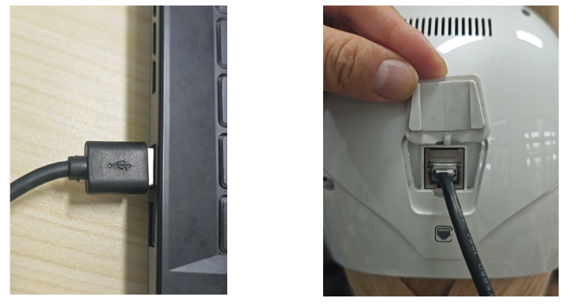
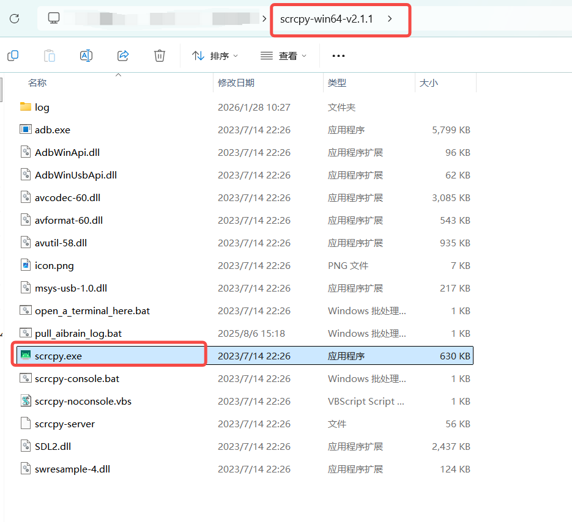
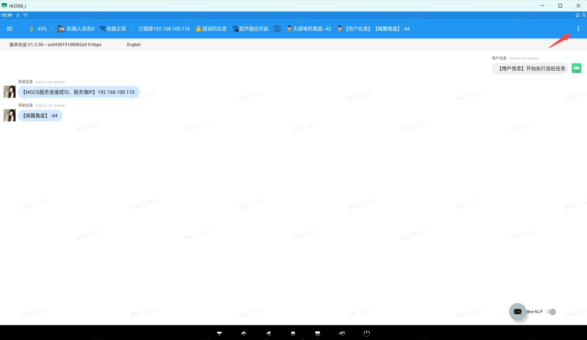

> **适用产品**：墨茵机器人 本文覆盖大脑设备连接、投屏操作及安全注意事项。

## 1 连接设备

- 将调试线 USB 公头连接电脑。
- RJ45 端连接机器人大脑调试口。

## 2 投屏操作

- 打开 `scrcpy` [投屏软件](https://drive.weixin.qq.com/s?k=AHYAsQcTADcVPUyN4x)。
- 检查是否正常识别设备。
- 验证投屏功能是否正常。

## 3 安全注意事项

<Warning>
  注意：严禁将调试线作为网口插入交换机、路由器等网络设备；错误使用可能导致设备短路损坏。
</Warning>
