> **适用产品**：墨茵机器人 本文覆盖 APP 首次启动登录、连接机器人、机器人网络配置与 APP 快捷连接。

## 1 APP 首次启动

通用 APP 首次使用需要登录账号，有以下两种方式。

### 1.1 方式一：账号注册登录

用邮箱或手机号进行账号注册，注册完成后通过账号密码登录。

<Columns cols={2}>
  <Column>
    
  </Column>
  <Column>
    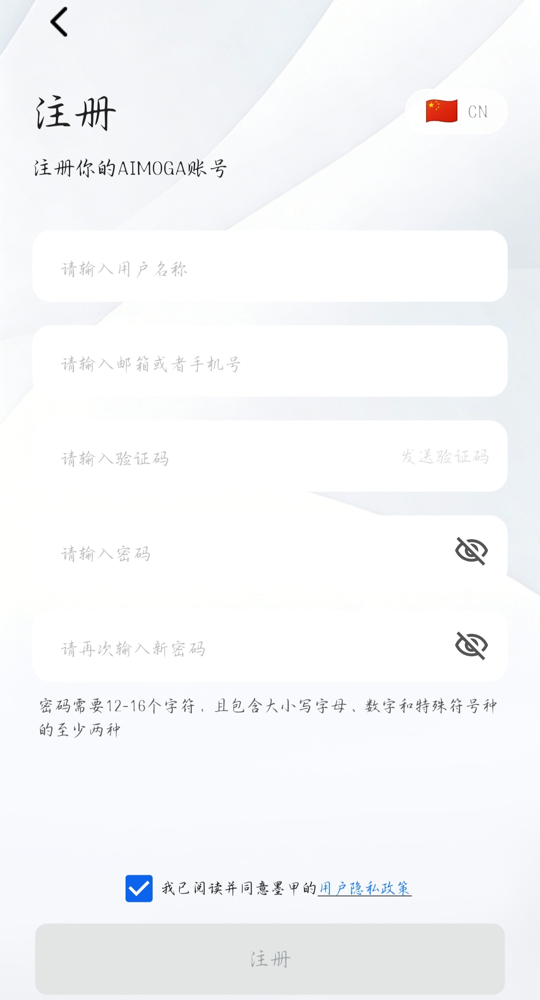
  </Column>
</Columns>

### 1.2 方式二：验证码登录

输入手机号或邮箱，等待验证码发送，输入验证码即可登录。

<Columns cols={2}>
  <Column>
    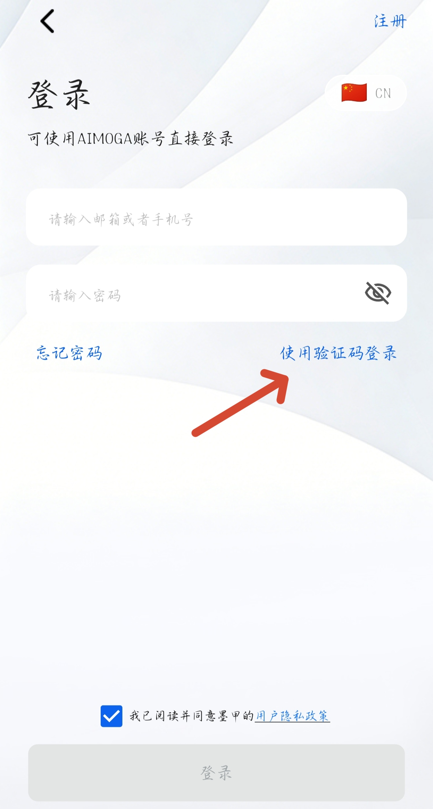
  </Column>
  <Column>
    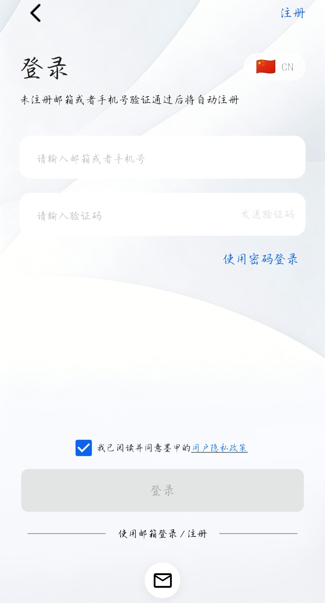
  </Column>
</Columns>

## 2 连接机器人

> **【注意】** 连接机器人前，务必先断开其他外网 Wi-Fi 和移动网络。

### 2.1 启动机器人

- 确保机器人已开机并进入曲腿站立模式。
- 打开通用 APP 进入首页，点击页面下方的“+”号添加设备，选择 SN 码绑定。

<Columns cols={2}>
  <Column>
    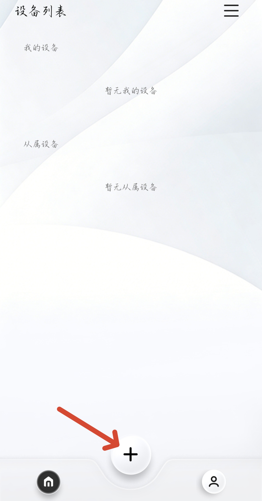
  </Column>
  <Column>
    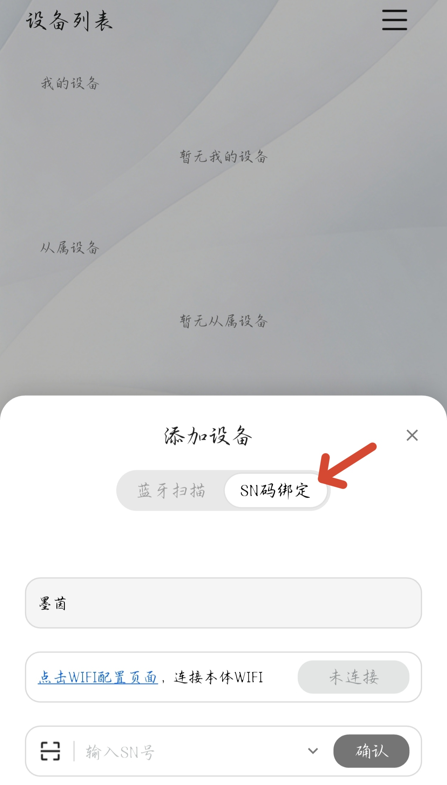
  </Column>
</Columns>

### 2.2 连接本体热点

- 选择机器人 Wi-Fi（名称见背部铭牌），密码：`111@Moga`。

> 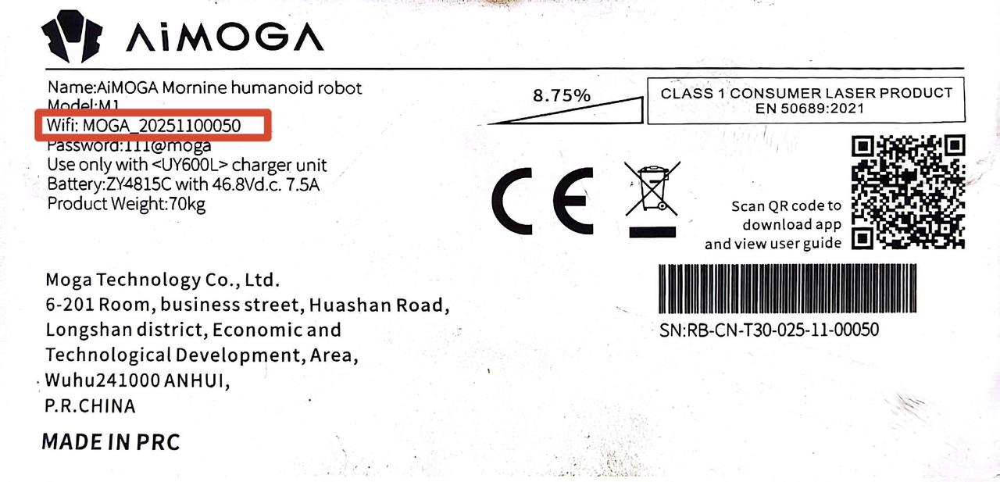

### 2.3 输入 SN 码

- 返回 APP，扫描或手动输入机身背部 SN 码，并确认。

> 
>
> 待人工确认：原文内容（图片未提供链接）

### 2.4 进入控制界面

控制界面下可以查看机器人状态，并控制机器人各项功能使用。

<Columns cols={2}>
  <Column>
    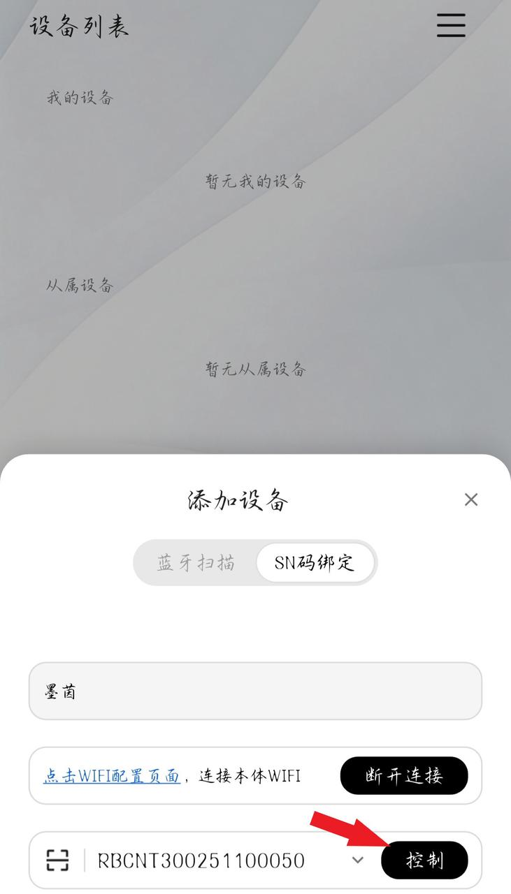
  </Column>
  <Column>
    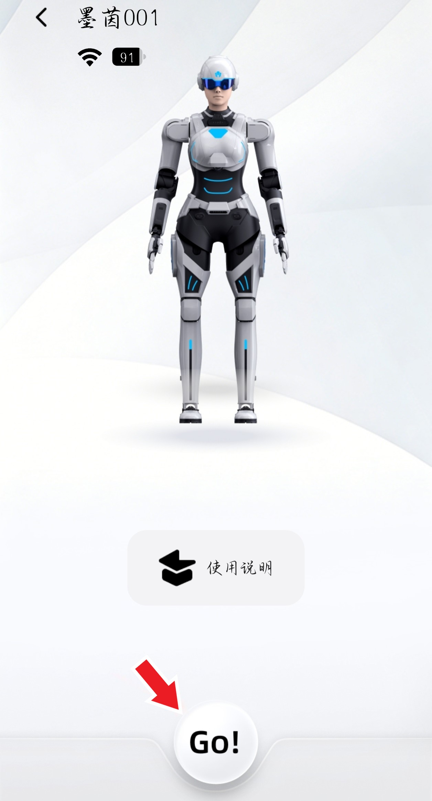
  </Column>
</Columns>

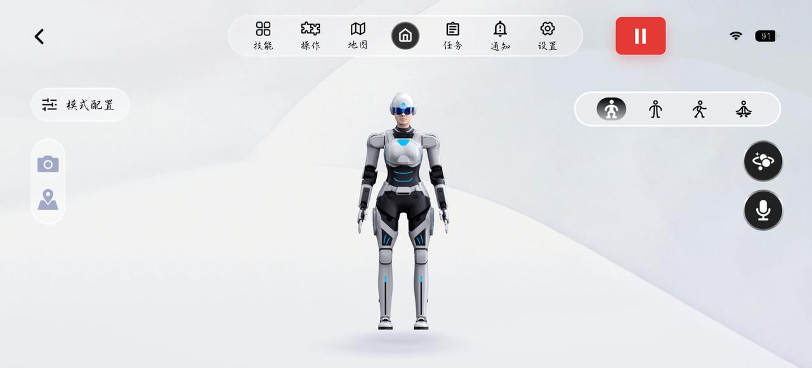

## 3 机器人网络配置

机器人语音交互必须在联网状态下才能进行。首次使用机器人需要给机器人手动连接外部网络，后续如果该网络保持正常开放使用，机器人开机后会自动连接该网络，无需再手动连接。

### 3.1 进入 Wi-Fi 配置界面

- 在 APP 顶部导航栏点击【设置】→“通用设置”→“WIFI 设置”。

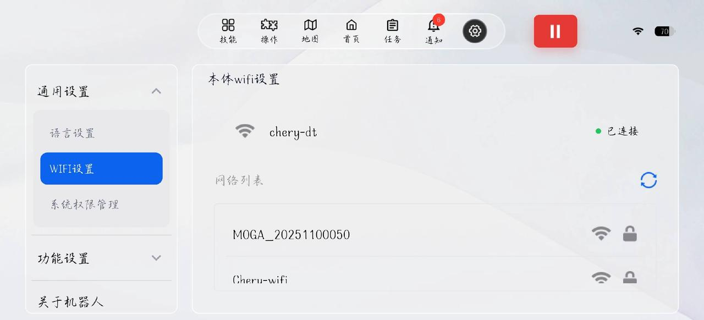

### 3.2 连接外部网络

- 刷新网络列表，找到当前场景可以使用的外部网络，点击输入 Wi-Fi 密码连接。
- 连接成功后机器人本体会播报：“机器人网络已连接”。

### 3.3 机器人网络连接状态判断

- 如果外部网络故障或者不稳定，可能会导致机器人断开与外部网络的连接，断网后机器人会播报网络异常，无法对话。
- 也可以通过机器人耳灯状态判断网络状态：耳灯为蓝色时代表网络连接正常；耳灯变红时代表网络断开或者网络不可用。
- 网络异常时，可进入 Wi-Fi 配置界面重新选择新的外部网络进行连接。

## 4 APP 快捷连接

使用 APP 连接过的设备会保存在 APP 界面，可以实现后续快速连接设备。

### 4.1 连接本体热点

- 机器人启动后，先打开手机 Wi-Fi 连接界面连接机器人本体热点。

### 4.2 打开通用 APP

- 进入 APP 首页设备列表，可以看到连接过的机器人设备卡片，点击要连接的本体卡片，再点热点连接，等待连接成功即可。
- 如果连接失败，可以检查一下手机是否还保持着与机器人本体热点的连接，或者机器人是否完全启动（胸灯变蓝）。

<Columns cols={3}>
  <Column>
    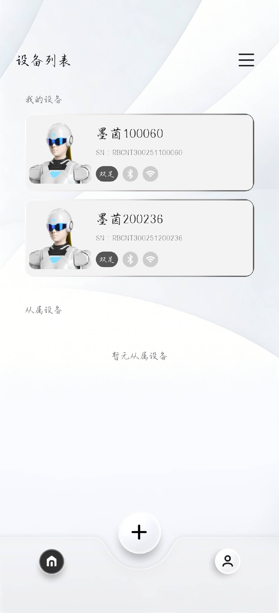
  </Column>
  <Column>
    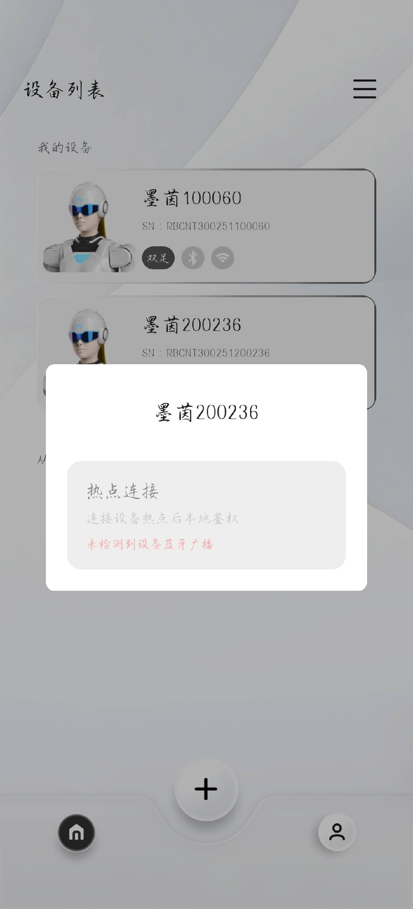
  </Column>
  <Column>
    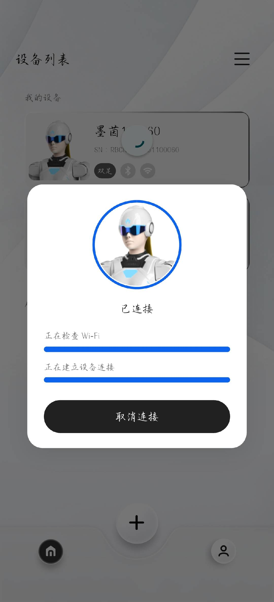
  </Column>
</Columns>
