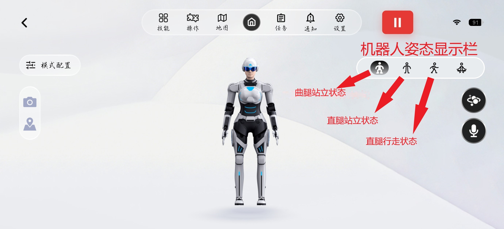
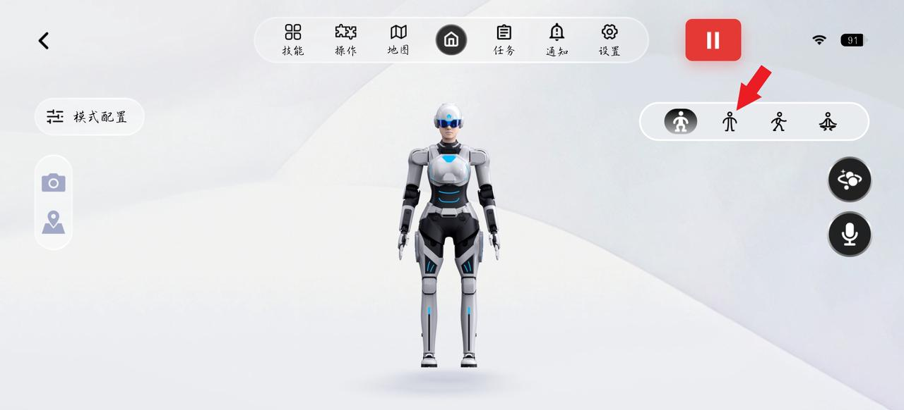
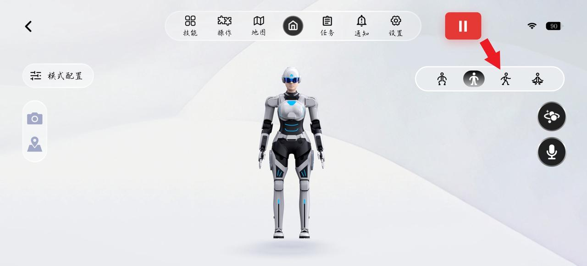
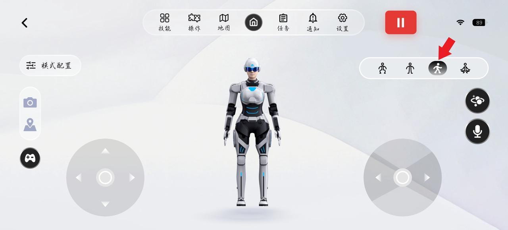
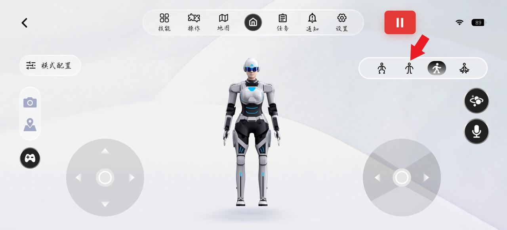
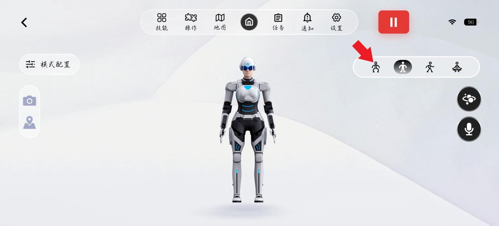
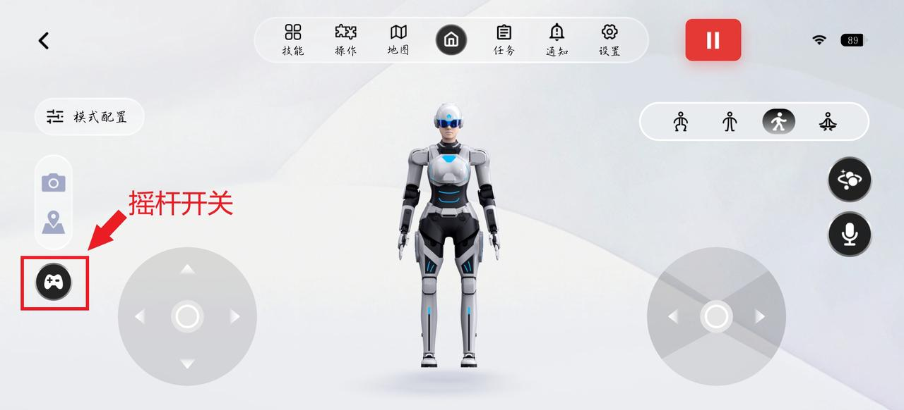
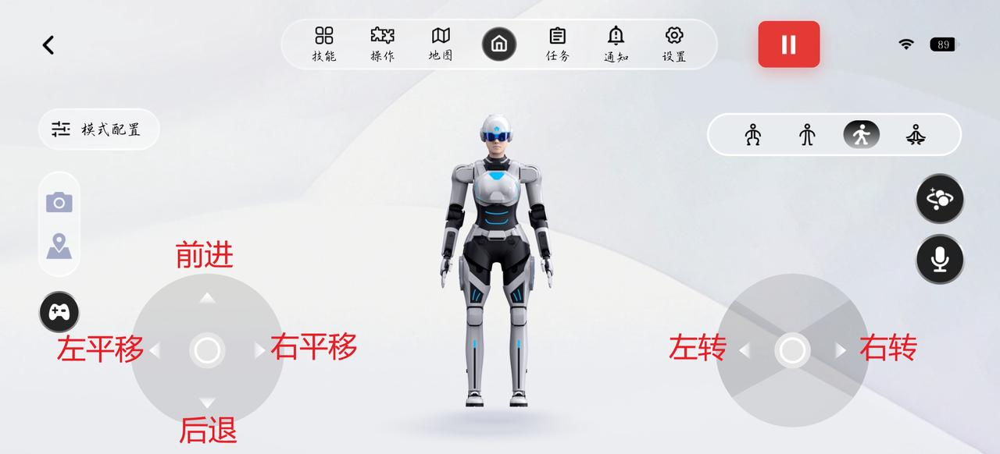

> **适用产品**：墨茵机器人 本文覆盖姿态模式说明、姿态切换、遥控行走与安全注意事项。

## 1 姿态模式说明

<table>
  <colgroup>
    <col width="100" />
    <col width="442" />
    <col width="152" />
  </colgroup>
  <thead>
    <tr>
      <th>模式</th>
      <th>特征</th>
      <th>状态</th>
    </tr>
  </thead>
  <tbody>
    <tr>
      <td>曲腿站立</td>
      <td>非强化位控，需靠待机站支撑，双脚离地</td>
      <td>开机默认</td>
    </tr>
    <tr>
      <td>直腿站立</td>
      <td>非强化位控，需靠待机站支撑，双足站立地面，电机负荷大</td>
      <td>需 APP 切换</td>
    </tr>
    <tr>
      <td>直腿行走</td>
      <td>可自主移动，上肢轻微摆动</td>
      <td>需 APP 切换</td>
    </tr>
  </tbody>
</table>

> **【危险】** 直腿站立单次最长不超过 5 分钟，防止电机过热引发摔机；直腿行走模式下严禁双足同时离地，将导致下肢异常运动。

## 2 姿态切换

### 2.1 曲腿站立切换到直腿站立

- 先确保 APP 已连接机器人，且机器人处于曲腿站立模式。
- 再点击 APP 主界面右侧“站立姿态”图标。
- 向右滑动按钮确认切换。

- 等待机器人从曲腿平稳切换至直腿。
- 必要时人工辅助扶稳，防止倾倒。

### 2.2 直腿站立切换到直腿行走

> **【危险】** 切换前必须确认机器人双足站立于地面；双足离地将导致下肢异常运动。

- 先点击右侧“行走姿态”图标。
- 再向右滑动按钮确认切换。

> 
>
> 

- 听到“进入直腿行走状态”播报。
- 上肢打开，同步轻微摆动。
- 等待播报完成且机器人平稳站立后，松开待机站两侧锁扣。
- 此时用一只手扶住机器人肩膀处，另一只手从机器人身后平稳移走待机站。

### 2.3 其他切换

#### 2.3.1 直腿行走到直腿站立

- 机器人重新点击“直腿行走”图标，确认机器人上肢打开。

> 

- 安装机器人待机站，确认固定完毕。
- 点击“站立模式”图标。

> 

#### 2.3.2 直腿站立到曲腿站立

- 点击“曲腿姿态”图标。
- 向右滑动按钮确认切换。

> 

## 3 遥控行走

- 机器人切换至直腿行走模式时，页面会自动显示摇杆按钮。
  - 屏幕显示左右两个虚拟摇杆，通过摇杆开关控制虚拟摇杆显示与否，以防误触情况。

> 

- 操控移动：
  - 左侧摇杆：控制前后移动 + 左右蟹步移动。
  - 右侧摇杆：控制转向移动。

> 

- 关闭摇杆：点击“摇杆开关”可隐藏。

## 4 安全注意事项

> **【危险】** 严禁长时间直腿站立（>5 分钟），电机过热将导致摔倒；严禁未固定至待机站时切换至直腿站立模式。

> **【警告】** 行走时保持机器人始终在视野范围内；行走时注意地面环境，不符合要求将导致机器人摔倒；行走时安全半径 2 米，确保范围内无障碍物及人员；电机报警、过热异响时立即放置待机站关机；急停控制器仅限特殊情况使用，非紧急严禁使用。

> **【注意】** 模式切换顺序为曲腿 → 直腿站立 → 直腿行走，反向同理。
