> **适用产品**：墨茵机器人 本文覆盖功能模块说明、动作库、语音库、我的创作、全身舞蹈演示、技能快捷执行与定时播报操作。

## 1 功能模块说明

<table>
  <colgroup>
    <col width="100" />
    <col width="219" />
    <col width="398" />
  </colgroup>
  <thead>
    <tr>
      <th>模块</th>
      <th>功能</th>
      <th>说明</th>
    </tr>
  </thead>
  <tbody>
    <tr>
      <td>技能</td>
      <td>动作库</td>
      <td>执行预设上肢动作（招手、碰拳等）</td>
    </tr>
    <tr>
      <td>技能</td>
      <td>语音库</td>
      <td>语音播报内容，可配合动作执行</td>
    </tr>
    <tr>
      <td>技能</td>
      <td>我的创作</td>
      <td>用户自定义动作与语音组合</td>
    </tr>
    <tr>
      <td>操作</td>
      <td>藏族舞、爵士舞</td>
      <td>全身舞蹈演示</td>
    </tr>
    <tr>
      <td>操作</td>
      <td>定时播报</td>
      <td>可设置话术定时播报</td>
    </tr>
  </tbody>
</table>

- 点击主页顶部“技能”按钮。

> 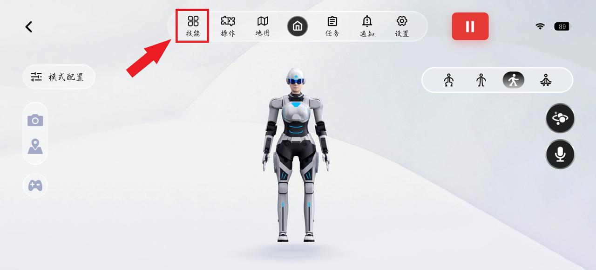

- 界面显示“语音库”“动作库”“我的创作”三个标签页。

> 

- 点击主页顶部“操作”按钮。

> 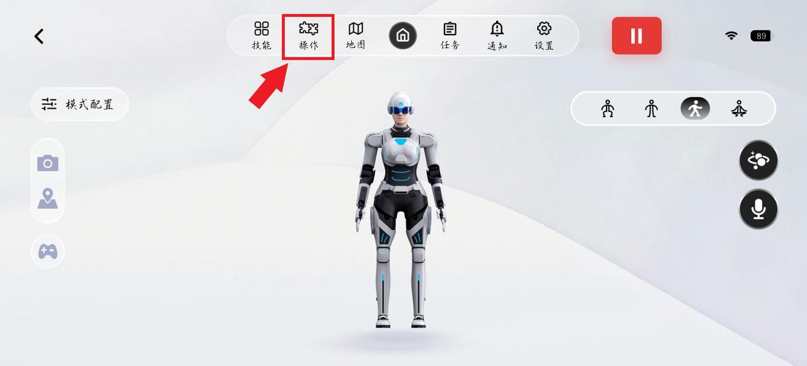

- 界面显示“藏族舞”“爵士舞”“定时播报”三个操作项。

> 
>
> 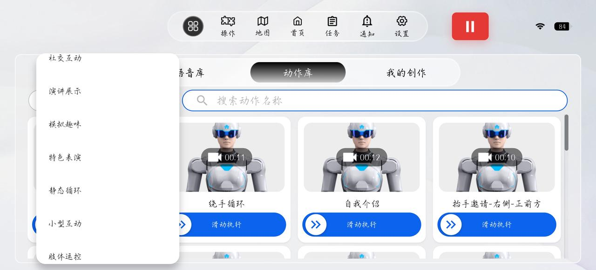

## 2 动作库使用

### 2.1 进入动作库界面，选择动作分类

- 点击“选择动作库分类”，会显示动作分类项，共七大使用场景，可先确定机器人动作执行类型，进而选择更合适的动作。

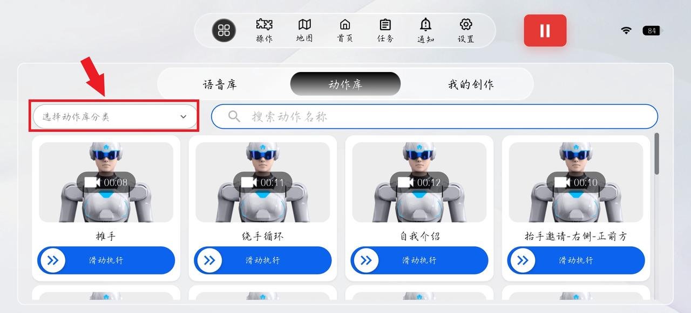

### 2.2 选择动作

- 进入相应动作分类后可以看到，每个动作对应执行时长显示在动作名称上方，通过向右滑动执行所需演示的动作（如摊手、绕手循环等）。

> 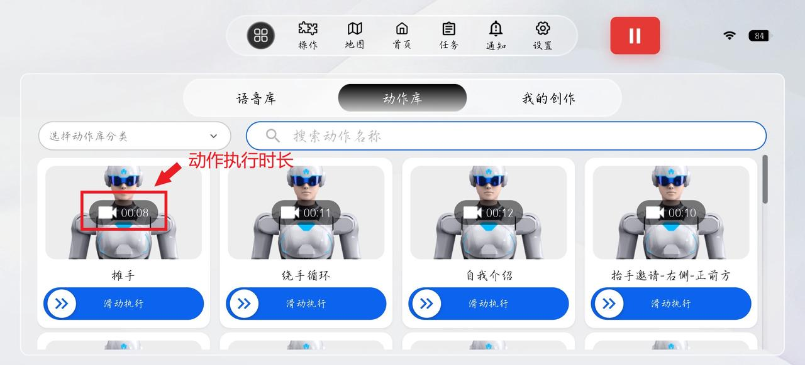

### 2.3 中止动作

- 如需中止动作，向左滑动执行按钮，机器人立即暂停当前动作，并恢复到准备姿势。

> 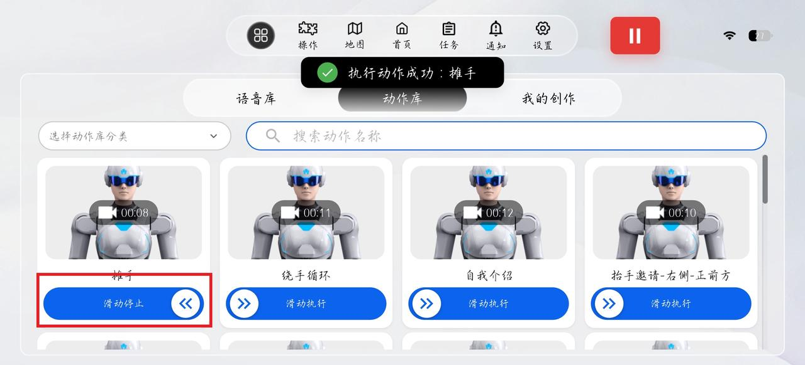

> **【危险】** 上肢动作执行时，必须预留充足安全空间，防止手臂与周围物体或人员发生碰撞干涉；写毛笔字、敲鼓等道具类动作前，务必确认道具摆放位置正确，避免动作执行时碰撞干涉。

## 3 语音库使用

### 3.1 语音合成与管理

#### 3.1.1 新建语音

- 点击右上角“新建语音”。

> 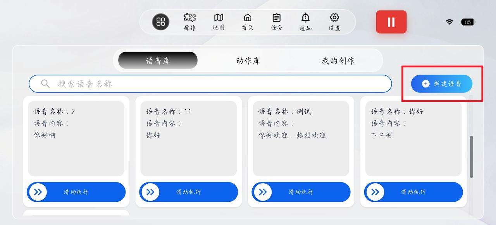

- 输入话术标题。
- 输入播报正文内容。
- 点击“保存”完成创建（后台进行语音合成）。

> 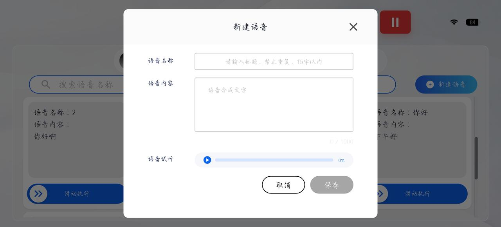

> **【注意】** 部分语种话术使用在线模型，需将 APP 切换到对应语言界面，并连接外部网络后方可正常合成。

#### 3.1.2 管理语音

- 生成的语音自动保存至语音库界面。
- 点击生成的语音显示框会进入语音编辑界面，此时可以进行话术内容编辑、语音试听、删除等操作。

> 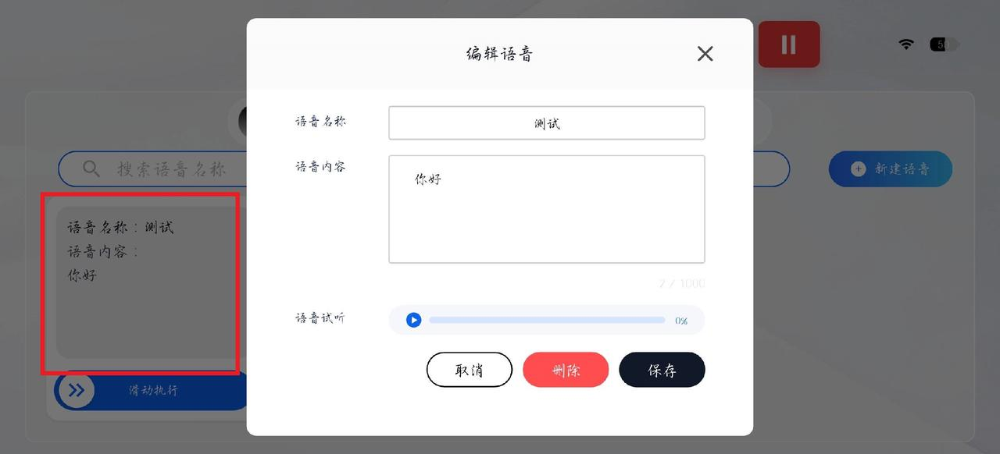

### 3.2 播放语音

- 点击“语音库”标签，显示已配置的语音列表。

> 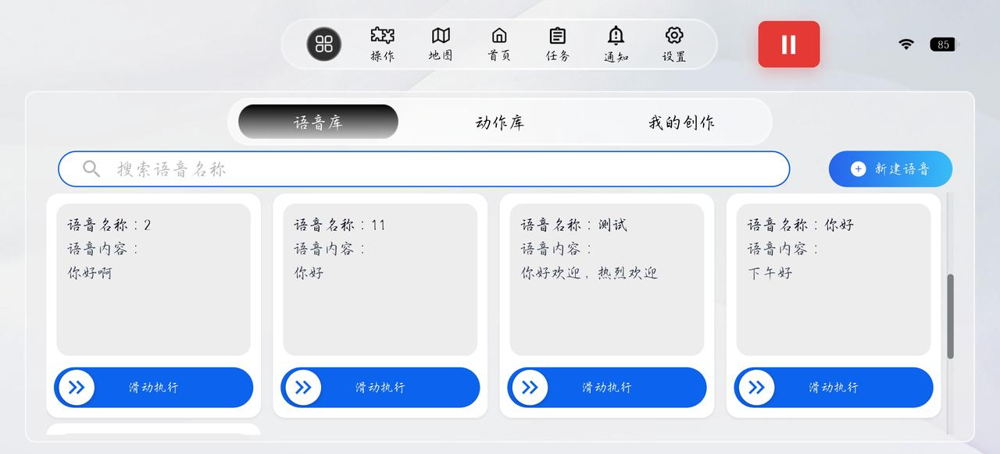

- 向右滑动执行语音开始播报。
- 向左滑动执行语音停止播报。

## 4 我的创作

### 4.1 新建创作

- 进入“我的创作”，点击右上角“新建创作”。

> 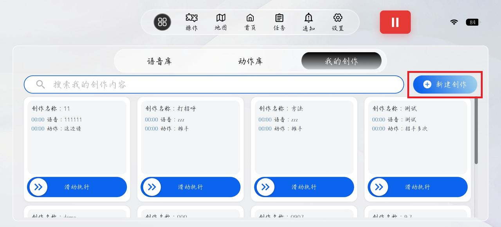

- 填写创作名称。
- 点击增加动作、语音，支持添加多组动作与语音。

> 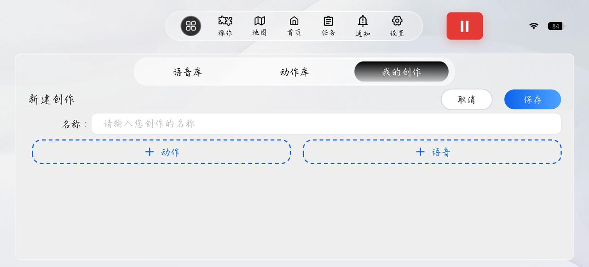

- 设置动作与话术的触发时间，单位秒，写几秒就代表执行创作后第几秒触发该语音或动作。
- 选择相应的动作和话术内容。
- 点击“保存”生成创作。

> 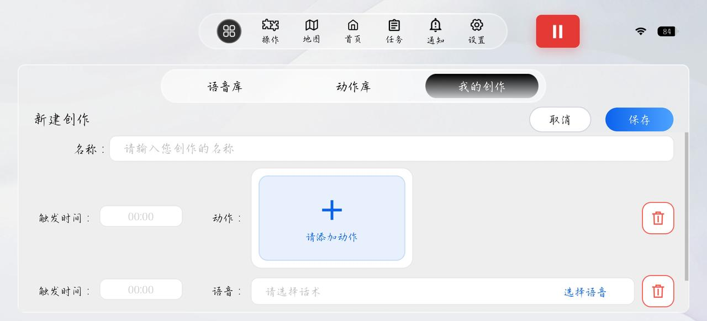

### 4.2 执行我的创作

- 向右滑动开始执行配置好的创作。
- 向左滑动停止执行当前创作。

> 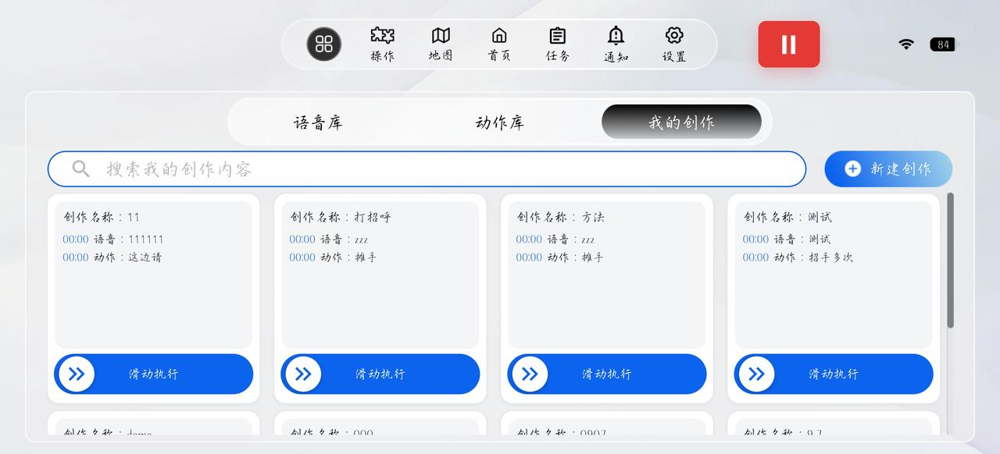

## 5 全身舞蹈演示

### 5.1 选择舞蹈

- 在 APP 顶部导航栏点击【操作】，显示当前支持演示的全身舞蹈：藏族舞、爵士舞，舞蹈名称上方有舞蹈执行时长。

> 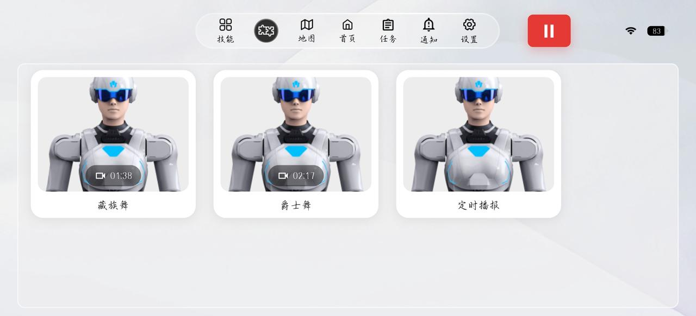
>
> 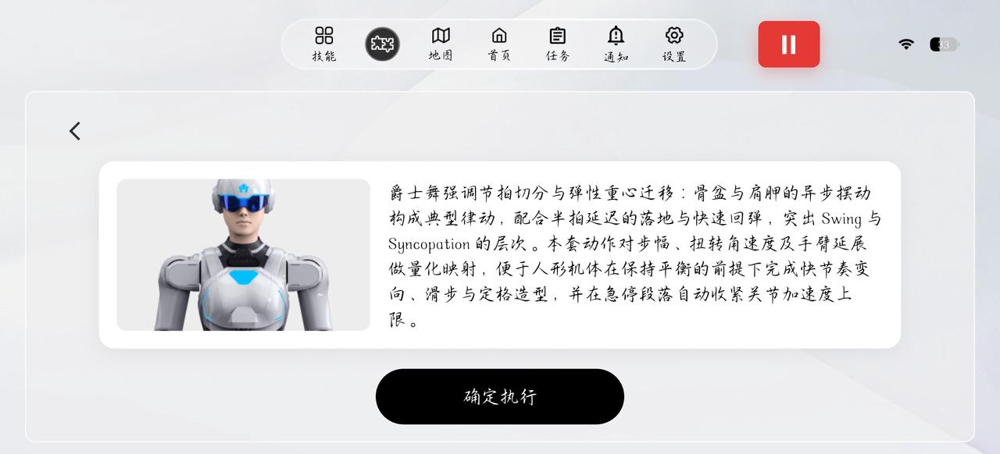

### 5.2 执行与中止

- 点击相应舞蹈会有文字介绍，然后点击确定执行，滑动执行。
- 全身舞蹈动作不支持中止，需要等待机器人执行完成后自动复位到准备姿势。

> 
>
> 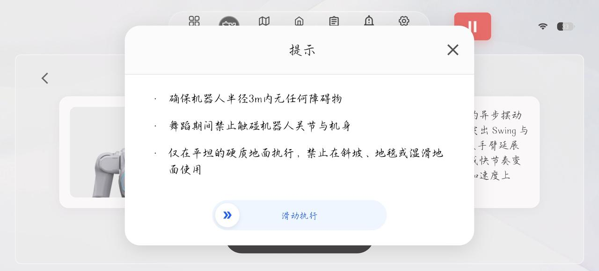

> **【危险】** 跳舞模式下机器人会产生位移，须确保周围 2 米范围内无障碍物及人员。

## 6 技能快捷执行

通用 APP 新增了快捷执行语音播放、动作、我的创作的功能，可以将常用的技能添加到快捷执行轮盘，快速一键执行。

### 6.1 技能添加

- 首页点击快捷轮盘按钮。

> 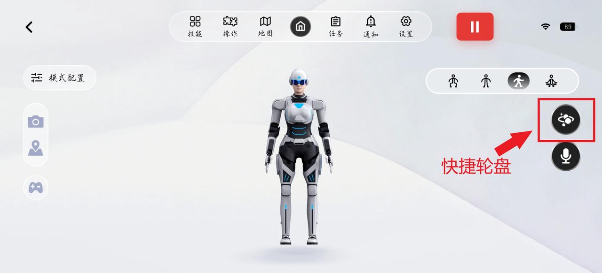

- 进入轮盘界面后点“+”号，会进入技能选择界面，选择想添加的语音、动作或者我的创作，选完点击确定就可以添加到快捷轮盘里了。

> 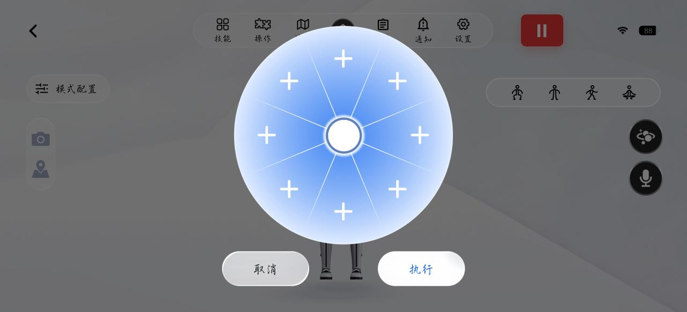

### 6.2 技能执行

技能添加完毕后打开快捷轮盘，点击想要执行的技能，被选中的技能字体会从白色变成黑色，然后点执行即可。

> 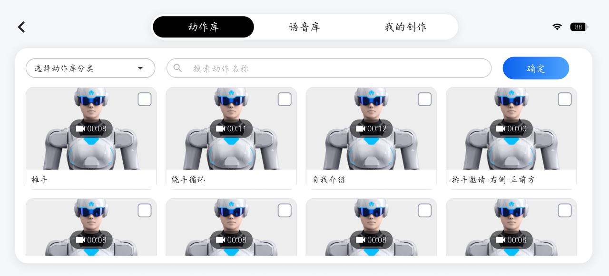

## 7 定时播报

定时播报用于设定机器人在指定时间或时间段自动执行语音播报任务，包含单时刻任务与多时段任务两种任务类型。

### 7.1 进入定时任务页面

- 在 APP 顶部导航栏点击【操作】，选择“定时播报”进入定时任务列表页面。
- 列表页会展示已创建的全部定时任务；首次进入时显示【暂无定时任务】。
- 点击右上角蓝色【新建】按钮，打开定时任务配置界面。

> 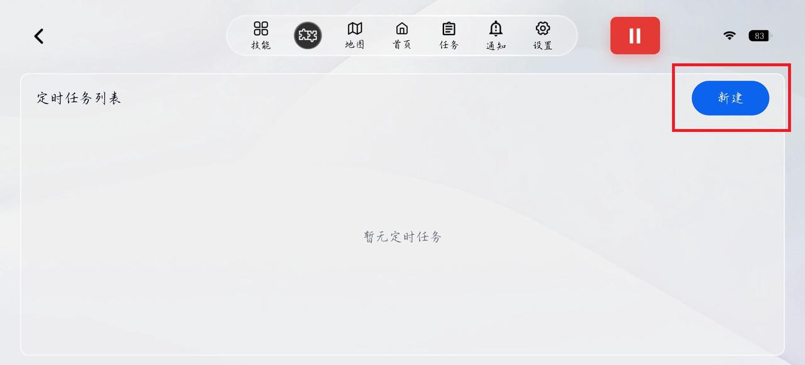

### 7.2 选择任务类型

定时任务分为两种模式，按需切换标签。

#### 7.2.1 单时刻任务

在一个固定时间点执行播报，可设置重复播报次数。

- 先选择【单时刻任务】标签。
- 任务名称：输入自定义名称，用于区分不同定时任务（例如：上午 10 点欢迎播报）。
- 子任务 1 配置：
  - 播报时间：设置任务触发的具体时刻。
  - 播报次数：填写本次触发后，语音循环播报多少次。
  - 输入内容：填写机器人需要播报的语音文本。
- 如需增加多条播报子任务，点击【+ 添加子任务】，重复配置子任务参数。

> 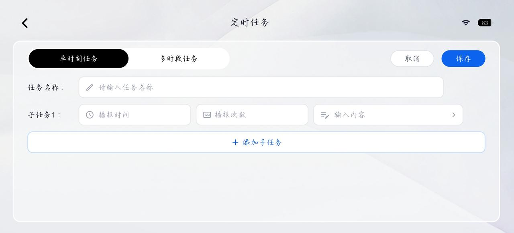

#### 7.2.2 多时段任务

在一段连续时间区间内，按固定间隔循环播报。

- 先切换到【多时段任务】标签。
- 任务名称：输入自定义任务名称。
- 子任务 1 配置：
  - 开始：设置播报时段的起始时间。
  - 结束：设置播报时段的截止时间。
  - 间隔时间：设置两次播报之间的等待间隔。
  - 输入内容：填写播报语音文本。
- 如需添加多组时段播报，点击【+ 添加子任务】继续新增子任务。

> 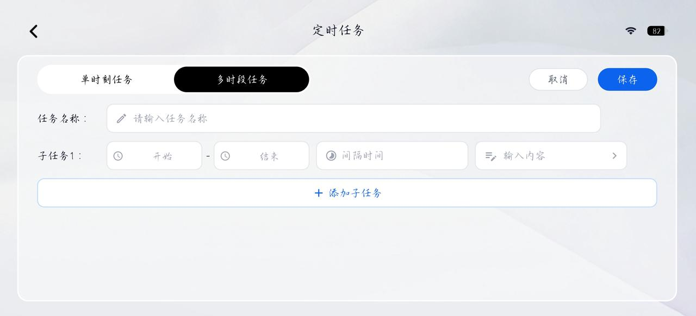

### 7.3 任务管理

- 配置全部参数完成后，点击右上角【保存】，任务将存入定时任务列表并生效。
- 可在定时任务列表删除已建好的定时任务，或者点击相应任务进入配置页面重新修改编辑。

> 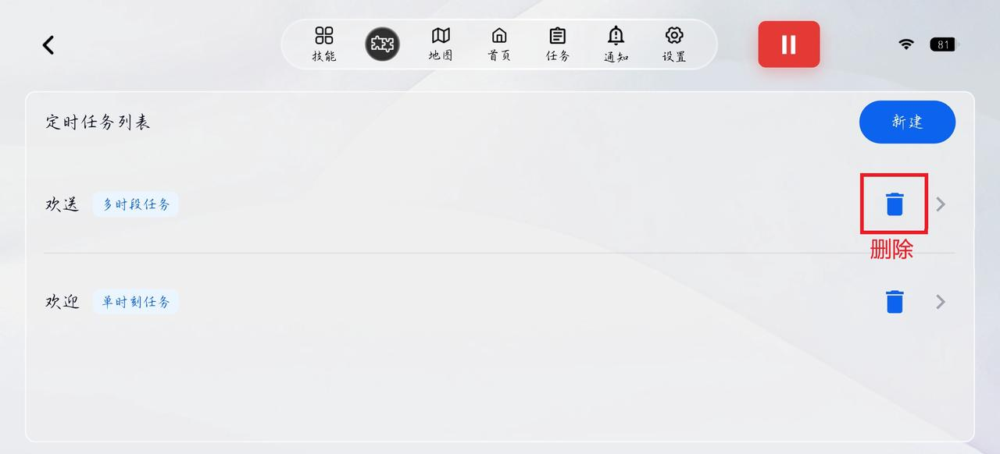

## 8 安全注意事项

> **【危险】** 执行动作前确保机器人处于直腿行走模式；上肢动作必须预留充足安全空间，防止干涉碰撞；跳舞模式下确保周围 2 米范围内无障碍物及人员。

> **【警告】** 写毛笔字、敲鼓等道具类动作前，务必确认道具摆放位置正确；全身舞蹈动作不支持中止，需等待执行完成。

> **【注意】** 话术播报时注意音量设置（0—15）；自定义组合时合理设置动作与话术的时间间隔，添加多个动作时也要注意设置每个动作间的时间间隔。
