> **适用产品**：墨茵机器人 本文覆盖地图构建、地图激活与编辑、路线配置、路线运行与地图显示控制。

## 1 功能说明

<table>
  <colgroup>
    <col width="130" />
    <col width="468" />
  </colgroup>
  <thead>
    <tr>
      <th>功能</th>
      <th>说明</th>
    </tr>
  </thead>
  <tbody>
    <tr>
      <td>地图构建</td>
      <td>通过激光雷达扫描环境，建立 2D 地图</td>
    </tr>
    <tr>
      <td>地图激活</td>
      <td>将构建好的地图设为当前使用地图</td>
    </tr>
    <tr>
      <td>路线配置</td>
      <td>在已激活地图上设置导航点位与路径</td>
    </tr>
    <tr>
      <td>路线运行</td>
      <td>机器人按预设路线自主导航行走</td>
    </tr>
  </tbody>
</table>

## 2 地图构建

> **【注意】** 建图前必须确保机器人附近地面平坦，机器人无倾斜、摇晃。

### 2.1 准备工作

- 将机器人移动至起点位置。

方法一：机器人放置于待机站 → 切换至曲腿站立模式 → 推动机器人和待机站到目标位置。

方法二：切换至直腿行走模式 → 移出待机站 → 遥控机器人到目标位置。

- 让机器人面向有标志性的物体（桌子、椅子等），不能面向玻璃等透光性物体。

### 2.2 启动建图

- 在 APP 顶部导航栏点击【地图】→“新建地图”。
- 输入地图标题，拉起建图程序。
- 等待界面成功显示点云（首次显示可能需超过 10 秒）。

> 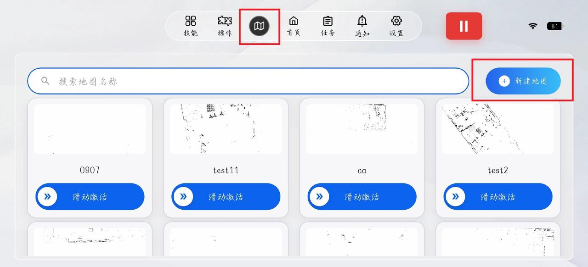
>
> 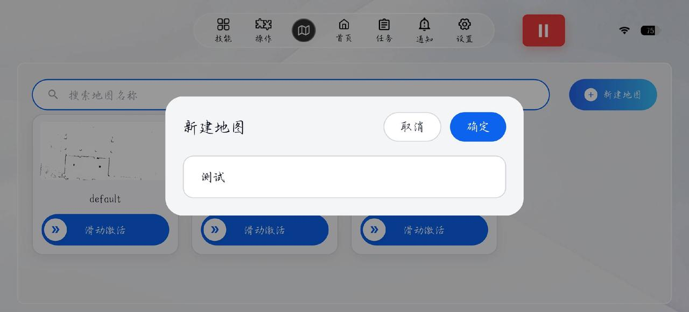
>
> 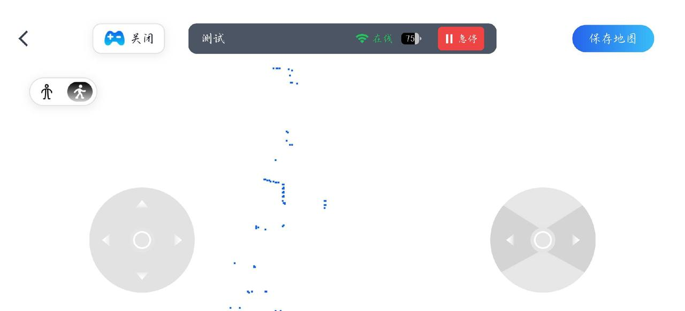

### 2.3 执行建图

- 点云出现后，移动机器人进行建图。
- 建图面积超过 3000 ㎡或单向距离超过 60 m 时，请向我司技术进行确认。

### 2.4 保存地图

- 建图完成后点击“保存地图”。

## 3 地图激活与编辑

### 3.1 激活条件

- 将机器人推动至新建地图的起始位置，或遥控行走至该位置。
- 确保朝向与建图原点的初始方向基本一致。

### 3.2 激活操作

#### 3.2.1 激活地图

- 在地图库中找到刚建好的地图，向右滑动“激活”。
- 激活成功后地图下方会显示“已激活”。

> 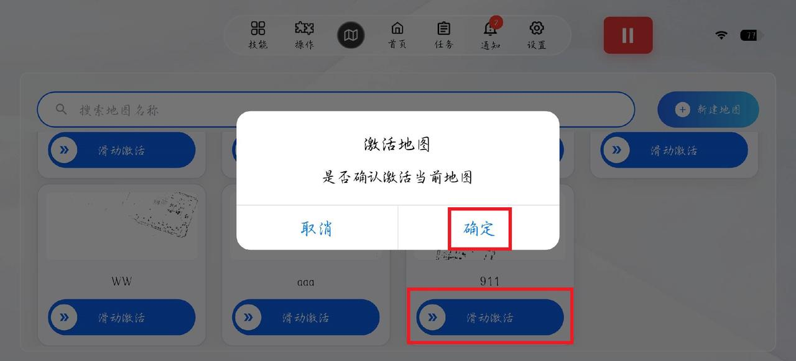
>
> 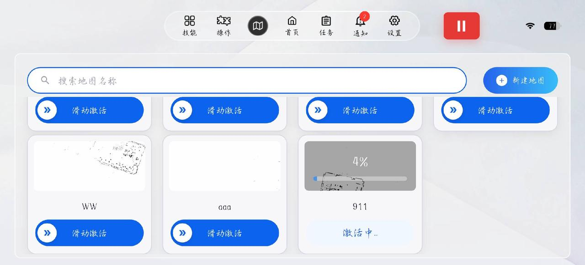
>
> 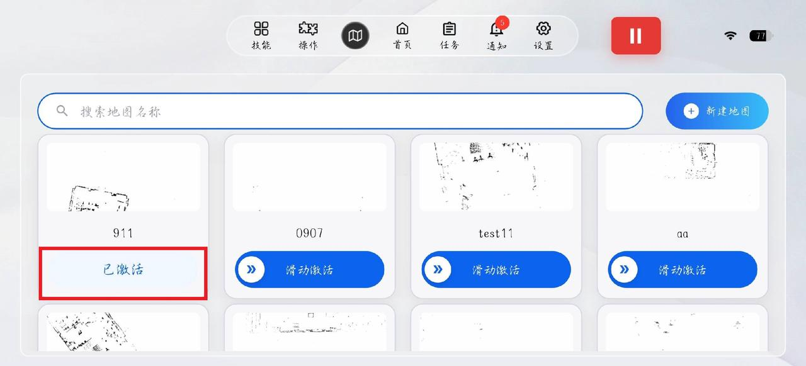

#### 3.2.2 激活失败处理

- 重新激活。
- 激活时尽量让机器人面向有标志性的物体。
- 机器人支持全域激活，移动机器人到其他位置进行激活。

#### 3.2.3 位置核对

- 地图激活成功后，点击地图进入地图编辑界面，核对机器人当前在地图的位置是否正确，确认无误可进行下一步编辑。

> 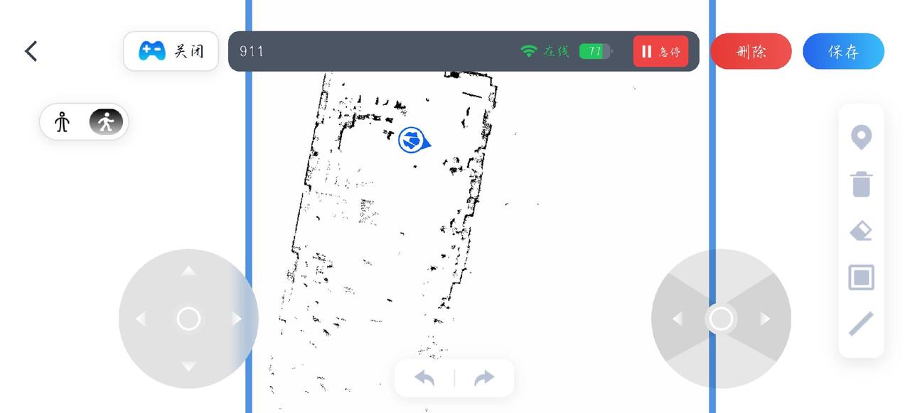

> **【注意】** 若使用云平台配置的流程、角色中涉及导航任务，则需要提前激活对应地图。

### 3.3 编辑地图

支持的编辑操作如下：

- 添加点位：输入关键点位名称（专用于流程、角色对话触发机器人导航功能）。

> 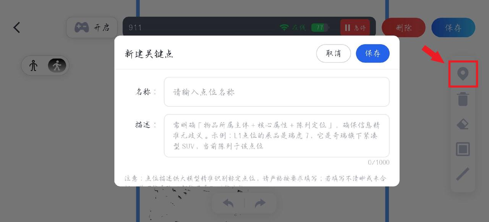

- 删除：可删除已添加的障碍墙、围栏、点位。

> 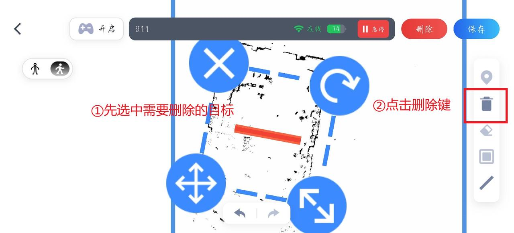

- 橡皮擦：清除地图上的噪点（一般是机器人在扫图过程中有人经过机器人前方而留下的黑色阴影）。

> 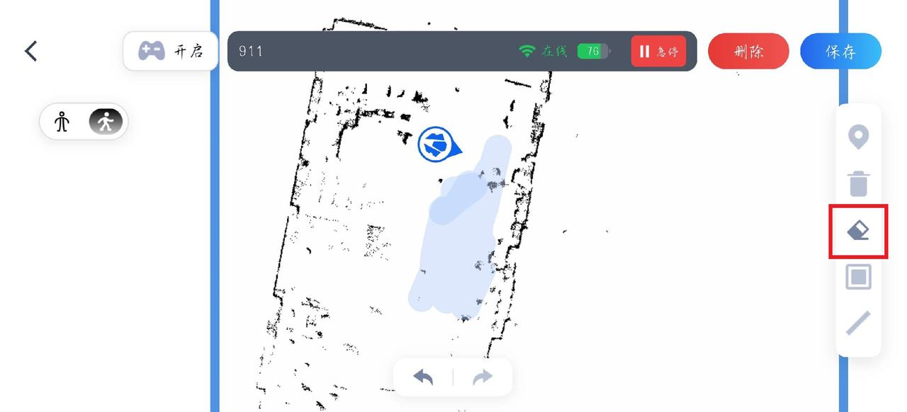

- 添加封闭围栏：设置边界。

> 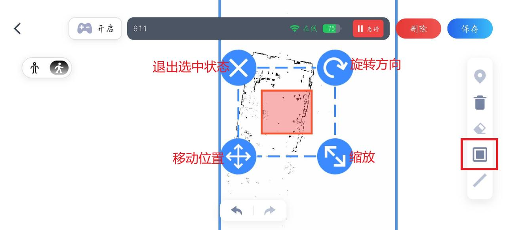

- 添加障碍墙：标记不可通行区域。

> 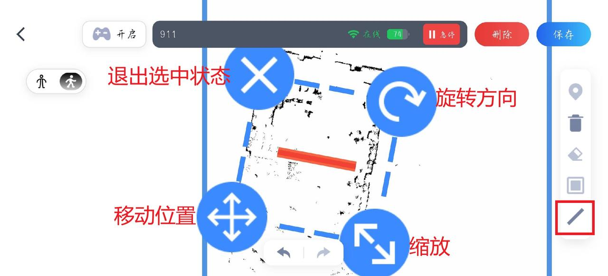

## 4 路线配置

> **【注意】** 必须先激活地图，才能新建路线。

### 4.1 准备工作

- 确保地图已激活。
- 若手动推动机器人建路线：放置于待机站，处于曲腿站立状态。
- 若遥控方式建路线：切换至直腿行走模式。

### 4.2 创建路线

- 在 APP 顶部导航栏点击【地图】→“路线管理”→“新建路线”。

> 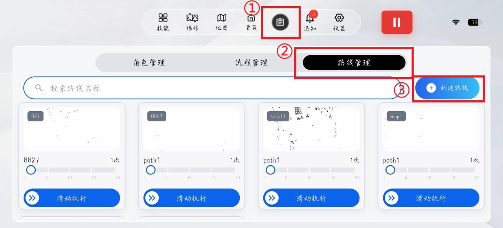

### 4.3 添加点位

- 点击右下角“+ 添加点位”。
- 设置点位动作和话术。
- 设置机器人开始执行动作、话术的时间和顺序。
- 点击“保存位点信息”。

> 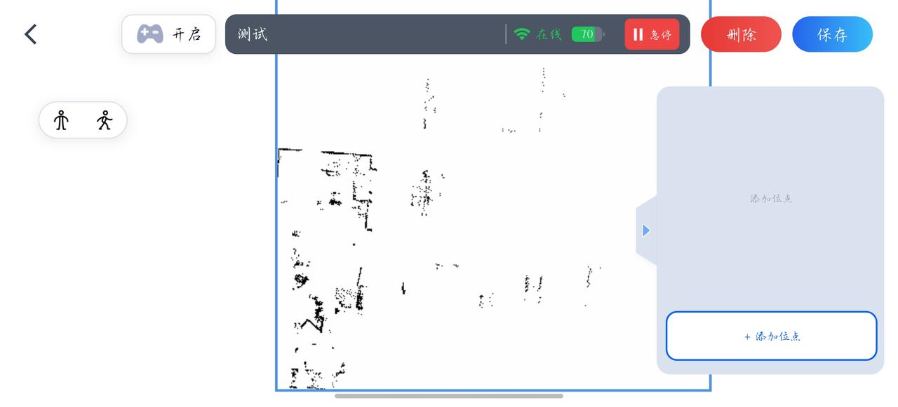
>
> 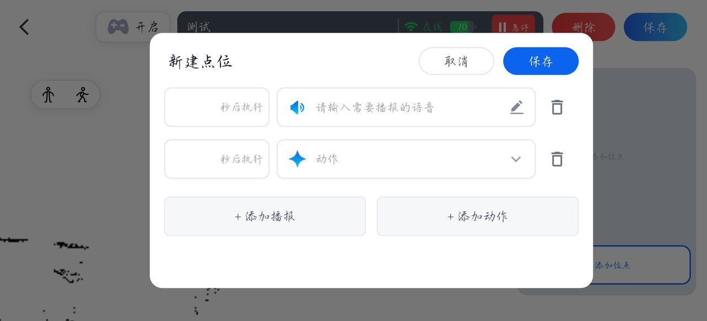

后续点位添加，先将机器人遥控至目标点位后重复上述操作。

> **【注意】** 成功添加点位后，推动机器人至下一位置时，请勿立即添加新点位，务必等待 APP 界面上机器人实时位置图标同步到位后再操作。

### 4.4 保存路线

- 所有点位添加完成后点击右上角“保存”。

### 4.5 编辑路线

- 路线管理界面直接点击相应路线进入编辑界面。
- 点击已生成点位：更改执行前时间、动作和话术。
- 点击点位框右边“×”：删除点位。

> 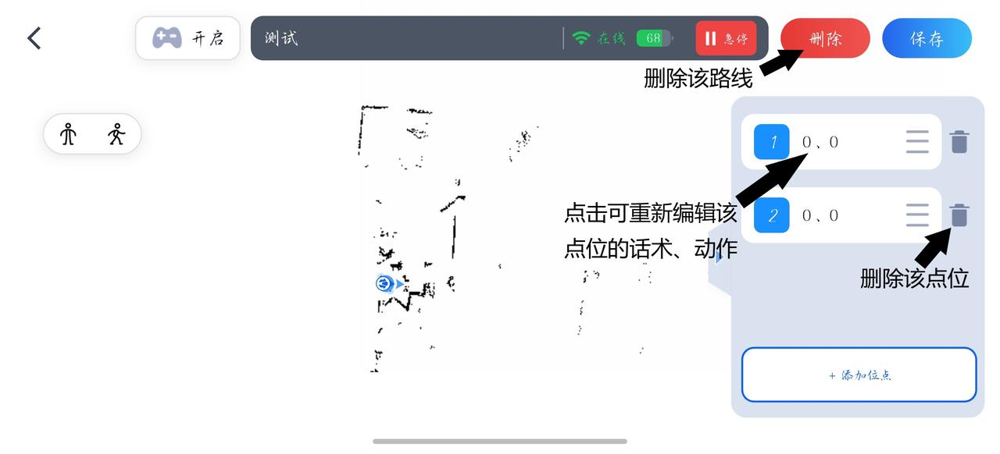

## 5 路线运行

### 5.1 运行准备

- 确保地图已激活。
- 机器人处于直腿行走状态。

### 5.2 执行路线

- 路线管理界面找到要运行的路线。
- 选择路线循环次数（最大 20 次），向右滑动开始执行路线。

> 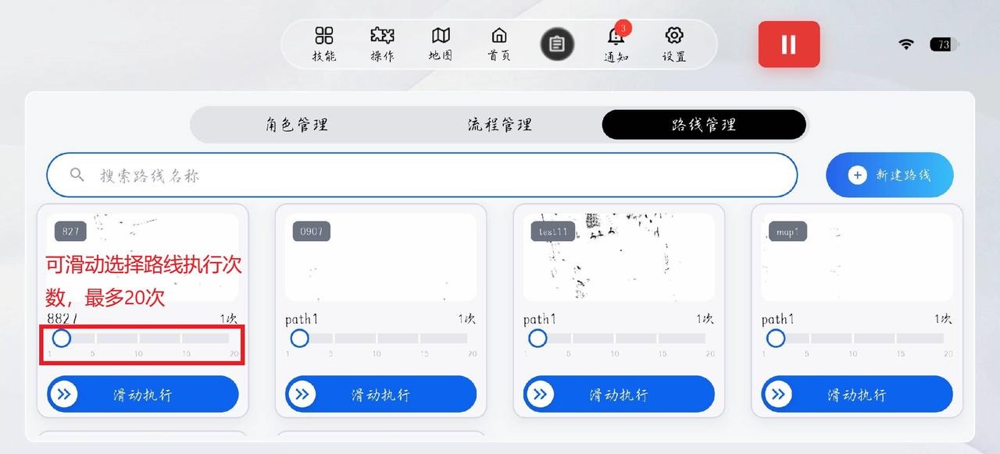

运行控制：

| 按钮 | 功能 |
| --- | --- |
| 暂停 | 机器人停止执行路线 |
| 继续 | 执行剩余路线点位 |
| 停止 | 结束路线任务，返回控制页面 |

> 

> **【注意】** 运行路线的初始点位可根据需要自行确定。开始运行后机器人会从当前放置位置走到标定好的第一个点位，然后执行路线。

## 6 地图显示控制

| 操作 | 说明 |
| --- | --- |
| 打开地图 | 点击“地图开启”按钮，控制界面显示 2D 地图 |
| 关闭地图 | 再次点击“地图开启”按钮关闭 |

> 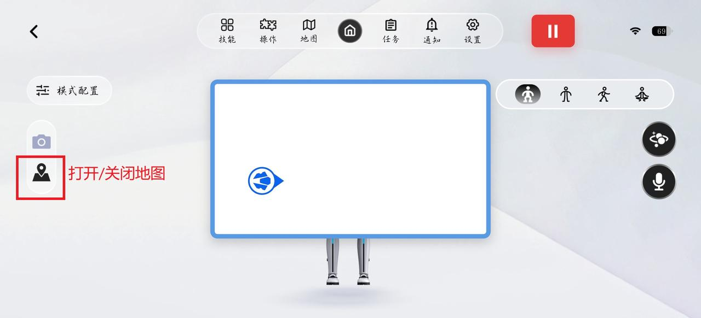
