> **适用产品**：墨茵机器人 本文覆盖APP下载、APP首次启动及连接机器人操作。

## 1 APP下载

### 1.1 Android系统

- 扫描二维码：扫描机身背部下方铭牌上的二维码。

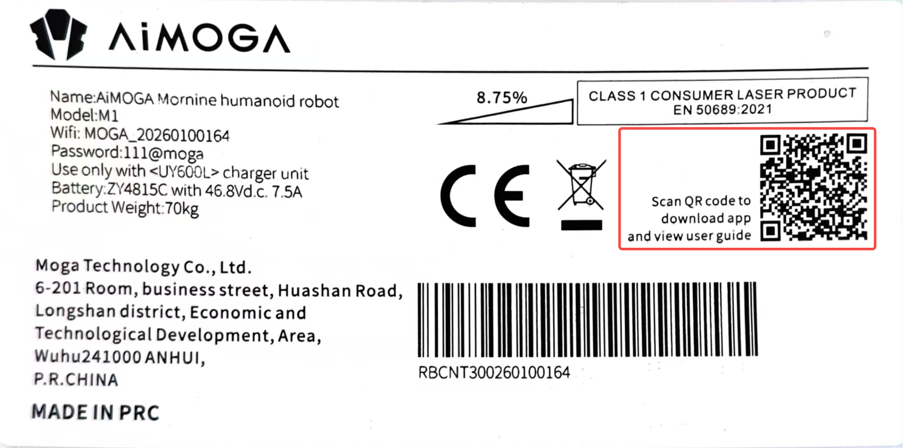

- 或访问网址：[APP下载地址](https://download.aimoga-robot.com/APP/robot)。

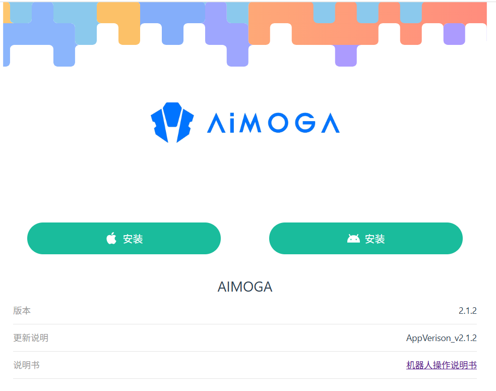

- 下载安装包：网页界面支持选择Android系统版本APP下载。

### 1.2 iOS系统

- 访问苹果商店：iOS系统可在Apple Store搜索“AiMOGA”下载APP。

## 2 APP首次启动

### 2.1 允许权限

- 允许位置、网络、照片、文件读取权限。

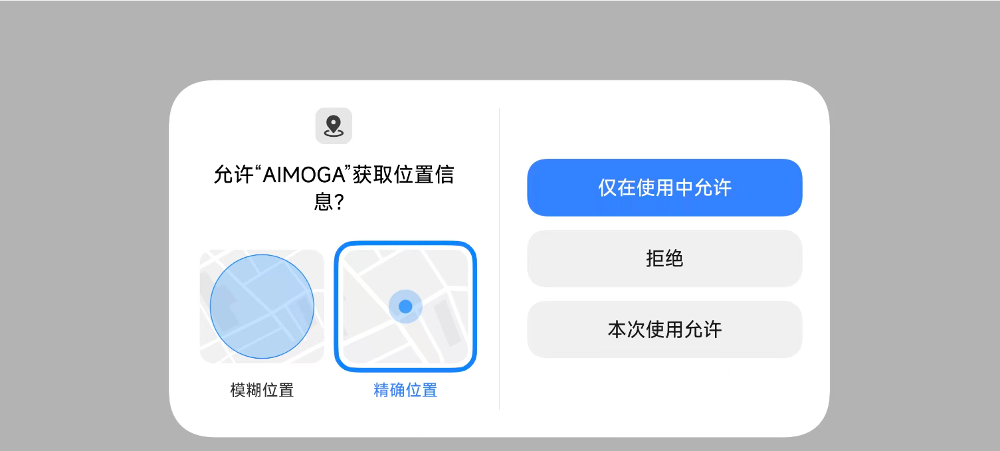

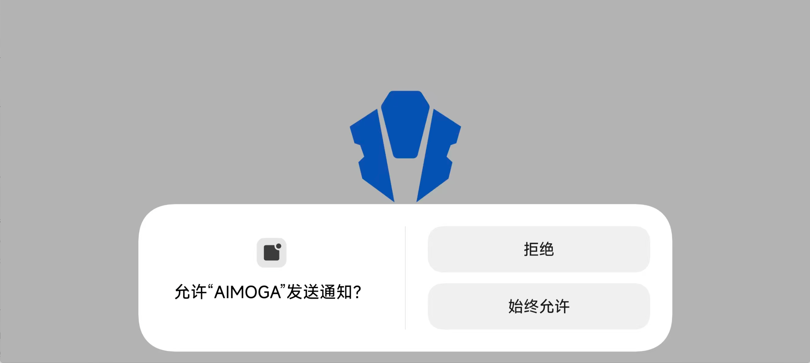

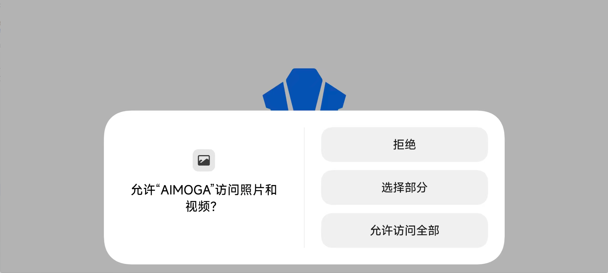

### 2.2 选择语言

- 选择中文简体、English、Русский、Español、Bahasa Indonesia。

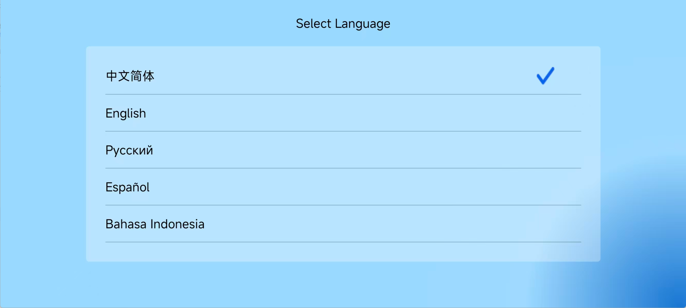

### 2.3 签署协议

- 阅读《用户隐私协议》。
- 勾选“同意签订协议”。

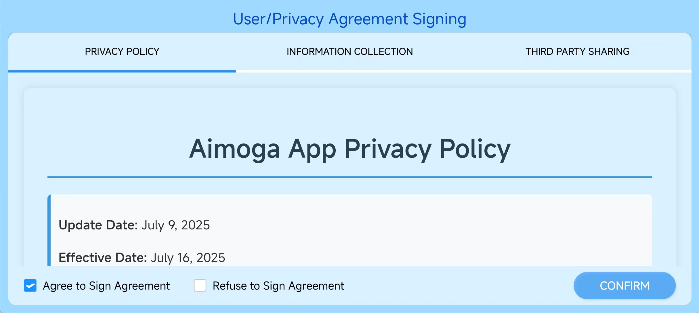

## 3 连接机器人

<Warning>
  连接机器人前，务必先断开其他外网Wi-Fi和移动网络。
</Warning>

### 3.1 启动机器人

- 确保机器人已开机并进入曲腿站立模式。
- 打开APP“AIMOGA”，点击“已连接，下一步”。

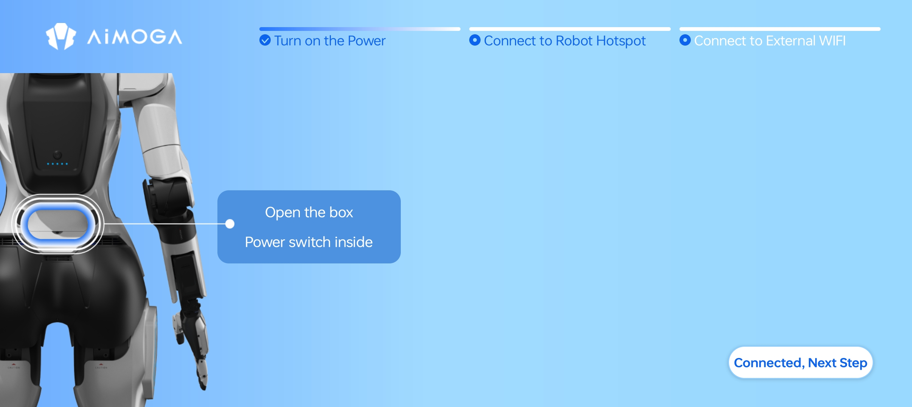

### 3.2 连接本体热点

- 选择机器人Wi-Fi（名称/密码见背部铭牌）。

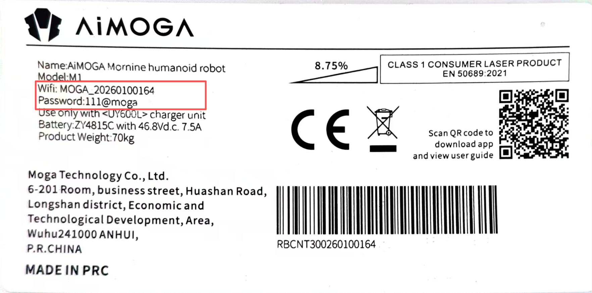

- 首次连接需强制修改Wi-Fi密码：默认密码为“111@moga”，一般建议修改为“111@Moga”便于记忆。
- 提示“已连接，但无法访问互联网”为正常现象，忽略即可。

### 3.3 输入SN码

- 扫描或手动输入机身背部SN码，并确认。

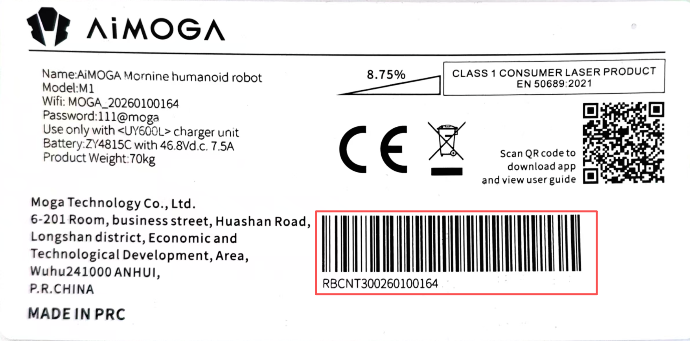

- 点击“已连接，下一步”。

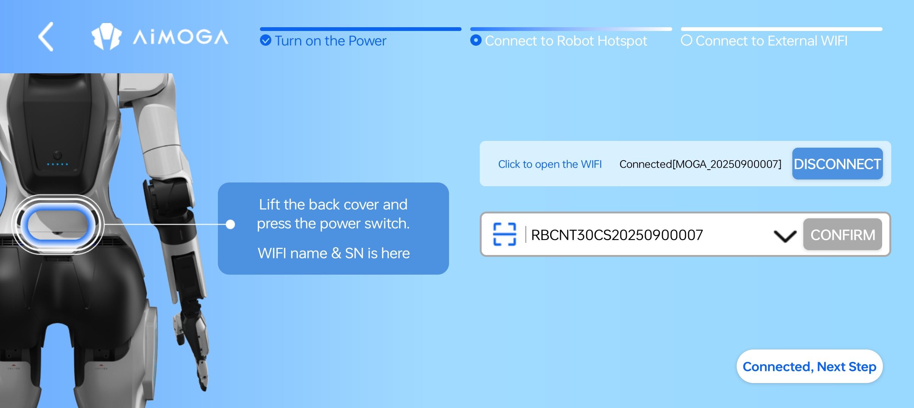

### 3.4 连接互联网（外部Wi-Fi）

- 联网模式：连接Internet后控制（推荐）；此时选择对应外部Wi-Fi网络并输入密码，等待网络连接成功后点击。
- 离线模式：直接控制（不可使用流程、角色对话功能）。

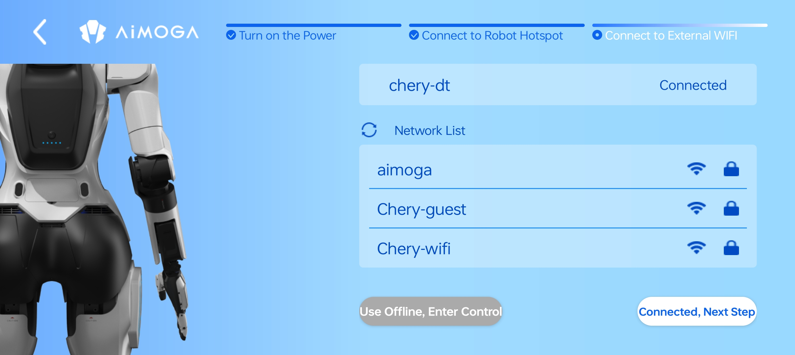

### 3.5 进入控制界面

- 控制界面下可以查看机器人状态，并控制机器人各项功能使用。

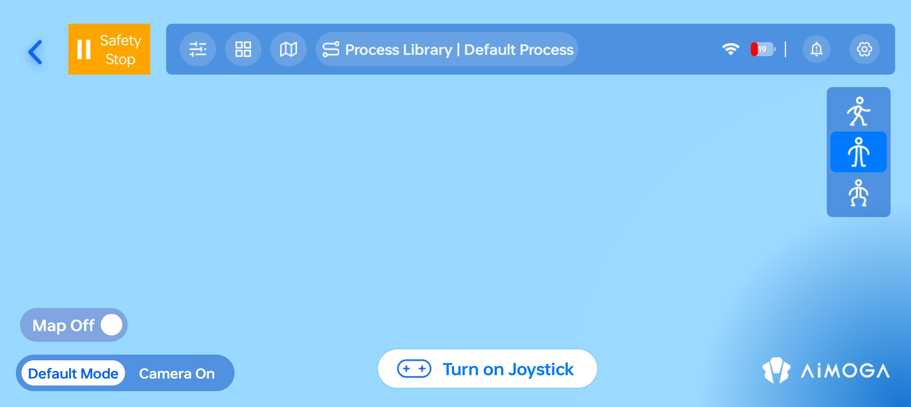
