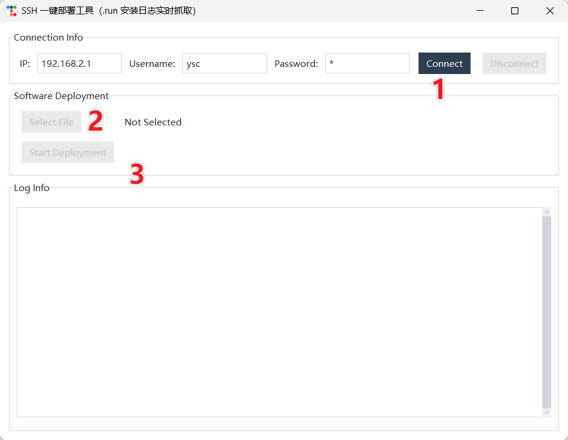

> **适用产品**：Argos X1 机器狗 本文覆盖升级准备工作、升级步骤与注意事项。

## 1 准备工作

> <table>
>   <colgroup>
>     <col width="129" />
>     <col width="398" />
>   </colgroup>
>   <thead>
>     <tr>
>       <td>**项目**</td>
>       <td>**内容**</td>
>     </tr>
>   </thead>
>   <tbody>
>     <tr>
>       <td>升级工具</td>
>       <td>[Argos_upgrade_assistant](https://drive.weixin.qq.com/s?k=AHYAsQcTADcXvyM6D4).rar</td>
>     </tr>
>     <tr>
>       <td>升级包</td>
>       <td>例如：installV2.2.5\_[03120911.run](http://03120911.run)</td>
>     </tr>
>     <tr>
>       <td>连接方式</td>
>       <td>机器狗热点（Argos hotspot）</td>
>     </tr>
>     <tr>
>       <td>默认IP</td>
>       <td>192.168.2.1</td>
>     </tr>
>     <tr>
>       <td>用户名</td>
>       <td>ysc</td>
>     </tr>
>   </tbody>
> </table>

## 2 升级步骤

### 2.1 连接机器狗网络

- 将电脑或手机连接至 Argos 机器狗的有线网口或无线网口。

>    src="/images/image-362.png"
>   alt="Image"
>   title="Image"
>   style={{ width:"58%" }}
> />

- 设置本地电脑有线网口 IP 地址在 `192.168.1.***` 网段。

>    src="/images/image-363.png"
>   alt="Image"
>   title="Image"
>   style={{ width:"73%" }}
> />

> **【说明】** 升级 V2.2.1 后续版本后，机器狗封闭无线网络的 SSH 通讯端口，仅支持有线网络连接升级。

### 2.2 打开升级工具

- 解压并运行 `Argos_upgrade_assistant` 工具。

> 

### 2.3 建立 SSH 连接

- 输入 IP：`192.168.1.120`（有线网络）或 `192.168.2.1`（无线网络 IP 地址）。
- 用户名：`ysc`。
- 输入密码，点击 Connect 连接。

### 2.4 选择升级包

- 点击 Select File，选择 `installV2.2.5_03120911.run`。

### 2.5 开始部署

- 点击 Start Deployment 执行升级。

### 2.6 查看日志

- 在 Log Info 区域实时查看安装进度，并等待关闭。

## 3 注意事项

> **【注意】** 升级前：确保机器狗电量充足（建议 > 50%）；确认已连接机器狗热点，网络稳定。

> **【注意】** 升级中：请勿断开连接或关闭工具；通过 Log Info 监控安装状态。

> **【注意】** 升级后：对机器狗关机重启，并测试其各项功能是否可以正常使用。
