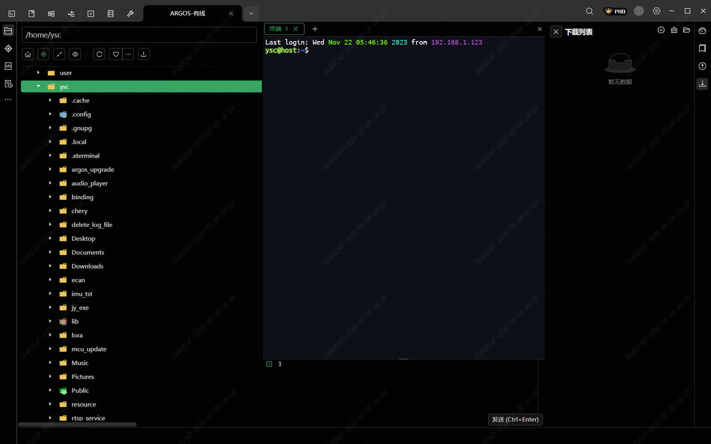
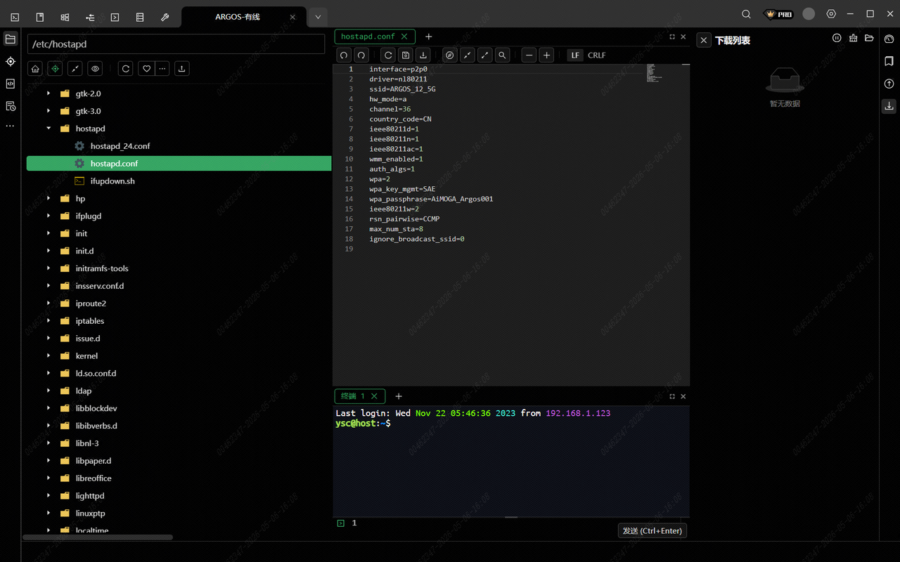

> **适用产品**：Argos X1 机器狗<br />本文覆盖 WiFi 频段切换的应用场景、前提条件、连接参数、修改步骤与字段详细说明。

## 1 应用场景

部分海外市场（如东南亚、南美等区域）的通讯频段法规与国内存在差异，当地手机、平板等设备可能无法识别机器狗出厂默认的 5 GHz WiFi 热点。

典型场景：

- 客户手机搜索不到机器狗 WiFi 热点。
- 连接后频繁掉线或无法稳定通信。
- 当地监管要求 2.4 GHz 频段方可合规使用。

机器狗出厂默认配置为 5 GHz 频段，需根据目标市场手动切换至 2.4 GHz 频段。

## 2 前提条件

<table>
  <colgroup>
    <col width="121" />
    <col width="470" />
  </colgroup>
  <thead>
    <tr>
      <th>项目</th>
      <th>要求</th>
    </tr>
  </thead>
  <tbody>
    <tr>
      <td>连接方式</td>
      <td>有线网口 SSH（V2.2.1 及以上版本仅支持有线 SSH）</td>
    </tr>
    <tr>
      <td>目标文件</td>
      <td>`/etc/hostapd/hostapd.conf`</td>
    </tr>
    <tr>
      <td>所需权限</td>
      <td>root 权限（或具备 sudo 权限的用户）</td>
    </tr>
    <tr>
      <td>工具准备</td>
      <td>MobaXterm / 命令行 SSH 客户端</td>
    </tr>
    <tr>
      <td>网络配置</td>
      <td>本地电脑 IP 与机器狗处于同一网段（`192.168.1.x`）</td>
    </tr>
  </tbody>
</table>

## 3 连接参数

<table>
  <colgroup>
    <col width="136" />
    <col width="250" />
  </colgroup>
  <thead>
    <tr>
      <th>参数</th>
      <th>值</th>
    </tr>
  </thead>
  <tbody>
    <tr>
      <td>IP 地址</td>
      <td>`192.168.1.120`</td>
    </tr>
    <tr>
      <td>用户名</td>
      <td>`ysc`</td>
    </tr>
    <tr>
      <td>密码</td>
      <td>`'`（单引号）</td>
    </tr>
    <tr>
      <td>端口号</td>
      <td>`22`</td>
    </tr>
  </tbody>
</table>

## 4 修改步骤

### 4.1 建立 SSH 连接

通过有线网口 SSH 登录机器狗，确认连接成功。

>    src="/images/image-365.png"
>   alt="Image"
>   title="Image"
>   style={{ width:"68%" }}
> />
>
> 

### 4.2 编辑配置文件

打开 hostapd 配置文件：

```bash
sudo vim /etc/hostapd/hostapd.conf
```

> 

### 4.3 修改频段相关字段

定位并修改以下关键参数：

| 字段 | 原值（5 GHz） | 建议修改值（2.4 GHz） | 字段说明 |
| --- | --- | --- | --- |
| `hw_mode` | `a` | `g` | 无线模式/频段标识。`a`=5 GHz，`g`=2.4 GHz，`b`=802.11b（已淘汰） |
| `channel` | `36` | `6` | 信道编号。2.4 GHz 推荐 `1`/`6`/`11`；5 GHz 推荐 `36`/`40`/`44`/`48`（非 DFS） |
| `ssid` | `ARGOS_12_5G` | `ARGOS_12_2.4G` | 热点名称。建议同步修改 SSID 以标识频段，便于识别 |

### 4.4 保存并退出

vim 操作：

- 按 `Esc` 键。
- 输入 `:wq` 回车保存退出。

### 4.5 重启机器狗

修改完成后，手动断电重启机器狗使配置生效。

## 5 字段详细说明

| 字段名 | 功能说明 | 可选值 | 备注 |
| --- | --- | --- | --- |
| `hw_mode` | 定义 WiFi 工作的无线标准/频段 | `a`（5 GHz）、`g`（2.4 GHz）、`b`（淘汰） | 核心字段，决定 AP 工作的频段 |
| `channel` | 指定无线信道 | 2.4 GHz：`1`—`13`（国内）；5 GHz：`36`/`40`/`44`/`48`/`149`—`165` 等 | 需与 `hw_mode` 匹配，否则配置无效 |
| `ssid` | WiFi 热点广播名称 | 自定义字符串 | 建议包含频段标识，便于区分 |
| `ieee80211n` | 启用 802.11n（WiFi 4）支持 | `1`（启用）、`0`（禁用） | 2.4 GHz 和 5 GHz 均支持，建议保持启用 |
| `ieee80211ac` | 启用 802.11ac（WiFi 5）支持 | `1`（启用）、`0`（禁用） | 仅 5 GHz 支持，切换 2.4 GHz 时需删除或设为 `0` |
| `country_code` | 国家代码，决定可用信道与功率法规 | `CN`（中国）、`US`（美国）等 | 出海设备需按目标市场配置 |
| `wpa_passphrase` | WiFi 连接密码 | 自定义字符串 | 切换频段后密码保持不变，无需修改 |
