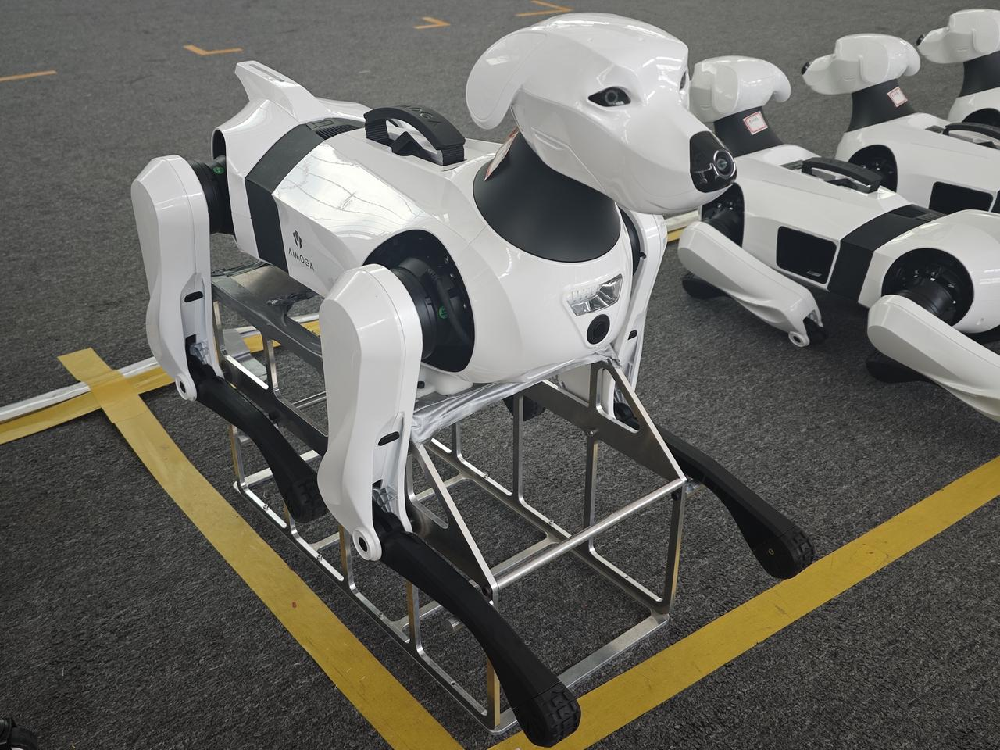
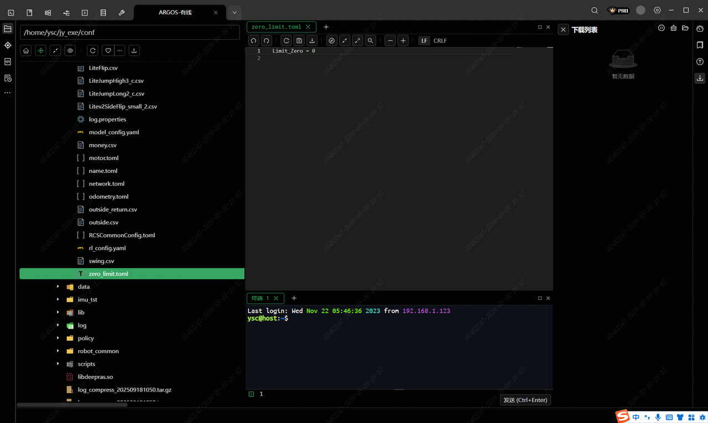
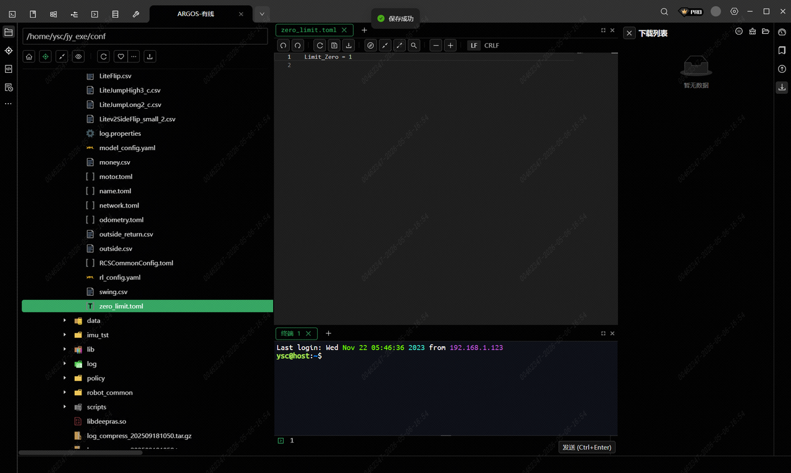
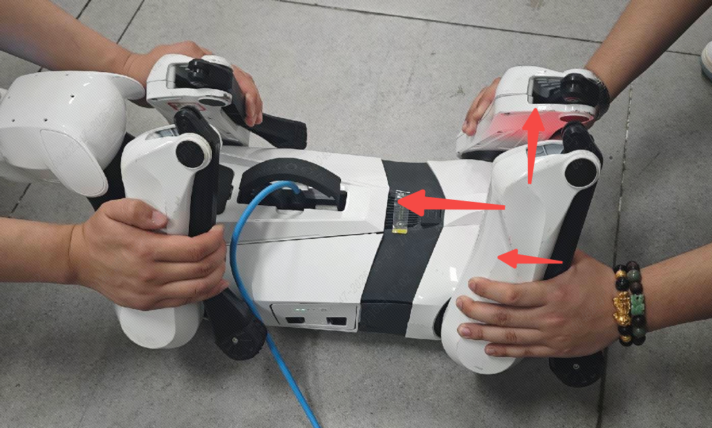
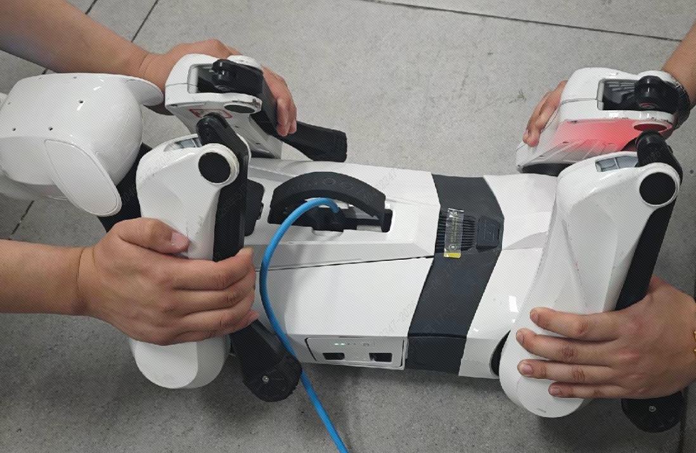
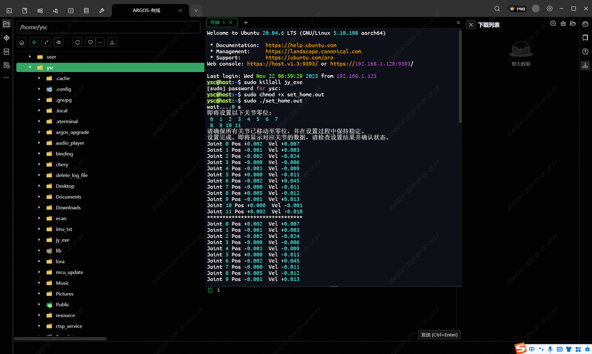

> **适用产品**：Argos X1 机器狗<br />本文覆盖极限标零的功能概述、前提条件、连接参数与操作步骤。

## 1 功能概述

机器狗出厂时采用工装标零，零点精度高、一致性好。当现场更换腿部电机、关节模组等硬件后，腿部零点会丢失，需重新标定后方可正常使用。

> **【注意】** 关键限制：现场不具备工装条件，故采用极限标零方式作为替代方案，精度略低于工装标零，但可恢复基本运动功能。

> 

## 2 前提条件

<table>
  <colgroup>
    <col width="100" />
    <col width="574" />
  </colgroup>
  <thead>
    <tr>
      <th>项目</th>
      <th>要求</th>
    </tr>
  </thead>
  <tbody>
    <tr>
      <td>适用场景</td>
      <td>更换腿部电机/关节模组后零点丢失</td>
    </tr>
    <tr>
      <td>连接方式</td>
      <td>SSH 有线连接（V2.2.1 及以上版本）</td>
    </tr>
    <tr>
      <td>所需工具</td>
      <td>MobaXterm / 命令行 SSH 客户端</td>
    </tr>
    <tr>
      <td>必要文件</td>
      <td>`zero_limit.toml`（标零模式配置文件）、`set_home.out`（标零脚本）</td>
    </tr>
    <tr>
      <td>物理操作</td>
      <td>需手动将关节摆至极限位置</td>
    </tr>
  </tbody>
</table>

## 3 连接参数

<table>
  <colgroup>
    <col width="123" />
    <col width="396" />
  </colgroup>
  <thead>
    <tr>
      <th>参数</th>
      <th>值</th>
    </tr>
  </thead>
  <tbody>
    <tr>
      <td>IP 地址</td>
      <td>`192.168.1.120`</td>
    </tr>
    <tr>
      <td>用户名</td>
      <td>`ysc`</td>
    </tr>
    <tr>
      <td>密码</td>
      <td>`'`（单引号）</td>
    </tr>
    <tr>
      <td>端口号</td>
      <td>`22`</td>
    </tr>
  </tbody>
</table>

> **【注意】** 若通过 WiFi 连接调试（如出厂配置阶段），IP 可能为 `192.168.2.1`，请以实际网络环境为准。

## 4 操作步骤

### 4.1 SSH 登录机器狗

通过有线网口 SSH 登录 Argos 主机：

```bash
ssh ysc@192.168.1.120
```

密码输入单引号 `'`（无回显）。

### 4.2 修改标零模式配置

进入配置文件目录：

```bash
cd /home/ysc/jy_exe/conf/
```

查看当前标零模式配置：

```bash
cat zero_limit.toml
```

默认配置：

```text
Limit_Zero = 0
```

`0` 表示工装标零模式（出厂默认）。

> 

### 4.3 切换为极限标零模式

赋予文件写权限：

```bash
sudo chmod 777 zero_limit.toml
```

编辑配置文件：

```bash
vim zero_limit.toml
```

将参数修改为：

```text
Limit_Zero = 1
```

`1` 表示极限标零模式。

保存退出（`Esc` → `:wq`）。

> 

### 4.4 物理摆位

将机器狗腿部关节按以下方向手动拉至极限位置，建议两人同步操作：

| 关节 | 摆位方向 |
| --- | --- |
| 侧摆关节 | 按箭头方向拉至极限 |
| 髋关节 | 按箭头方向拉至极限 |
| 膝关节 | 按箭头方向拉至极限 |

> **【注意】** 摆位要点：确保每个关节均到达机械限位点，不可留有余量，否则零点偏移。

> 
>
> 

### 4.5 执行标零脚本

关闭运动程序：

```bash
sudo killall jy_exe
```

赋予标零脚本执行权限：

```bash
sudo chmod +x set_home.out
```

执行标零：

```bash
sudo ./set_home.out
```

等待脚本执行完成，终端刷新各关节角度即可。

> 

### 4.6 重启机器狗

手动断电重启。重启后机器狗以新零点初始化，可进行运动测试验证。

主要验证项目：机器人站立、行走测试，机器人预置动作测试（向前跳）。
