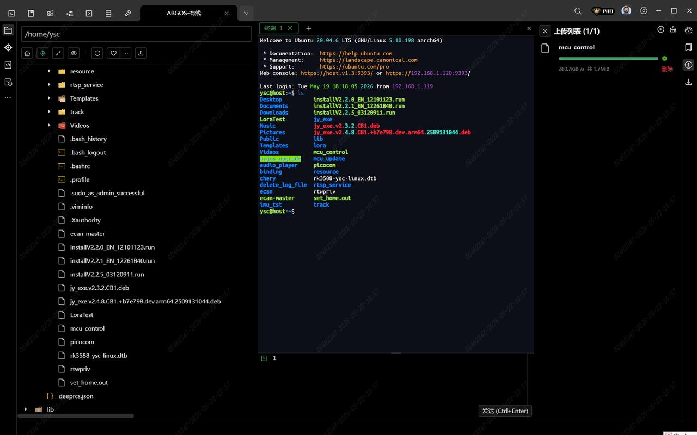
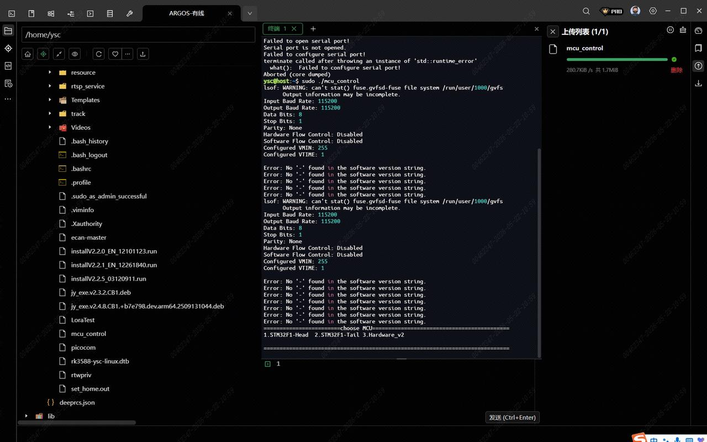
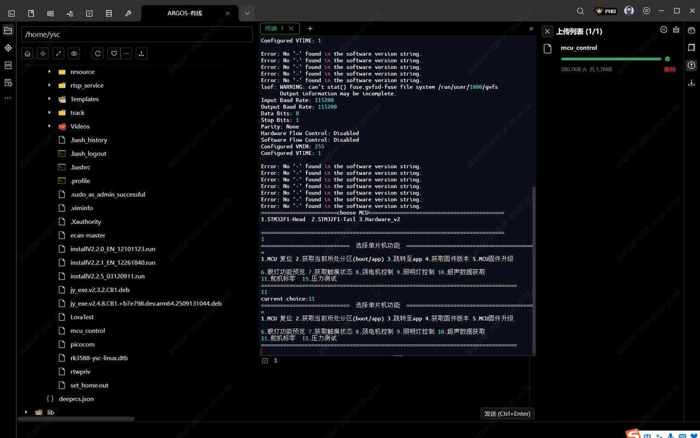

> **适用产品**：Argos X1 机器狗<br />本文覆盖头部舵机标零的适用场景与操作步骤。

## 1 适用场景

- 更换头部舵机后。
- 发生碰撞导致头部不正时。

## 2 操作步骤

### 2.1 SSH 连接机器狗

使用终端软件（如 MobaXterm / Xterminal）通过 SSH 连接机器狗。

### 2.2 传输 `mcu_control` 文件

将 `mcu_control` 文件传输至机器狗。部分设备已预置该文件，可跳过此步。

[mcu_control脚本](https://drive.weixin.qq.com/s?k=AHYAsQcTADccW1Or1e)

> 

### 2.3 赋权并执行

```bash
sudo chmod +x mcu_control
sudo ./mcu_control
```

### 2.4 进入舵机标零菜单

依次选择：

- `1. STM32F1-Head`
- `11. 舵机标零`

> 
>
> 

### 2.5 等待自动标零

头部将自动左转、右转至限位，系统计算零点位置并归零。全程无需人工干预，等待完成即可。

> <video src="/videos/20260525-155945.mp4" controls />

### 2.6 关机重启

标零完成后，关机重启机器狗，确认头部姿态恢复正常。
