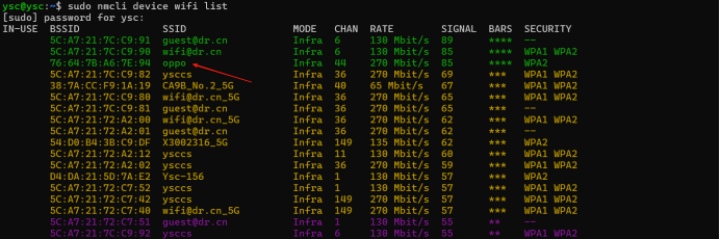
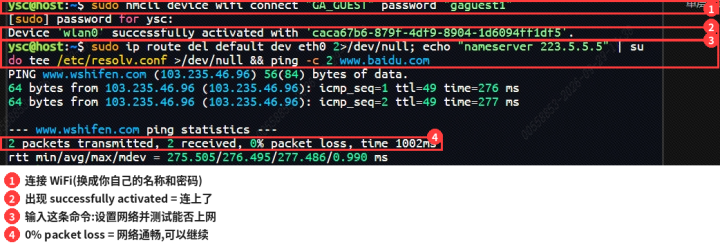
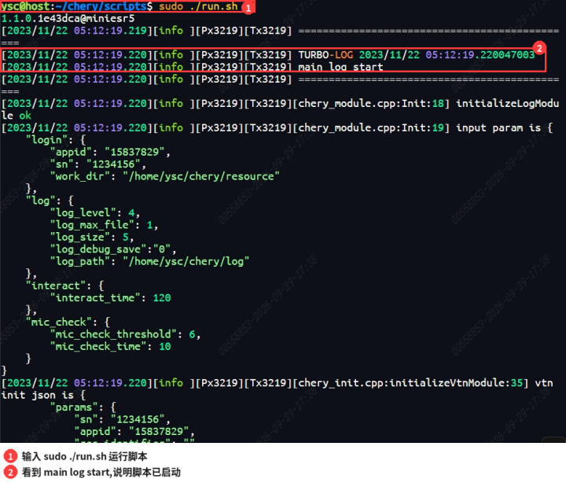
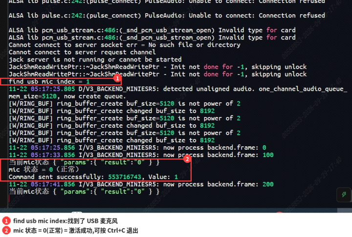
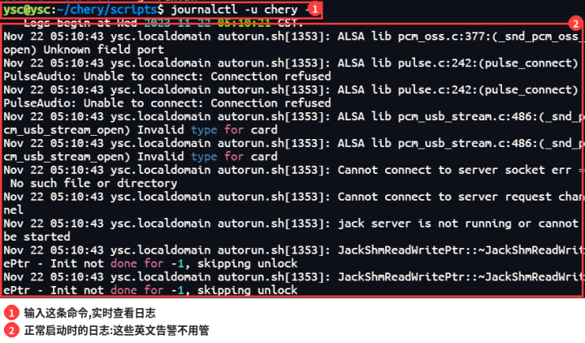
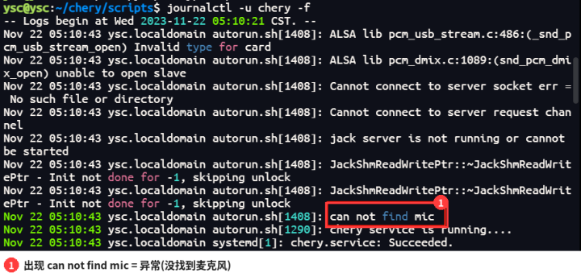

> **适用产品**：Argos X1 机器狗<br />本文覆盖语音功能激活的目的、适用范围、前置条件、操作步骤、激活后测试方法与异常处理。

## 1 目的

联网完成认证，重新激活机器狗的语音功能，恢复语音唤醒和指令响应。

## 2 适用范围

机器狗升级后语音功能失效，需要联网重新激活的场景。

## 3 前置条件

- 一个能上网的 WiFi热点，记下名称和密码。命令里的 `<WiFi名称>`、`<WiFi密码>` 要替换成实际值。
- 电脑已连接至机器狗终端。

## 4 流程总览

授权麦克风并重启 → 连接 WiFi → 理顺网络并测试 → 关闭 chery 后台服务 → 运行语音脚本 → 确认成功并退出 → 删除临时 WiFi。

## 5 操作步骤

### 5.1 给当前用户分配麦克风权限并重启

连接至机器狗终端，给当前用户分配麦克风权限，然后重启系统使权限生效。

```bash
sudo usermod -aG audio ysc
sudo reboot
```


预期结果：命令没有报错，机器狗开始重启；开机后重新连接终端。

### 5.2 连接 WiFi

首次运行前需要联网认证。请连接一个可以上网的 WiFi，手机热点也可以。

- 先查看附近有哪些 WiFi：

```bash
sudo nmcli device wifi list
```



- 连接目标 WiFi：

```bash
sudo nmcli device wifi connect '<WiFi名称>' password '<WiFi密码>'
```

预期结果：出现 `successfully activated`，表示已经连上。

### 5.3 理顺网络并测试上网

为什么要加这一步：实际排查时发现，连上 WiFi 之后，机器狗还是 ping 不到外网。下面这条命令依次做三件事：

- 删掉网线口（eth0）的默认路由，让机器狗走 WiFi 上网。
- 把域名解析（DNS）设成 `223.5.5.5`。
- ping 一下百度，确认可以上网。

```bash
sudo ip route del default dev eth0 2>/dev/null; echo "nameserver 223.5.5.5" | sudo tee /etc/resolv.conf >/dev/null && ping -c 2 www.baidu.com
```



预期结果：最后出现 `0% packet loss`（没有丢包），说明网通了。

> **【注意】** 如果 ping 不通，不要继续下一步，回到连接 WiFi 步骤检查 WiFi 名称、密码和信号。

### 5.4 关闭 chery 后台服务

后台服务开着，会和下一步要运行的脚本冲突，所以先关掉。

```bash
sudo systemctl stop chery
sudo systemctl stop chery.service
```

预期结果：两条命令都没有报错、没有输出。

### 5.5 运行语音脚本

先进入脚本所在的文件夹，再运行。

```bash
cd ~/chery/scripts
sudo ./run.sh
```




预期结果：屏幕开始不停刷日志，其中有 `main log start`，说明脚本已经启动。

### 5.6 确认激活成功并退出

等脚本跑一会儿，同时看到下面 4 句，就是语音功能激活成功：

- `find usb mic index = 1`：找到了 USB 麦克风。
- `当前mic状态 { "params":{ "result":"0" } }`：麦克风检测结果是 0。
- `mic 状态 = 0（正常）`：麦克风正常。
- `Command sent successfully`：指令发送成功。



确认无误后，按 `Ctrl+C` 退出脚本。

### 5.7 删除临时 WiFi

```bash
sudo nmcli connection delete '<WiFi名称>'
```

预期结果：提示连接已删除。至此激活流程全部完成。

## 6 激活后的测试方法

激活完成后，机器狗开机时语音服务会自动启动。按下面的方法检查它是否正常。

### 6.1 测试 1：查看开机日志

开机后，在终端输入下面的命令，查看实时日志（按 `Ctrl+C` 可以停止查看）：

```bash
journalctl -u chery -f
```

正常启动如图示，有些英文告警也属于正常现象，不用理会。



### 6.2 测试 2：喊唤醒词

日志正常后，对机器狗喊唤醒词“嗨阿狗斯”。

预期结果：日志会打印出识别到的命令词，同时机器狗执行唤醒动作。

## 7 异常处理：日志出现 can not find mic

如果日志里出现 `can not find mic`，就是异常（没找到麦克风）。



临时解决办法：进入脚本目录，运行脚本：

```bash
cd ~/chery/scripts
sudo ./run.sh
```


如果还是出现 `can not find mic`，可以重复运行几次脚本。一般情况下，自启成功一次之后，后续每次开机自启都不会再失败。
