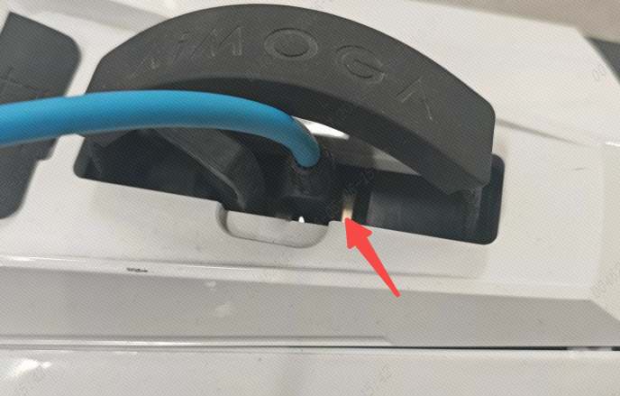
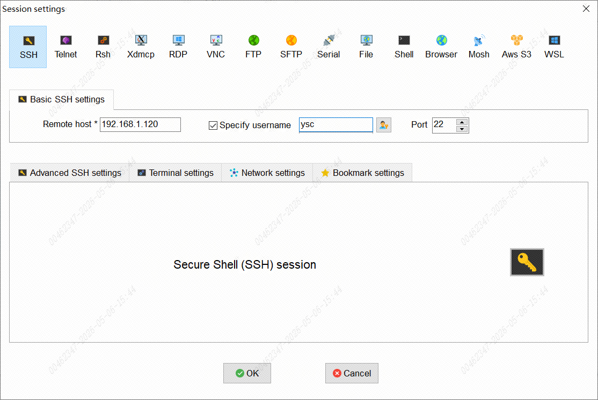
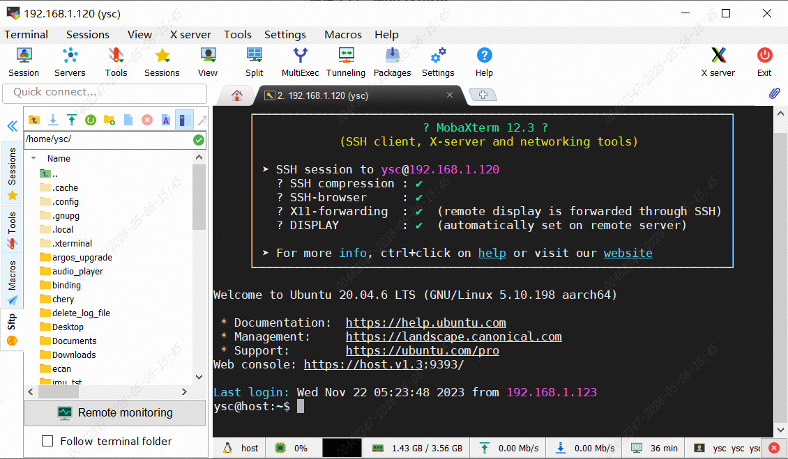
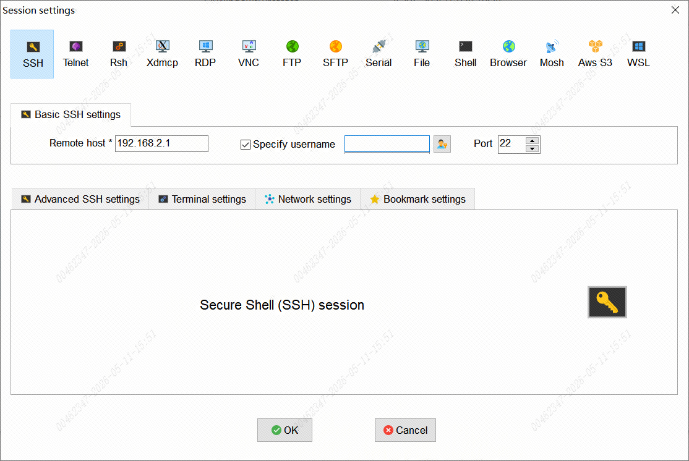
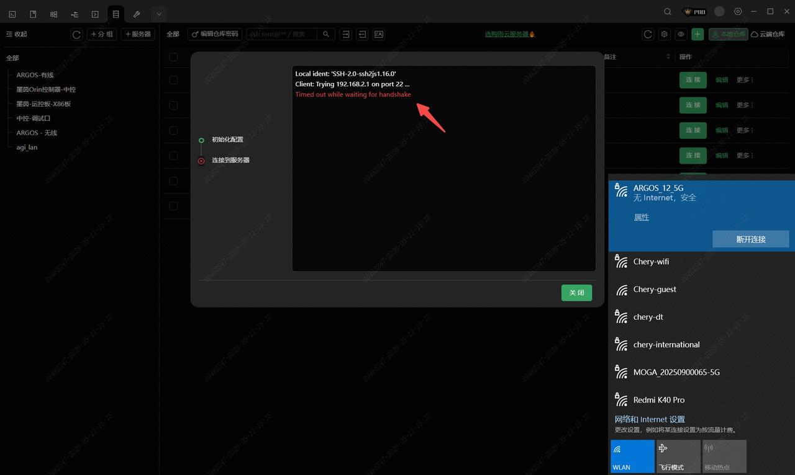
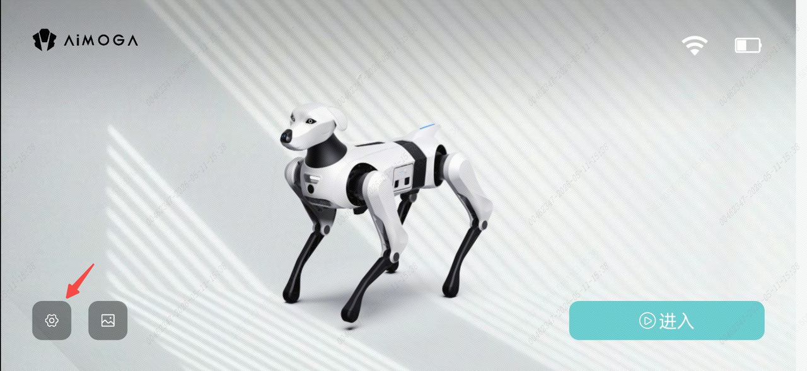
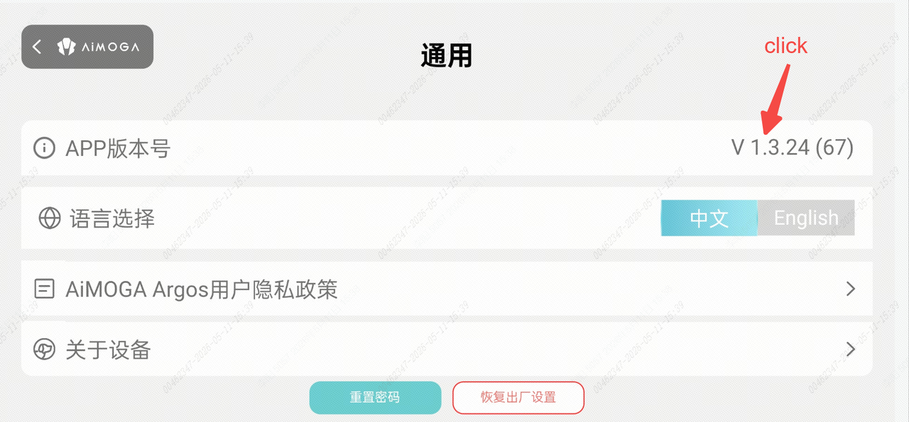
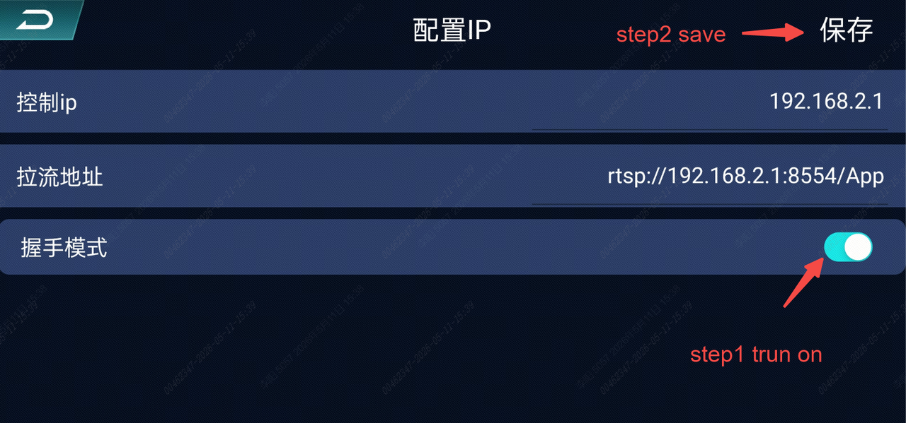
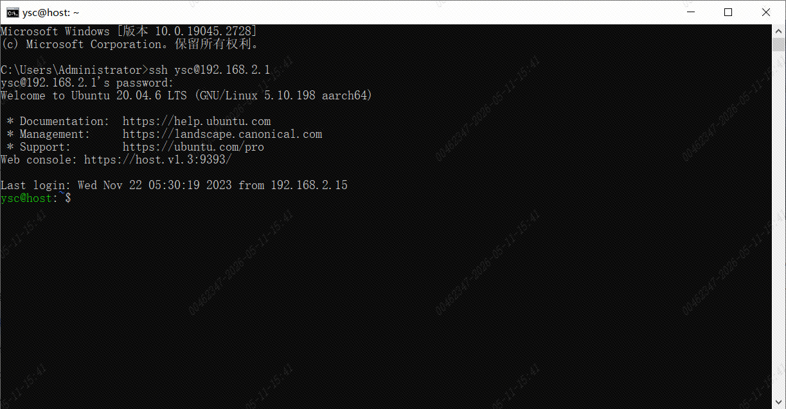

> **适用产品**：Argos X1 机器狗 本文覆盖 SSH 连接的功能概述、前提条件、有线网口连接、无线网络连接、握手模式开启及注意事项。

## 1 功能概述

本手册指导技术人员通过 SSH 协议与机器狗建立远程连接，用于软件升级、日志抓取、参数修改等运维操作。

> **【注意】** 适用范围：软件版本 V2.2.1 及以上；使用对象：售后技术支持、现场运维人员，不建议客户自行操作。

## 2 连接前提条件

### 2.1 版本确认

机器狗软件版本需为 V2.2.1 或更高版本。该版本后 SSH 通讯默认仅支持通过有线网口建立连接，无线 SSH 接入需先通过官方 APP 开启握手模式。

### 2.2 硬件准备

- 网线一根（RJ45 接口）。
- 笔记本电脑或台式机（带网口、USB 转网口适配器或 Wi-Fi 网卡）。
- 智能手机一部（已安装 Argos 官方 APP，无线连接时使用）。
- 机器狗处于开机状态且热点正常广播。

## 3 有线网口连接

### 3.1 网络配置

本地电脑 IP 地址需设置为与机器狗同一网段：

| 项目 | 机器狗端 | 本地电脑端 |
| --- | --- | --- |
| IP 地址 | `192.168.1.120` | `192.168.1.x` （x 为 2—254 任意值，避免冲突） |
| 子网掩码 | `255.255.255.0` | `255.255.255.0` |
| 网关 | 可不配置 | 可不配置 |

> **【建议】** 本地 IP 建议设置为 `192.168.1.100`，避免与机器狗 IP 冲突。
>
>    src="/images/image-351.png"
>   alt="Image"
>   title="Image"
>   style={{ width:"79%" }}
> />

### 3.2 连接参数

<table>
  <colgroup>
    <col width="150" />
    <col width="267" />
  </colgroup>
  <thead>
    <tr>
      <th>参数项</th>
      <th>值</th>
    </tr>
  </thead>
  <tbody>
    <tr>
      <td>连接方式</td>
      <td>有线网口 SSH</td>
    </tr>
    <tr>
      <td>IP 地址</td>
      <td>`192.168.1.120`</td>
    </tr>
    <tr>
      <td>端口号</td>
      <td>`22`（默认）</td>
    </tr>
    <tr>
      <td>用户名</td>
      <td>`ysc`</td>
    </tr>
    <tr>
      <td>密码</td>
      <td>`'`（单引号）</td>
    </tr>
  </tbody>
</table>

### 3.3 连接工具与操作步骤

推荐工具：MobaXterm。

<table>
  <colgroup>
    <col width="143" />
    <col width="275" />
  </colgroup>
  <thead>
    <tr>
      <th>参数</th>
      <th>值</th>
    </tr>
  </thead>
  <tbody>
    <tr>
      <td>Remote host</td>
      <td>`192.168.1.120`</td>
    </tr>
    <tr>
      <td>Username</td>
      <td>`ysc`</td>
    </tr>
    <tr>
      <td>Password</td>
      <td>`'`（单引号）</td>
    </tr>
    <tr>
      <td>Port</td>
      <td>`22`</td>
    </tr>
  </tbody>
</table>

> 
>
> 

备选工具：

- 命令行：`ssh ysc@192.168.1.120`。
- XTerminal。

## 4 无线网络连接

### 4.1 网络配置

本地电脑通过 Wi-Fi 连接机器狗无线热点，无需手动修改本地 IP 地址。机器狗端 IP 地址为 `192.168.2.1`，本地电脑端通过 DHCP 自动获取 IP 地址，无需手动配置子网掩码及网关。

### 4.2 前置操作：开启握手模式

无线 SSH 连接必须先通过 APP 开启握手模式，否则无法建立连接。

### 4.3 连接参数

<table>
  <colgroup>
    <col width="188" />
    <col width="233" />
  </colgroup>
  <thead>
    <tr>
      <th>参数项</th>
      <th>值</th>
    </tr>
  </thead>
  <tbody>
    <tr>
      <td>连接方式</td>
      <td>无线网络 SSH</td>
    </tr>
    <tr>
      <td>IP 地址</td>
      <td>`192.168.2.1`</td>
    </tr>
    <tr>
      <td>端口号</td>
      <td>`22`（默认）</td>
    </tr>
    <tr>
      <td>用户名</td>
      <td>`ysc`</td>
    </tr>
    <tr>
      <td>密码</td>
      <td>`'`（单引号）</td>
    </tr>
  </tbody>
</table>

### 4.4 连接工具与操作步骤

推荐工具：MobaXterm。

<table>
  <colgroup>
    <col width="145" />
    <col width="198" />
  </colgroup>
  <thead>
    <tr>
      <th>参数</th>
      <th>值</th>
    </tr>
  </thead>
  <tbody>
    <tr>
      <td>Remote host</td>
      <td>`192.168.2.1`</td>
    </tr>
    <tr>
      <td>Username</td>
      <td>`ysc`</td>
    </tr>
    <tr>
      <td>Password</td>
      <td>`'`（单引号）</td>
    </tr>
    <tr>
      <td>Port</td>
      <td>`22`</td>
    </tr>
  </tbody>
</table>

> 
>
> 

备选工具：

- 命令行：`ssh ysc@192.168.2.1`。
- XTerminal。

## 5 握手模式开启操作

### 5.1 功能背景

适用软件版本为 V2.2.1 及以上。该版本起，Argos 机器狗默认关闭无线网络的 SSH 通讯端口，仅保留有线网络访问控制板的通道。此变更旨在提升设备网络安全性。

当运维电脑不支持本地 IP 地址修改，或现场不具备有线网络条件时，仍需通过无线网络连接机器狗。此时需借助官方 APP 进入隐藏菜单，手动开启握手模式，临时恢复无线 SSH 通讯能力。未开启该模式下，无法通过 Wi-Fi 进行 SSH 连接。

> 

### 5.2 操作步骤

前置条件：手机已安装 Argos 官方 APP，机器狗处于开机状态且热点正常广播。

#### 5.2.1 连接机器狗热点

打开手机 Wi-Fi 设置，连接到 Argos 机器狗的默认热点。热点名称通常为 `Argos-XXXX` 格式，具体标识请查看机器狗机身标签。

#### 5.2.2 进入 APP 隐藏菜单

打开 Argos APP 并完成与机器狗的连接。点击底部菜单栏的「设置」选项进入设置页面。在设置页面找到 APP 版本号区域，连续点击 5 次，直至页面跳转至隐藏菜单界面。

> 
>
> 
>
> 待人工确认：原文内容（本节图片均未提供链接）

#### 5.2.3 开启握手模式

在隐藏菜单中找到「握手模式」选项。点击开启开关，等待界面状态显示为“已连接”或“开启成功”。确认状态正常后，点击右上角「保存」按钮，确保配置写入并生效。

> 
>
> <video src="/videos/20260511-160515.mp4" controls />

#### 5.2.4 验证 SSH 连通性

在电脑端打开终端工具。Windows 系统可使用 PowerShell 或 CMD，Mac 及 Linux 系统使用 Terminal。执行 SSH 连接命令，格式为 `ssh ysc@机器狗无线IP地址`，输入对应密码后成功登录即表示握手模式生效，无线 SSH 通道已恢复。

> 

## 6 注意事项

- 网段一致性：有线连接时本地电脑 IP 必须与机器狗（`192.168.1.120`）处于同一网段，否则无法建立连接。
- 连接方式差异：V2.2.1 版本后默认仅支持有线网口 SSH，无线方式需先开启握手模式。
- 握手模式前提：无线 SSH 连接必须先通过 APP 开启握手模式，否则无法建立连接。
- 热点连接：本地电脑必须连接至机器狗自身广播的 Wi-Fi 热点，而非现场其他无线网络。
- 密码特殊性：密码为单引号 `'`，输入时终端无回显显示，直接输入后回车即可，无需额外处理。
- 不建议客户使用：该功能涉及系统底层操作，误操作可能导致设备异常，仅限受过培训的技术人员使用。
- 安全建议：完成运维操作后及时断开 SSH 连接，避免长时间占用会话；敏感操作前做好配置备份；无线连接完成后建议在 APP 中关闭握手模式以恢复默认安全状态。
