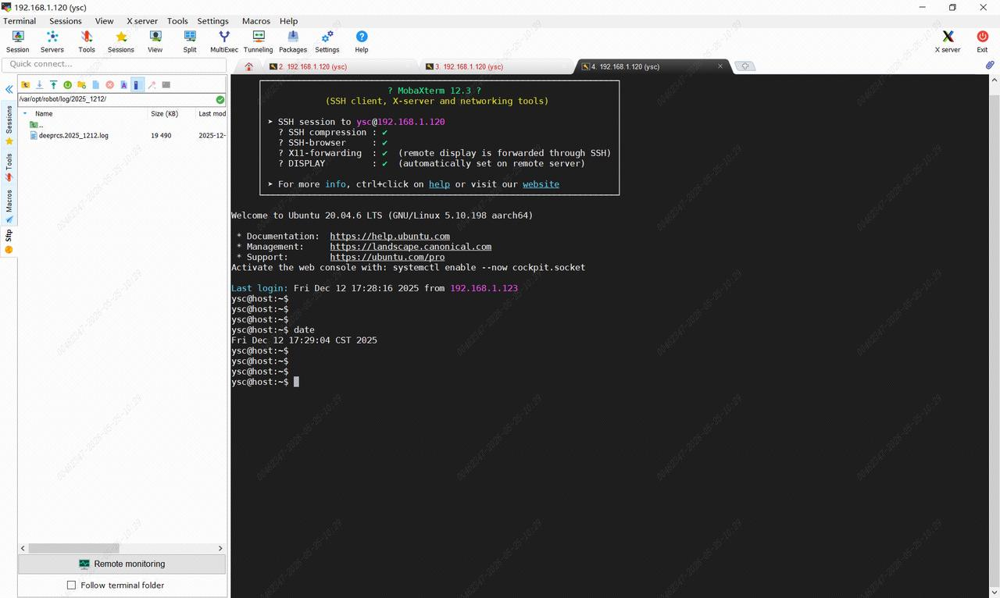

> **适用产品**：Argos X1 机器狗<br />本文覆盖连接控制板、查询日期并进入日志目录、下载日志与发送分析。

## 1 连接控制板

使用 MobaXterm 或 Xterminal SSH 登录机器狗：

- IP：`192.168.1.120`。
- 用户名：`ysc`。
- 密码：`'`（英文符号，单引号）。

> **【说明】** 连接方式详见《Argos 机器狗 SSH 通讯连接说明》。

## 2 查询日期并进入目录

- 先执行 `date` 查询当前日期。
- 再根据输出日期进入对应日志目录（以 2025 年 12 月 12 日为例）。

```bash
cd /var/opt/robot/log/2025_1212/
ls
```



## 3 下载日志

使用 MobaXterm 方式：左侧 SFTP 面板展开 `/var/opt/robot/log/2025_1212/`，选择需要下载的日志文件，右键下载。

## 4 发送分析

将下载的 `deeprcs.YYYY_MMDD.log` 文件通过飞书或邮件发送给我司售后，附机器狗序列号和故障现象即可。
