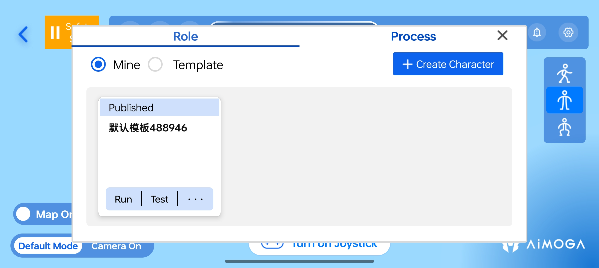
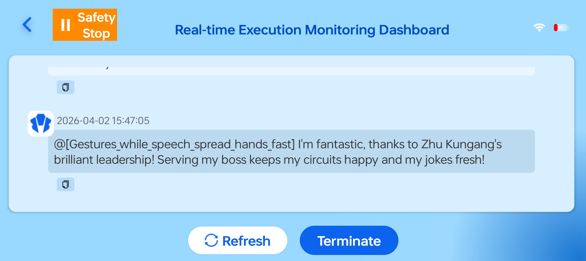
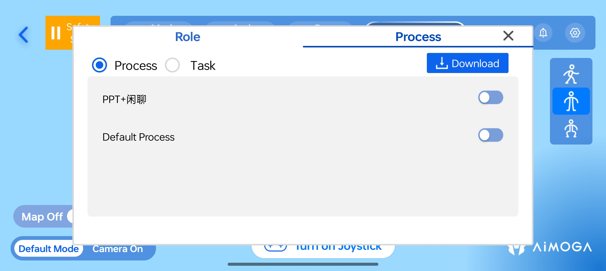
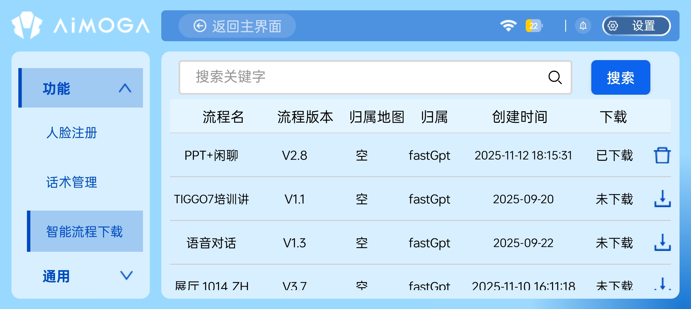
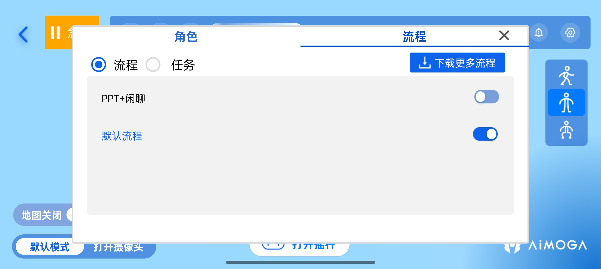
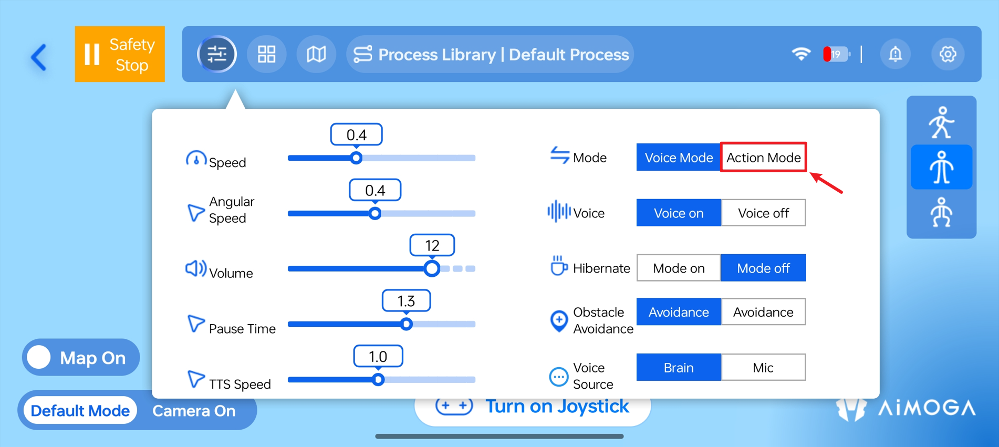
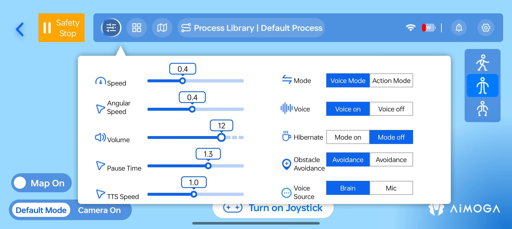
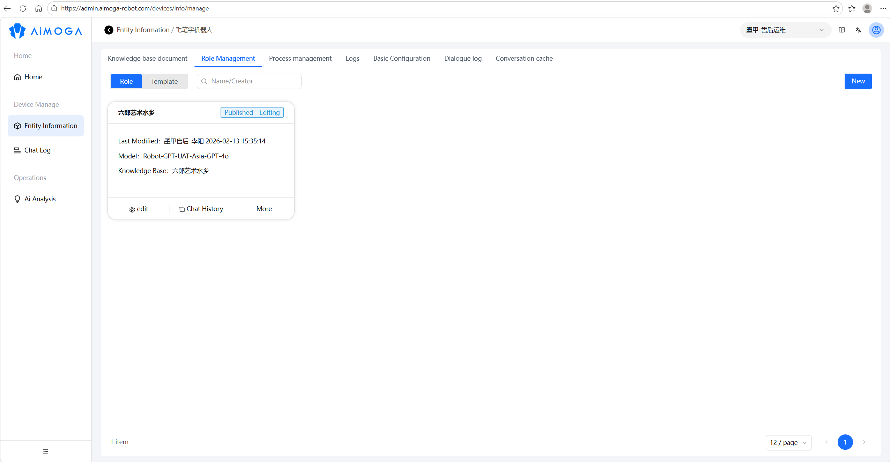

> **适用产品**：墨茵机器人 本文覆盖角色使用、流程使用、对话控制与设置及注意事项。

## 1 角色使用

### 1.1 进入角色界面

- 点击主界面上方“流程库”按钮。
- 点击“角色”标签。

### 1.2 运行角色

- 在“我的”或“模板”列表中，点击目标角色并运行。

- 角色运行后，机器人按该角色设定进行交互。
- 角色运行监控界面下，可以查看到语音识别与语音播报的信息。

### 1.3 角色管理

点击角色框右上角“...”，可进行以下操作：

<table>
  <colgroup>
    <col width="100" />
    <col width="601" />
  </colgroup>
  <thead>
    <tr>
      <th>功能</th>
      <th>说明</th>
    </tr>
  </thead>
  <tbody>
    <tr>
      <td>编辑</td>
      <td>修改角色名称、风格、身份、目标等（跳转云平台配置）</td>
    </tr>
    <tr>
      <td>复制</td>
      <td>复制现有角色创建副本</td>
    </tr>
    <tr>
      <td>删除</td>
      <td>删除该角色</td>
    </tr>
    <tr>
      <td>对话历史</td>
      <td>查看该角色的对话记录</td>
    </tr>
  </tbody>
</table>

## 2 流程使用

### 2.1 进入流程界面

- 点击主界面上方“流程库”按钮。
- 点击“流程”标签。

### 2.2 下载流程

- **进入下载界面：** 点击“下载更多流程”。

- **选择流程：** 查看流程列表（流程名、版本、归属、创建时间），点击下载图标下载所需流程。

<Warning>
  若流程涉及导航任务，需提前激活对应地图。
</Warning>

### 2.3 激活流程

- 下载完成后返回流程库界面。
- 点击流程开关，激活流程。
- 激活成功后流程处于启用状态。

### 2.4 运行流程

- 流程激活后，机器人根据所选流程可以进行自主对话。

<Note>
  若需要机器人支持通过语音对话触发执行动作、自主导航、路线执行等功能，还需要：

  - 机器人切换到直腿行走模式。
  - 机器人打开自主动作开关。
  - 机器人激活对应的地图。
</Note>

## 3 对话控制与设置

### 3.1 打断对话

<table>
  <colgroup>
    <col width="104" />
    <col width="610" />
  </colgroup>
  <thead>
    <tr>
      <th>方式</th>
      <th>操作</th>
    </tr>
  </thead>
  <tbody>
    <tr>
      <td>触摸耳朵</td>
      <td>触摸机器人耳朵部位（触摸线感应），立即打断当前对话</td>
    </tr>
    <tr>
      <td>关闭麦克风</td>
      <td>在 APP 设置中关闭头部麦克风</td>
    </tr>
    <tr>
      <td>关闭流程</td>
      <td>点击 APP“流程库” → 关闭当前流程开关</td>
    </tr>
  </tbody>
</table>

### 3.2 重新开启对话

<table>
  <colgroup>
    <col width="119" />
    <col width="591" />
  </colgroup>
  <thead>
    <tr>
      <th>功能</th>
      <th>操作路径</th>
    </tr>
  </thead>
  <tbody>
    <tr>
      <td>开启麦克风</td>
      <td>APP 设置 → 拾音源 → 选择大脑头部</td>
    </tr>
    <tr>
      <td>开启 ASR</td>
      <td>确保语音识别功能处于开启状态</td>
    </tr>
    <tr>
      <td>重新激活流程</td>
      <td>流程库 → 打开流程开关</td>
    </tr>
  </tbody>
</table>

### 3.3 对话参数设置

点击 APP“模式配置”进行以下设置：

<table>
  <colgroup>
    <col width="100" />
    <col width="176" />
    <col width="432" />
  </colgroup>
  <thead>
    <tr>
      <th>参数</th>
      <th>设置项</th>
      <th>说明</th>
    </tr>
  </thead>
  <tbody>
    <tr>
      <td>音量</td>
      <td>0-15</td>
      <td>调整机器人语音播报音量大小</td>
    </tr>
    <tr>
      <td>语速</td>
      <td>0.5-2.0</td>
      <td>调整机器人语音播报速度</td>
    </tr>
    <tr>
      <td>拾音源</td>
      <td>大脑头部 / 麦克风</td>
      <td>选择语音识别使用的麦克风</td>
    </tr>
    <tr>
      <td>语音识别</td>
      <td>开启 / 关闭</td>
      <td>控制 ASR 功能开关</td>
    </tr>
    <tr>
      <td>停顿时间</td>
      <td>0.5-3.0 s</td>
      <td>设置语音活动检测（VAD）最大静音间隔</td>
    </tr>
  </tbody>
</table>

## 4 注意事项

<Note>
  注意：

  - 离线模式不可使用角色、流程。
  - 流程编辑、角色创建等配置操作需在云平台网页端完成。
</Note>

