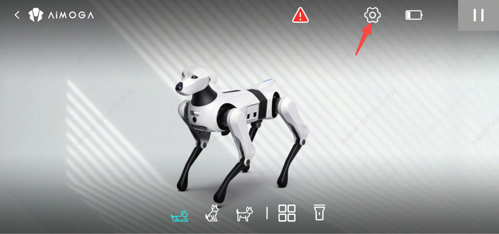
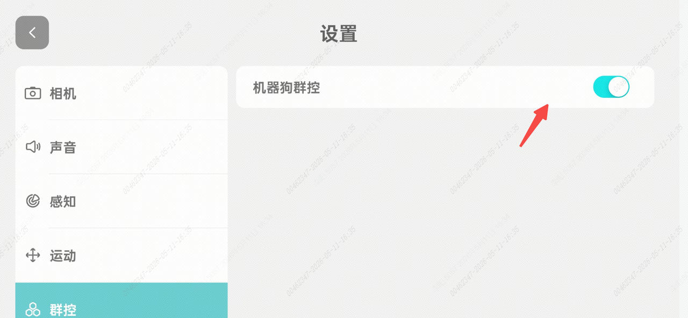
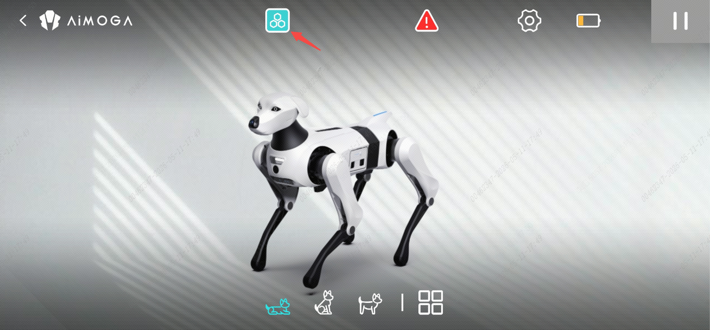
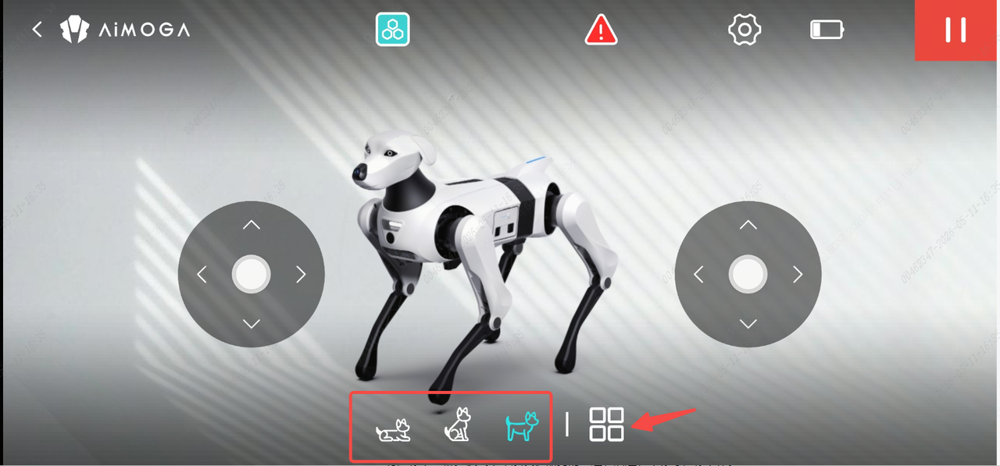
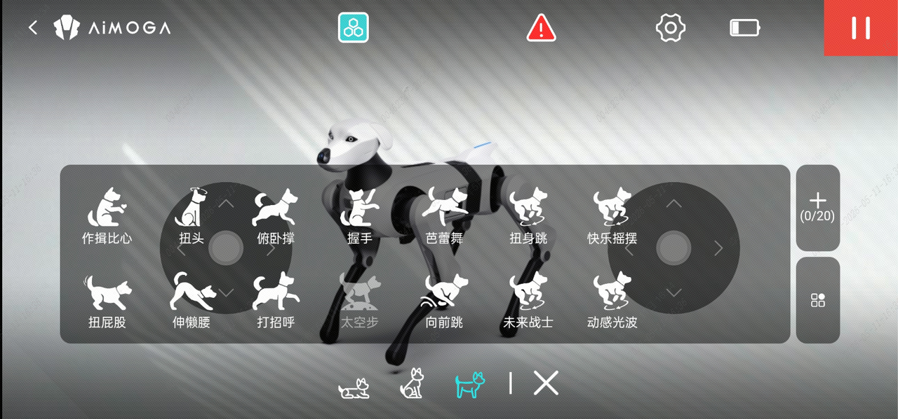
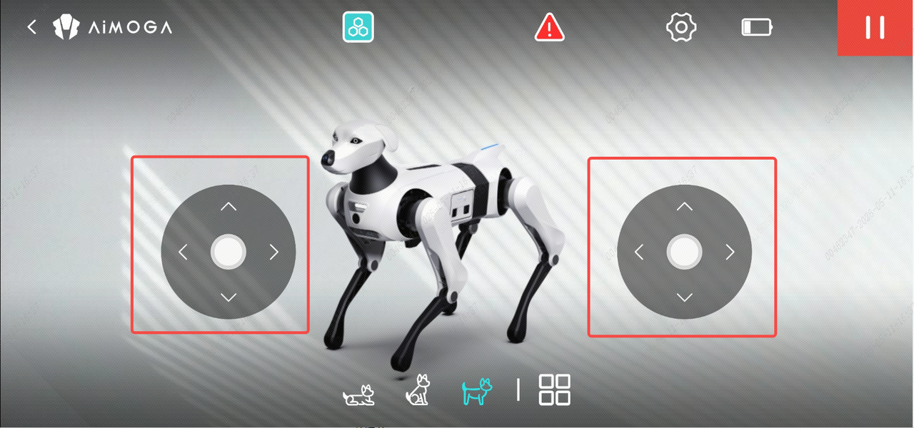

> **适用产品**：Argos X1 机器狗 本文覆盖 LoRa 群控的方案目的、适用场景、操作步骤、群控功能说明与注意事项。

## 1 方案目的

本方案支持通过单部手机实现对多台机器狗的集中群控。

群控功能涵盖机器狗的姿态切换及组合动作编排，但不支持机器狗的行走移动与转向控制。执行群控前，需由人工将各台机器狗提前摆放至预设的初始位置。

## 2 适用场景

- 舞台编队动作表演。
- 批量姿态调试与演示。

## 3 操作步骤

### 3.1 机器狗初始化复位

对所有待群控的机器狗执行以下操作：

- 依次将每台机器狗开机，在 APP 端选择复位操作并执行密码重置。
- 完成密码重置后，解除当前手机与该机器狗的绑定关系，确保设备处于未配对状态。

### 3.2 逐台开启群控开关

- 使用手机依次连接每台机器狗的 Wi-Fi 热点。
- 连接成功后，使用修改后的密码完成 APP 登录。
- 进入 APP 设置菜单，找到群控开关选项并将其打开。

> 

此时界面将显示该机器狗的群控状态标识。

> 
>
> 

- 完成设置后，断开当前机器狗的热点连接。
- 按照上述流程，依次对剩余机器狗重复操作，直至倒数第二台机器狗完成群控开关开启。

### 3.3 末台机器狗激活群控

连接最后一台机器狗的 Wi-Fi 热点，同样进入设置菜单打开群控开关。当最后一台机器狗的群控状态激活后，系统将自动识别网络内所有已开启群控开关的机器狗，并建立群控组网关系。此时单部手机即可实现对全部机器狗的统一姿态切换与组合动作控制。

## 4 群控功能说明

### 4.1 支持操作

- 姿态切换：包括站立、坐下、趴下、伸展等预设姿态的同步切换。

> 

- 组合动作：支持多机同步执行预设动作序列，以及组合动作等。

> 

### 4.2 不支持操作

- 行走移动：群控模式下不触发机器狗的前进、后退、平移等位移动作。
- 转向控制：群控模式下不触发机器狗的左转、右转及原地旋转动作。

> 

## 5 注意事项

- 初始位置摆放：群控前必须由人工将各台机器狗摆放至预设初始位置，并确保各机器狗间距合理，避免动作执行时发生物理碰撞。
- 网络环境要求：群控依赖 LoRa 组网通讯，操作现场应避免强电磁干扰源，确保机器狗之间的通讯链路稳定。
- 逐台配置顺序：必须严格按照逐台开启、最后激活的顺序执行。
- 密码一致性：建议将所有机器狗的连接密码统一设置为相同值，便于后续群控管理与快速接入。
- 群控状态保持：机器狗重启后群控开关仍保持，需要关闭群控开关时，需要重置绑定并使用手机关闭群控开关。
- 电量监控：群控展示前确认所有机器狗电量充足，建议电量不低于 50%，避免表演过程中因低电量导致动作异常或关机。
