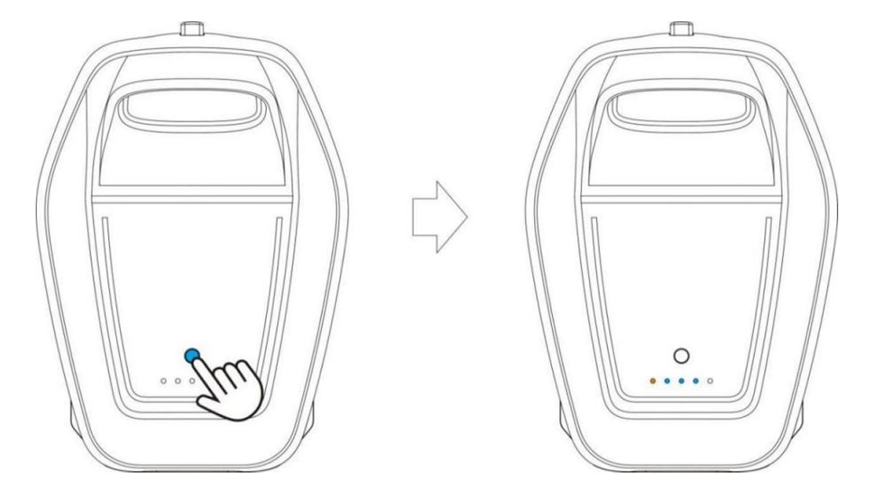
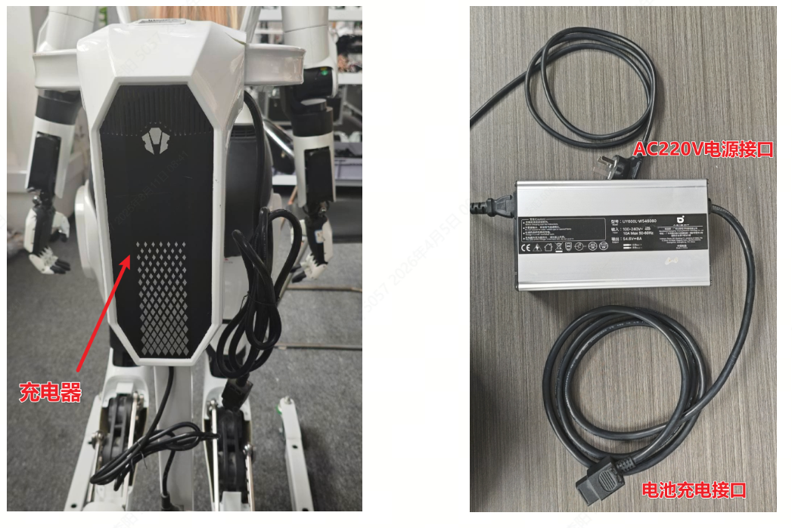
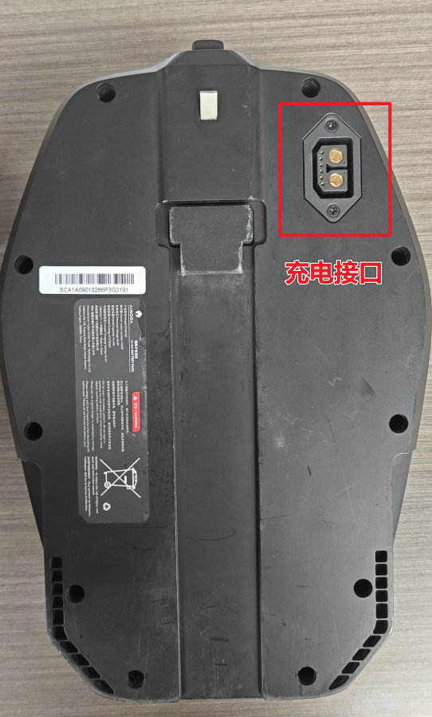
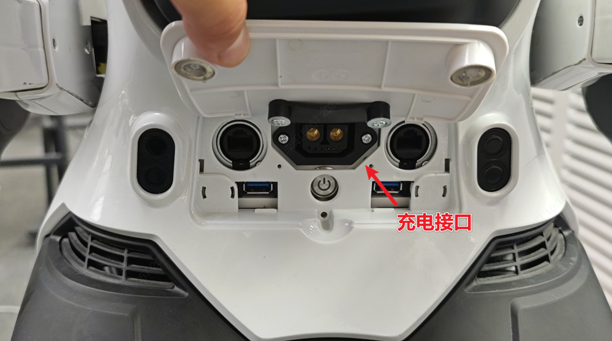

> **适用产品**：墨茵机器人 本文覆盖电量检查、电池安装、电池拆卸、充电及安全注意事项。

## 1 电量检查

短按电池指示灯上方圆形按钮，查看电量。

| 指示灯 | 电量 | 操作 |
| --- | --- | --- |
| 3~5 颗 | ≥60% | 可安装使用 |
| 2 颗 | 40% | 建议先充电 |
| 1 颗 | 20% | **必须充电** |
| 1 颗闪烁 | \<20% | **立即充电** |

<Note>
  使用前确保电量 ≥60%。
</Note>

## 2 电池安装

<Note>
  安装前确保机器人**关机**并放置于**待机站**上。
</Note>

- 电池对准卡槽，沿导轨推入至“咔哒”锁定。
- 轻拉确认锁定。

> [电池安装演示视频](https://drive.weixin.qq.com/s?k=AHYAsQcTADcOWysmgo)

## 3 电池拆卸

<Note>
  拆卸前确保机器人**关机**并放置于**待机站**上。
</Note>

- 按下锁定卡扣，保持按压状态。
- 将电池左右进行晃动，沿导轨逐步拉出电池。

> [电池拆卸演示视频](https://drive.weixin.qq.com/s?k=AHYAsQcTADcO1BMn4S)

## 4 充电

### 4.1 单独充电（推荐）

- 取出电池。
- 充电器梯形抽头插入电池后背接口。
- 插头接入 AC180~240V 插座。
- 充满后指示灯常亮（1 红+4 白）。

### 4.2 机器人本体充电

- 机器人若在关机状态下，将**双足平稳放置于地面**，防止机器人充电时通电启动切换到曲腿模式后发生倾倒；同样支持开机状态下直接充电使用。
- 充电器插入腰部电源接口。
- 插头接入 AC180~240V 插座。

## 5 安全注意事项

<Warning>
  危险：

  - 严禁使用非原装充电器。
  - 充电温度 0°C~40°C，远离热源。
  - 电池损坏时禁止充电。
</Warning>

<Note>
  注意：

  - 长期存放保持电量 40%~60%。
</Note>
