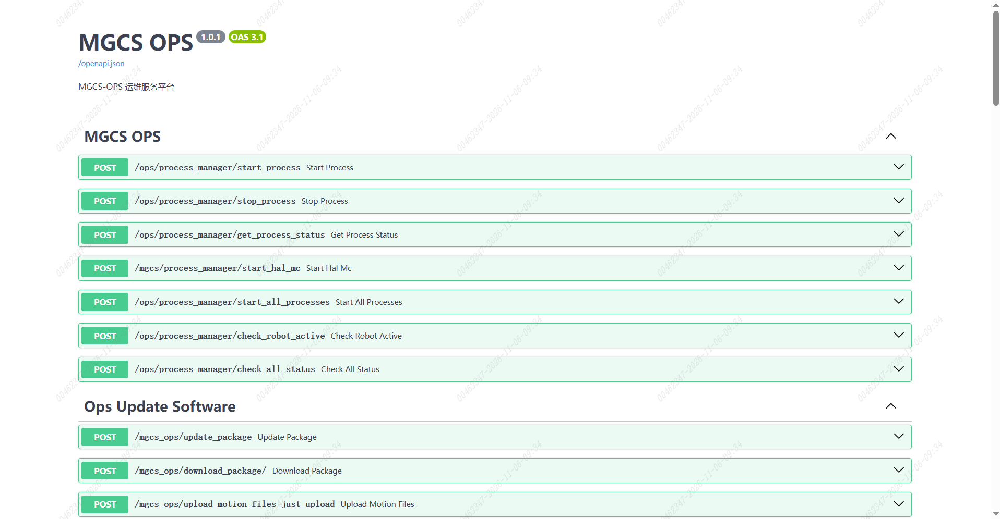

> **适用产品**：墨茵机器人 本文覆盖平台访问方式及进程管理、软件升级、OTA 版本管理、系统信息、文件服务、无线接入点配置、端口管理等接口清单。

<Warning>
  注意：本平台接口存在操作风险，不建议自行摸索使用。如需调用，请先联系我司技术人员确认。
</Warning>

## 1 平台访问

机器人 ORIN 控制器支持 Swagger 接口，MGCS-OPS 运维服务平台访问地址如下：

| 网络类型 | 访问地址 |
| --- | --- |
| 无线网络连接 | `http://192.168.100.110:8887/docs#/` |
| 有线网络连接 | `http://192.168.101.100:8887/docs#/` |

## 2 接口清单

### 2.1 进程管理

- `POST /ops/process_manager/start_process`：启动指定进程。
- `POST /ops/process_manager/stop_process`：停止运动控制进程。
- `POST /ops/process_manager/get_process_status`：获取进程状态。
- `POST /mgcs/process_manager/start_hal_mc`：启动 HAL 运动控制。
- `POST /ops/process_manager/start_all_processes`：启动全部进程。
- `POST /ops/process_manager/check_robot_active`：检查机器人激活状态。
- `POST /ops/process_manager/check_all_status`：检查全部进程状态。

### 2.2 软件升级

- `POST /mgcs_ops/update_package`：上传更新包。
- `POST /mgcs_ops/download_package/`：按文件名下载安装包。
- `POST /mgcs_ops/upload_motion_files_just_upload`：上传运控文件。
- `POST /mgcs_ops/upload_action_files`：上传动作包。
- `POST /mgcs_ops/upload_operation/upload_deb`：上传 deb 包并校验版本。
- `GET /mgcs_ops/upload_operation/install_sse/{filename}`：实时推送安装日志。
- `GET /mgcs_ops/upload_operation/get_installed_version`：获取已安装版本。
- `POST /mgcs_ops/ota_operation/upload_zipfile`：上传 OTA 更新包。
- `POST /mgcs_ops/ota_operation/ota_update`：执行 OTA 更新。
- `POST /mgcs_ops/ota_operation/retry_failed_modules`：重试失败模块。
- `POST /mgcs_ops/ota_operation/rollback_installed_modules`：回滚已安装模块。
- `POST /mgcs_ops/ota_operation/rollback_or_retry_modules`：回滚或重试模块。

### 2.3 OTA 版本管理

- `GET /mgcs_ops/ota_version_management/get_version`：获取当前版本。
- `GET /mgcs_ops/ota_version_management/get_version_history`：获取版本升级历史。
- `POST /mgcs_ops/ota_version_management/manual_update_version`：手动更新版本信息。
- `POST /mgcs_ops/ota_version_management/notify_update_version`：通知版本更新。
- `GET /mgcs_ops/ota_version_management/get_update_version_status`：获取更新版本状态。
- `POST /mgcs_ops/ota_version_management/notify_download_progress`：上报下载进度。
- `POST /mgcs_ops/ota_version_management/notify_download_package`：开始下载。
- `POST /mgcs_ops/ota_version_management/set_update_version_status`：更新版本状态。

### 2.4 系统信息

- `GET /ops/system/get_sn`：获取 SN。
- `POST /ops/system/sn_update`：更新 SN。
- `GET /ops/system/get_face_device_id`：获取人脸设备 ID。
- `POST /ops/system/upload_face_offline_license`：上传离线人脸授权。

### 2.5 文件服务

- `POST /multithread_upload/{file_name}`：多线程分片上传。
- `GET /multithread_download/{file_name}`：多线程分段下载。
- `GET /mgcs_ops/server/files{file_path}`：按路径下载服务端文件。
- `POST /api/upload`：客户端上传文件。
- `GET /api/download/{filename}`：客户端下载文件。

### 2.6 无线接入点配置

- `POST /mgcs/wifi_setting/set_mgcs_ap`：设置 MGCS 接入点。
- `GET /mgcs/wifi_setting/use_default`：查询是否使用默认接入点配置。

### 2.7 端口管理

- `GET /port_manager/disable_ufw`：关闭 UFW 防火墙。
- `GET /port_manager/close_all_ports`：关闭默认屏蔽端口。
- `GET /port_manager/open_all_ports`：开放全部端口。
- `POST /port_manager/operation`：对指定端口执行开放、屏蔽或检查操作。
