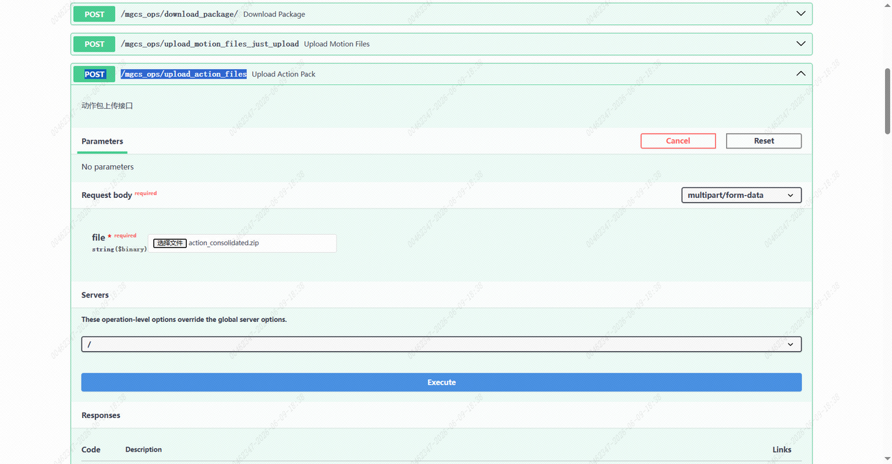
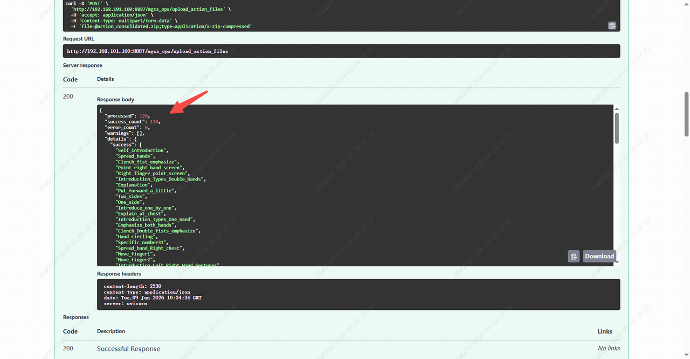

> **适用产品**：墨茵机器人 本文覆盖运维服务平台上传动作文件的操作步骤。

## 1 使用场景

- 生产新机时更新机器人动作库。
- 导入定制的动作库。

## 2 导入动作库

> <video src="/videos/步骤3.动作库导入.mp4" controls />

- 先访问中控页面：`http://192.168.101.100:8887/docs#/`。
- 再使用接口 `/mgcs_ops/upload_action_files`，选择 `action_consolidated.zip`，执行动作库上传。

> 

- 最后查看动作文件上传情况。

> 
