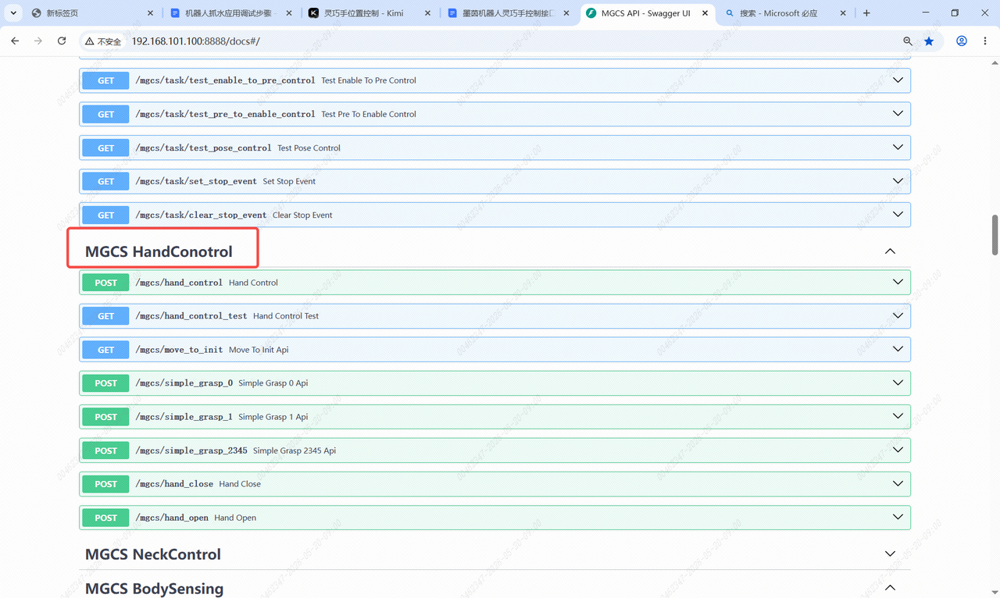
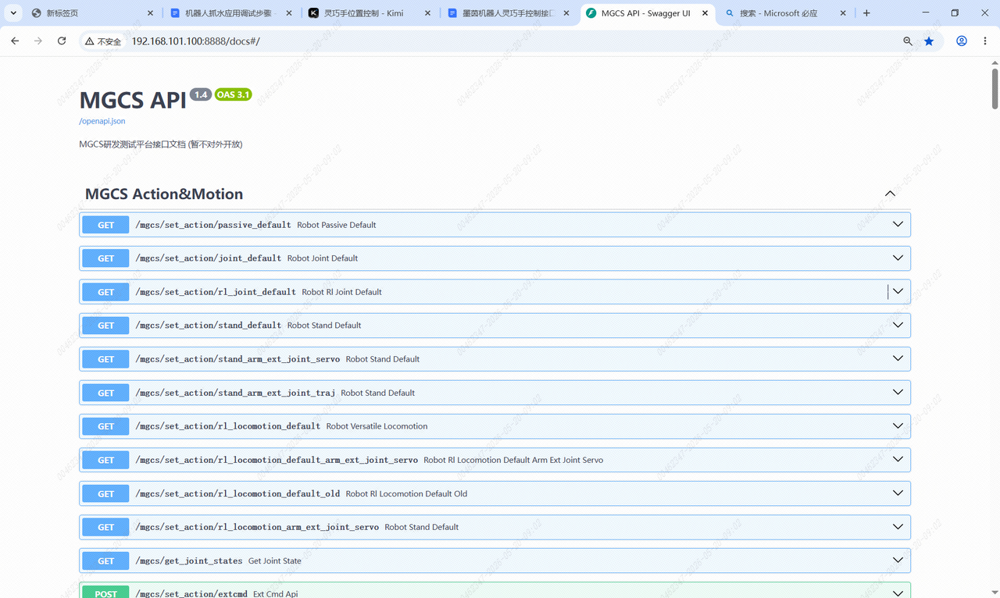
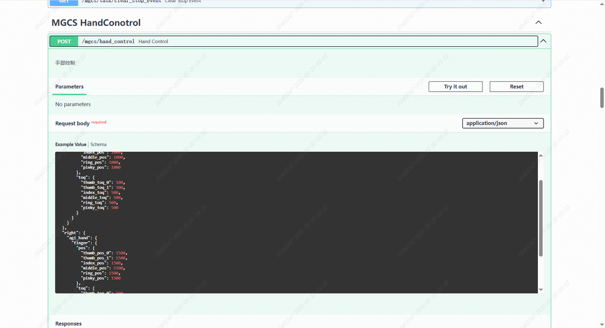
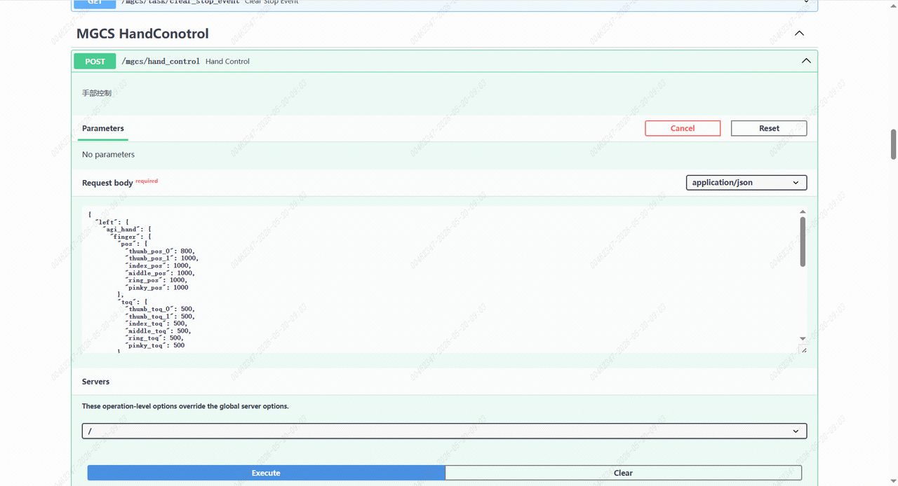
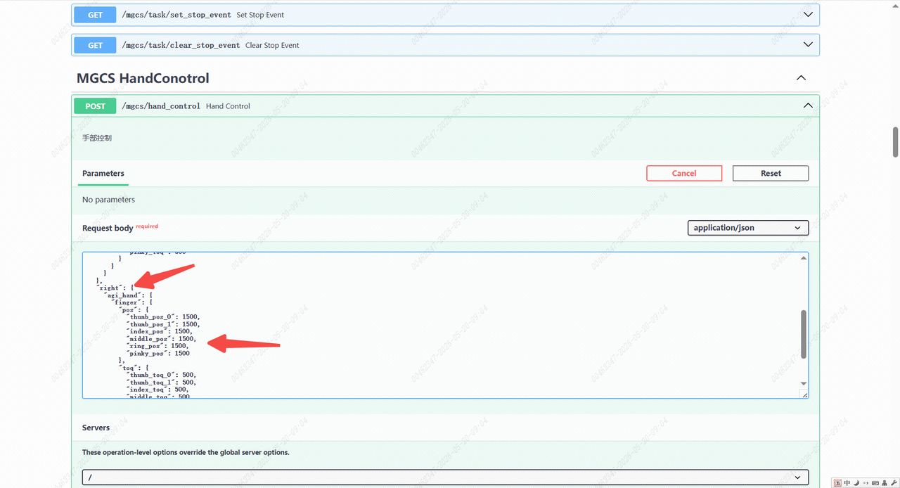

> **适用产品**：墨茵机器人<br />本文覆盖灵巧手控制接口的功能概述、接口清单、参数说明与操作步骤。

## 1 功能概述

本说明指导用户通过中控MGCS研发测试平台接口，对机器人灵巧手进行单舵机位置与力矩的精细化控制。支持左右手独立控制，适用于递水、抓取、手势展示等场景。

## 2 接口清单

> | 接口类型 | 请求路径 | 功能说明 |
> | :-- | :-- | :-- |
> | POST | /mgcs/hand_control | 手部控制（设置所有舵机的位置和力矩） |
> | POST | /mgcs/hand_close | 手部控制关闭（闭合手势） |
> | POST | /mgcs/hand_open | 手部控制打开（张开手势） |

本文重点说明 `/mgcs/hand_control` 接口的位置控制用法。

> 

## 3 参数说明

### 3.1 舵机位置参数（pos）

> <table>
>   <colgroup>
>     <col width="147" />
>     <col width="216" />
>     <col width="100" />
>     <col width="100" />
>   </colgroup>
>   <thead>
>     <tr>
>       <td>参数名</td>
>       <td>说明</td>
>       <td>默认值</td>
>       <td>建议抓水值</td>
>     </tr>
>   </thead>
>   <tbody>
>     <tr>
>       <td>thumb_pos_0</td>
>       <td>拇指根部舵机位置</td>
>       <td>1000</td>
>       <td>1500</td>
>     </tr>
>     <tr>
>       <td>thumb_pos_1</td>
>       <td>拇指指尖舵机位置</td>
>       <td>1000</td>
>       <td>1500</td>
>     </tr>
>     <tr>
>       <td>index_pos</td>
>       <td>食指舵机位置</td>
>       <td>1000</td>
>       <td>1500</td>
>     </tr>
>     <tr>
>       <td>middle_pos</td>
>       <td>中指舵机位置</td>
>       <td>1000</td>
>       <td>1500</td>
>     </tr>
>     <tr>
>       <td>ring_pos</td>
>       <td>无名指舵机位置</td>
>       <td>1000</td>
>       <td>1500</td>
>     </tr>
>     <tr>
>       <td>pinky_pos</td>
>       <td>小指舵机位置</td>
>       <td>1000</td>
>       <td>1500</td>
>     </tr>
>   </tbody>
> </table>

### 3.2 舵机力矩参数（toq）

> <table>
>   <colgroup>
>     <col width="150" />
>     <col width="218" />
>     <col width="100" />
>     <col width="100" />
>   </colgroup>
>   <thead>
>     <tr>
>       <td>参数名</td>
>       <td>说明</td>
>       <td>默认值</td>
>       <td>建议值</td>
>     </tr>
>   </thead>
>   <tbody>
>     <tr>
>       <td>thumb_toq_0</td>
>       <td>拇指根部力矩</td>
>       <td>500</td>
>       <td>500</td>
>     </tr>
>     <tr>
>       <td>thumb_toq_1</td>
>       <td>拇指指尖力矩</td>
>       <td>500</td>
>       <td>500</td>
>     </tr>
>     <tr>
>       <td>index_toq</td>
>       <td>食指力矩</td>
>       <td>500</td>
>       <td>500</td>
>     </tr>
>     <tr>
>       <td>middle_toq</td>
>       <td>中指力矩</td>
>       <td>500</td>
>       <td>500</td>
>     </tr>
>     <tr>
>       <td>ring_toq</td>
>       <td>无名措力矩</td>
>       <td>500</td>
>       <td>500</td>
>     </tr>
>     <tr>
>       <td>pinky_toq</td>
>       <td>小指力矩</td>
>       <td>500</td>
>       <td>500</td>
>     </tr>
>   </tbody>
> </table>

## 4 操作步骤

### 4.1 连接机器人 Wi-Fi 热点

在电脑或手机 Wi-Fi 列表中找到机器人热点并连接。

### 4.2 访问中控 API 文档页面

访问地址：`http://192.168.100.110:8888/docs#/`

页面加载后显示 MGCS API 接口文档总览。

> 

### 4.3 定位灵巧手控制接口

- 在接口列表中找到 `MGCS HandControl`。
- 接口：`POST /mgcs/hand_control`，即手部控制。
- 点击该接口展开详情。

> 

### 4.4 进入调试模式

- 点击接口卡片页面上的“Try it out”按钮，解除输入框锁定。

> 
>
> 待人工确认：原文内容（图片未提供链接）

### 4.5 修改舵机位置与力矩

- 在 `Request body` 输入框中，按需求修改 JSON 参数。

右手抓水推荐配置：

```json
{
  "left": {
    "agi_hand": {
      "finger": {
        "pos": {
          "thumb_pos_0": 800,
          "thumb_pos_1": 1000,
          "index_pos": 1000,
          "middle_pos": 1000,
          "ring_pos": 1000,
          "pinky_pos": 1000
        },
        "toq": {
          "thumb_toq_0": 500,
          "thumb_toq_1": 500,
          "index_toq": 500,
          "middle_toq": 500,
          "ring_toq": 500,
          "pinky_toq": 500
        }
      }
    }
  },
  "right": {
    "agi_hand": {
      "finger": {
        "pos": {
          "thumb_pos_0": 1500,
          "thumb_pos_1": 1500,
          "index_pos": 1500,
          "middle_pos": 1500,
          "ring_pos": 1500,
          "pinky_pos": 1500
        },
        "toq": {
          "thumb_toq_0": 500,
          "thumb_toq_1": 500,
          "index_toq": 500,
          "middle_toq": 500,
          "ring_toq": 500,
          "pinky_toq": 500
        }
      }
    }
  }
}
```

> 

### 4.6 执行控制指令

- 确认参数无误后，点击“Execute”按钮发送请求，查看手部动作变化。
