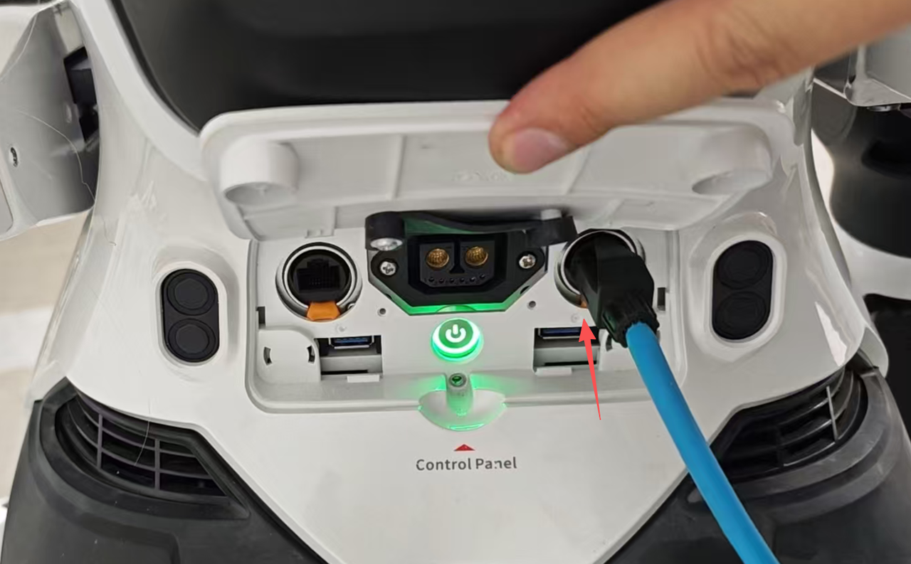
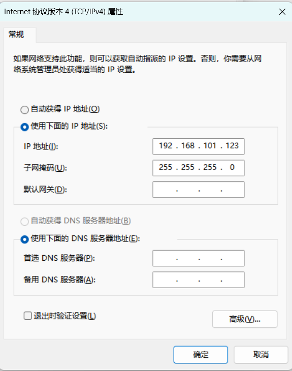
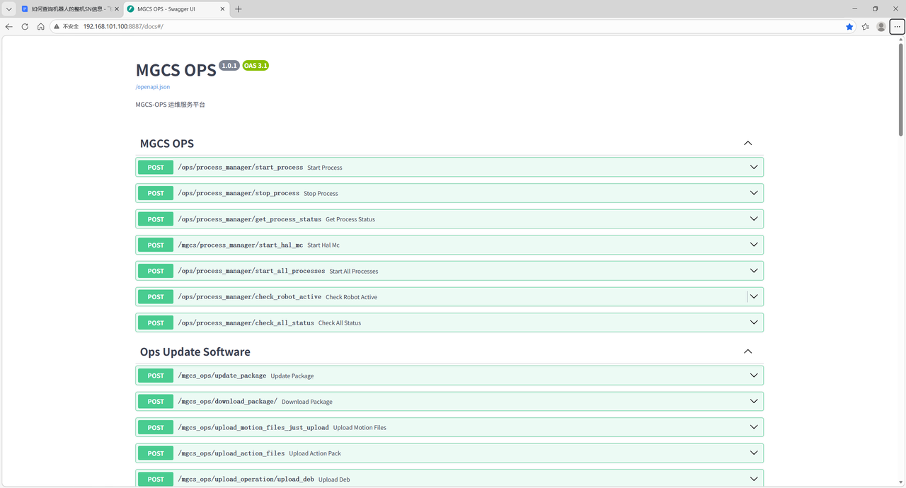
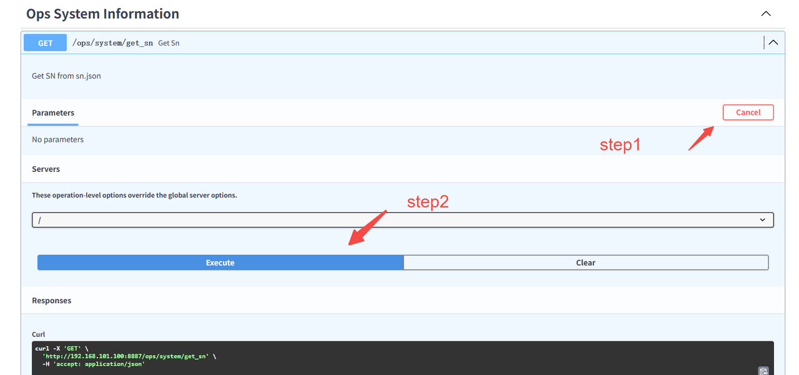
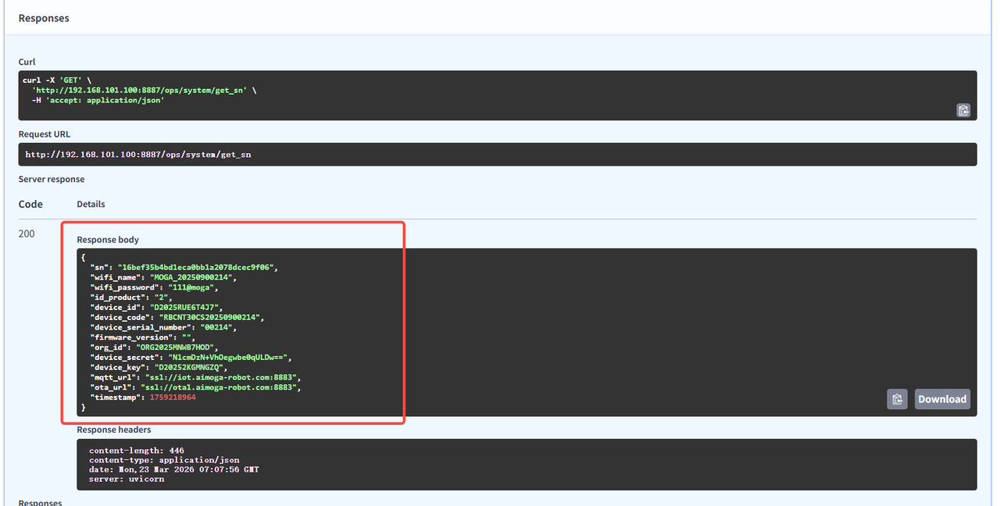

> **适用产品**：墨茵机器人<br />本文覆盖通过调试网口连接机器人、设置本地 IP、访问 Ops 系统查询 SN 信息及返回字段说明。

## 1 连接设置

- 先通过有线网络连接至机器人调试网口。
  

再设置本地网口 IP 地址为 `192.168.101.***` 网段，注意不要使用 `100`、`110`，避免 IP 地址重复。



## 2 访问MGCS-OPS运维服务平台

- 然后访问网址 `http://192.168.101.100:8887/docs#/`



- 最后点击 `Ops System Information` >> `/ops/system/get_sn` 查询机器人 SN 信息。





-  返回示例

```json
{
  "sn": "16bef35b4bd1eca0bb1a2078dcec9f06",
  "wifi_name": "MOGA_20250900214",
  "wifi_password": "111@moga",
  "id_product": "2",
  "device_id": "D2025RUE6T4J7",
  "device_code": "RBCNT30CS20250900214",
  "device_serial_number": "00214",
  "firmware_version": "",
  "org_id": "ORG2025MNWB7HOD",
  "device_secret": "NlcmDzN+VhOegwbe0qULDw==",
  "device_key": "D20252KGMNGZQ",
  "mqtt_url": "ssl://iot.aimoga-robot.com:8883",
  "ota_url": "ssl://ota1.aimoga-robot.com:8883",
  "timestamp": 1759218964
}
```

- `device_code` 对应机器人整机编号，`device_id` 可用于机器人云平台设备注册。
