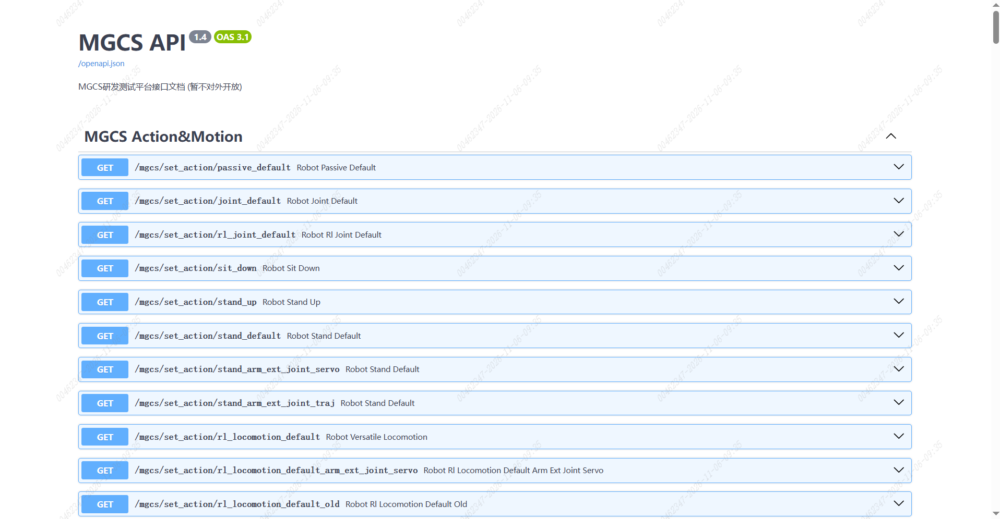

> **适用产品**：墨茵机器人 本文覆盖平台访问方式及动作与运动、网络状态、感知、标定、任务、手部控制、颈部控制、人体感应、日志查询、系统管理、导航测试、SLAM、文件服务、进程管理、电池管理、群控、OTA、TCP 接口、遥控、MPC、任务组、关节轨迹等接口清单。

<Warning>
  注意：本平台接口存在操作风险，不建议自行摸索使用。如需调用，请先联系我司技术人员确认。
</Warning>

## 1 平台访问

机器人 ORIN 控制器支持 Swagger 接口，MGCS 研发测试平台访问地址如下：

| 网络类型 | 访问地址 |
| --- | --- |
| 无线网络连接 | `http://192.168.100.110:8888/docs#/` |
| 有线网络连接 | `http://192.168.101.100:8888/docs#/` |

<Note>
  说明：MGCS 研发测试平台暂不对外开放，仅用于研发测试。
</Note>

## 2 接口清单

### 2.1 动作与运动

- `GET /mgcs/set_action/passive_default`：软急停，机器人进入瘫软状态。
- `GET /mgcs/set_action/joint_default`：位置控制站立。
- `GET /mgcs/set_action/rl_joint_default`：强化学习位置控制站立。
- `GET /mgcs/set_action/sit_down`：坐下。
- `GET /mgcs/set_action/stand_up`：站起。
- `GET /mgcs/set_action/stand_default`：力控站立。
- `GET /mgcs/set_action/stand_arm_ext_joint_servo`：力控站立并接收外部关节伺服指令。
- `GET /mgcs/set_action/stand_arm_ext_joint_traj`：力控站立并接收外部关节轨迹点。
- `GET /mgcs/set_action/rl_locomotion_default`：强化学习下肢行走。
- `GET /mgcs/set_action/rl_locomotion_default_arm_ext_joint_servo`：强化行走并接收外部关节伺服指令。
- `GET /mgcs/set_action/rl_locomotion_default_old`：强化行走旧模型。
- `GET /mgcs/set_action/rl_locomotion_arm_ext_joint_servo`：强化行走加外部上肢动作。
- `GET /mgcs/get_joint_states`：获取当前关节状态。
- `POST /mgcs/set_action/extcmd`：外部动作指令下发。
- `GET /mgcs/set_action/rl_whole_body_dance`：全身舞蹈模式。
- `POST /mgcs/motion/arm_motion_start`：启动上肢动作。
- `GET /mgcs/motion/arm_motion_pause`：暂停上肢动作。
- `GET /mgcs/motion/arm_motion_end`：停止上肢动作。
- `GET /mgcs/action/get_current_action`：获取当前动作。
- `POST /mgcs/action_lib/start_action`：启动动作库动作。
- `POST /mgcs/get_action_libraries`：获取动作库列表。
- `GET /mgcs/hibernate_mode/start`：进入休眠模式。
- `GET /mgcs/hibernate_mode/stop`：退出休眠模式。
- `POST /mgcs/set_arm_motion_obs`：设置上肢动作避障。
- `GET /mgcs/dance/list`：获取可用舞蹈列表。
- `POST /mgcs/dance/play`：播放指定舞蹈。

### 2.2 网络状态

- `GET /mgcs/network/state`：获取机器人网络状态。
- `GET /mgcs/wifi_setting/list`：获取 Wi-Fi 列表。
- `GET /mgcs/wifi_setting/status`：获取 Wi-Fi 状态。
- `POST /mgcs/wifi_setting/connect`：连接指定 Wi-Fi。
- `POST /mgcs/wifi_setting/set_mgcs_ap_without_encryted`：设置无加密接入点。
- `POST /mgcs/wifi_setting/set_mgcs_ap`：设置加密接入点。
- `GET /mgcs/wifi_setting/use_default`：查询接入点是否使用默认配置。
- `POST /mgcs/wifi_setting/modify_country_code`：修改接入点国家码。

### 2.3 感知

- `GET /mgcs/target_recognition`：目标识别。
- `GET /mgcs/get_box_pose`：获取目标物体位姿。
- `POST /mgcs/mgcs_calibration`：机器人标定。
- `POST /mgcs/face_detect_recognition/register`：人脸注册。
- `POST /mgcs/face_detect_recognition/operation`：人脸识别操作开关。
- `POST /mgcs/face_detect_recognition/face_detect`：删除人脸。
- `POST /mgcs/get_face_db_list`：获取人脸库列表。
- `GET /mgcs/sync_face_db`：同步人脸库。
- `GET /mgcs/face_detect_recognition/face_image`：获取人脸图像。
- `GET /mgcs/face_detect_recognition/get_face_database`：获取人脸数据库。
- `POST /mgcs/face_detect_recognition/face_update`：更新人脸信息。
- `POST /mgcs/people_detect/operation`：人体检测开关。
- `GET /mgcs/people_detect/get_image`：获取单帧图像。
- `GET /mgcs/people_detect/is_active`：检测区域内是否有人。

### 2.4 标定

- `GET /mgcs/calibration/start_hand_eye_calibration_launch`：启动手眼标定进程。
- `GET /mgcs/calibration/move_to_calibration_position`：移动至标定板位置。
- `POST /mgcs/calibration/mgcs_hand_eye_calibration`：执行手眼标定。
- `GET /mgcs/calibration/start_sensor_calibration_launch`：启动传感器标定进程。
- `GET /mgcs/calibration/cameras_solve_srv`：外参标定。
- `GET /mgcs/calibration/start_collect_data`：采集传感器数据。
- `GET /mgcs/calibration/start_offline_solve`：离线求解。

### 2.5 任务

- `POST /mgcs/task/move_pick_bottle`：移动抓取任务。
- `GET /mgcs/task/reset_arm_for_car_door_opening`：开车门异常重置手臂。
- `GET /mgcs/task/test_pre_to_pose_control`：倒水回初始位置。
- `GET /mgcs/task/test_enable_to_pre_control`：使能位置到倒水初始位置。
- `GET /mgcs/task/test_pre_to_enable_control`：倒水初始位置回使能位置。
- `GET /mgcs/task/test_pose_control`：倒水功能。
- `GET /mgcs/task/set_stop_event`：紧急停止。
- `GET /mgcs/task/clear_stop_event`：清除停止事件。

### 2.6 手部控制

- `POST /mgcs/hand_control`：手部控制。
- `GET /mgcs/hand_control_test`：手部控制测试。
- `GET /mgcs/move_to_init`：手部回到初始位置。
- `POST /mgcs/simple_grasp_0`：简单抓取 0。
- `POST /mgcs/simple_grasp_1`：简单抓取 1。
- `POST /mgcs/simple_grasp_2345`：简单抓取 2345。
- `POST /mgcs/hand_close`：手部闭合。
- `POST /mgcs/hand_open`：手部张开。

### 2.7 颈部控制

- `POST /mgcs/neck_control`：脖子电机旋转。

### 2.8 人体感应与避障

- `POST /serial_body_sensing_operation`：人体感应检测开关。
- `GET /serial_body_sensing_status`：人体感应状态上报。
- `POST /remote_obstacle_avoidance/behind/operation`：遥控避障开关。
- `POST /remote_obstacle_avoidance/behind/distance`：遥控避障后方距离设置。
- `GET /remote_obstacle_avoidance/function/status`：遥控避障功能状态。

### 2.9 日志查询

- `POST /mgcs/query_log`：查询日志。

### 2.10 系统管理

- `POST /mgcs/system/sn_update`：更新 SN。
- `GET /mgcs/system/get_sn`：获取 SN。
- `POST /mgcs/system/receive_version_json`：接收版本列表。
- `POST /mgcs/system/check_version`：校验版本。
- `POST /mgcs/system/version_query`：查询版本。
- `POST /mgcs/alarm/internal_error_report`：内部错误上报。
- `GET /mgcs/system/alarm_query`：查询告警。
- `GET /mgcs/system/factory_reset`：恢复出厂设置。
- `GET /mgcs/system/runtime_uptime`：获取累计运行时长。

### 2.11 导航测试

- `POST /mgcs/nav_test/active_map`：业务层激活地图。
- `POST /mgcs/nav_test/go_with_cmd_vel`：按速度指令行走。
- `POST /mgcs/navigation/go_to_pose`：导航至指定位姿。
- `POST /mgcs/navigation/go_to_dock`：导航至充电桩。
- `POST /mgcs/navigation/go_with_object`：导航至目标物体。
- `POST /mgcs/nav_test/go_with_rosbag`：按 rosbag 行走。
- `POST /mgcs/nav_test/start_record`：开始录制。
- `POST /mgcs/nav_test/save_record`：保存录制结果。
- `POST /mgcs/nav_test/go_with_record_bag`：按录制结果行走。
- `GET /mgcs/nav_test/go_forward_and_turn_around`：前进并转向。

### 2.12 SLAM

- `POST /mgcs/slam_test/start_mapping_launch`：启动建图进程。
- `GET /mgcs/slam_test/start_mapping`：开始建图。
- `GET /mgcs/slam_test/finish_mapping`：结束建图。
- `POST /mgcs/slam_test/kill_mapping_launch`：停止建图进程。
- `GET /mgcs/slam_test/update_map_list_to_sqlite`：更新地图列表至数据库。
- `POST /mgcs/slam_test/activate_map_test`：激活地图。

### 2.13 SLAM V2

- `POST /mgcs/slam_v2_test/start_mapping`：启动建图进程。
- `POST /mgcs/slam_v2_test/start_mapping_svr`：启动建图服务。
- `POST /mgcs/slam_v2_test/finish_mapping_svr`：结束建图服务。
- `POST /mgcs/slam_v2_test/reset_mapping_svr`：重置建图服务。

### 2.14 文件服务

- `GET /mgcs/server/face_files`：列出人脸文件。
- `GET /mgcs/server/files/{file_name}`：下载文件。
- `GET /mgcs/server/map_files/{map_name}/{image_name}`：下载地图文件。
- `GET /mgcs/server/map_files/{map_name}/path_actions/{path_name}`：下载路径动作图像。
- `GET /mgcs/server/image_files/{filename}`：下载摄像头图像。
- `POST /mgcs/server/mapfile/update_path_action_map`：上传路径动作图像。
- `POST /mgcs/server/mapfile/update_map`：上传 SLAM 地图文件。
- `POST /mgcs/server/files/upload_file_to_face_info`：上传文件至人脸目录。
- `POST /mgcs/server/files/upload_file_to_mgcs`：上传文件至 MGCS 目录。

### 2.15 进程管理

- `POST /mgcs/process/manager/start_mapping_launch`：启动建图进程。
- `POST /mgcs/process/manager/kill_mapping_launch`：停止建图进程。
- `POST /mgcs/process/manager/start_perception_launch`：启动感知进程。
- `POST /mgcs/process/manager/kill_perception_launch`：停止感知进程。
- `POST /mgcs/process/manager/start_navigation`：启动导航进程。
- `POST /mgcs/process/manager/kill_navigation`：停止导航进程。
- `POST /mgcs/process/manager/kill_all`：停止全部 ROS2 进程。

### 2.16 电池管理

- `GET /mgcs/bms/get_bms_info`：获取 BMS 信息。

### 2.17 群控

- `POST /mgcs/group_control/operation`：群控开关。
- `GET /mgcs/group_control/online_robot_list`：获取群控在线机器人列表。

### 2.18 OTA

- `POST /ota_operation/aibrain`：大脑 OTA 升级。
- `POST /ota_operation/embedded_head`：嵌入式头部 OTA 升级。

### 2.19 TCP 接口

- `POST /mgcs/http_to_tcp/send_to_ai_brain`：发送 TCP 报文至 AI 大脑。
- `POST /mgcs/http_to_tcp/send_to_hand_app`：发送 TCP 报文至手持 App。

### 2.20 遥控

- `POST /control/`：遥控机器人。
- `GET /status/`：获取遥控状态。
- `GET /control-panel/`：遥控控制面板页面。

### 2.21 MPC

- `POST /mpc/mpc/simple_grasp`：简单抓取。

### 2.22 任务组

- `GET /mgcs/task_group/get`：获取任务组列表。
- `POST /mgcs/task_group/save`：保存任务组列表。
- `POST /mgcs/task_group/execute`：执行指定任务组。
- `POST /mgcs/task_group/stop`：停止当前任务组。
- `GET /mgcs/task_group/current`：获取当前任务索引。
- `GET /mgcs/task_group/editor`：任务组编辑器页面。
- `GET /mgcs/task_group/player`：任务组播放页面。

### 2.23 关节轨迹

- `GET /mgcs/joint_trajectory/list`：列出可用关节轨迹文件。
- `POST /mgcs/joint_trajectory/execute`：按名称执行关节轨迹。
