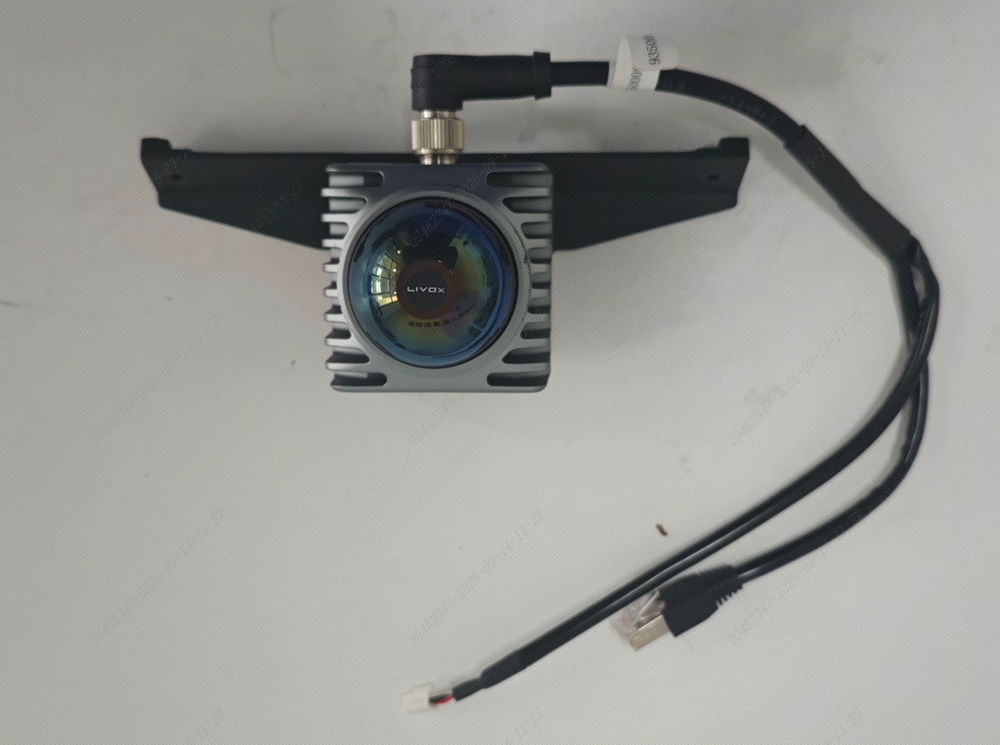
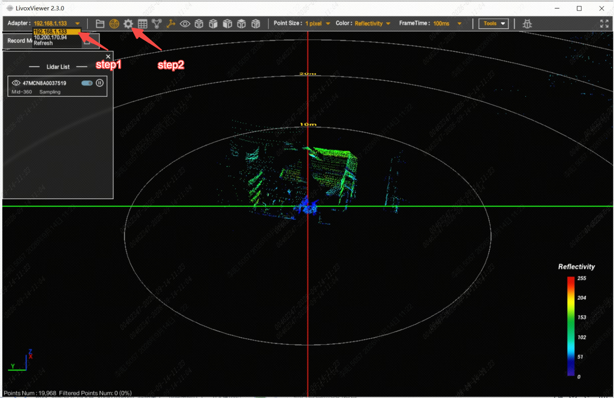
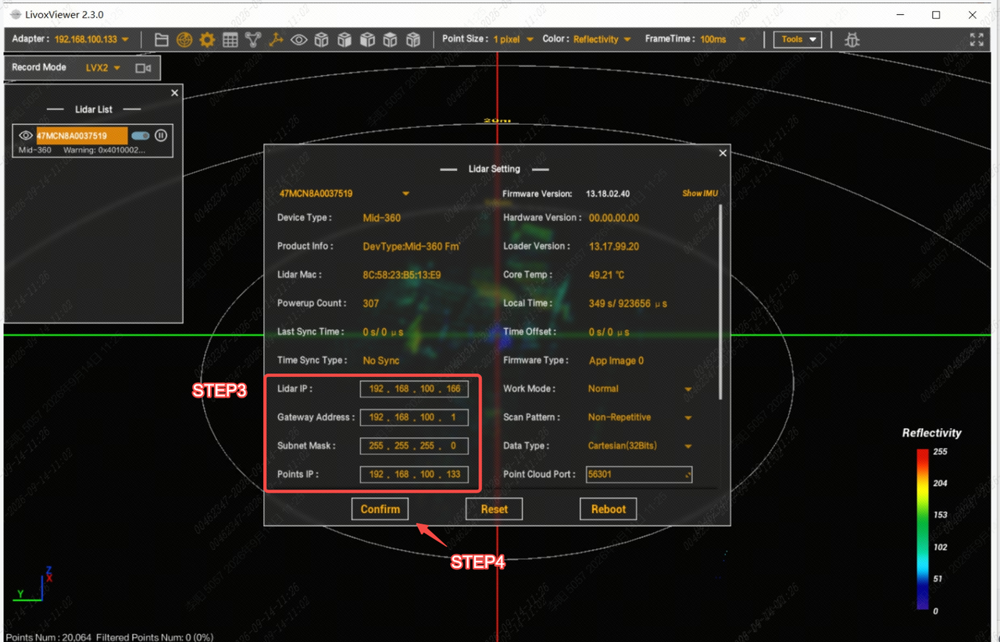
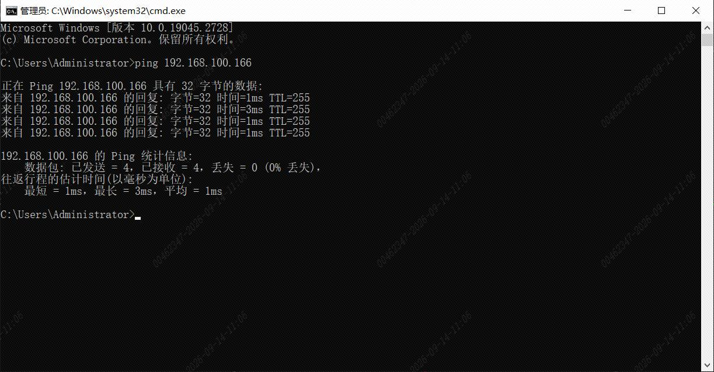

> **适用产品**：墨茵机器人 本文覆盖激光雷达 IP 配置的前置条件与工具、壳体拆卸、线束连接、临时 IP 设置、雷达 IP 配置及保存验证。

## 1 前置条件与工具

- 机器人处于安全停机状态，先断电再拆装。
- 调试笔记本、网线、拆装工具。
- [激光雷达调试软件](https://drive.weixin.qq.com/s?k=AHYAsQcTADcarjMaMv)：`LivoxViewer2.exe`

## 2 操作步骤

### 2.1 拆卸壳体

- 拆卸机器人前、后胸壳体，露出激光雷达。

### 2.2 识别并连接线束

激光雷达与机器人线束包含两个连接器：

> 

- RJ45 接口：用于与机器人中控通信。初始配置时，将该接口从 ORIN 控制器上拔下，连接至调试电脑进行 IP 设置。
- 2PIN 电源接口：用于给激光雷达供电，保持连接在机器人本体上。

### 2.3 上电并检查供电

- 机器人上电开机，观察激光雷达是否有振动。若有振动，说明供电正常。

### 2.4 连接调试电脑并设置临时 IP

- 将激光雷达 RJ45 网口接入调试笔记本，将笔记本本地 IP 设置为 `192.168.1.xxx` 网段，例如：
  - IP 地址：`192.168.1.123`。
  - 子网掩码：`255.255.255.0`。

>    src="/images/image-264.png"
>   alt="Image"
>   title="Image"
>   style={{ width:"68%" }}
> />

### 2.5 使用 LivoxViewer2 配置雷达 IP

- 先打开 `LivoxViewer2.exe`。
- 再选择与激光雷达连接对应的网卡。
- 然后点击设置按钮，进入 IP 配置界面。

> 

- 按以下参数进行配置：

<table>
  <colgroup>
    <col width="123" />
    <col width="206" />
  </colgroup>
  <thead>
    <tr>
      <th>参数</th>
      <th>值</th>
    </tr>
  </thead>
  <tbody>
    <tr>
      <td>Lidar IP</td>
      <td>`192.168.100.166`</td>
    </tr>
    <tr>
      <td>Gateway</td>
      <td>`192.168.100.1`</td>
    </tr>
    <tr>
      <td>Mask</td>
      <td>`255.255.255.0`</td>
    </tr>
    <tr>
      <td>Point IP</td>
      <td>`192.168.100.110`</td>
    </tr>
  </tbody>
</table>

> 

### 2.6 保存、重启并验证

- 保存设置后，激光雷达会重启。
- 此时将调试电脑本地 IP 修改为 `192.168.100.xxx` 网段，重新连接激光雷达，检查雷达工作状态是否正常。

>    src="/images/image-267.png"
>   alt="Image"
>   title="Image"
>   style={{ width:"59%" }}
> />
>
> 

验证项：

- 激光雷达正常上电并有振动。
- `LivoxViewer2` 能发现并连接激光雷达。
- 雷达 IP 为 `192.168.100.166`，Point IP 为 `192.168.100.110`。
- RJ45 接口接回 ORIN 控制器后，机器人中控可正常接收雷达数据。
- 机器人前、后胸壳体恢复，线束固定可靠。
