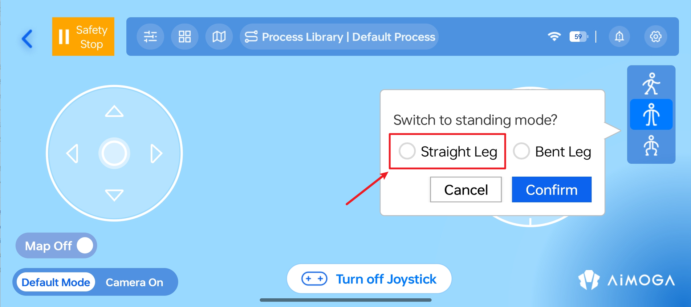
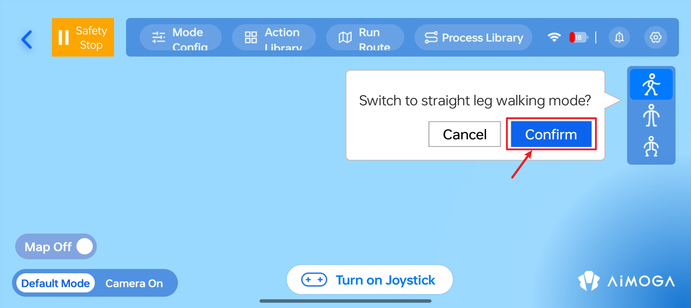
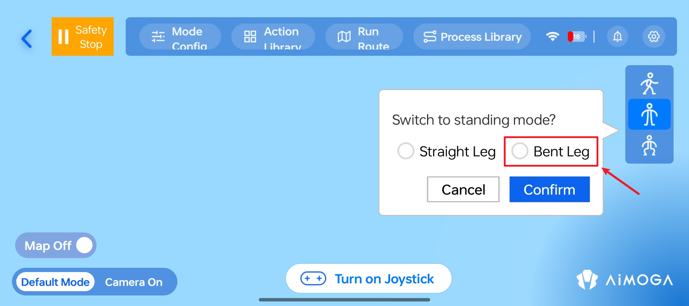
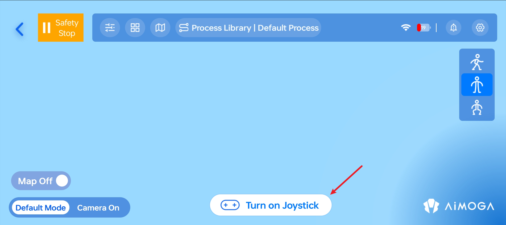
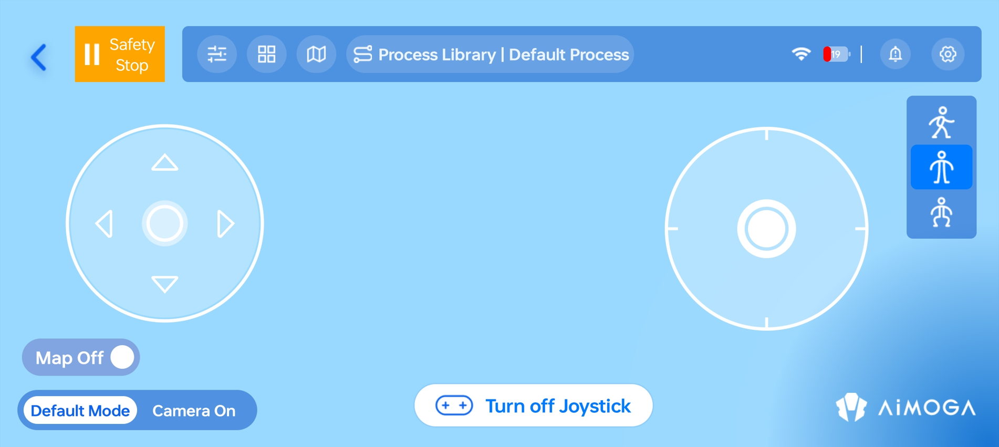
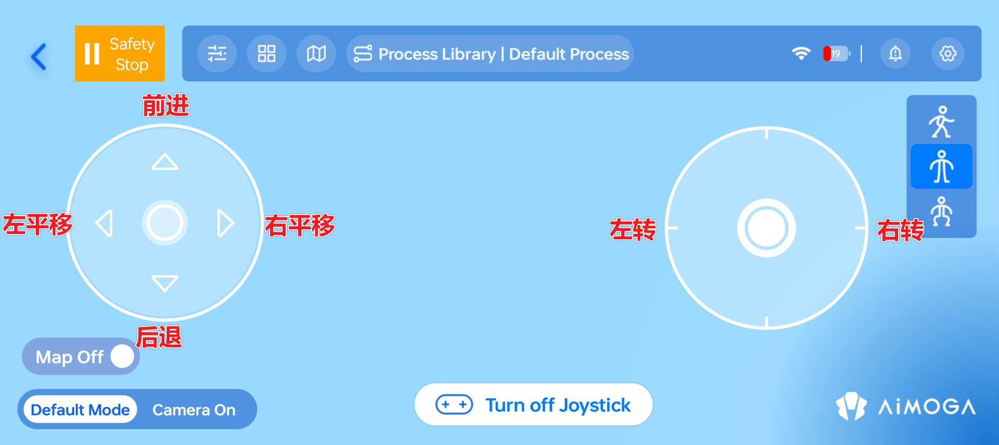

> **适用产品**：墨茵机器人 本文覆盖姿态模式说明、姿态切换、遥控行走及安全注意事项。

## 1 姿态模式说明

| 模式 | 特征 | 状态 |
| --- | --- | --- |
| 曲腿站立 | 非强化位控，待机站支撑，双脚离地 | 开机默认 |
| 直腿站立 | 非强化位控，待机站支撑，双足站立地面，电机负荷大 | 需 APP 切换 |
| 直腿行走 | 可自主移动，上肢轻微摆动 | 需 APP 切换 |

<Warning>
  危险：

  - 直腿站立单次最长不超过 5 分钟，防止电机过热引发摔机。
  - 直腿行走模式下严禁双足同时离地，将导致下肢异常运动。
</Warning>

## 2 姿态切换

### 2.1 曲腿站立切换至直腿站立

- **确保连接：** APP 已连接机器人，机器人处于曲腿站立模式。
- **执行切换：** 点击 APP 主界面右侧“站立姿态切换”图标，选择“直腿”模式，确认切换。

- **等待稳定：** 机器人从曲腿平稳切换至直腿；必要时人工辅助扶稳，防止倾倒。

### 2.2 直腿站立切换至直腿行走

<Warning>
  危险：

  - 切换前必须确认机器人双足站立于地面。
  - 双足离地将导致下肢异常运动。
</Warning>

- **执行切换：** 点击右侧“行走模式”图标，确认切换。

- **等待播报：** 听到“进入直腿行走状态”播报，上肢打开，同步轻微摆动。
- **移除待机站：** 等待播报完成且机器人平稳站立，松开待机站两侧锁扣，此时可平稳移走待机站。

### 2.3 其他切换

#### 2.3.1 直腿行走切换至直腿站立

- 机器人重新点击“直腿行走”图标，确认机器人上肢打开。
- 安装机器人待机站，确认固定完毕。
- 点击“站立模式”图标。

#### 2.3.2 直腿站立切换至曲腿站立

- 点击“站立姿态切换”图标。
- 选择“曲腿”选项。

## 3 遥控行走

- **打开摇杆：** 点击“打开摇杆”按钮，屏幕显示左右两个虚拟摇杆。

- **操控移动：** 左侧摇杆控制前后移动和左右蟹步移动；右侧摇杆控制转向移动。

- **关闭摇杆：** 点击“关闭摇杆”隐藏。

## 4 安全注意事项

<Warning>
  危险：

  - 严禁长时间直腿站立（>5 分钟），电机过热将导致摔倒。
  - 严禁未固定至待机站时切换至直腿站立模式。
</Warning>

<Warning>
  警告：

  - 行走时保持机器人始终在视野范围内。
  - 行走时注意地面环境，不符合要求将导致机器人摔倒。
  - 行走时安全半径 2 m，确保范围内无障碍物及人员。
  - 电机报警、过热异响时立即放置待机站关机。
  - 急停控制器仅限特殊情况使用，非紧急严禁使用。
</Warning>

<Note>
  注意：

  - 模式切换顺序：曲腿 → 直腿站立 → 直腿行走；反向同理。
</Note>
