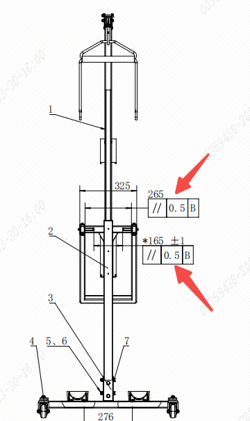
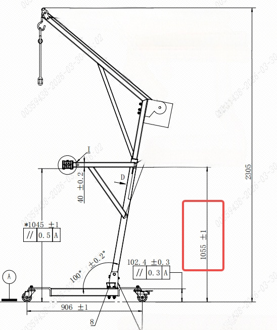
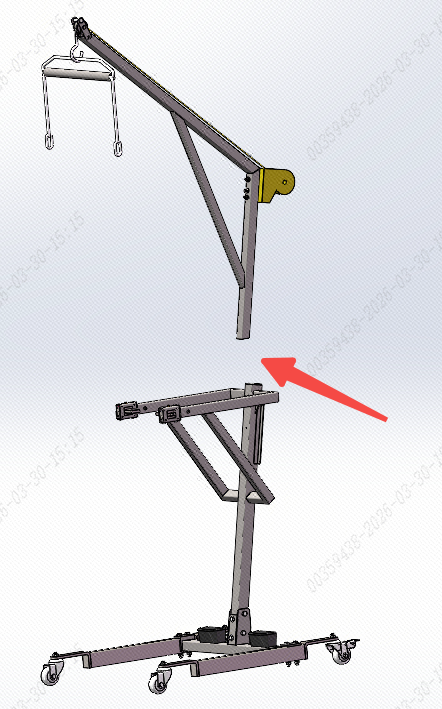

> **适用产品**：墨茵机器人 本文覆盖待机站装箱清单、安装前准备、安装步骤、安装后检查及注意事项。 [附件：待机站组装演示视频](https://drive.weixin.qq.com/s?k=AHYAsQcTADcSJ1zVl0)

## 1 装箱清单

打开包装后，请确认以下部件齐全完好：

<table>
  <colgroup>
    <col width="166" />
    <col width="100" />
    <col width="167" />
  </colgroup>
  <thead>
    <tr>
      <th>部件名称</th>
      <th>数量</th>
      <th>说明</th>
    </tr>
  </thead>
  <tbody>
    <tr>
      <td>底座支架组件</td>
      <td>2 件</td>
      <td>底部支撑</td>
    </tr>
    <tr>
      <td>焊接架一组件</td>
      <td>1 件</td>
      <td>中间连接</td>
    </tr>
    <tr>
      <td>焊接架二组件</td>
      <td>1 件</td>
      <td>高度可调</td>
    </tr>
    <tr>
      <td>抬升支架组件</td>
      <td>1 件</td>
      <td>顶部支撑</td>
    </tr>
  </tbody>
</table>

## 2 安装前准备

### 2.1 工具准备

待机站包装箱中已预留开口扳手用于安装，请额外准备钢卷尺用于安装后的尺寸测量。

### 2.2 安装环境

- 选择平整、坚固的地面进行安装。
- 预留足够的操作空间，便于人员走动。

## 3 安装步骤

<Warning>
  关键尺寸超差将直接导致机器人待机姿态异常和运行稳定性下降。总高度必须严格控制在 1055 mm ± 1 mm；尺寸不合格时必须调整，严禁强行使用。
</Warning>

### 3.1 底座支架与焊接架一安装

- 将两件底座支架组件平放在地面上，确保底面完全接触地面。
- 将焊接架一组件放置在底座支架上方，对准安装孔位。
- 使用 4 颗 M10×90 螺栓配合垫片进行固定。
- 使用扳手按对角线顺序逐步拧紧。

### 3.2 焊接架二安装（关键步骤）

- 安装前检查：测量左右扶手骨架间距应为 165 mm ± 1 mm，横向间距为 265 mm。

- 将焊接架二组件按图示方向安装在已组装好的底座上。
- 使用 4 颗 M10×75 螺栓预紧，此时不要完全拧紧。
- 如图所示，测量从底座底面至抬升支架顶端的总高度。
- 确认尺寸为 1055 mm ± 1 mm，如超差需进行调整。

尺寸调整：

- 尺寸偏小（\< 1054 mm）：松开 M10×75 螺栓，将焊接架二向后调整。
- 尺寸偏大（> 1056 mm）：松开 M10×75 螺栓，将焊接架二向前调整。

调整完成后，按对角线顺序拧紧螺栓。

### 3.3 抬升支架安装

将抬升支架组件按图示方向安装在焊接架组件上。

## 4 安装后检查

### 4.1 紧固检查

- 检查所有螺栓是否拧紧，无松动。
- 检查螺栓是否安装到位，无突出。
- 用手轻摇各部件，确认连接牢固。

### 4.2 稳定性检查

- 将待机站放置在水平地面上。
- 用手轻推，确认无晃动。
- 检查底座四脚是否均与地面接触。

## 5 注意事项

<Warning>
  注意：

  - 安装作业时请佩戴防护手套，避免金属边缘割伤。
  - 所有部件先进行试装，确认配合良好后再拧紧。
  - 拧紧螺栓时按对角线顺序逐步拧紧，避免零件变形。
  - 安装完成后进行全面检查，确认无遗漏。
</Warning>
