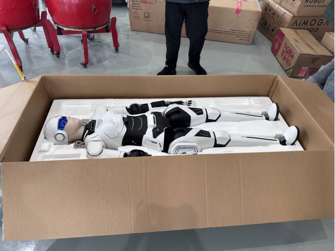
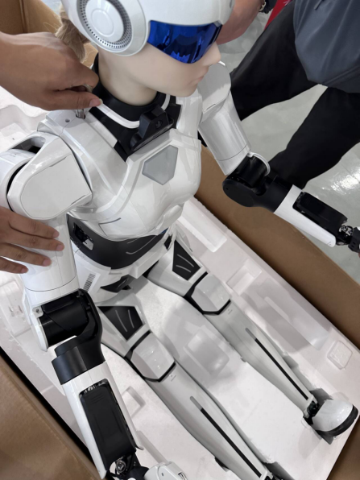
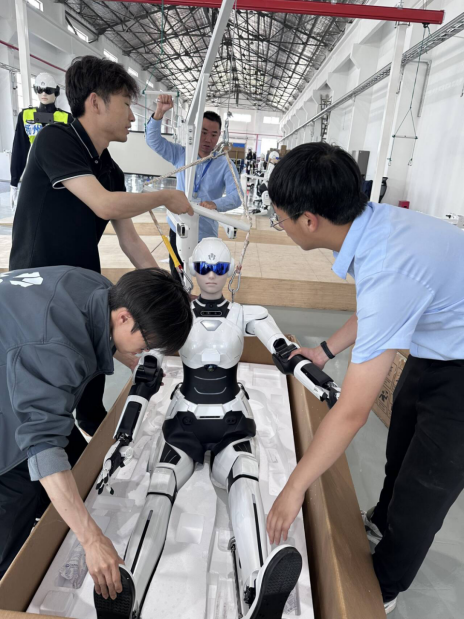
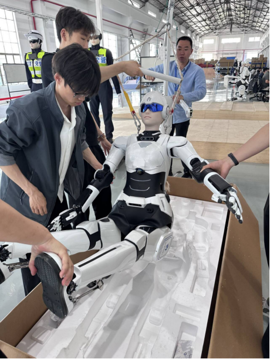
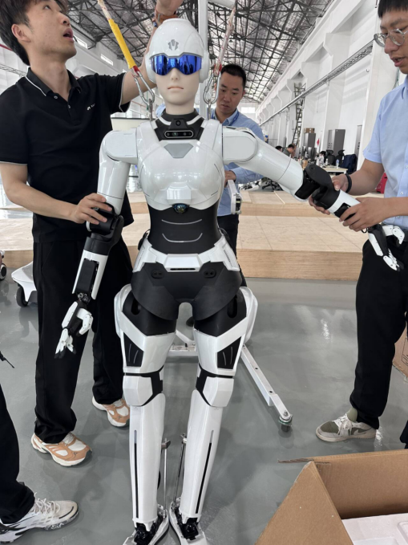
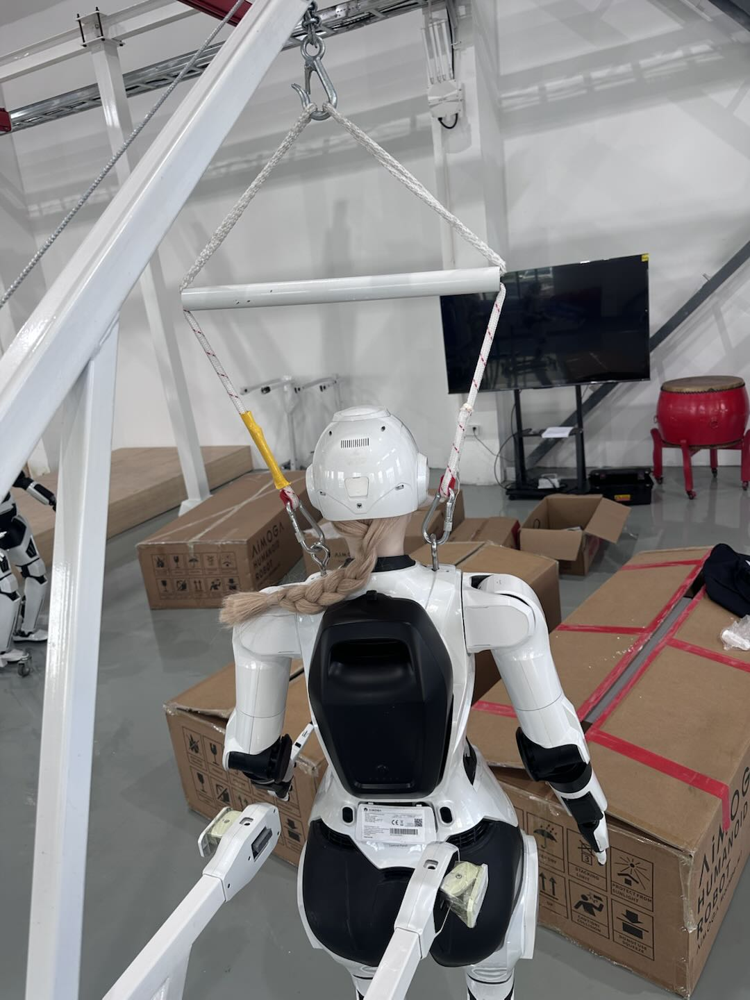
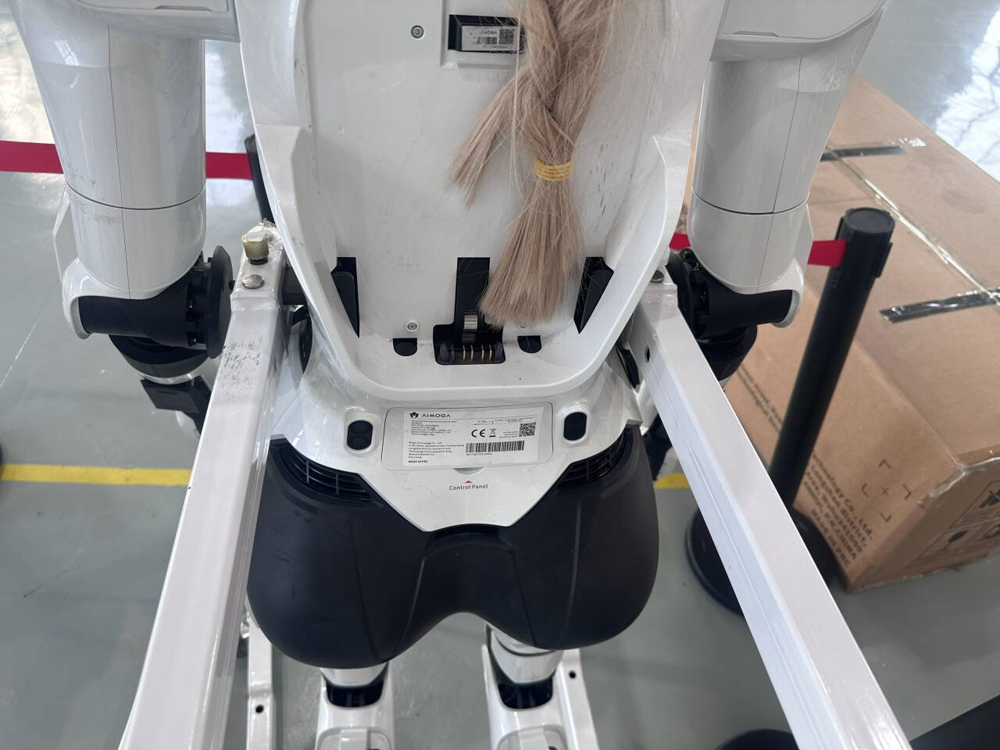

> **适用产品**：墨茵机器人 本文覆盖人员与工具准备、开箱步骤和安全注意事项。 [**附件**](https://drive.weixin.qq.com/s?k=AHYAsQcTADcdNF39rL)：[机器人开箱视频](https://drive.weixin.qq.com/s?k=AHYAsQcTADcdNF39rL)

## 1 人员与工具准备

- 操作人员：不少于 3 人。
- 工具：开箱刀、待机站。
- 场地：地面平整、干净、空旷。

## 2 开箱步骤

### 2.1 打开箱盖

- 划开顶部封条，取下箱盖。
- 取出上层泡沫盖，放在一旁。

### 2.2 扶起机器人

- 先抬起机器人双手，防止卡箱、磕碰。
- 扶住背部和底部，缓慢扶起机器人，使其坐立。

### 2.3 挂装待机站

- 将待机站移至机器人后方。
- 把待机站挂环挂在机器人身上，确保挂牢。

### 2.4 抬起机器人

- 操作待机站人员踩住底座，防止前倾。
- 缓慢摇动摇杆，使机器人臀部离开箱底。
- **全程必须托住机器人双手双脚。**

### 2.5 移出箱体并落地

- 继续缓慢摇动，使机器人完全移出箱外。
- 撤出空箱，缓慢下降待机站。
- 将机器人双脚平稳放至地面，确认站稳后取下挂环。

### 2.6 安装电池

机器人开机站立，状态切换至直腿行走模式。

### 2.7 固定机器人并取出电池

- 将机器人固定在待机站上，腰两侧卡住。
- 确认机器人稳定固定后，取下挂环，取出电池。

## 3 安全注意事项

- 全程不得松手，必须有人托住机器人手脚臀部。
- 摇动摇杆动作平稳缓慢，禁止猛摇、急停。
- 机器人未落地站稳前，严禁撤离保护。
- 开箱过程避免磕碰外壳、拉扯线缆。
