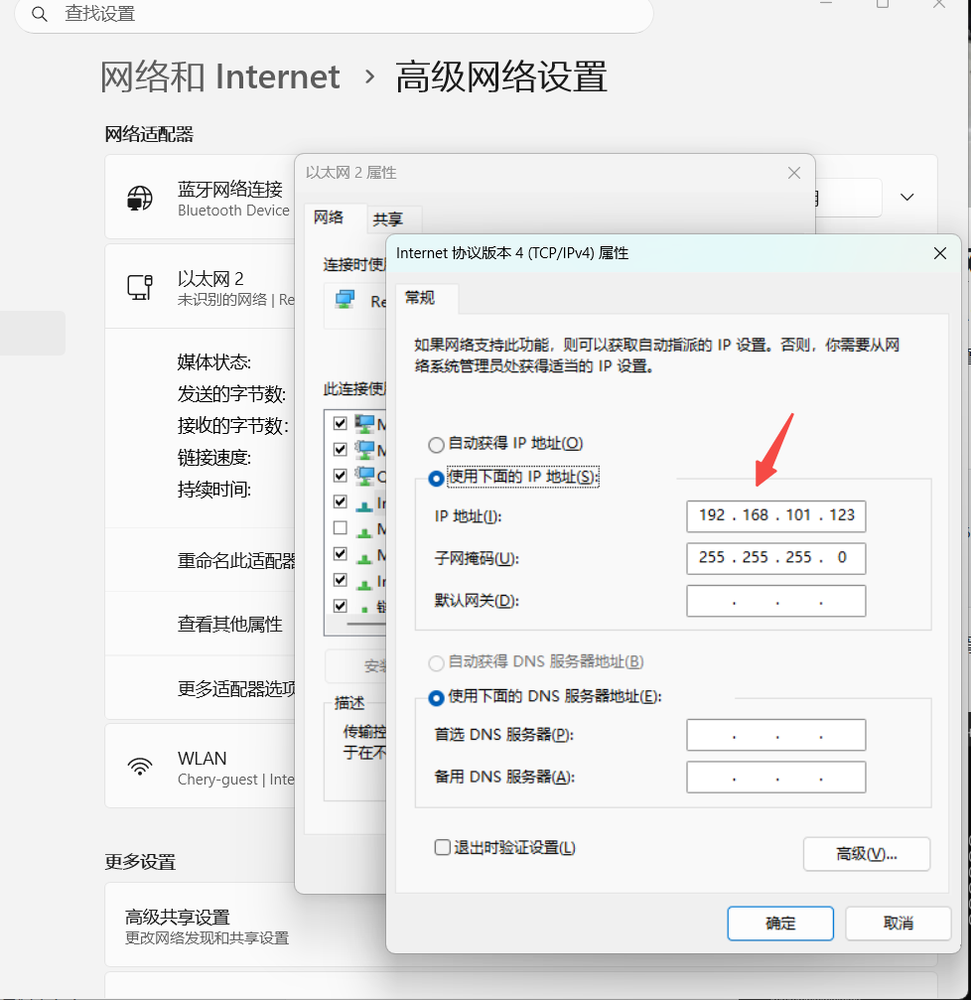
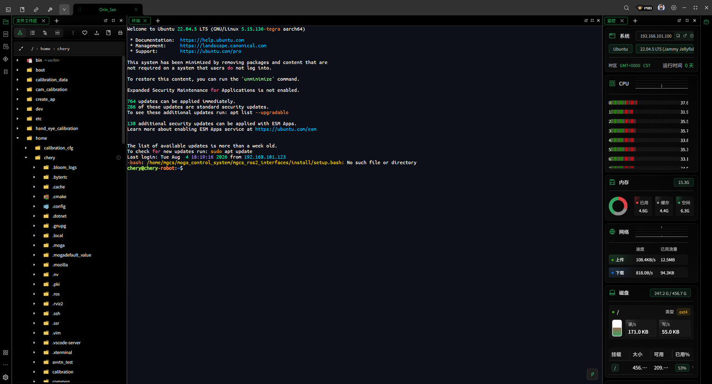
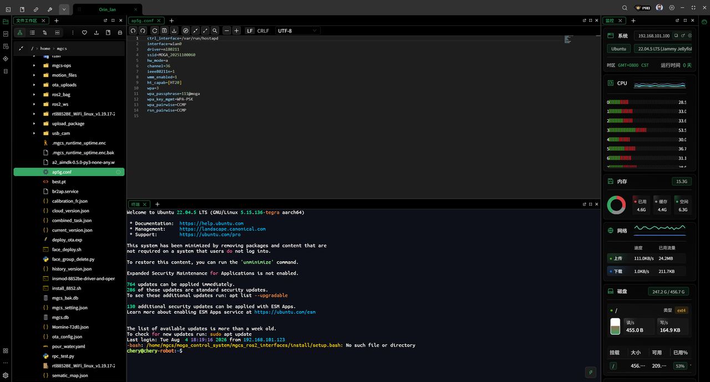
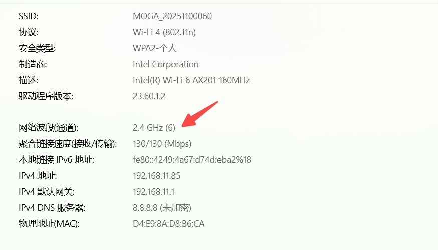

> **适用产品**：墨茵机器人<br />本文覆盖频段切换背景、所需工具、有线连接与配置修改步骤、重启生效及验证排查。

## 1 背景说明

墨茵机器人出厂默认将 Wi-Fi 热点配置在 5 GHz 频段（802.11a/ac）。部分海外市场对 5 GHz 信道的监管要求不同，可能导致当地终端设备（手机、平板等）无法搜索到机器人的热点信号。为解决此兼容性问题，可将机器人热点切换至 2.4 GHz 频段（802.11b/g/n），该频段在全球范围内具有更广泛的兼容性。

本说明文档将指导您通过有线网络连接机器人，修改其 Wi-Fi 配置文件，完成频段切换。

## 2 所需工具

- 一台安装有 SSH 客户端的电脑。
- 一根标准网线（RJ45）。
- 机器人已正常启动并接入电源。

## 3 操作步骤

### 3.1 硬件连接

将机器人与电脑使用有线网络连接。机器人有线网口位于腰部后部右侧，如下图所示（标注位置）：

>    src="/images/image-137.png"
>   alt="Image"
>   title="Image"
>   style={{ width:"72%" }}
> />

- 将网线一端插入机器人网口，另一端插入电脑网口。
- 确认连接牢固，网口指示灯正常亮起。

### 3.2 设置电脑有线网口 IP 地址

机器人有线网口的默认 IP 地址为 `192.168.101.100`。您需要将电脑的有线网口 IP 设置为同一网段内的不同地址，例如 `192.168.101.10`（最后一段可在 `1~254` 之间，但不得与 `100` 重复）。

Windows 设置示例：

- 先打开“控制面板” → “网络和共享中心” → “更改适配器设置” → 右键点击“以太网” → “属性” → 双击“Internet 协议版本 4 (TCP/IPv4)”。
- 再选择“使用下面的 IP 地址”，填入：
  - IP 地址：`192.168.101.10`。
  - 子网掩码：`255.255.255.0`。
  - 默认网关：留空或填 `192.168.101.1`。
- 最后点击“确定”保存。

> 

设置完成后，可用 `ping 192.168.101.100` 测试连通性。

### 3.3 建立 SSH 通讯

打开命令终端，输入以下命令建立 SSH 连接：

```text
ssh chery@192.168.101.100
```

系统提示输入密码，默认密码为 `3333`（输入时不显示字符，正常输入后回车）。

> 

### 3.4 查看并修改热点配置文件

机器人热点配置文件路径为 `/etc/ap5g.conf`。在 SSH 终端中输入：

```text
vi /etc/ap5g.conf
```

此时将显示当前配置文件内容（默认为 5 GHz 配置）。

#### 3.4.1 默认 5 GHz 配置

默认配置内容如下：

```text
ctrl_interface=/var/run/hostapd
interface=wlan0
driver=nl80211
ssid=MOGA_20251100060
hw_mode=a
channel=36
ieee80211n=1
wmm_enabled=1
ht_capab=[HT20]
wpa=3
wpa_passphrase=111@moga
wpa_key_mgmt=WPA-PSK
wpa_pairwise=CCMP
rsn_pairwise=CCMP
```

#### 3.4.2 修改为 2.4 GHz 配置

进入编辑模式：

- 按下键盘上的 `Shift + i`（即大写 `I`）进入插入模式，此时可编辑文件内容。

将 `hw_mode` 从 `a` 改为 `g`，并将 `channel` 改为适合 2.4 GHz 的信道（推荐 `1`、`6` 或 `11`，此处以 `6` 为例）。其他参数保持不变，修改后的完整配置如下：

```text
ctrl_interface=/var/run/hostapd
interface=wlan0
driver=nl80211
ssid=MOGA_20251100060
hw_mode=g
channel=6
ieee80211n=1
wmm_enabled=1
ht_capab=[HT20]
wpa=3
wpa_passphrase=111@moga
wpa_key_mgmt=WPA-PSK
wpa_pairwise=CCMP
rsn_pairwise=CCMP
```

#### 3.4.4 保存并退出

- 修改完成后，按 `ESC` 键退出插入模式，返回命令模式。
- 输入 `:wq`（冒号 + `w` + `q`）并回车，即可保存文件并退出 `vi` 编辑器。

> 

## 4 重启机器人使配置生效

修改配置文件后，需要重启机器人系统才能应用新设置。直接按机器人硬件上的电源键关机再开机。

重启完成后，机器人将使用 2.4 GHz 频段广播热点，SSID 和密码保持不变，此时所有支持 2.4 GHz Wi-Fi 的终端设备均可正常搜索并连接。

## 5 验证与故障排查

- 用手机搜索 Wi-Fi 热点，确认能发现 `MOGA_20251100060`。
- 连接后，可查看手机连接详情中的频率（如显示 2.4 GHz 或信道 `6`）。

> 
