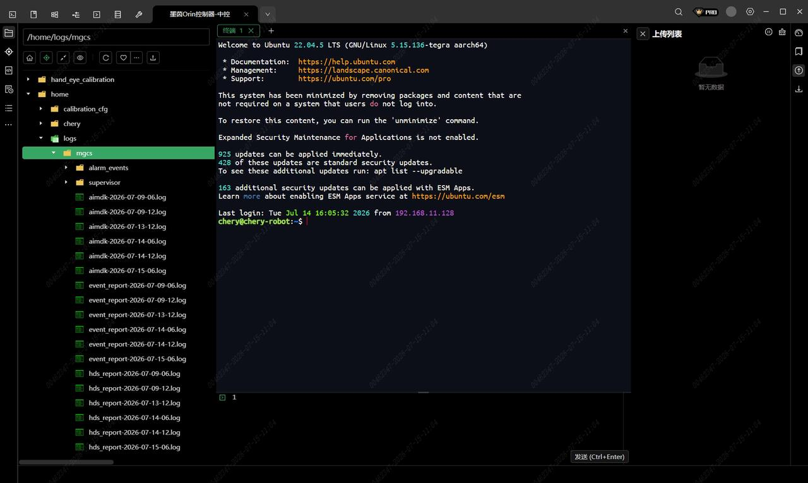
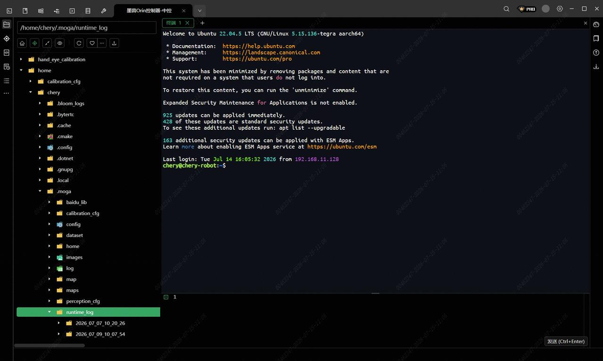

> **适用产品**：墨茵机器人 本文覆盖 ORIN 控制器日志的适用故障场景、准备工作、操作步骤、常见日志文件说明与注意事项。

## 1 适用故障场景

当机器人出现以下异常情况时，需要抓取 ORIN 控制器（中控）日志，供技术人员分析定位问题：

- 机器人上肢控制异常。
- OTA 升级失败或异常中断。
- 中控与其他模块通讯异常。
- SLAM 导航异常（建图失败、定位丢失、路径规划异常等）。
- 其他疑似中控侧导致的故障。

## 2 准备工作

- SSH 工具：Xterminal（推荐）、MobaXterm 等。
- 连接方式：
  - 有线连接：网口 IP `192.168.101.100`。
  - 无线连接：Wi-Fi IP `192.168.100.110`。
- 登录凭据：
  - 用户名：`chery`。
  - 密码：`3333`。

## 3 操作步骤

### 3.1 连接机器人 ORIN 控制器

- 先使用网线将电脑与机器人 ORIN 控制器网口相连，或确保电脑已连接机器人发出的 Wi-Fi 网络。
- 再打开 Xterminal（或其他 SSH 工具），新建 SSH 连接：
  - 主机 IP：`192.168.101.100`（有线）或 `192.168.100.110`（无线）。
  - 端口：`22`。
  - 用户名：`chery`。
  - 密码：`3333`。
- 最后点击连接，登录成功后进入远程文件管理界面。

### 3.2 日志目录路径

- 中控日志目录：`/home/logs/mgcs`，以及`/home/logs/mgcs-ops`

> 

- SLAM 导航日志目录：`/home/chery/.moga/runtime_log`。

> 

### 3.3 导出日志文件

- 先 在 Xterminal 的远程文件管理窗口中，导航至上述日志目录。
- 再选中需要下载的日志文件或整个文件夹。
- 最后右键选择“下载”或直接拖拽到本地电脑目录中，即可完成导出。

### 3.4 提交日志

将导出的日志文件（建议打包为 `.zip` 或 `.tar.gz` 格式）连同以下信息一并提供给我司技术人员：

- 故障发生的时间点（精确到分钟）。
- 故障现象描述。
- 机器人编号/序列号。
- 涉及的日志类型。

## 4 常见日志文件说明

<table>
  <colgroup>
    <col width="267" />
    <col width="481" />
  </colgroup>
  <thead>
    <tr>
      <th>日志文件名</th>
      <th>说明</th>
    </tr>
  </thead>
  <tbody>
    <tr>
      <td>`mgcs_arm_control-日期-时间.log`</td>
      <td>上肢控制日志，记录机械臂动作指令与反馈</td>
    </tr>
    <tr>
      <td>`mgcs_ops_ota-日期-时间.log`</td>
      <td>OTA 升级日志，记录系统固件升级过程</td>
    </tr>
    <tr>
      <td>`mgcs_ops-日期-时间.log`</td>
      <td>中控 OPS 接口日志，记录对外业务接口调用</td>
    </tr>
    <tr>
      <td>`mgcs_task_info-日期-时间.log`</td>
      <td>任务信息日志，记录任务调度与执行状态</td>
    </tr>
    <tr>
      <td>`mgcs_tcp-日期-时间.log`</td>
      <td>中控 TCP 通讯日志，记录与各模块的 TCP 网络通信</td>
    </tr>
    <tr>
      <td>`mgcs_*.log`</td>
      <td>其他中控相关日志</td>
    </tr>
  </tbody>
</table>

<Tip>
  建议：根据故障现象选择对应的日志文件，如无法判断，可打包整个 `mgcs/` 目录全部导出。
</Tip>

## 5 注意事项

- 日志文件可能包含设备运行参数，请勿公开发布，仅用于技术支持。
- 建议在故障发生后立即导出日志，避免日志轮转覆盖关键信息。
- 导出大文件时，优先使用有线网口连接，速度更快更稳定。

<Warning>
  注意：操作时请勿随意修改或删除系统文件，以免影响机器人正常运行。
</Warning>

## 6 技术支持

如按本说明操作仍无法获取日志，或需要进一步协助，请联系我司售后技术支持团队。
