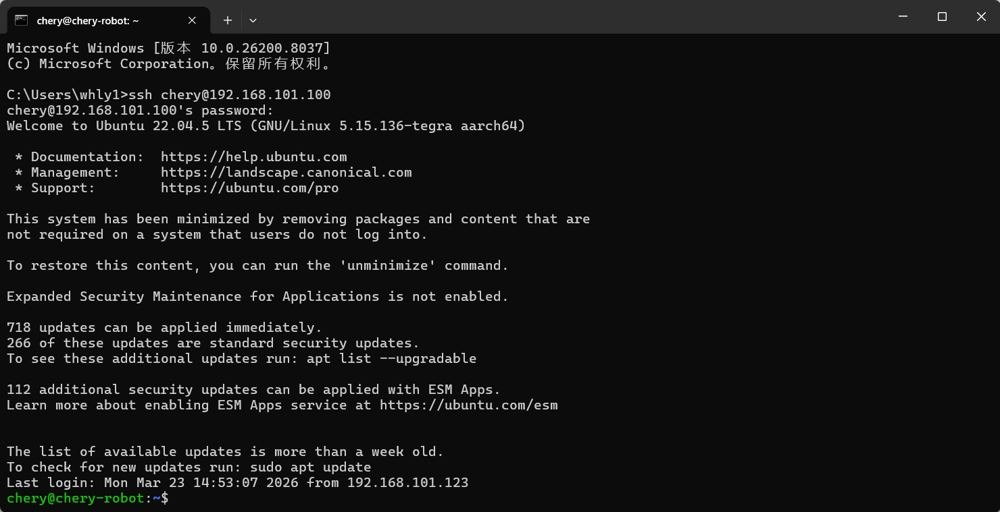
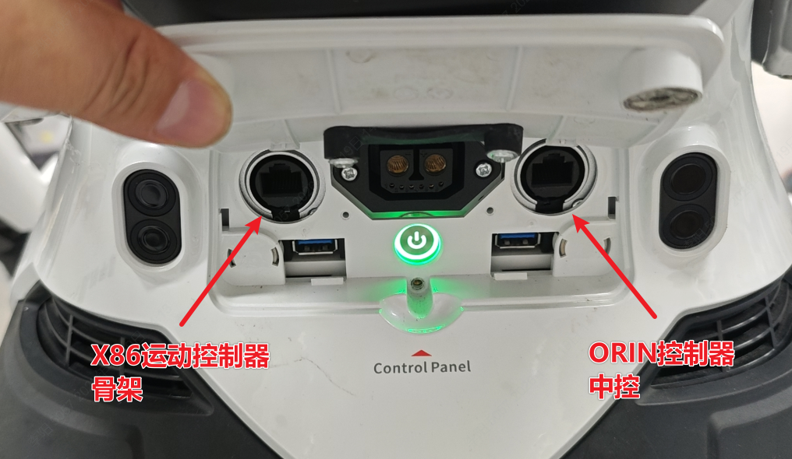
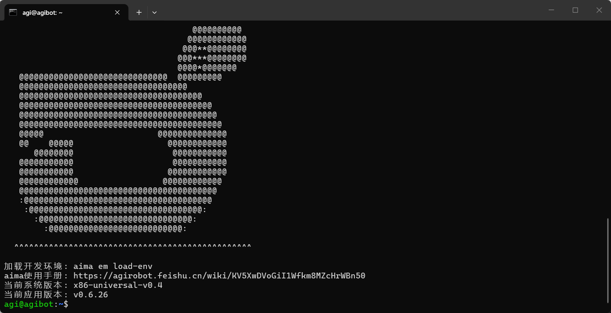

> **适用产品**：墨茵机器人<br />本文覆盖中控 ORIN 的有线网络访问、无线网络访问及网口位置说明。

## **1 机器人中控 ORIN 控制器**

机器人中控支持通过有线网络和无线网络直接访问。

```text
//////////////////有线网络////////////////////
//IP地址：
192.168.101.100
//用户名：
chery
//密码：
3333
//SSH通讯连接命令：
ssh chery@192.168.101.100

//////////////////无线网络////////////////////
//IP地址：
192.168.100.110
//用户名：
chery
//密码：
3333
//SSH通讯连接命令：
ssh chery@192.168.100.110
```



## **2 有线网络连接说明**

- 机器人有线网络通讯使用机器人腰后部的网口。
- 右侧为 ORIN 控制器的连接网口，IP 地址为 `192.168.101.100`。



## 1 机器人中控Orin控制器

机器人中控支持通过有线网络和无线网络直接访问。

```text
//////////////////有线网络////////////////////
**//IP地址：**
192.168.101.100
**//用户名：**
chery
**//密码：**
3333
**//SSH通讯连接命令：**
ssh chery@192.168.101.100

//////////////////无线网络////////////////////
**//IP地址：**
192.168.100.110
**//用户名：**
chery
**//密码：**
3333
**//SSH通讯连接命令：**
ssh chery@192.168.100.110
```


## 2 机器人运控X86控制器

机器人运控支持通过无线网络直接访问，以及通过中控跳转访问。

```text
//////////////////无线网络、中控跳转////////////////////
**//IP地址：**
192.168.100.100
**//用户名：**
agi
**//密码：**
1
**//SSH通讯连接命令：**
ssh agi@192.168.100.100

//////////////////有线网络////////////////////
**//IP地址：**
192.168.2.50
**//用户名：**
agi
**//密码：**
1
**//SSH通讯连接命令：**
ssh agi@192.168.2.50
```



## 3 有线网络连接说明

- 机器人有线网络通讯使用机器人腰后部的网口。
- 左侧为 X86 运动控制器的连接网口，IP 地址为 `192.168.2.50`。
- 右侧为 ORIN 控制器的连接网口，IP 地址为 `192.168.101.100`。


