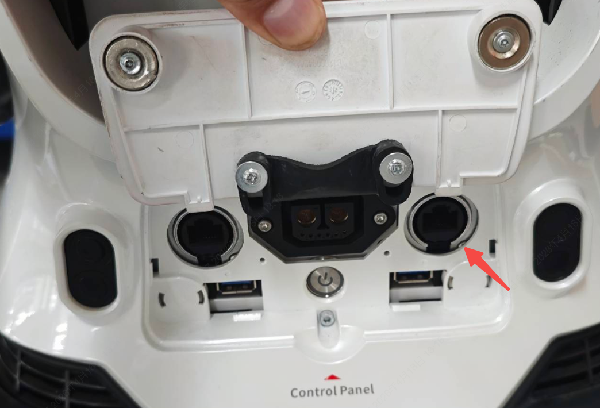
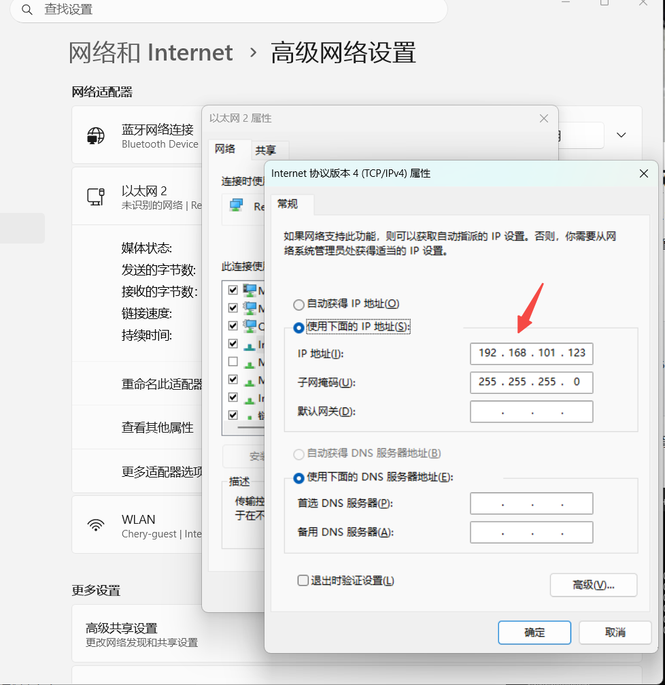
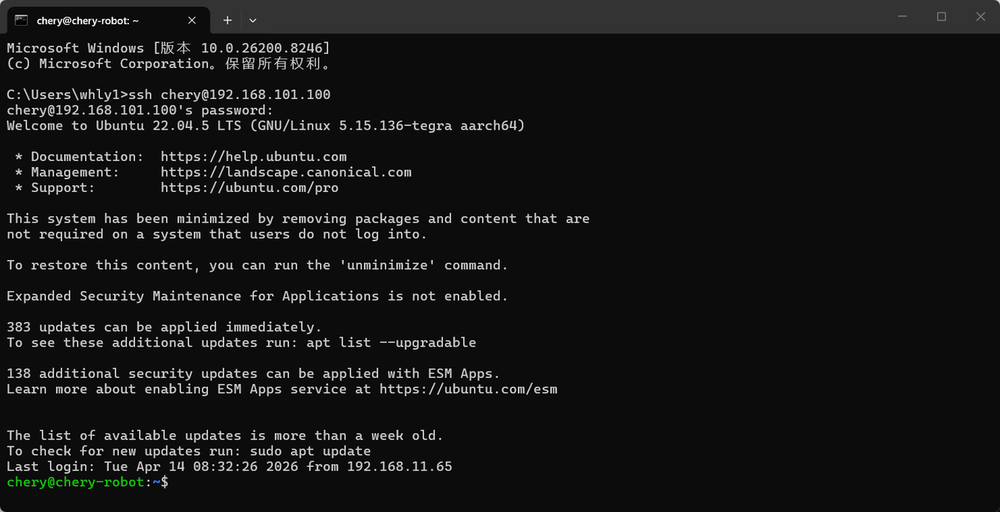
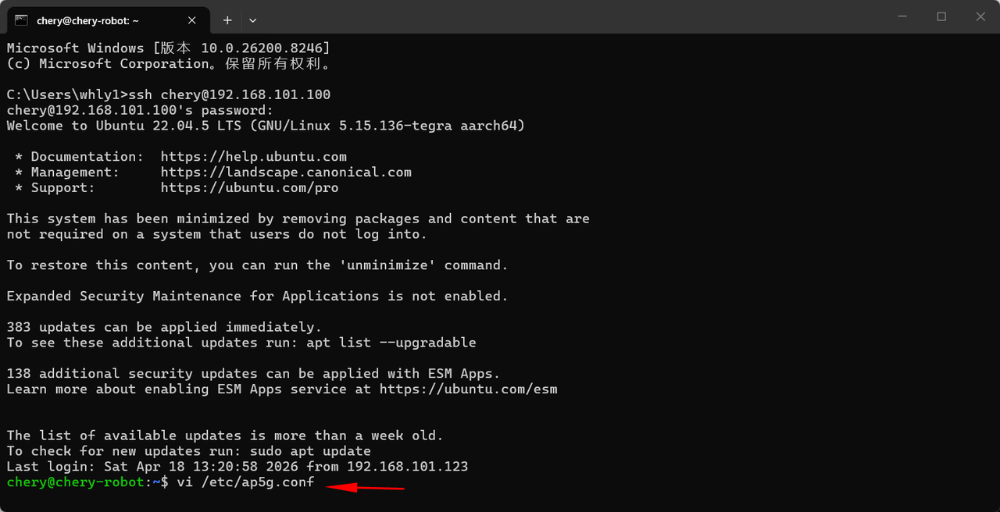
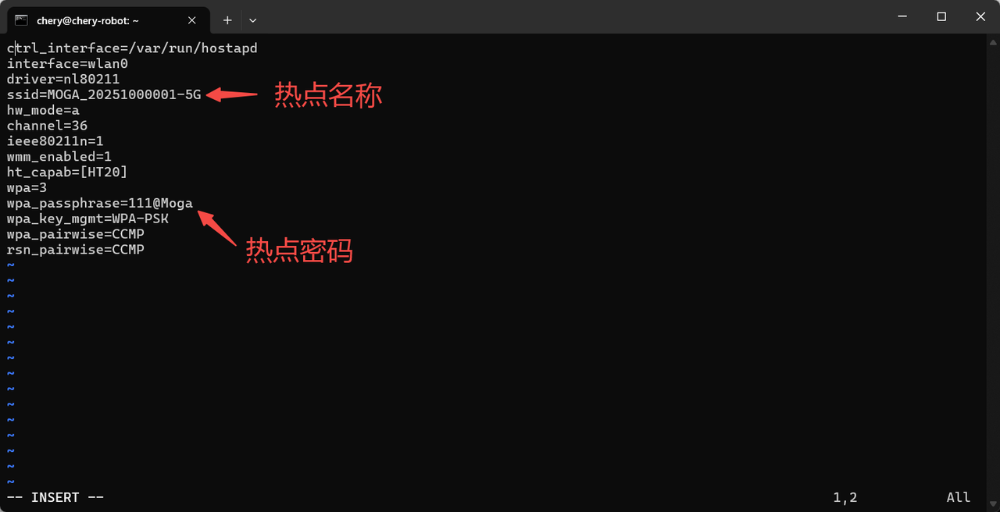

> **适用产品**：墨茵机器人<br />本文覆盖硬件连接、网络 IP 设置、SSH 通讯建立及热点配置文件查看与修改。

## 1 硬件连接

当用户遗忘机器人的 Wi-Fi 热点名称，或需要查询、修改机器人的 Wi-Fi 热点名称与密码时，可通过以下操作步骤实现。

- 将机器人与电脑使用有线网络连接，机器人使用腰后部右侧的有线网口。

> 

## 2 设置网络 IP

- 机器人有线网口 IP 地址为 `192.168.101.100`。
- 将连接的电脑有线网口设置到同一网段的不同 IP：`192.168.101.**`。

> 
>
> 待人工确认：原文内容（图片未提供链接）

## 3 建立 SSH 通讯

- 打开命令终端，输入命令行，建立 SSH 通讯。
  ```text
  ssh chery@192.168.101.100
  //密码：3333
  ```

> 

## 4 查看与修改热点配置

- 输入命令行，查看热点配置文件。
  ```text
  vi /etc/ap5g.conf
  ```

> 

- 查看配置文件内容。

> 

- 使用 `Shift + i` 可以进入编辑模式，对配置文件进行修改。
- 修改后，按 `ESC` 键进入命令模式，输入 `:wq` 保存并退出。
- 关机重启后，修改后的配置生效。
