> **适用产品**：墨茵机器人 本文覆盖 OTA 升级的升级前准备、升级步骤与升级后检查项。

## 1 升级前准备

<table>
  <colgroup>
    <col width="100" />
    <col width="249" />
    <col width="358" />
  </colgroup>
  <thead>
    <tr>
      <th>项目</th>
      <th>要求</th>
      <th>备注</th>
    </tr>
  </thead>
  <tbody>
    <tr>
      <td>起始版本</td>
      <td>V1.5.2 及以上</td>
      <td>V1.5.2 以下版本需先联系技术支持进行升级</td>
    </tr>
    <tr>
      <td>电量要求</td>
      <td>≥60%</td>
      <td>建议充电至 80% 以上，防止升级过程中断电</td>
    </tr>
    <tr>
      <td>网络环境</td>
      <td>稳定 Wi-Fi（2.4 GHz/5 GHz）</td>
      <td>确保下载过程中网络不中断</td>
    </tr>
    <tr>
      <td>预计时长</td>
      <td>60 min</td>
      <td>OTA 升级包文件较大，升级完成时间视网络环境而定</td>
    </tr>
  </tbody>
</table>

<Warning>
  注意：V1.5.2 以下版本因系统架构差异，当前版本除 OTA 升级外还需手动更新软件环境及库文件。
</Warning>

升级前请确保机器人中控 MGCS-OPS 与大脑升级环境已提前部署。

**MGCS-OPS版本**：mgcs-ops_1.6.4_arm64.deb

**aibrain_upgrade_service版本**：aibrain_upgrade_service_v1.7.5_20261104_132105.apk及以上

## 2 升级步骤

<Warning>
  注意：机器人升级前需要将其置于待机状态并固定，升级过程中机器人可能会重启。
</Warning>

### 2.1 推送 OTA 升级包

> 注意：用户需要 OTA 升级时，请联系我司服务人员进行推送。

- 登录生产管理平台。
- 选择目标机器人，推送 OTA 升级文件至分发队列。

> 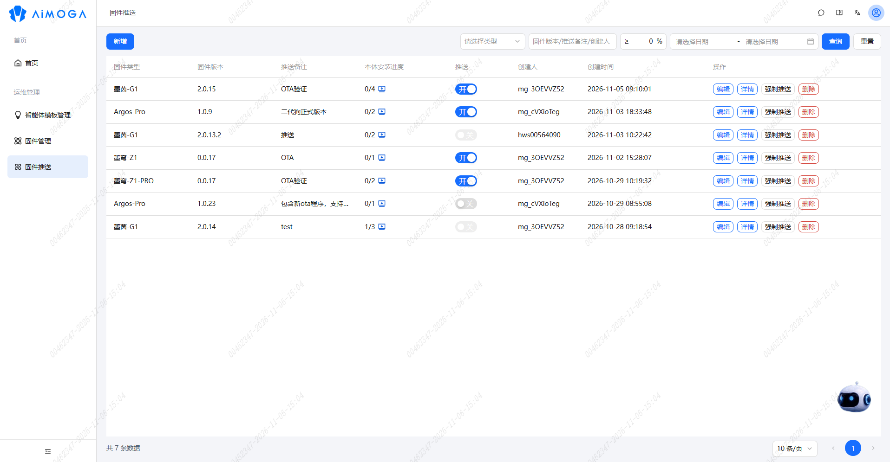

### 2.2 建立本地连接

- 关闭机器人电源，等待 10 秒后重新开机。
- 使用新版本 APP 连接机器人。

> 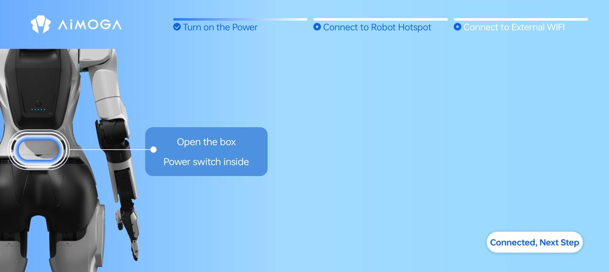
>
> 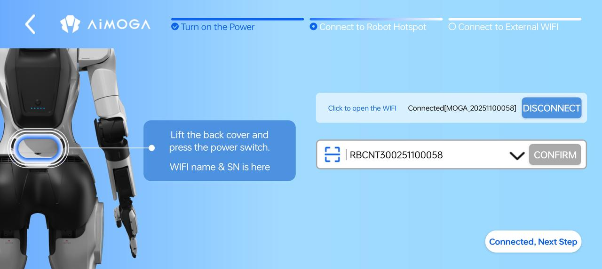

### 2.3 配置外部网络连接

- 通过 APP 设置机器人连接外部网络。

> 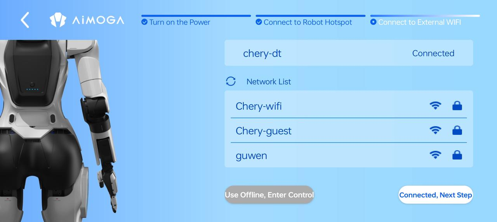

### 2.4 获取升级固件

- 进入 APP「系统设置」→「检查更新」。

> 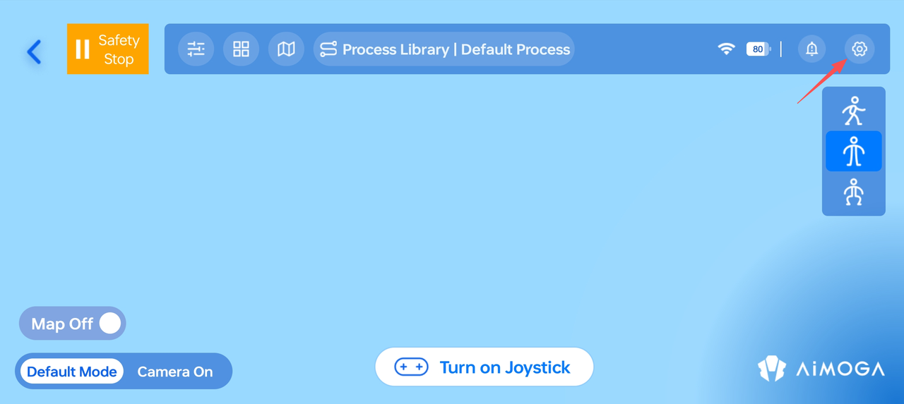

- 检测到新版本后，点击「下载」（在 Wi-Fi 环境下进行）。
- 等待文件下载成功。

> 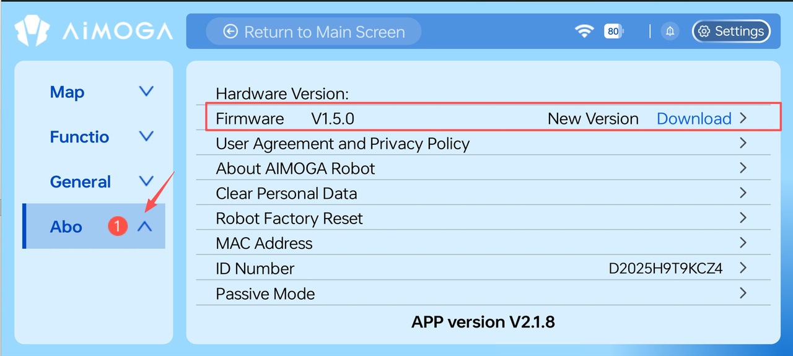
>
> 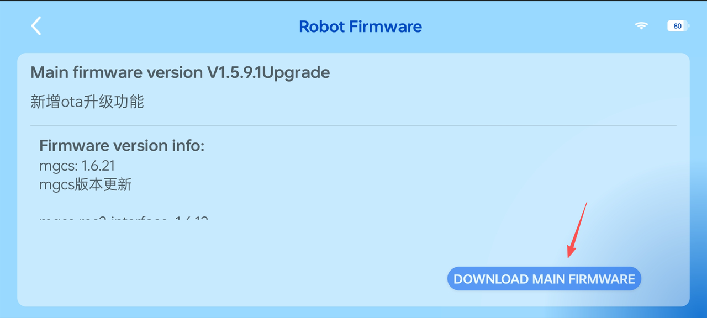
>
> 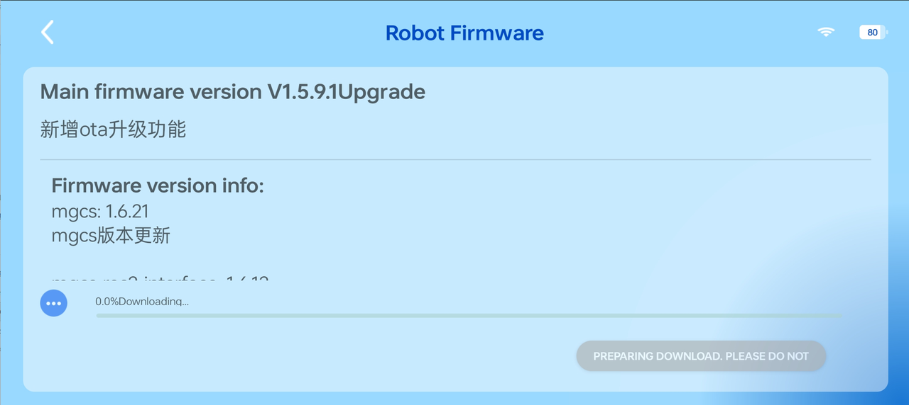
>
> 

### 2.5 进入升级就绪状态

执行以下三项检查，全部满足后方可继续：

- 电量检查：检查 APP 电量显示 ≥60%。

> 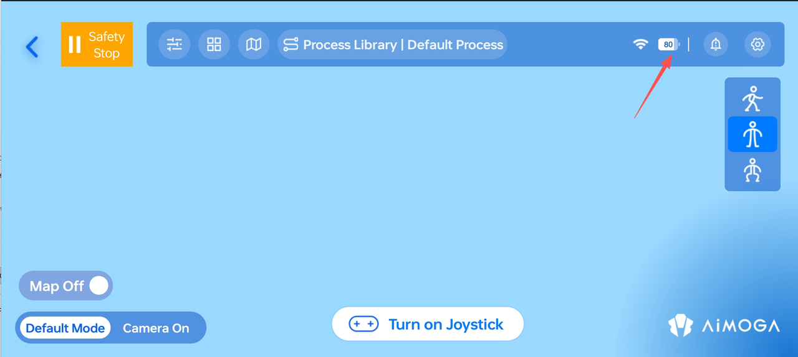

- 流程、角色关闭：在 APP 角色、流程菜单检查关闭执行中的任务。

> 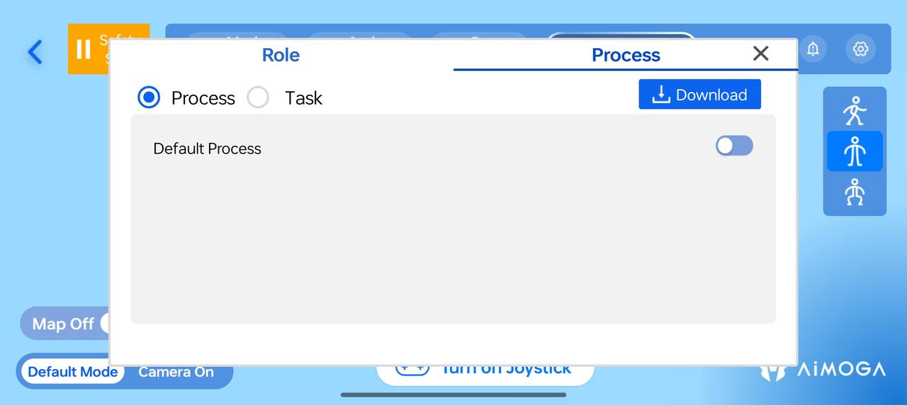
>
> 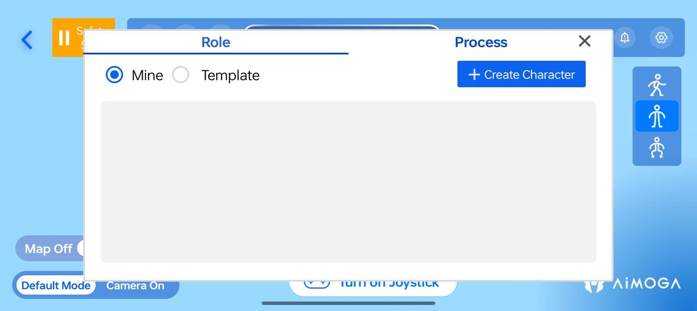

- 卸力模式：找到卸力模式开关，将机器人切换到卸力模式。

> 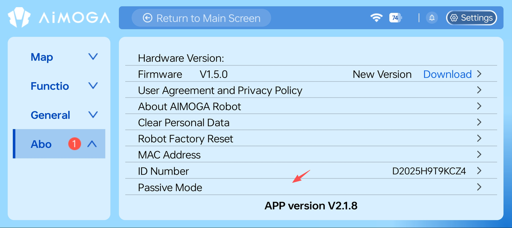
>
> 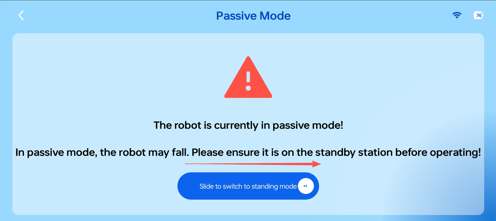

### 2.6 执行 OTA 升级

- 在 APP 内点击「立即升级」。

> 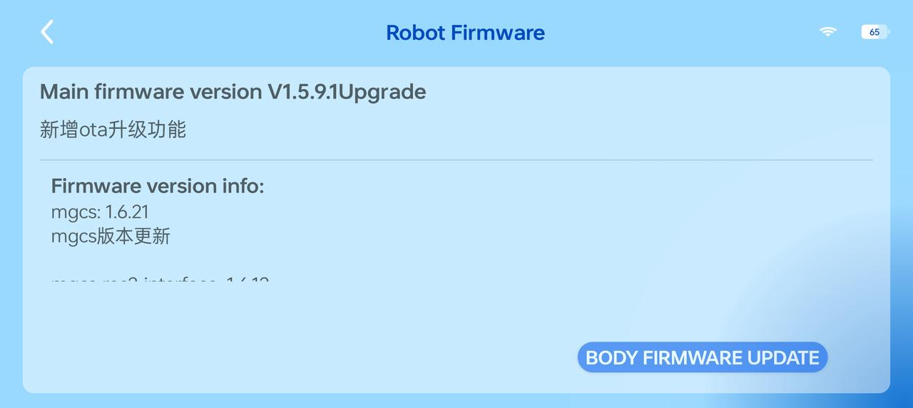
>
> 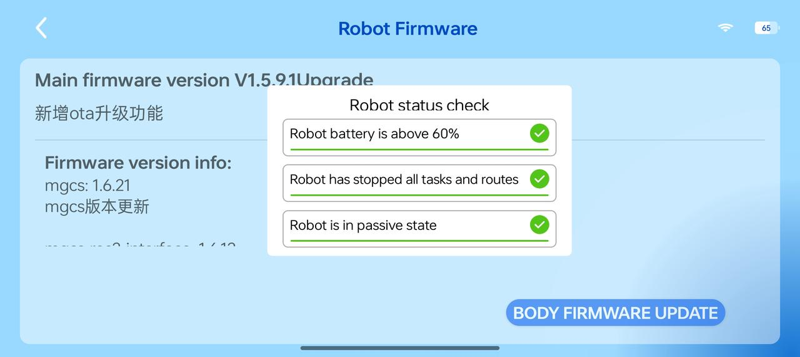
>
> 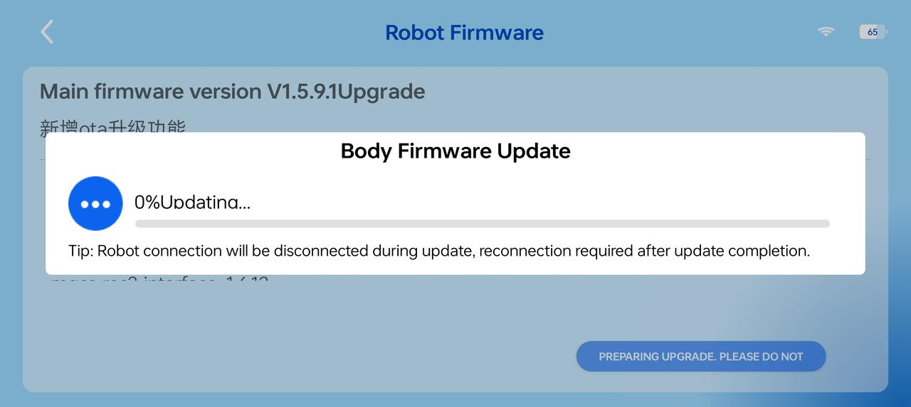

<Warning>
  注意：升级过程中请勿关机；升级过程中机器人可能存在重启；升级如果失败，可以尝试关机重启，并重新点击升级，若仍无法成功升级请联系我司售后服务人员。
</Warning>

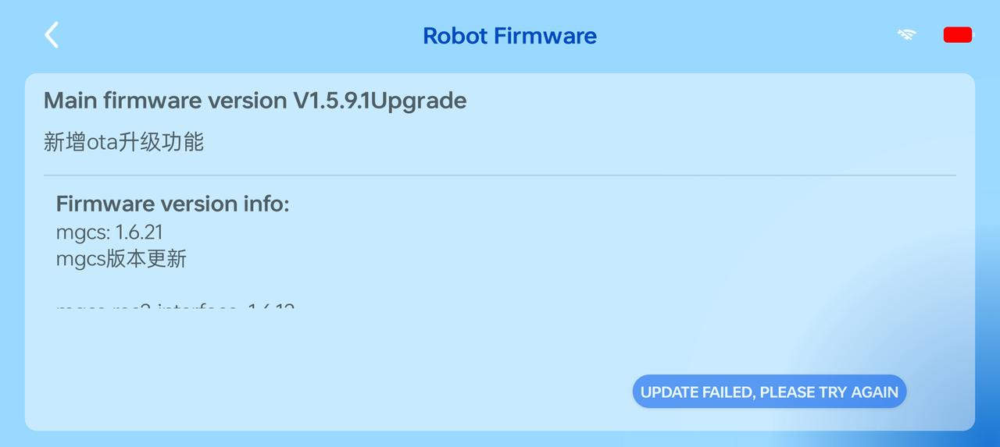

## 3 升级后检查项

升级完成后，请对如下功能进行检测：

- 机器人指示灯检查。
- 机器人姿态切换检查。
- 机器人手动遥控行走检查。
- 机器人上肢动作检查。
- 机器人语音对话检查。
- 机器人扫描建图检查。
