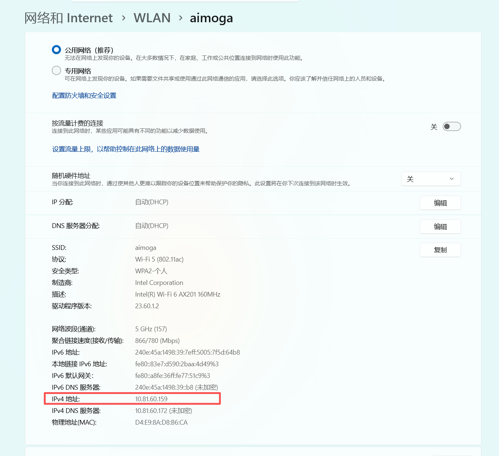
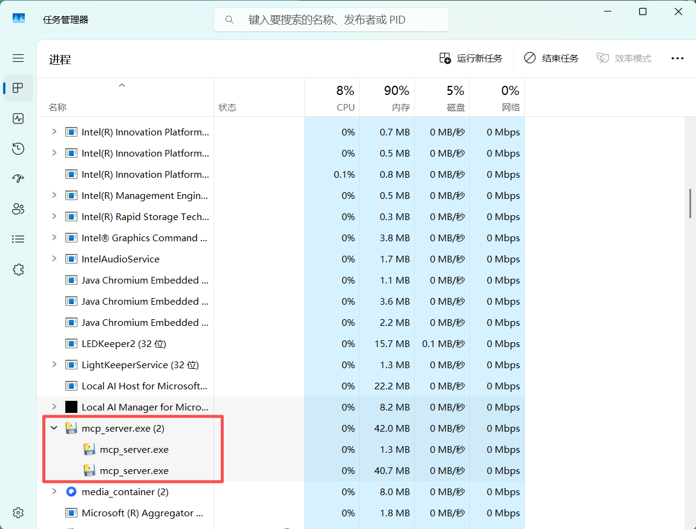
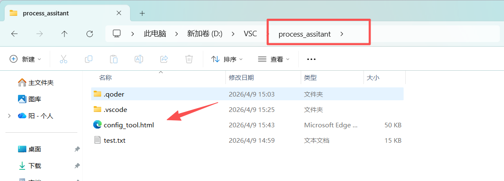
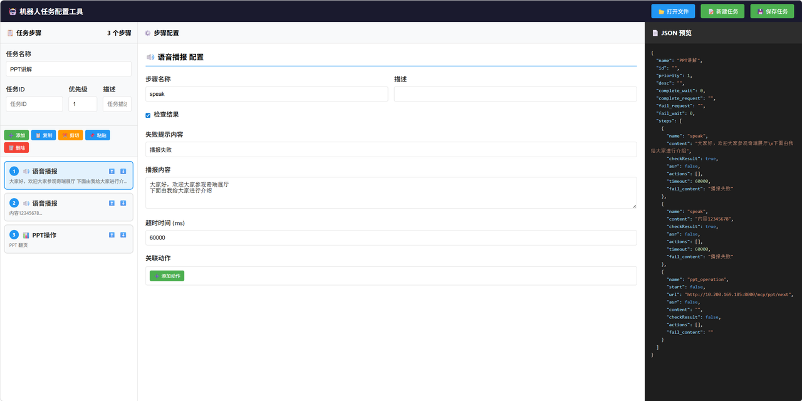
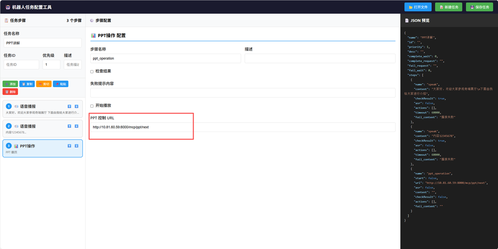
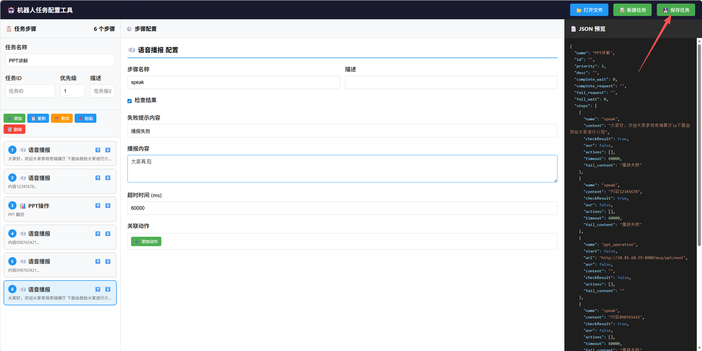
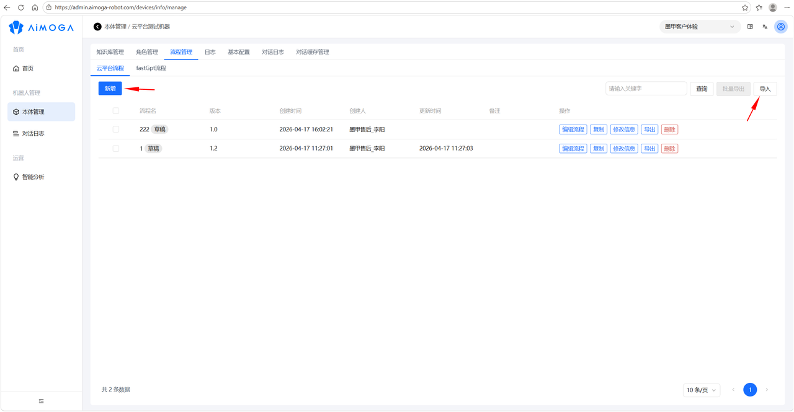
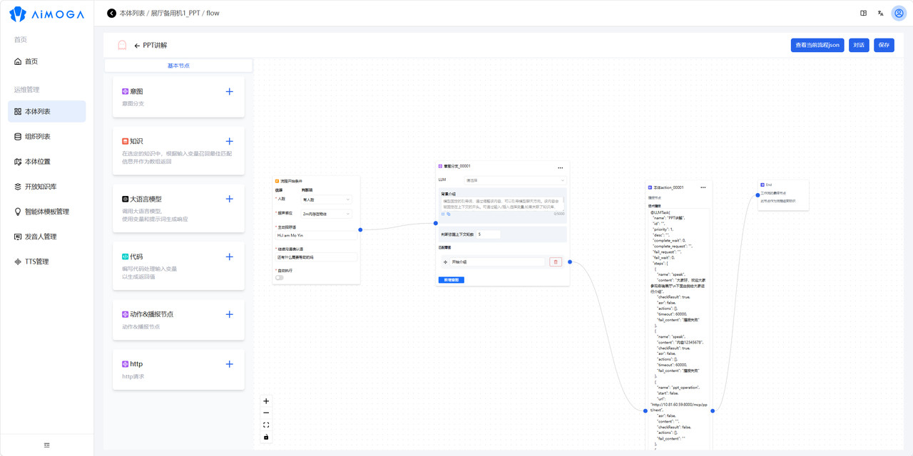

> **适用产品**：墨茵机器人 本文覆盖 PPT 自动讲解的功能概述、详细操作步骤与常见问题排查。

## 1 功能概述

墨茵机器人支持在公司参观介绍、内部培训等场景中进行 PPT 自动讲解。核心功能包括：

- 语音讲解：支持导入讲解词，实现同步语音播报。
- PPT 翻页控制：与电脑端联动，实现讲解过程中的自动翻页。

## 2 详细操作步骤

### 2.1 配置 Wi-Fi 网络

目标：确保机器人与演示电脑处于同一局域网环境。

- 将机器人和需要控制 PPT 翻页的电脑连接到同一 Wi-Fi 网络。
- 在电脑端查看并记录当前 IP 地址（后续步骤需使用）。

示例：Windows 系统可通过命令提示符输入 `ipconfig` 查看 IPv4 地址。

> 

### 2.2 电脑端运行服务器插件

#### 2.2.1 启动 PPT 控制服务器插件

- 在电脑端启动 PPT 控制服务器插件（插件程序由技术支持提供）。

> [MCP_SERVER](https://drive.weixin.qq.com/s?k=AHYAsQcTADc2RBjCFn)

#### 2.2.2 验证程序是否正常运行

- 打开任务管理器 → 查看“进程”列表。
- 确认服务器插件进程已启动。

<Tip>
  建议：插件运行后，电脑端将监听来自机器人的翻页指令。
</Tip>

> 

### 2.3 录入 PPT 讲解词

使用[流程配置助手](https://drive.weixin.qq.com/s?k=AHYAsQcTADcU0gp29D)配置讲解流程

#### 2.3.1 打开配置工具

- 启动 `process_assistant.exe`，进入流程编辑界面。

> 

#### 2.3.2 配置语音播报节点

- 添加“语音播报”动作。
- 录入或导入讲解词文本。

> 

#### 2.3.3 配置 PPT 翻页节点

- 添加“PPT 翻页”动作。
- 关键设置：将 IP 地址替换为配置 Wi-Fi 网络步骤中记录的电脑端 IP 地址。

> 

#### 2.3.4 保存讲解流程

- 按讲解顺序依次配置所有动作节点。
- 保存任务，生成 `.txt` 配置文件。
- 打开生成的 TXT 文件，复制全部内容（后续云平台配置需使用）。

> 

### 2.4 云平台流程配置

#### 2.4.1 进入云平台

- 登录 ARGOS 云平台，导航至：流程管理 → 云平台流程。

#### 2.4.2 创建或导入流程

- 方式 A：新建云平台流程，手动配置。
- 方式 B：直接导入 PPT 讲解 JSON 模板文件。

> 
>
> 

#### 2.4.3 配置关键参数

<table>
  <colgroup>
    <col width="130" />
    <col width="529" />
  </colgroup>
  <thead>
    <tr>
      <th>配置项</th>
      <th>说明</th>
    </tr>
  </thead>
  <tbody>
    <tr>
      <td>语音触发词</td>
      <td>修改为用户自定义的唤醒词（如“开始讲解”）</td>
    </tr>
    <tr>
      <td>动作&播放节点</td>
      <td>在对应节点中粘贴上一步复制的讲解词代码</td>
    </tr>
  </tbody>
</table>

<Warning>
  注意：确保触发词与 APP 端语音指令保持一致。
</Warning>

### 2.5 PPT 讲解测试

#### 2.5.1 准备工作

- 在电脑端使用 Microsoft Office 打开待讲解的 PPT 文件。
- 确保电脑端服务器插件处于运行状态。

#### 2.5.2 机器人端操作

- 打开手机 APP，下载并加载配置好的云平台流程。
- 启动流程，进入语音对话模式。

#### 2.5.3 触发测试

- 说出云平台配置的语音触发词（如“开始讲解”）。
- 观察机器人是否正常播报讲解词，以及电脑端 PPT 是否同步翻页。

## 3 常见问题排查

| 现象 | 可能原因 | 解决方案 |
| --- | --- | --- |
| PPT 无法翻页 | 电脑与机器人不在同一网络 | 检查 Wi-Fi 连接，确认 IP 地址正确 |
| 语音未播报 | 触发词配置错误 | 核对云平台与 APP 端触发词一致性 |
