> **适用产品**：墨茵机器人<br />本文覆盖升级文件获取、升级环境安装、OTA 升级、动作库导入及爵士舞音乐导入。

## 1 升级文件获取

升级环境与升级包详见软件版本说明，可从企业微信云盘获取 OTA 环境与升级包。

## 2 升级环境安装

### 2.1 大脑升级环境更新

- 机器人使用 APP 连接网络。
- 使用 `scrcpy` 软件连接到大脑安卓开发板并投屏。
- 拖入 `aibrain_upgrade_service_v1.7.5_20261104_132105.apk` 执行软件安装。

> 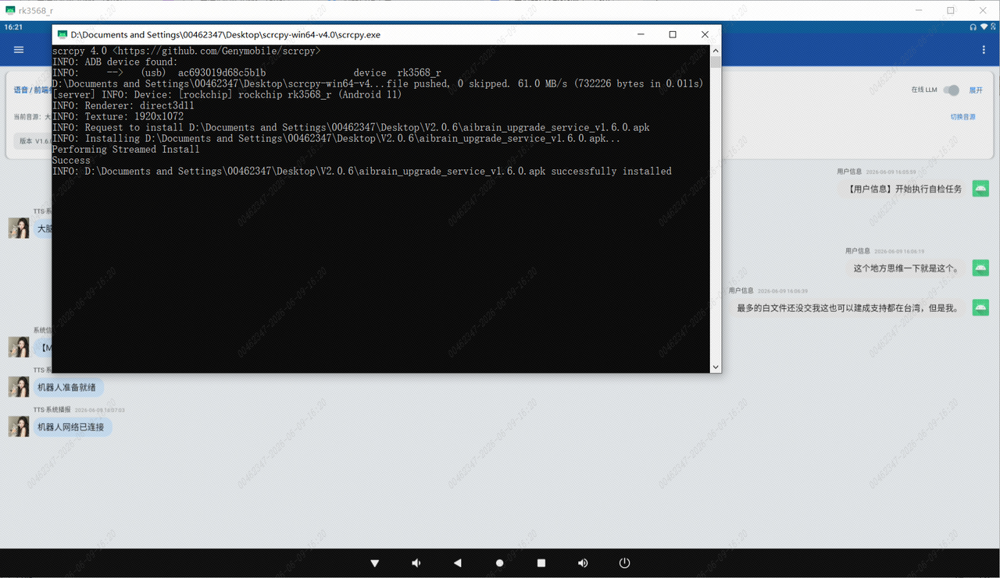
>
> 待人工确认：原文内容（图片未提供链接）

### 2.2 中控升级环境更新

- 使用命令终端工具通过 SSH 通讯访问机器人中控 ORIN 控制器。
- 传输文件 `mgcs-ops_1.6.4_arm64.deb`。

> 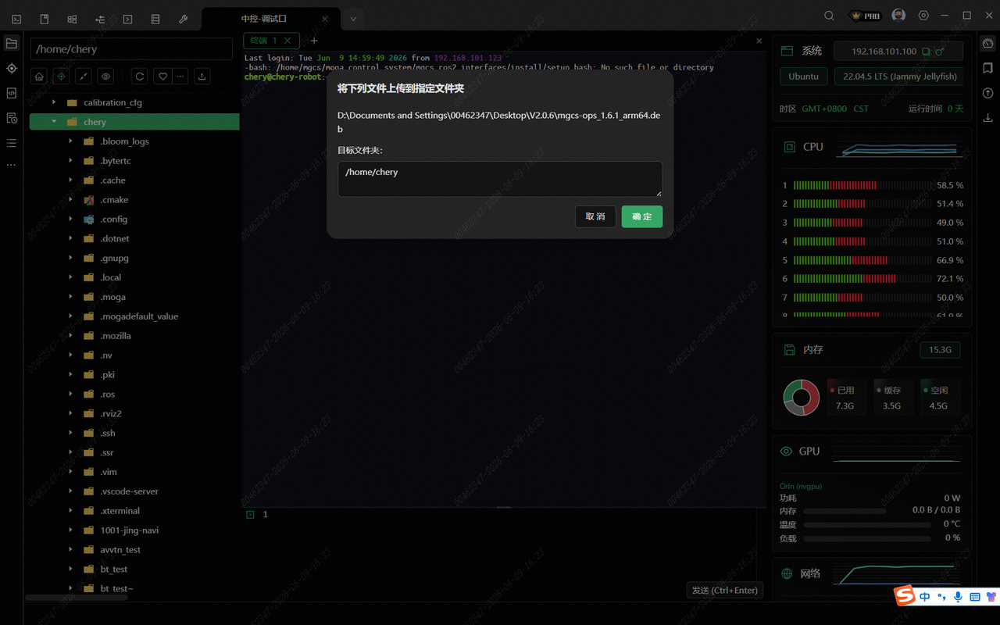
>
> 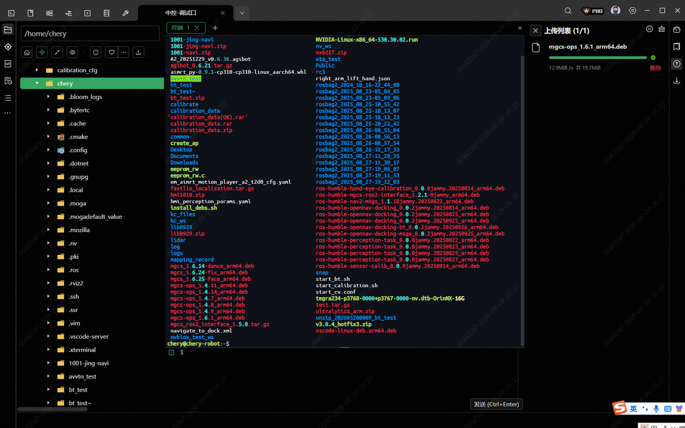

- 执行安装命令：

```bash
sudo dpkg -i mgcs-ops_1.6.4_arm64.deb
```

> 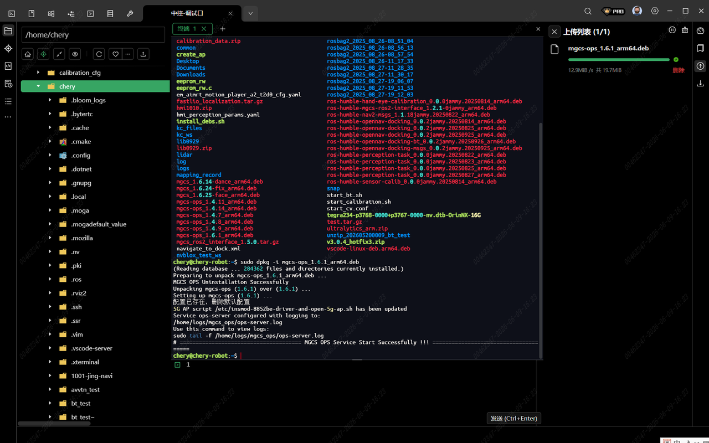

## 3 访问中控执行 OTA 升级

> 待人工确认：原文内容（原文为“暂时无法在 iChery 文档外展示此内容”）

- 机器人安装完升级环境后，关机重启，等待环境生效。
- 机器人访问中控页面：`http://192.168.101.100:8887/docs#/`。

> 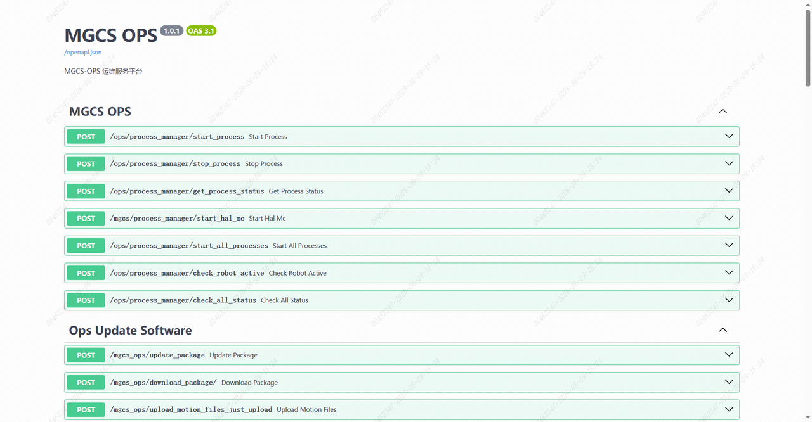

### 3.1 上传升级包

- 调用接口 `/mgcs_ops/ota_operation/upload_zipfile`，上传文件 `robot_2.0.6.zip`。

> 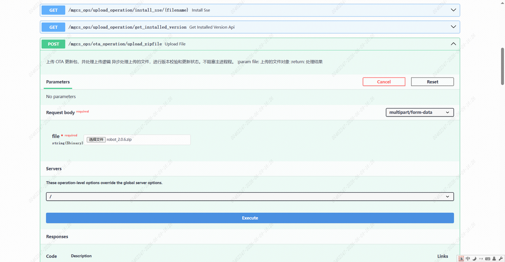

- 或者使用命令终端软件通过 SCP 传输文件到 `/mgcs_ops/ota_operation/ota_update` 目录并解压。

> 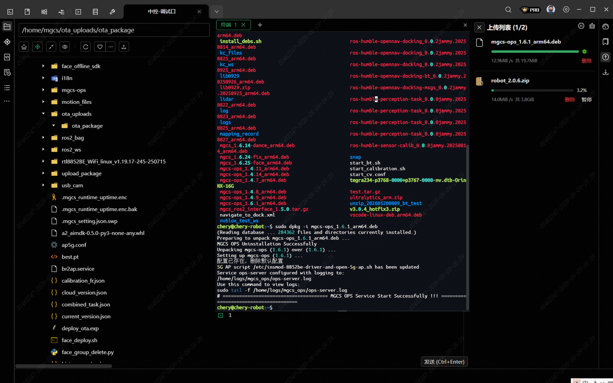
>
> 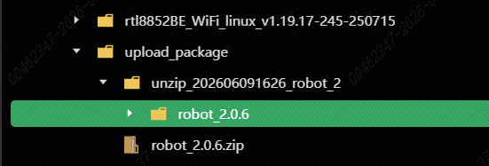

### 3.2 获取解压后的目录路径

- 通过 MGCS 文件上传接口，上传成功后获取解压后的文件目录，或者通过命令终端软件获取路径。

例如：

```text
/home/mgcs/upload_package/unzip_202606091626_robot_2/robot_2.0.6
```

### 3.3 执行 OTA 更新

- 调用接口 `/mgcs_ops/ota_operation/ota_update`，替换 OTA 文件目录执行安装。

> 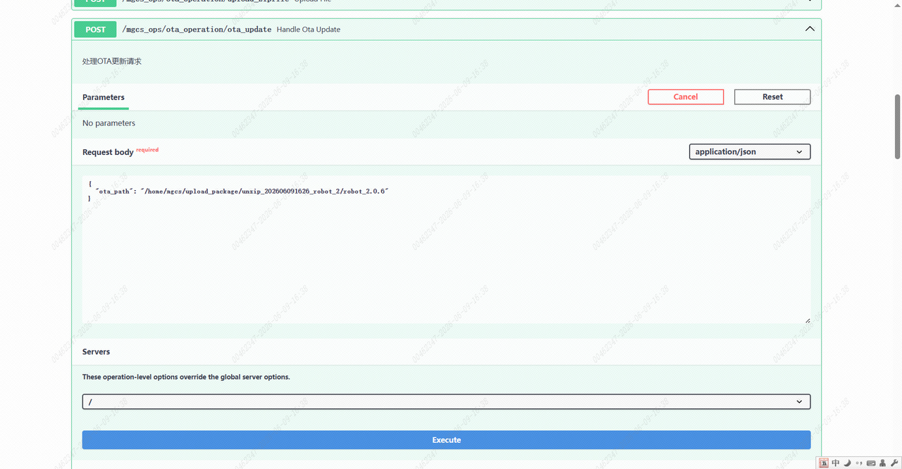

### 3.4 查询升级状态

- 调用接口 `/mgcs_ops/ota_version_management/get_update_version_status`。

> 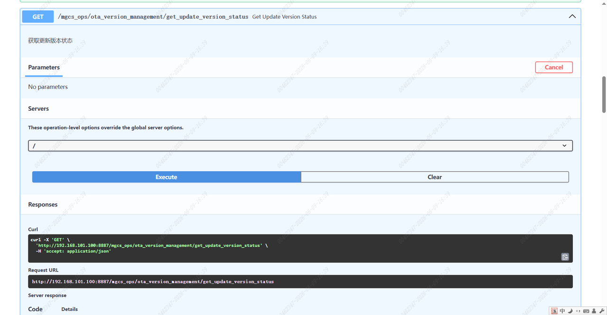
>
> 待人工确认：原文内容（图片未提供链接）

- 每点击一次 Execute，刷新一次状态。

> 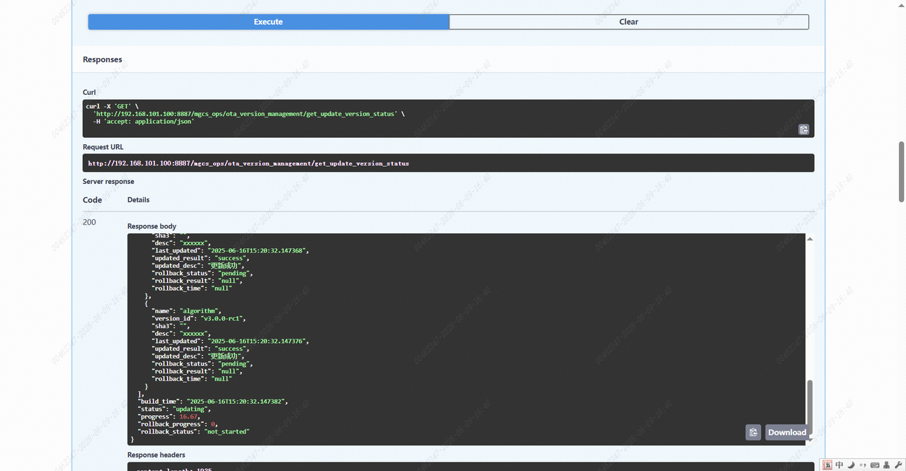
>
> 待人工确认：原文内容（图片未提供链接）

- 进度显示 100% 且状态为 `updated` 时，表示更新成功。

> 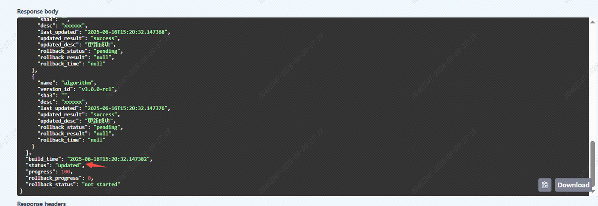

- 若升级失败，状态显示 `update_failed`，可以确认升级失败的部分。

> 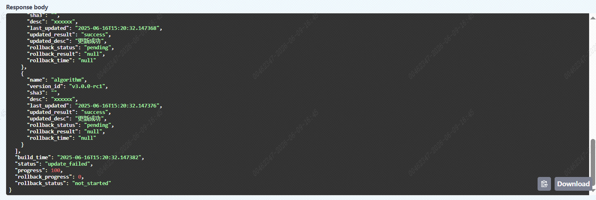

- 可尝试重启设备，重新输入路径后再次执行升级。

## 4 导入动作库

- 机器人访问中控页面：`http://192.168.101.100:8887/docs#/`。
- 使用接口 `/mgcs_ops/upload_action_files`，选择 `action_consolidated.zip`，执行动作库上传。

> 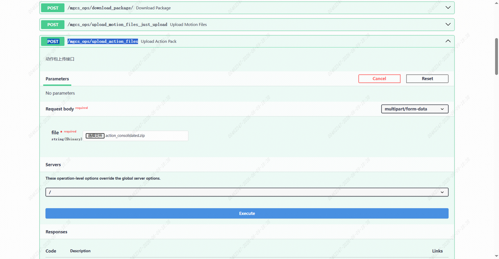

- 查看动作文件上传情况。

> 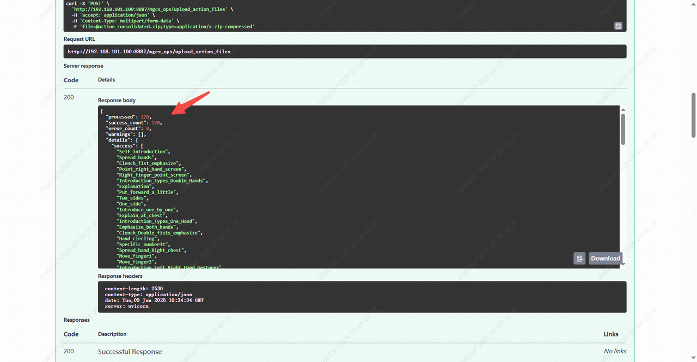

## 5 导入爵士舞音乐

- 准备文件：
  - `藏族舞.mp3`
  - `爵士舞.mp3`
- 存放位置：`adb tool` 文件夹下。
- 执行脚本：双击运行 `push_aibrain_music.bat`，脚本将自动完成音乐文件推送至机器人指定目录。

> 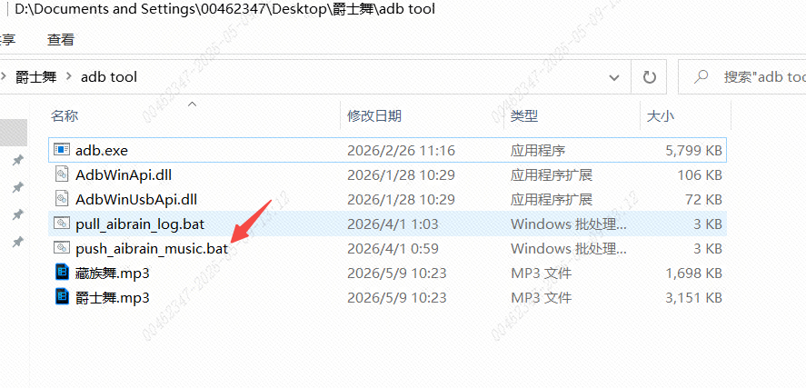
>
> 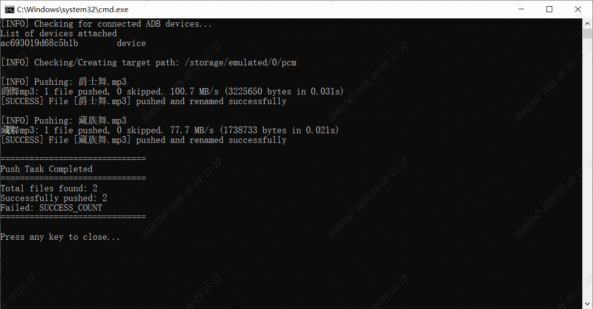
