---

> **适用产品**：Argos X1 机器狗 本文覆盖电池安装、电源开启、设备连接、功能操作、关机、安全注意事项、常见问题与使用须知。

## **1 电池安装**

### **1.1 取出电池**

- 从充电区取一块充满电的机器狗电池。
- 长按电池电源 2 秒开启电池开关。
- 短按按钮可查看剩余电量（通过指示灯显示）。

> 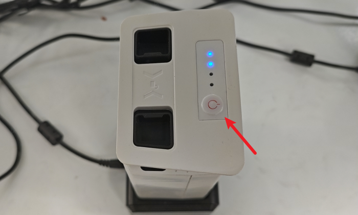

### **1.2 安装步骤**

- 打开机器狗侧边电池仓（电池指示灯在上侧）。

> 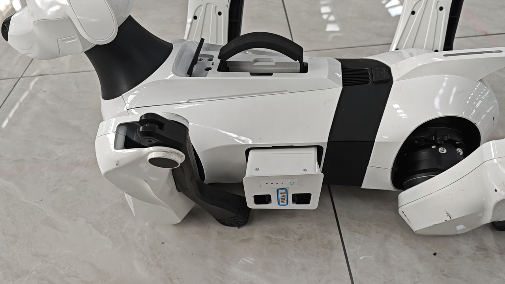

- 将电池（指示灯面朝上）平稳推入仓内直至卡扣锁定。

> **【警告】** 务必检查卡扣锁定，避免电池使用过程中弹出。
>
> 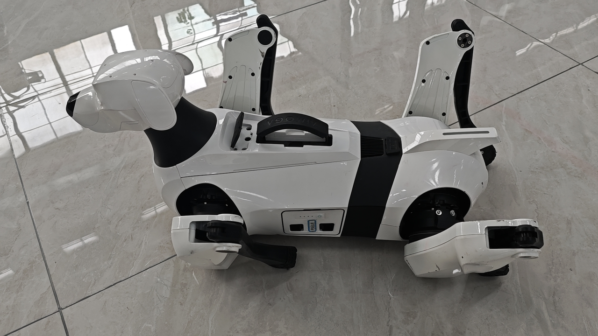

- 确认电池安装牢固无松动。

## **2 电源开启**

> **【注意】** 开机前手动调整腿部至初始待机位置。

> <video src="/videos/124817094.mp4" controls />

开机操作：

- 长按电池开关 2 秒至指示灯亮起。

> <video src="/videos/195181703.mp4" controls />

- 松开按钮等待启动（背部风扇运转）。
- 当眼部 LED 亮起即完成开机。

>    src="/images/image-314.png"
>   alt="Image"
>   title="Image"
>   style={{ width:"56%" }}
> />

## **3 设备连接**

### **3.1 连接方式**

- 手机 APP 控制（仅支持安卓设备）。

### **3.2 Wi-Fi 连接步骤**

- 选择网络“Argos[SN]”（SN 为机身编号）。

>    src="/images/image-315.png"
>   alt="Image"
>   title="Image"
>   style={{ width:"60%" }}
> />
>
> 待人工确认：原文内容（图片未提供链接）

- 输入初始密码：`AiMOGA_Argos001`。
- 首次连接需更改密码。

> **【建议】** 统一改为 `Aa123456789.`。

> **【警告】** 切记确认输入正确，密码记错需重置。

- 机器狗会与控制设备绑定，请确认控制人员及控制设备，避免紧急演示无法连接。
- 若密码忘记，同时触摸机器狗双耳 10 秒，机器狗反馈叫声表示密码重置完成，重置后密码恢复为初始密码 `AiMOGA_Argos001`。
- 机器狗连接后需要手动执行回归零点操作。

> 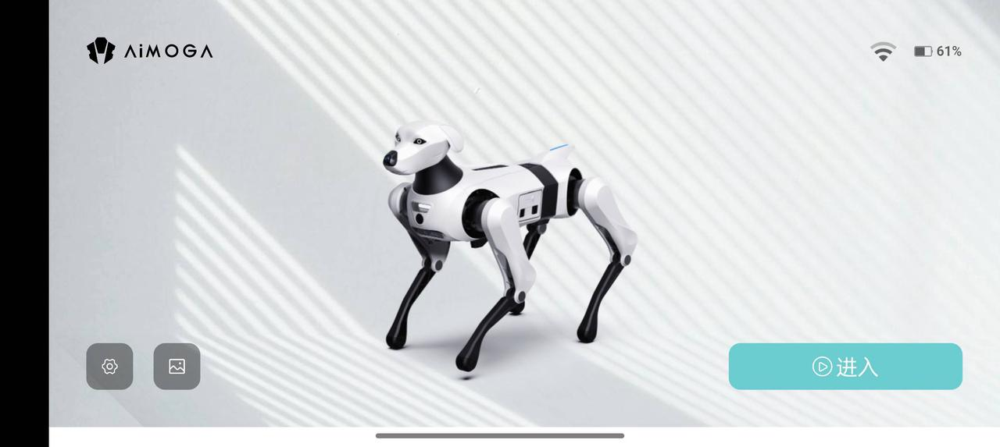
>
> 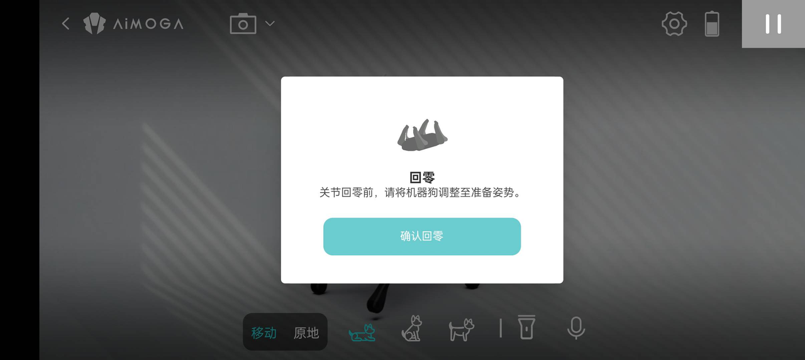
>
> <video src="/videos/18446744072704825415.mp4" controls />

## **4 功能操作**

### **4.1 姿态切换**

> **【注意】** 支持三种基础姿态。

> <table>
>   <colgroup>
>     <col width="157" />
>     <col width="254" />
>   </colgroup>
>   <thead>
>     <tr>
>       <td>**姿态**</td>
>       <td>**状态说明**</td>
>     </tr>
>   </thead>
>   <tbody>
>     <tr>
>       <td>卧姿</td>
>       <td>低功耗待机状态</td>
>     </tr>
>     <tr>
>       <td>坐姿</td>
>       <td>交互待命状态</td>
>     </tr>
>     <tr>
>       <td>站姿</td>
>       <td>准备运动状态</td>
>     </tr>
>   </tbody>
> </table>
>
> 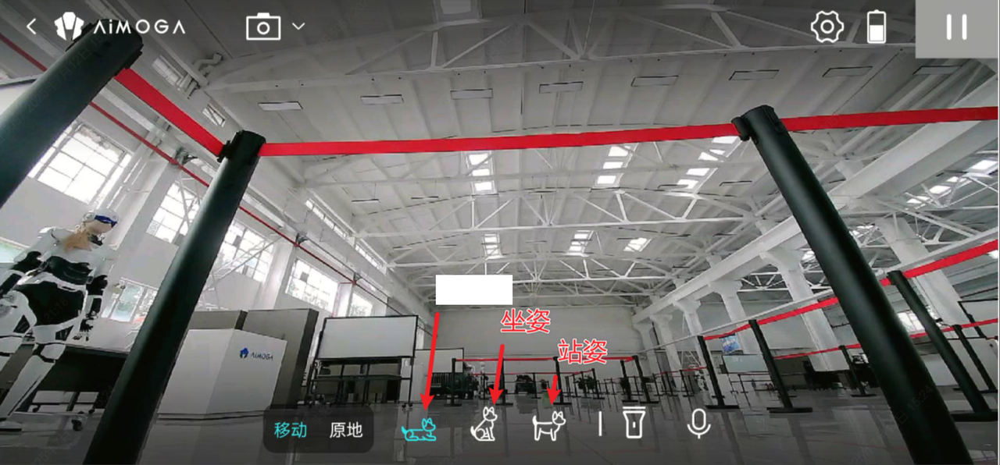

- 卧姿状态如下。

> 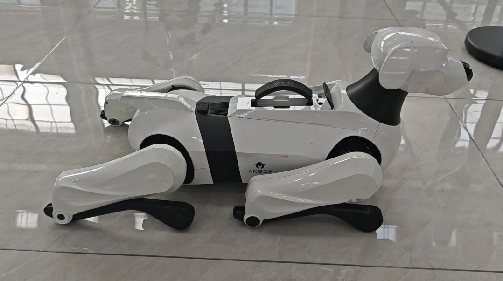

- 坐姿状态如下。

> 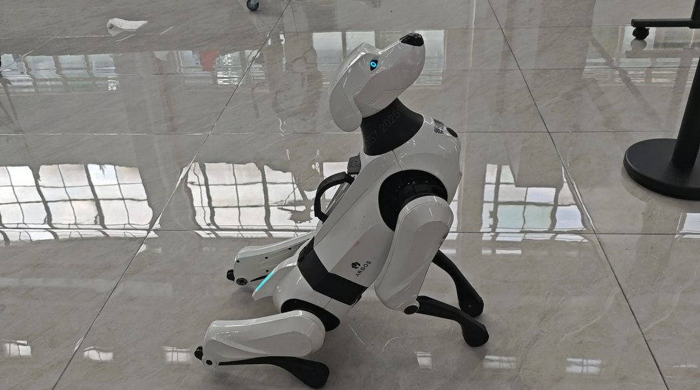

- 站姿状态如下。

> 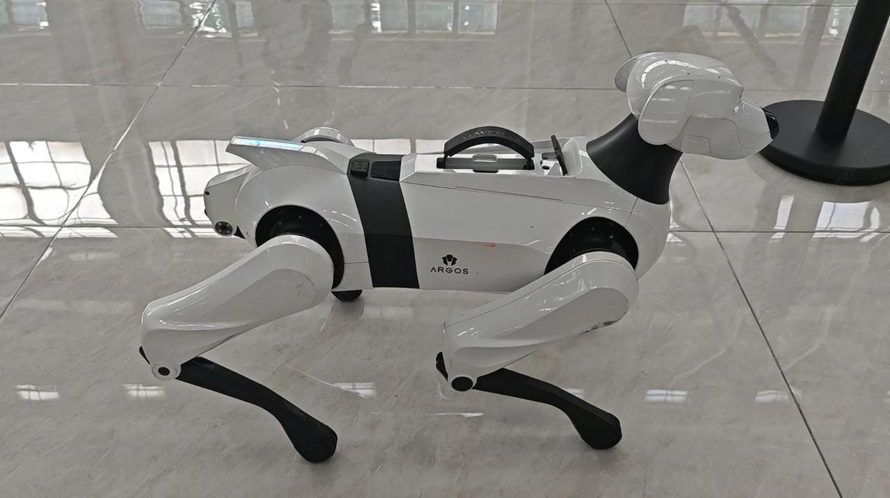

### **4.2 移动控制**

- 站立模式下激活遥控界面，使用方向键控制移动。

> 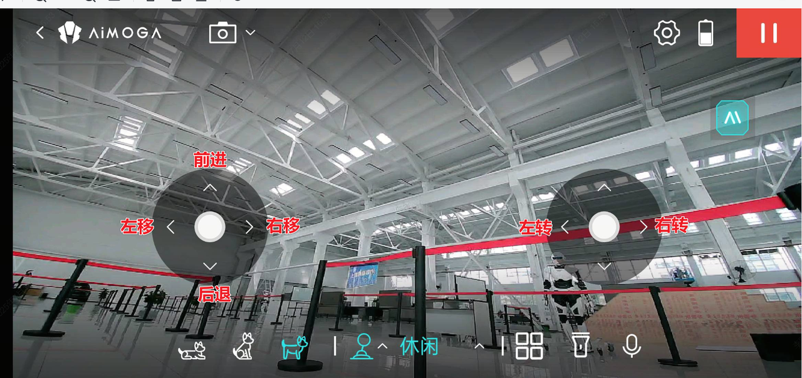

- 速度调节：休闲/日常/运动三档可调。

> 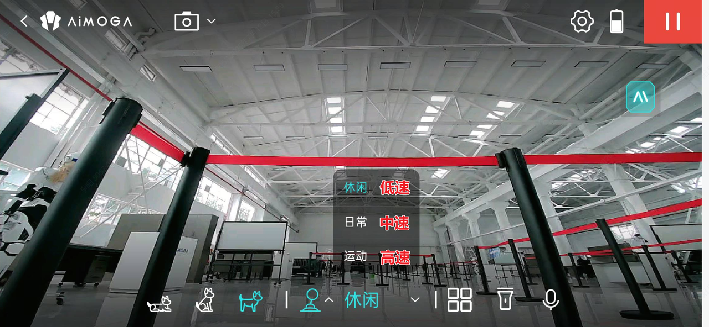

### **4.3 动作库**

- 进入动作库界面。

> 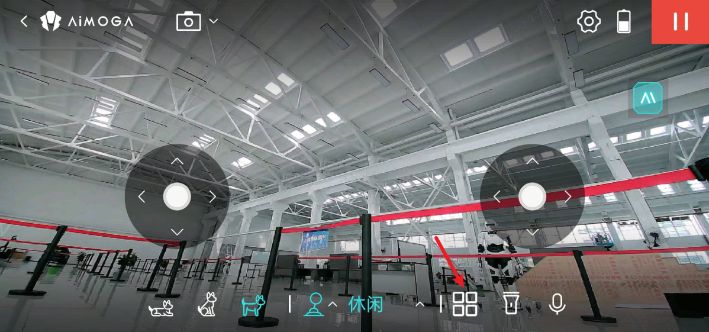

- 选择预设动作（如比心、握手等）。

> 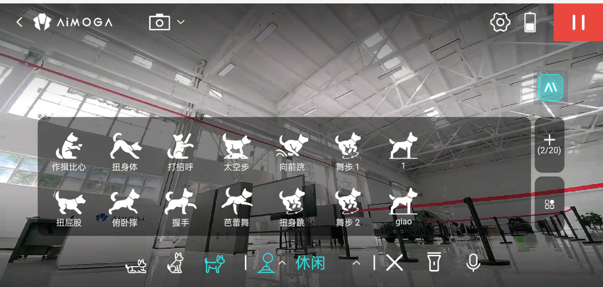

- 自动执行选定动作。

### **4.4 智能跟随模式**

- 开启跟随模式。

> 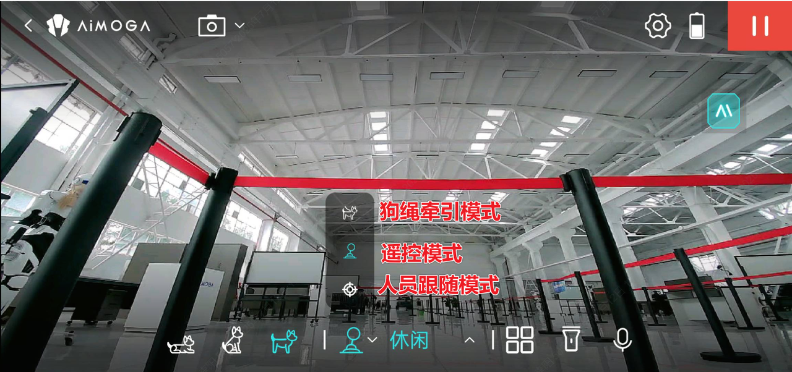

- 屏幕锁定跟随目标。

> 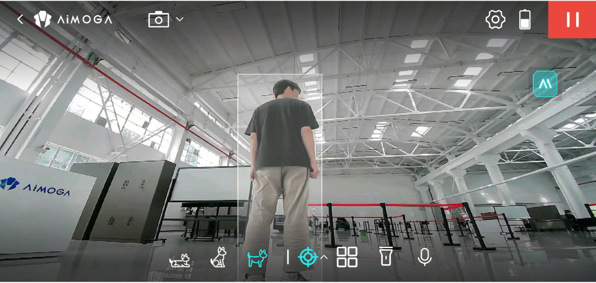
>
> <video src="/videos/18446744072839475220.mp4" controls />

- 单击取消跟随。

## **5 关机**

> **【注意】** 关机前必须切换至卧姿。

关机操作：

- 通过 APP 切换至卧姿。
- 短按后长按电池开关。
- 等待所有指示灯熄灭。

> <video src="/videos/672090229.mp4" controls />

## **6 安全注意事项**

> **【危险】** 严禁在站姿模式下直接断电。

> **【警告】** 首次使用前请充满电；进行大幅度动作时确保周边有 1 米安全空间；禁止使用最大超过 2.5 kg 的负载；机器狗头部舵机、尾巴为易损件，切勿有意踢踹。

> **【注意】** 开机后自动进入待机模式，无需手动切换；指示灯异常或无播报时，重新启动或联系售后。

## **7 使用须知**

- 请检查并确保本产品各关节没有异物影响，确保线束没有破损，确保足底正常无损坏。
- 请检查确保头部摄像头表面清洁。使用时，请避免用硬物划伤镜片。如摄像头表面有脏污，请及时用干软布擦拭干净。
- 放置本产品时，请确保腿部呈自然不受力状态，避免机身重力挤压对腿部关节造成伤害。
- 请勿使本产品趴卧在坚硬、尖锐、凸起过多的地面上，请勿在地上拖动本产品，易导致机身底部或足底损伤。
- 本产品的足底是软质材料，应避免踩踏到尖锐物品，例如图钉、尖角等。
- 使用时，请保持在视线范围内控制，预留足够的安全距离，远离障碍物、人群及其他任何可能碰撞损坏的障碍物。
- 本产品具备良好的地形自适应性，但用户请注意，如若地形已超越本产品的动态稳定能力，可能会导致本产品失控而发生碰撞、摔倒或损伤，因此请时刻注意，确保机器狗行走的地形符合环境要求。
- 本产品为高性能运动产品，在转弯时请务必小心。快速转弯容易出现碰撞、摔倒或损伤。
- 当遇到陡坡、不平坦地面或其他危险地形，请勿进行冒险操作。
- 在电量显示不足的状态下使用机器狗时，本产品可能没有足够移动力执行动作，请尽快停止使用，充电后再使用，以避免危险的发生。
- 请勿将手伸入本产品大腿的间隙、肩部关节电机连接处的缝隙，以免夹伤或碰伤。
- 使用时，避免因身体部位接触本产品的运动部件而导致夹伤或碰伤。
- 使用时或停止使用后的短时间内，避免身体部位接触关节电机表面的金属部件，谨防烫伤。
- 请勿长时间连续使用本产品，这可能会导致电机过热，应停上一段时间后再使用。
- 切勿使用不符合规格的充电设备对本产品充电。
- 使用完毕后，请务必即时关机。
- 在使用电池时，请确保机身电池仓内无异物。请注意，仅能使用本产品配置的对应电池，不允许使用其他电池，使用其他电池会造成机器狗损害或产生危害。
