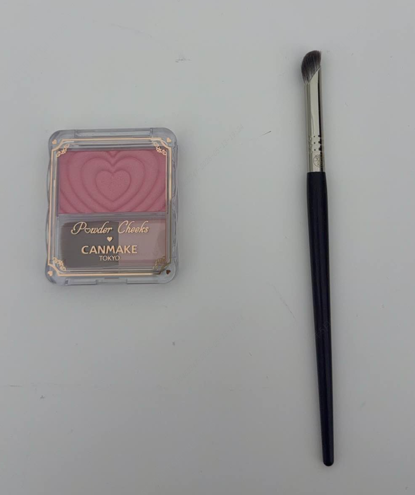

> **适用产品**：墨茵机器人 本文覆盖功能概述、适用场景、化妆前准备与化妆操作步骤。

## 1 功能概述

机器人出厂默认不化妆，客户可根据实际需求在日常使用中自行进行化妆处理。

## 2 适用场景

- 展厅接待、活动展示等需要提升机器人外观亲和力的场景。
- 客户个性化定制需求。

## 3 化妆前准备

### 3.1 确认材质特性

- 机器人头部头套材质为硅胶。
- 硅胶表面特性与常规皮肤不同，普通化妆品附着力较差，易出现脱妆、晕染等问题。

### 3.2 建议工具与材料

- 眼部/脸部上色：建议使用眼影（粉状或膏状均可）配合化妆刷进行操作。
- 唇部上色：建议使用眼影，配合细头化妆刷勾勒唇形。
- 辅助工具：软毛化妆刷。

> 

## 4 操作步骤

### 4.1 清洁头套表面

- 使用干净软布轻拭硅胶头套，确保表面无灰尘、油污，保持干燥。

### 4.2 唇部上色

- 取适量眼影或专用颜料于调色板。
- 用细头化妆刷蘸取少量颜料，沿唇线轮廓轻扫填充。

### 4.3 脸部上色

- 选择合适色号的眼影，用化妆刷轻扫脸颊区域。
- 采用少量多次原则，逐步叠加至理想显色度。
- 注意过渡自然，避免出现明显色块边界。

> <video src="/videos/20260513-192701.mp4" controls />
