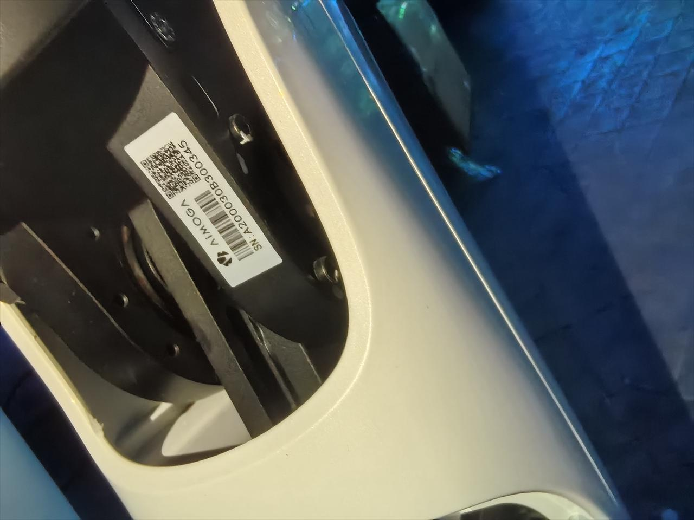

> **适用产品**：墨茵机器人 本文覆盖骨架编号的作用、查看位置及追溯信息提供要求。

## 1 骨架编号说明

墨茵机器人除整机 SN 序列号外，还具备唯一的骨架编号，该编号是重要的零部件序号，用于骨架质量问题的追溯。

## 2 查看位置

- 查看位置：机器人右侧腿部膝盖后方的骨架上。
- 您可以在该位置找到贴附的标识标签，上面印有骨架编号信息。

> 

## 3 质量问题反馈

如需进行质量问题反馈或备件追溯，请同时提供整机 SN 序列号和该骨架编号。
