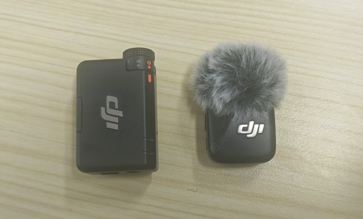
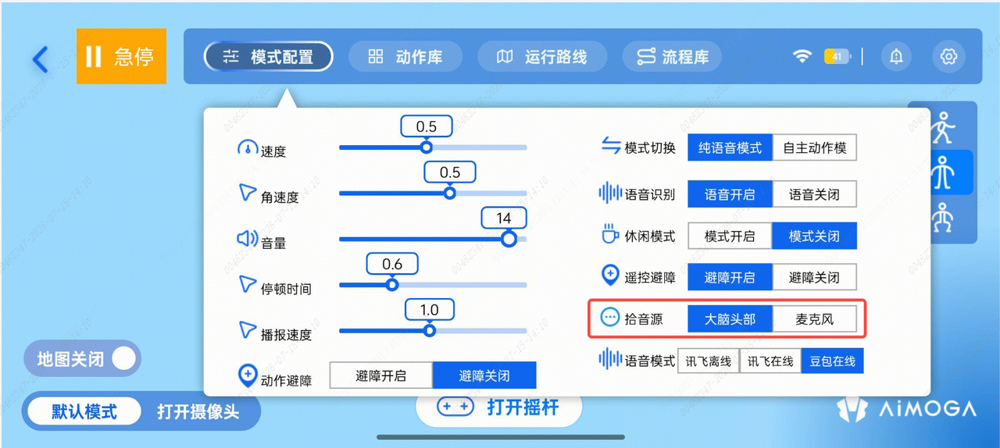
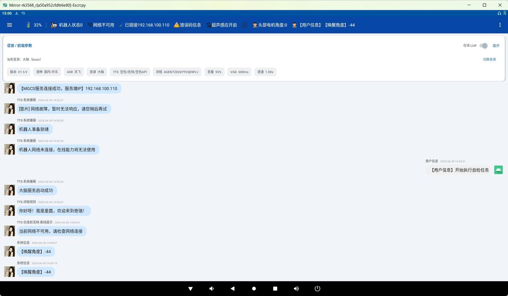

> **适用产品**：墨茵机器人 本文覆盖收音效果差的问题现象、原因分析、解决方案与优化建议，以及外接领夹麦克风的安装与使用。

## 1 问题现象

在大型会场、展厅或会议场景中，墨茵机器人的语音交互表现明显下降，具体表现为：唤醒成功率低、语音转文字错误率高、对话响应超时或无反应，以及频繁提示“网络异常”。该问题严重影响了机器人现场服务的效果与用户体验。

## 2 原因分析

经归纳，导致收音效果差的根本原因主要集中在以下三类因素上：

- 云端 ASR 对网络质量的依赖：机器人采用云端自动语音识别（ASR）方案，所有拾取的音频数据需实时上传至云端进行解码处理。这一过程对网络的上行带宽、延迟和丢包率极为敏感。会场提供的公共 Wi-Fi 或 4G/5G 信号往往因接入设备过多、信号弱或存在盲区，导致音频流传输受阻，从而引发识别超时或失败。
- 头部六麦阵列被物理遮挡：机器人头部标配了六麦环形阵列，依靠空间波束成形技术进行定向拾音和降噪。若机器人佩戴了装饰帽、玩偶头套，或头部声孔被异物、贴纸遮挡，将直接破坏声学通道。声波无法有效到达麦克风，导致拾音灵敏度大幅下降，即使近场唤醒也难以准确捕捉指令。

>    src="/images/image-273.png"
>   alt="Image"
>   title="Image"
>   style={{ width:"71%" }}
> />

- 现场环境信噪比过低（声音嘈杂）：会场通常人员密集，并存有背景音乐、广播通知及多人交谈声等多重声源。复杂的环境噪声使得机器人内置降噪算法难以有效分离有效人声与背景噪音，导致语音指令被淹没。

> 

## 3 解决方案与优化建议

针对以上三类原因，建议按以下优先级顺序采取相应措施。

### 3.1 优先保障机器人网络连接质量

会前务必对部署区域的网络状况进行专项测试。优先为机器人拉设专用有线网络或部署独立的企业级高密度 Wi-Fi 接入点（AP），确保该区域的上行速率稳定且延迟较低。若场馆提供的公用网络条件不达标，可临时使用 5G/4G 手机热点作为替代方案，但需将热点设备放置在机器人附近，并提前在会场的各个角落测试网络延迟与丢包率，确保满足云端 ASR 服务的运行要求。

### 3.2 检查并移除头部遮挡物

部署前，仔细检查机器人头部的六麦声孔区域，确保开孔通透、无积灰，且未被装饰物或标签覆盖。若因形象需要必须佩戴帽子或头饰，请选用网眼材质或后置佩戴式的轻便装饰，确保不包裹或紧贴头部四周的麦克风孔位，维持原始声学路径通畅。

>    src="/images/image-275.png"
>   alt="Image"
>   title="Image"
>   style={{ width:"56%" }}
> />

### 3.3 为嘈杂环境加装外部收音麦克风

若会场噪声无法通过物理手段降低（如无法关闭背景音乐），建议为机器人外接高指向性领夹式外部麦克风。此举能有效缩短拾音距离，显著提升输入信号的信噪比，从而绕过机器人自带阵列在远场嘈杂环境下的性能瓶颈，极大改善语音识别准确率。

## 4 外接领夹麦克风安装与使用

### 4.1 背景说明

墨茵机器人在会场、展厅等嘈杂环境中，内置的头部六麦阵列可能因环境噪声过大或物理遮挡而导致拾音效果下降。为解决该问题，可为本机器人外接高指向性领夹麦克风。

本说明以大疆领夹麦克风套装为例，详细介绍其安装、连接及使用配置方法。该设备支持通过 USB 接口进行供电和数据传输，无需额外电池或独立接收盒。

### 4.2 适用场景

本方案适用于以下情况的音质改善：

- 会场背景音乐或广播音量较大，影响唤醒率。
- 机器人需在较远距离（3—5 米）拾取发言人的语音指令。
- 内置麦克风被装饰物（帽子、头套）遮挡，且无法拆除装饰。
- 需要进行公开演示或直播，对语音清晰度有较高要求。

### 4.3 所需硬件与工具

在开始安装前，请准备好以下物品：

- 大疆领夹麦克风套装（包含发射器（麦克风）和接收器各一个）。
- USB-A 转 USB-C 数据线一条（长度建议 15—20 厘米，需确保同时支持供电和数据传输功能，劣质充电线可能无法传输音频数据）。
- 内六角套装（用于拆卸机器人头部后壳）。

### 4.4 安装操作流程

#### 4.4.1 安装前功能预检

在拆机之前，建议先验证领夹麦自身工作状态是否正常：

- 将大疆接收器通过 USB 线连接至一台电脑的 USB 端口。
- 打开发射器（麦克风）电源，确认接收器与发射器之间的无线对频指示灯正常亮起。
- 打开电脑的录音软件，对着领夹麦说话，查看是否有清晰的波形输入。
- 通过标准：若电脑端能清晰录制人声且无异常杂音，则设备合格，可进行下一步安装。

#### 4.4.2 拆卸机器人头部后壳

- 确保机器人已完全关机并断开电源适配器。
- 按照维修手册取下头部后壳。

>    src="/images/image-277.png"
>   alt="Image"
>   title="Image"
>   style={{ width:"57%" }}
> />

#### 4.4.3 连接内部数据线路至主板

- 在拆开的机身内部找到主控板（RK3568），定位到其左侧预留的 USB 接口（该接口为 USB-A 母座形态）。
- 将准备好的 USB-A 转 USB-C 数据线的 USB-A 端牢固插入 RK3568 主板的预留 USB 口。
- 将数据线的 USB-C 端预留至头部后壳内侧的空腔位置，便于后续插接接收器。

#### 4.4.4 恢复头部后壳并整理线束

- 将新增的 USB 数据线从头部下方假发处引出。
- 将头部后壳对准卡槽归位，均匀拧紧所有固定螺丝，确保外壳闭合紧密、无松动异响。

#### 4.4.5 安装接收器并隐藏于发网内

- 拿起大疆领夹麦克风的接收器，将其底部的 USB-C 接口与预留在头部的 USB-C 数据线对插。
- 打开接收器电源开关。
- 将接收器和连接线束收纳至机器人头部的仿生发网内部。

>    src="/images/image-278.png"
>   alt="Image"
>   title="Image"
>   style={{ width:"61%" }}
> />

### 4.5 APP 设置与功能启用

硬件连接完毕后，需在软件端完成音频输入源的切换，机器人才能正确识别外接麦克风信号：

- 给机器人上电开机，等待系统完全启动。
- 打开手机端的墨茵机器人控制 APP，连接至目标机器人。
- 进入 APP 的「设置」菜单，找到“拾音源”选项。
- 将输入源由默认的“大脑头部”切换为“麦克风”。

> 
>
> 待人工确认：原文内容（图片未提供链接

### 4.6 对话测试与降噪效果评估

安装设置完成后，务必进行实际场景测试以验证效果：

- 将发射器（领夹麦）开机，并佩戴在测试人员衣领位置（距离嘴巴约 15—20 厘米处）。
- 开启机器人的对话角色流程或唤醒词测试。
- 建议分别在安静环境和模拟嘈杂环境（如播放背景音乐）下，于 1 米、3 米、5 米距离处分别发出语音指令。
- 验收标准参考：外接麦克风启用后，机器人的唤醒成功率应明显提升，且语音转文字（ASR）的识别准确率相较内置麦克风应有显著提高；对话响应流畅，背景环境噪声应被有效抑制，人声清晰突出。

> 
