---

> **适用产品**：墨茵机器人 本文覆盖云平台流程框架搭建、机器人任务配置工具使用、任务配置与流程运行。

## **1 概述**

一般来说，流程用于机器人执行比较固定的任务和动作，比如 PPT 讲解、固定路线的导航带路讲解等，这些都是一套标准化固定业务。本文档主要说明云平台流程配置逻辑和方法，包括流程框架搭建、如何使用机器人任务工具配置任务以及流程运行。

## **2 云平台流程框架搭建**

### **2.1 新建流程**

找到需要配置的机器人本体，进入“流程管理 → 云平台流程 → 新增”，自定义一个流程名后会进入流程配置界面。

> 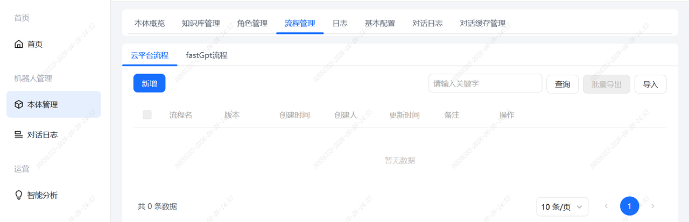
>
> 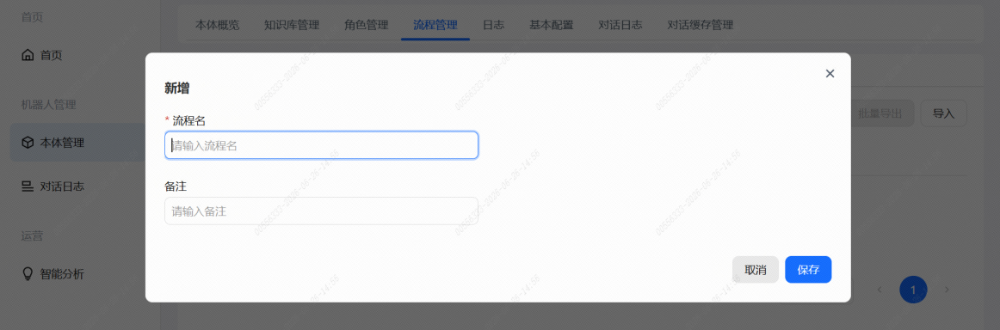

### **2.2 界面预览**

进入流程配置界面后，左侧有可选用的流程节点，流程开始和结束节点默认存在。

> 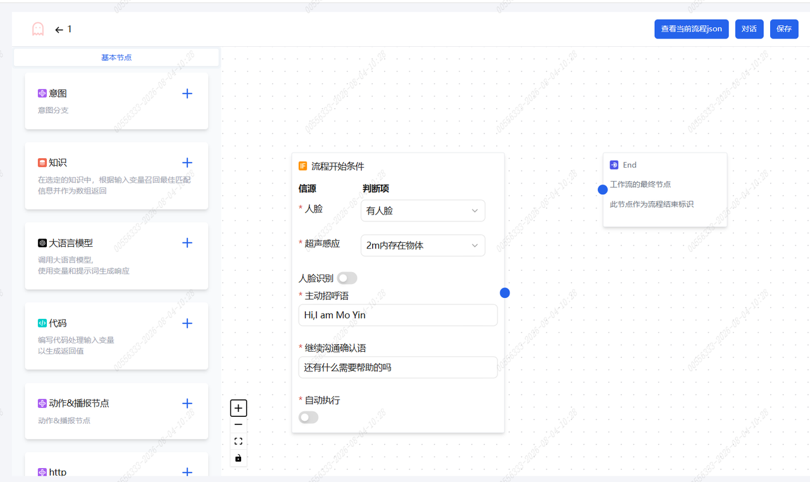

### **2.3 常用节点说明**

- 意图：调用大模型，结合对话识别用户意图，实现流程分支跳转。

>    src="/images/image-285.png"
>   alt="Image"
>   title="Image"
>   style={{ width:"67%" }}
> />

- 知识库：根据用户输入，从指定知识库中找出最匹配的文本内容，并按相关度从高到低排序后，以数组形式传递给后续流程。

>    src="/images/image-286.png"
>   alt="Image"
>   title="Image"
>   style={{ width:"67%" }}
> />

- 大语言模型：调用 AI 大模型，结合历史聊天、提示词、用户问题，让 AI 生成回答。

>    src="/images/image-287.png"
>   alt="Image"
>   title="Image"
>   style={{ width:"69%" }}
> />

- 动作&播报节点：通过写入配置好的 JSON 可以让机器人执行特定任务，包括但不限于 PPT 讲解、导航带路讲解等。

>    src="/images/image-288.png"
>   alt="Image"
>   title="Image"
>   style={{ width:"69%" }}
> />

### **2.4 流程框架搭建**

现以搭建一个迎宾接待流程为例，作为基本框架搭建的参考。

> 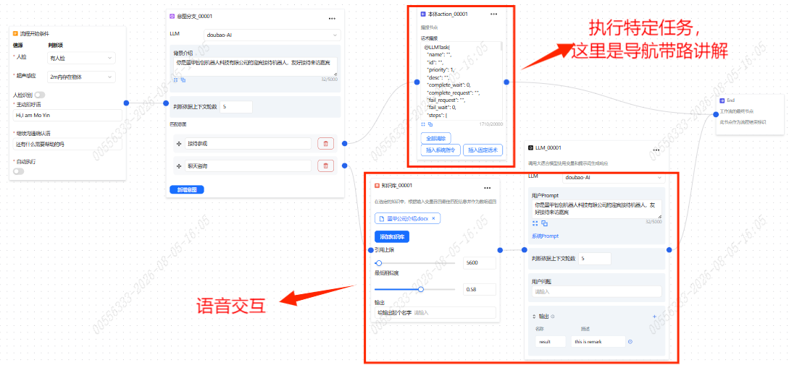

如上图所示，这是一个既能实现特定讲解任务又能兼顾语音对话的流程框架：

- 语音交互通过调用“知识库”和“大语言模型”两个节点即可实现。
- 执行特定任务需要将配置好的 JSON 写入“动作&播报节点”。

接下来说明如何使用机器人任务配置工具，根据我们想要机器人实现的功能输出 JSON 文件。

## **3 机器人任务配置工具使用**

### **3.1 打开配置工具**

- 打开文件包 `process_assitant.zip`，将 `config_tool.html` 拖到浏览器打开。

> 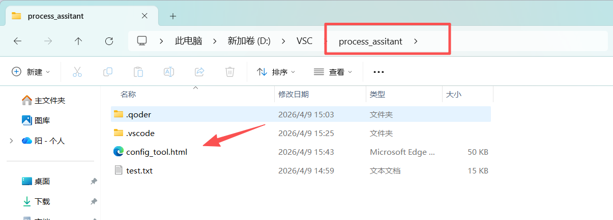

### **3.2 进入配置工具界面**

- 进入配置工具界面，点击“添加”可以看到可配置的任务模块，根据配置需要灵活选用。

> 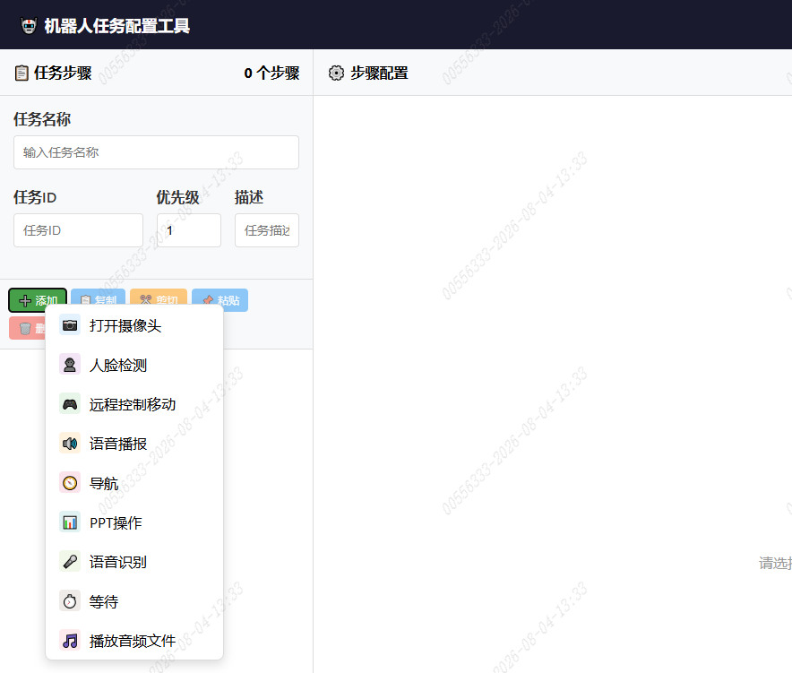

### **3.3 常用任务模块介绍**

#### **3.3.1 语音播报**

- 输入需要机器人合成的话术内容，并可为该段话术添加一个动作，动作选用参考墨茵动作清单。

<Warning>
  - 一个语音播报只能添加一个动作。如果话术内容过长，建议拆分多段，添加多个语音播报，每个语音播报再对应添加一个动作。
  - 如果话术内容过长，需要调整超时时间，默认是 60 秒。超时时间必须大于话术实际播报时间，可以预估话术时间灵活调整；如果话术过长未调整超时时间，会导致话术播报失败，进而导致流程提前终止。
  - 添加动作时，建议根据话术长短选用相匹配的动作。比如话术播报大概 30 秒，可以选用一个执行时长大概为 10—20 秒的动作，不建议选用执行时长少于话术播报时长的动作，否则会出现动作还未做完就被下一个任务打断的情况。
</Warning>

> 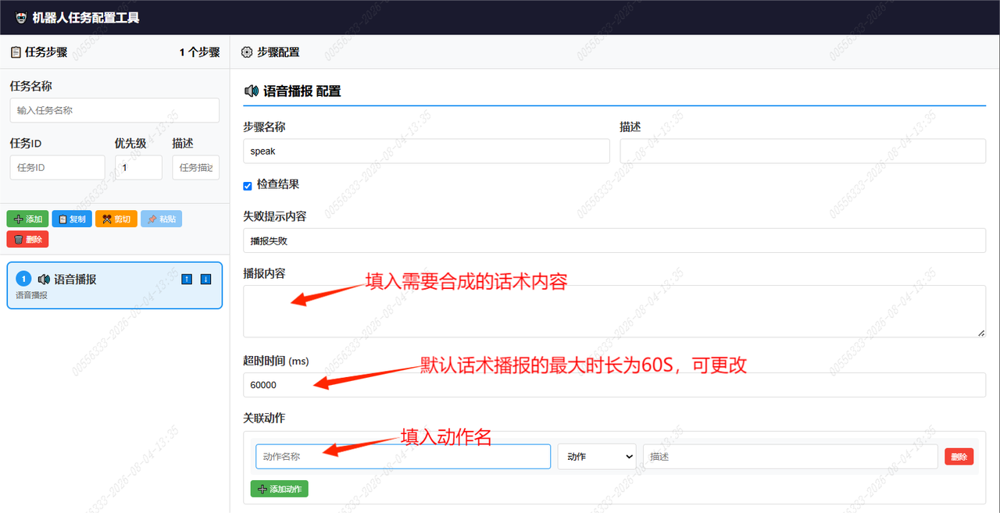

#### **3.3.2 导航**

- 控制机器人导航走到相应点位，只需要在终点的地方填入要去的点位名称即可。

<Warning>
  - 如果要用到导航任务模块，必须建好图，并在建好的图上添加好需要机器人导航去的点位。
  - 点位名称必须要和已建好的地图上的点位名称保持一致。
  - 涉及导航的流程，运行之前需要激活对应地图和打开机器人自主动作模式，否则机器人无法执行导航任务。
</Warning>

> 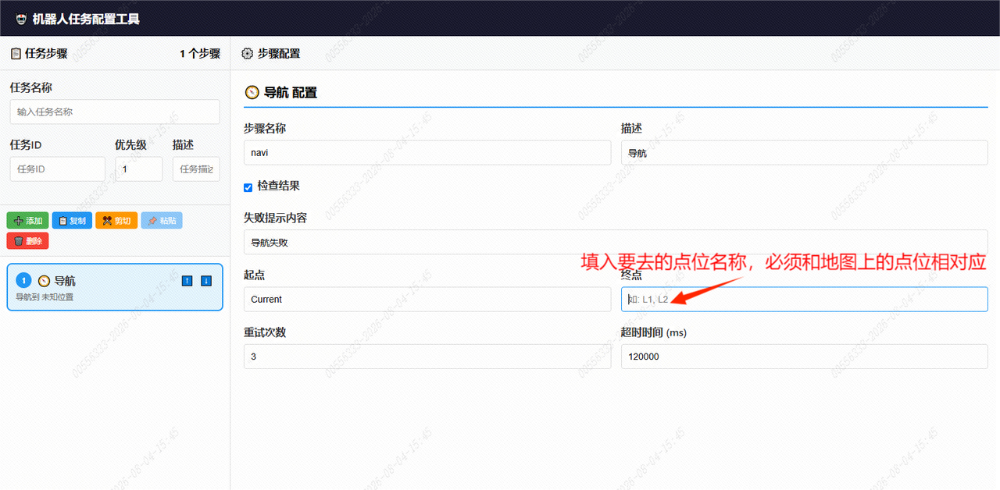

#### **3.3.3 PPT 操作**

- 让机器人实现控制 PPT 翻页。如需配置 PPT 讲解，可参考墨茵机器人 PPT 讲解调试流程。

#### **3.3.4 等待**

- 实现不同任务间的延时等待，默认为 1 秒，可根据需求灵活调整。

## **4 任务配置**

仍以迎宾接待流程为例，语音交互已经配置好了，现在配置导航带路讲解的任务。假设任务为：机器人先说开场白，然后依次走到 A 点、B 点、C 点分别讲解。

- 先打开任务配置工具，添加语音播报。这一步相当于完成了机器人在起点播报话术加做动作。

> 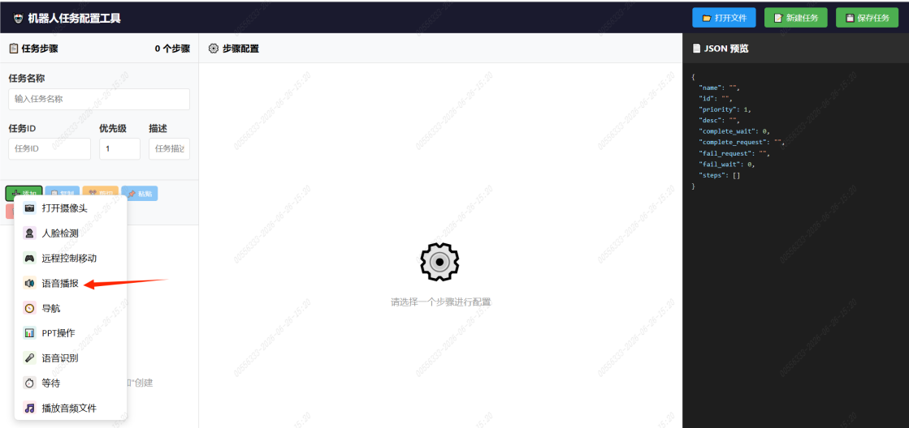
>
> 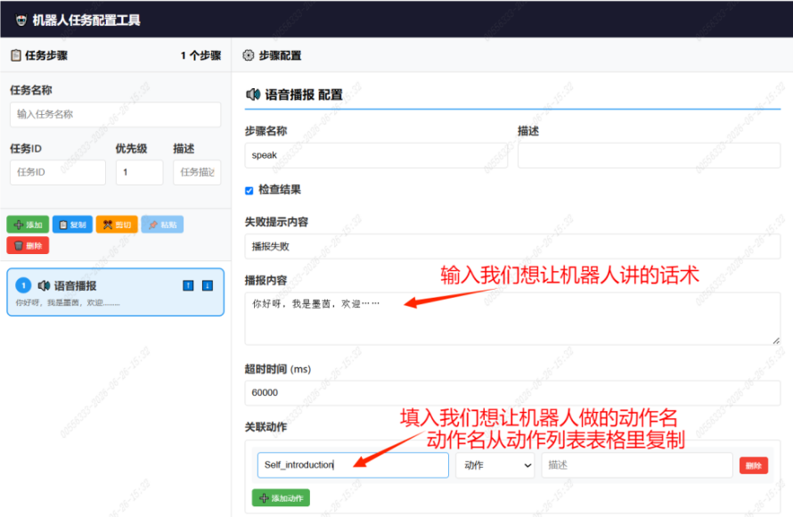

- 讲完后机器人要导航走到 A 点继续讲解，需要添加第二步——导航。

> 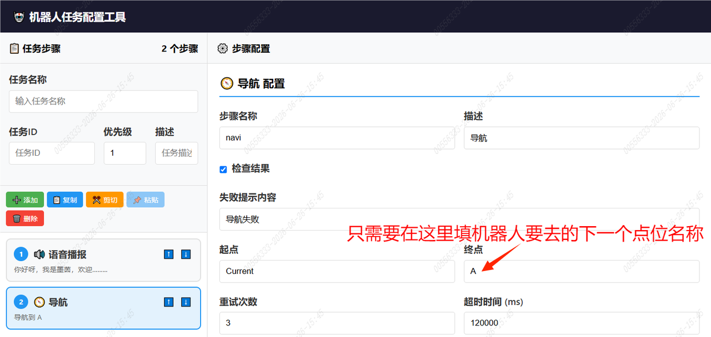

- 添加完导航后继续添加语音播报，输入机器人在 A 点要讲的话术加动作。

> 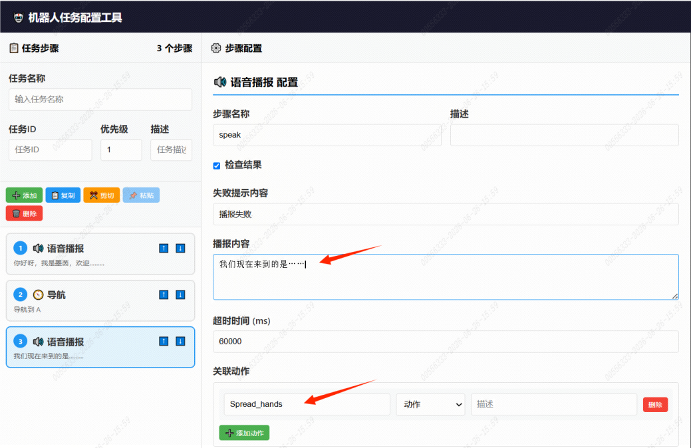

- A 点讲完机器人就要去 B 点，继续添加导航。

> 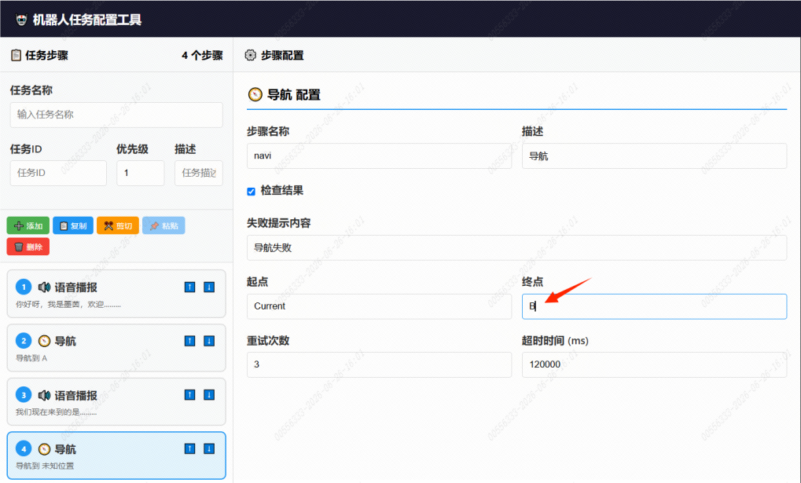

- 以此类推，添加在 B 点的语音播报、导航到 C 点、C 点的语音播报。

- 所有任务添加完后，点击右上角保存任务，会自动生成一个文本文档，打开里面就是要用的流程代码。

> 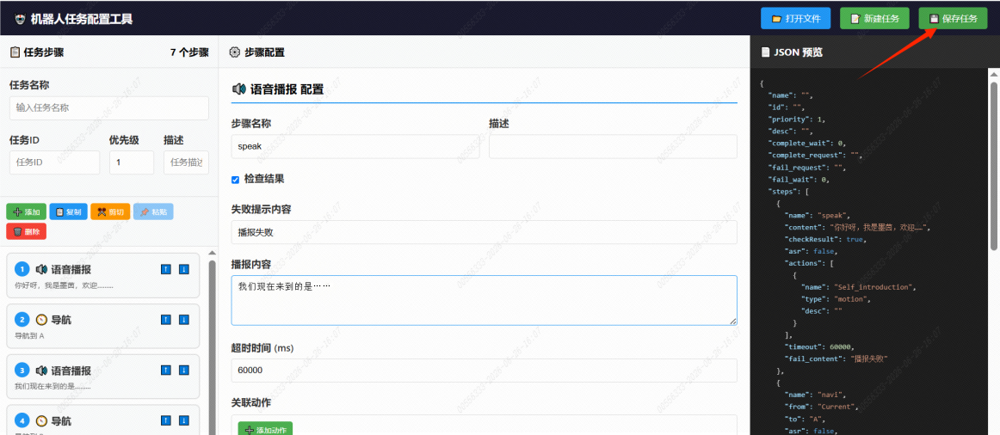
>
> 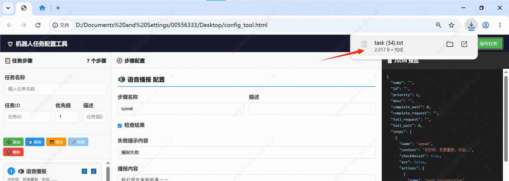
>
> 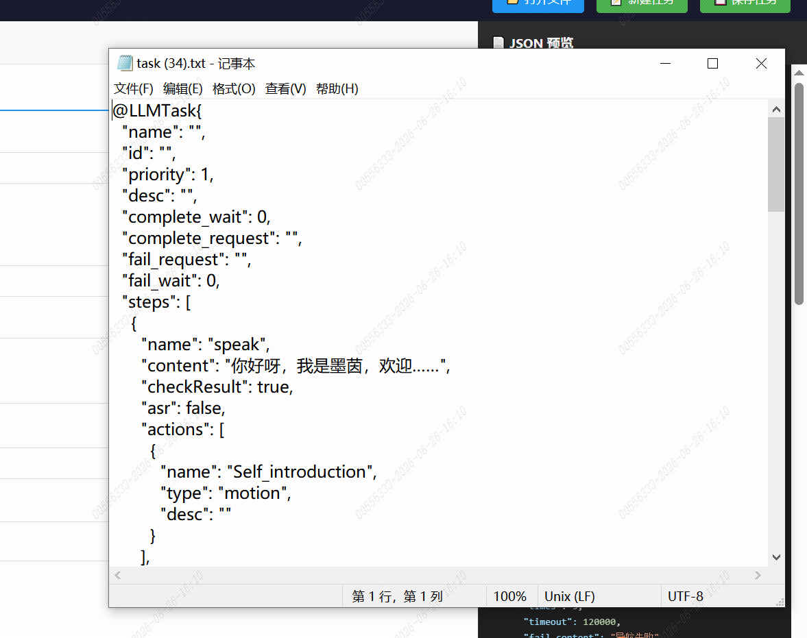

## **5 流程运行**

- 将上述代码全部复制下来，粘贴到流程框架里的“本体 action”，粘贴完保存并发布。
- 用手机 APP 连接上机器人后可下载相应流程。
- 流程下载到 APP 后，开启流程，通过对机器人说出相应关键词触发不同任务。

> 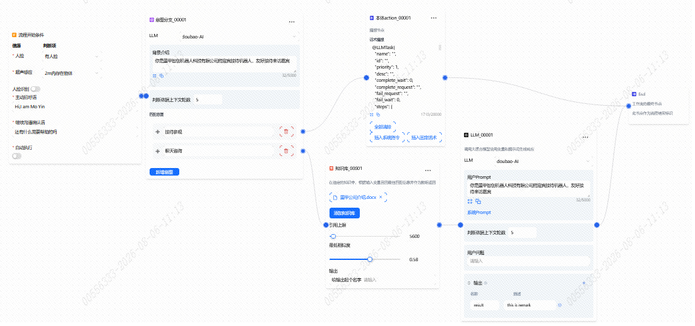
