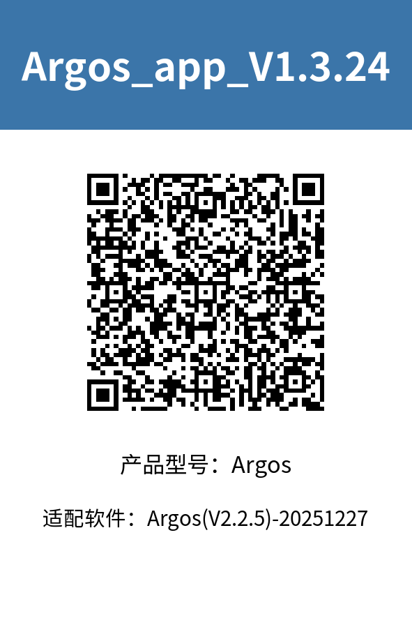
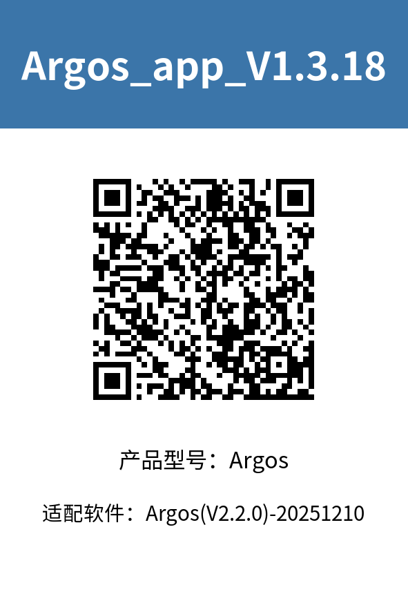
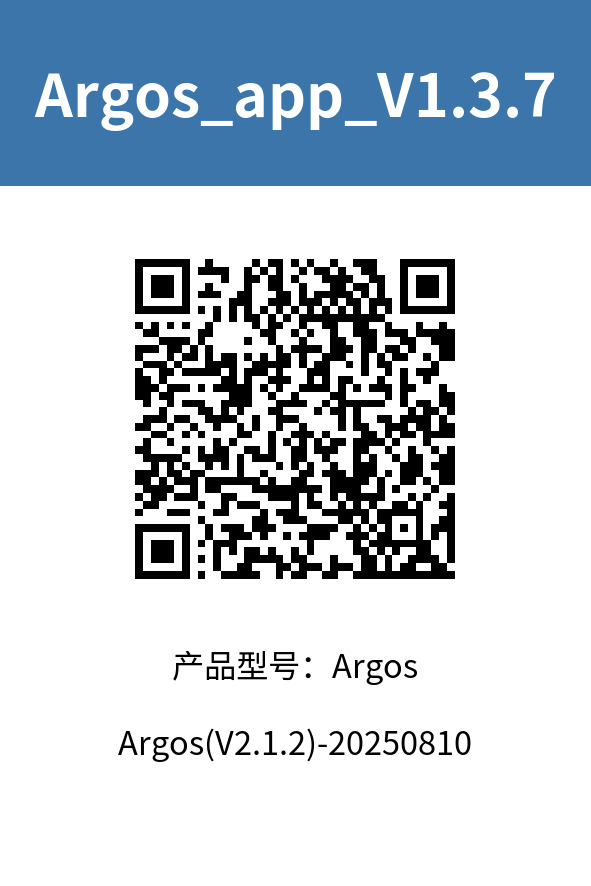
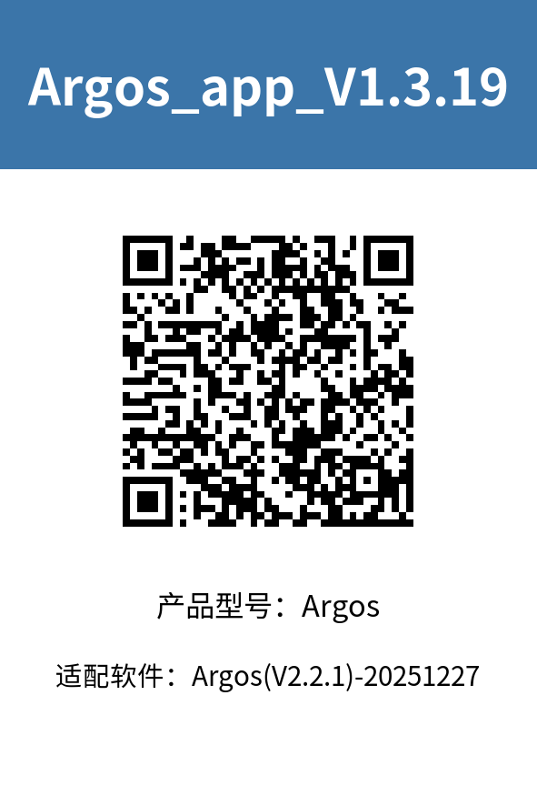
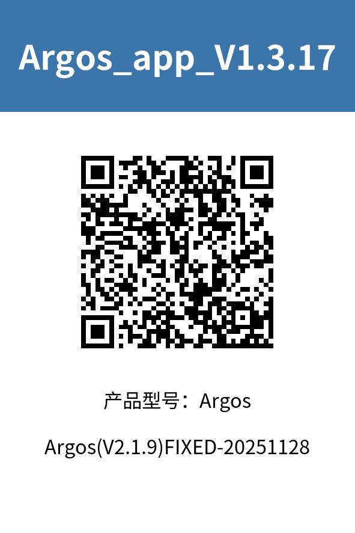

> **适用产品**：Argos X1 机器狗 本文覆盖 APP 版本匹配说明与首次使用指南。

## 1 APP 版本匹配说明

本页面汇总了 Argos 机器狗各软件批次对应的 APP 版本，请根据机器狗当前系统版本选择匹配的 APP 下载安装。

版本不匹配可能导致功能异常、连接失败或数据不兼容等问题。

如无法确认设备初始版本，请联系我司服务人员，提供机器狗 SN 编号查询出厂默认版本。

<Columns cols={2}>
  <Column>
    

    

    
  </Column>
  <Column>
    

    
  </Column>
</Columns>

## 2 首次使用指南

- 重置密码：同时触摸两只耳朵约 10 秒，听见狗叫声后松开，恢复初始密码。
- 连接 Wi-Fi：用密码 `AiMOGA_Argos001` 连接机器狗的 Wi-Fi，打开 APP。
- 关闭移动数据：操作设备断开移动数据连接，仅通过 Wi-Fi 连接至机器狗热点。
- 修改密码：进入 APP 后修改密码，然后退出 APP。

> **【建议】** 建议修改为 `Aa123456789.  `。

- 重新连接：重新连接机器狗的 Wi-Fi，输入新密码。
- 开始使用：打开 APP，进入主界面操作设备，享受 Argos 的智能陪伴服务。
