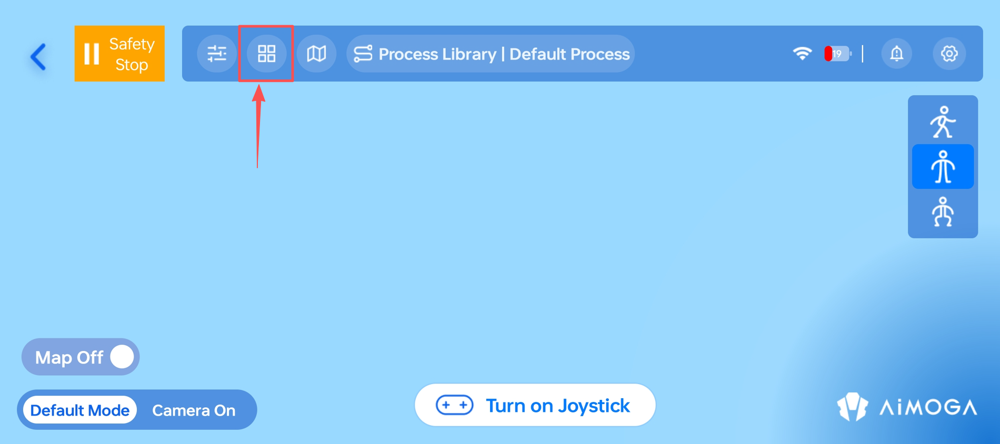
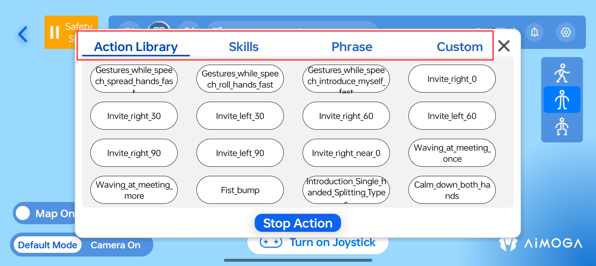
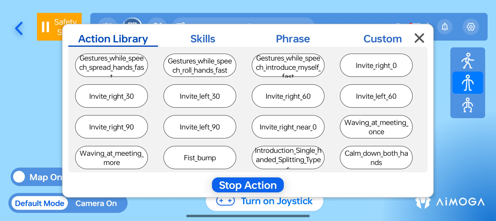
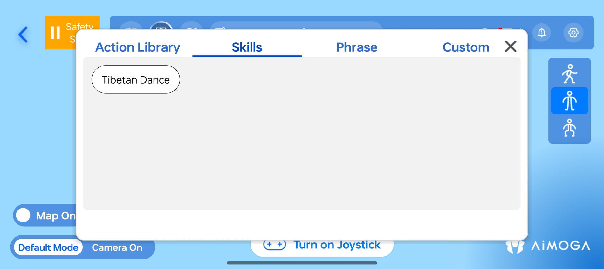
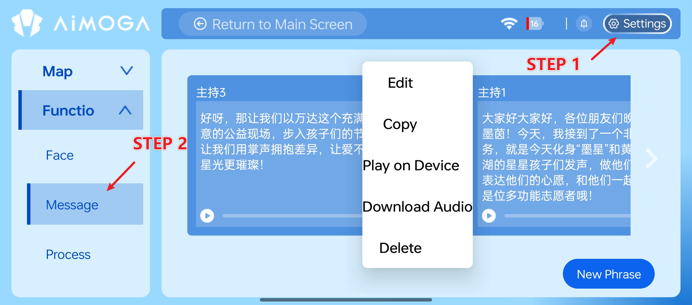
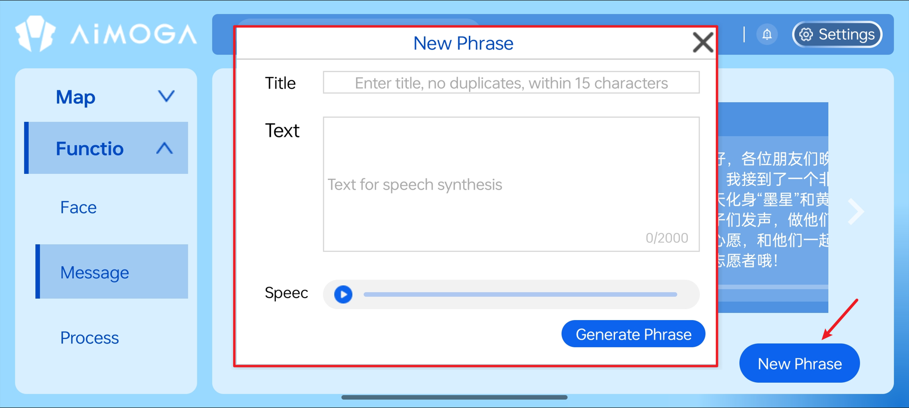
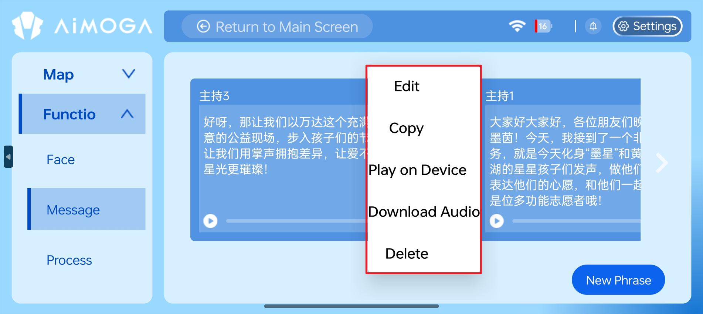
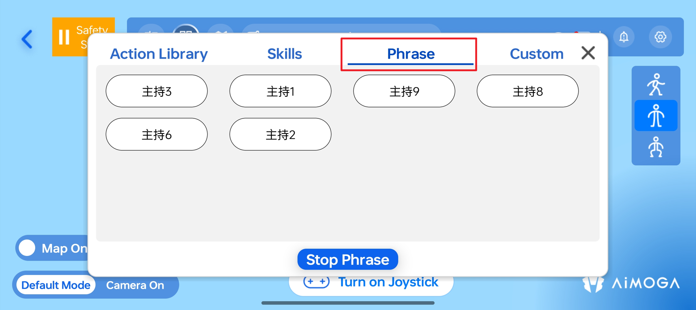
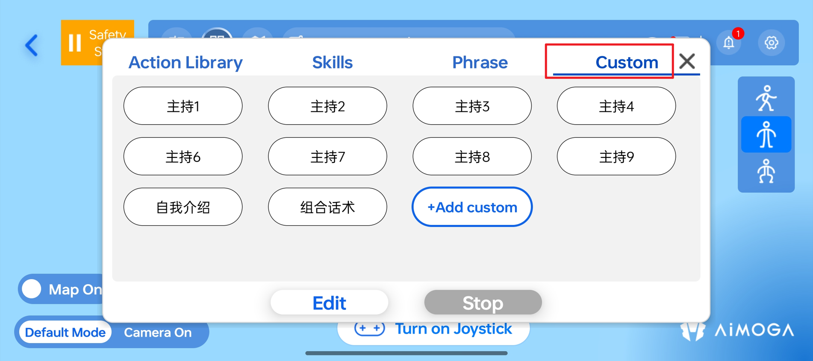
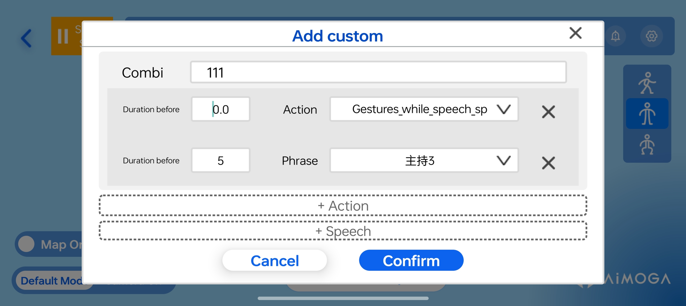

> **适用产品**：墨茵机器人 本文覆盖功能说明、动作库使用、技能使用、话术播放、自定义组合动作话术及安全注意事项。

## 1 功能说明

| 功能 | 说明 |
| --- | --- |
| 独立动作 | 预设上肢动作（招手、碰拳等） |
| 技能 | 全身舞蹈动作等技能（藏族舞等） |
| 话术 | 语音播报内容，可配合动作执行 |
| 自定义 | 用户自定义动作与话术组合 |

- 点击主页顶部“动作库”按钮。

- 界面显示“独立动作”、“技能”、“话术”、“自定义”四个标签页。

## 2 动作库使用

- **进入界面：** 点击“独立动作”标签，显示动作库清单。动作库对应的动作视频见[墨茵机器人动作清单](https://pcnd0lo57681.feishu.cn/wiki/XR19wYnhNiptemkILUacCME9nRe?from=from_copylink)。

- **选择动作：** 点击所需演示的动作（如：抬手邀请-右侧-30°、碰拳等）。
- **查看进度：** 系统通过颜色渐变进度条实时显示执行状态。
- **中止动作：** 如需中止动作，点击“中止动作”按钮，机器人立即暂停当前动作，并恢复到准备姿势。

<Warning>
  危险：

  - 上肢动作执行时，必须预留充足安全空间，防止手臂与周围物体或人员发生碰撞干涉。
  - 写毛笔字、敲鼓等道具类动作前，务必确认道具摆放位置正确，避免动作执行时碰撞干涉。
</Warning>

## 3 技能使用

- **选择技能：** 点击“独立动作”，显示预设技能清单。当前 V2.0.1 版本支持的预设技能包括：藏族舞。

> 待人工确认：原文此处为“点击‘独立动作’”，按上下文可能应为“技能”标签，请人工核对。

- **执行与中止：** 点击技能名称开始执行。全身舞蹈动作不支持中止，需要等待机器人执行完成后自动复位到准备姿势。

<Warning>
  危险：

  - 跳舞模式下机器人会产生位移，须确保周围 2 m 范围内无障碍物及人员。
</Warning>

<Warning>
  警告：

  - 跳舞完成后，须操作机器人向前或向后移动 2-3 步，以防未成功切换到直腿行走模式导致电机过热，产生摔机风险。
</Warning>

## 4 话术播放

### 4.1 话术管理

- **进入话术管理：** 点击“配置” → “功能” → “话术管理”，进入本地话术管理界面。

- **新建话术：**
  - 点击“新建话术”。
  - 输入话术标题。
  - 输入播报正文内容。
  - 点击“生成话术”完成创建（后台进行语音合成）。

<Note>
  注意：部分语种话术使用在线模型，需将 APP 切换到对应语言界面，并连接外部网络后方可正常合成。
</Note>

- **管理话术：**
  - 生成的话术自动保存至话术管理界面。
  - 选中生成的话术，点击右上角省略号标志。
  - 可进行编辑、复制、APP 播报、下载、删除等操作。

### 4.2 播放话术

- **选择话术：** 点击“话术”标签，显示已配置的话术列表。

- **执行控制：** 点击话术开始播报；点击“中止话术”停止播报。

## 5 自定义组合动作话术

### 5.1 创建自定义

- **进入自定义：** 点击“自定义”标签，点击“+添加自定义”。

- **设置参数：**
  - 填写组合名称。
  - 点击增加动作、话术，支持添加多组动作与话术。
  - 设置动作与话术的开始时间。
  - 选择相应的动作和话术内容。
  - 点击“确认”保存组合。

### 5.2 执行组合动作话术

- 点击配置好的组合动作话术开始执行。
- 点击“停止”停止语音播报及当前动作。

## 6 安全注意事项

<Warning>
  危险：

  - 执行动作前确保机器人处于直腿行走模式。
  - 上肢动作必须预留充足安全空间，防止干涉碰撞。
  - 跳舞模式下确保周围 2 m 范围内无障碍物及人员。
</Warning>

<Warning>
  警告：

  - 写毛笔字、敲鼓等道具类动作前，务必确认道具摆放位置正确。
  - 跳舞完成后须操作机器人移动 2-3 步，防止电机过热摔机。
  - 话术播报时注意音量设置（0-15）。
  - 自定义组合时合理设置动作与话术的时间间隔。
</Warning>

<Note>
  注意：

  - 点击中止按钮后，机器人立即暂停当前动作或话术播报。
  - 全身舞蹈动作不支持中止，需等待执行完成。
  - 自定义组合时合理设置动作与话术的时间间隔。
</Note>
