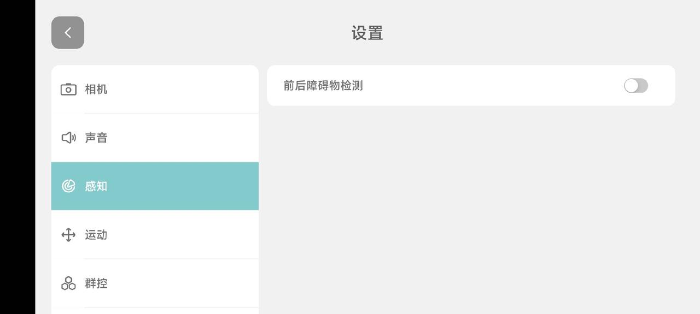
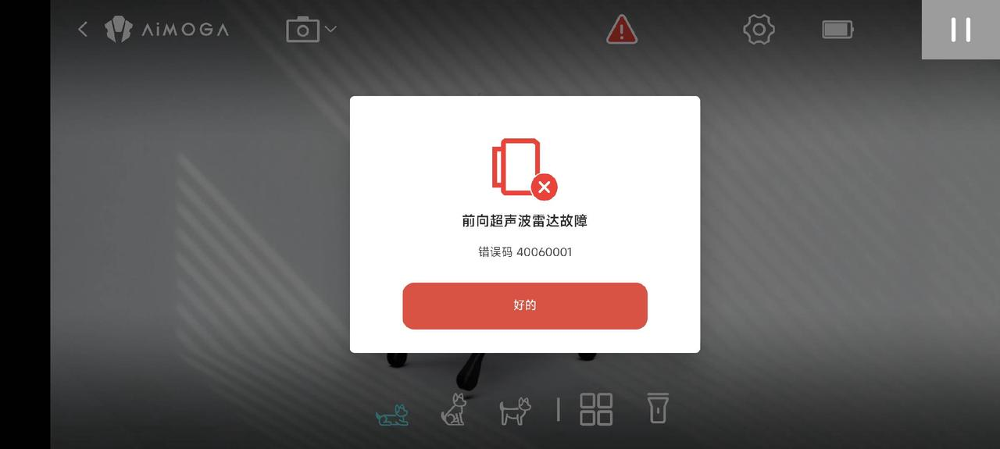

> **适用产品**：Argos X1 机器狗 本文覆盖超声波雷达未检测障碍物的现象描述、可能原因、处理措施与补充说明。

## 1 现象描述

机器狗在前进或后退过程中，超声波雷达未能检测到障碍物，导致机器狗未停止并发生碰撞。

## 2 可能原因

### 2.1 功能开关未开启

在机器狗的“设置 >> 感知”菜单下，检查“前后障碍物检测”开关是否已打开。

若开关处于关闭状态，超声波雷达将不参与避障决策，机器狗不会主动停止。

> 

### 2.2 超声波雷达的物理检测局限性

当前机器狗采用单超声波雷达方案（前进方向一个，后退方向一个），其检测能力存在以下局限：

- 对特定材质/形状物体不敏感：超声波雷达依赖声波反射回波进行测距，对于人体、柱状物体（如细杆、桌腿）、低矮物体（如门槛、矮凳）等，因声波反射面积小或反射角度偏离，回波信号弱，可能导致漏检。
- 对平整大面物体敏感：针对墙体、玻璃、柜体等平整且垂直于声波传播方向的物体，反射回波强，检测效果较好。

### 2.3 超声波雷达硬件异常

查看机器狗当前是否存在超声雷达异常报警（如接口松动、线路损坏等）。若雷达本身报故障，则无法正常输出测距数据。

> 

## 3 处理措施

<table>
  <colgroup>
    <col width="71" />
    <col width="191" />
    <col width="453" />
  </colgroup>
  <thead>
    <tr>
      <th>序号</th>
      <th>措施</th>
      <th>操作说明</th>
    </tr>
  </thead>
  <tbody>
    <tr>
      <td>1</td>
      <td>开启检测开关</td>
      <td>进入“设置 >> 感知”，确认“前/后障碍物检测”开关已打开</td>
    </tr>
    <tr>
      <td>2</td>
      <td>人工辅助注意</td>
      <td>在复杂环境（人流密集、障碍物低矮/细小）下使用时，建议人工监护，避免完全依赖自动停障</td>
    </tr>
    <tr>
      <td>3</td>
      <td>返厂检修</td>
      <td>若确认开关已打开且无环境干扰因素，仍频繁出现不停止情况，请联系售后安排返厂检修，排查超声雷达安装问题或硬件故障</td>
    </tr>
  </tbody>
</table>

## 4 补充说明

### 4.1 单雷达方案的覆盖特性

- 前进雷达：安装在机器狗头部或前胸位置，水平扇面探测，主要覆盖正前方区域，存在一定盲区（雷达正下方贴近地面的低矮物体可能检测不到）。
- 后退雷达：安装在机器狗尾部，覆盖后方区域，同样存在低空盲区。
- 检测角度与距离：单雷达的探测波束呈锥形扩散，距离越远波束覆盖范围越宽，但分辨率下降；近距离时波束窄，可能漏检偏离中心轴的障碍物。

### 4.2 检测失效的典型场景

- 吸波/透波材质：海绵、软布、窗帘等材质会吸收或透过超声波，导致无回波或回波极弱。
- 镜面反射/全反射偏离：光滑玻璃或倾斜角度大的表面，声波发生镜面反射，回波未返回雷达接收器。
- 障碍物尺寸小于波束宽度：细小障碍物（如直径小于 5 cm 的杆状物）反射能量不足，被系统噪声淹没。
- 多径干扰：在狭窄走廊或复杂室内环境中，声波经多次反射形成干扰回波，导致测距失真。
