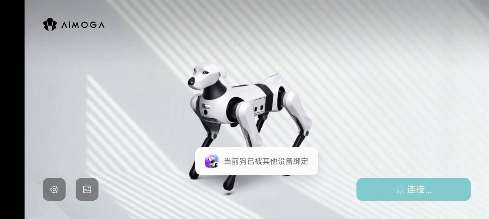
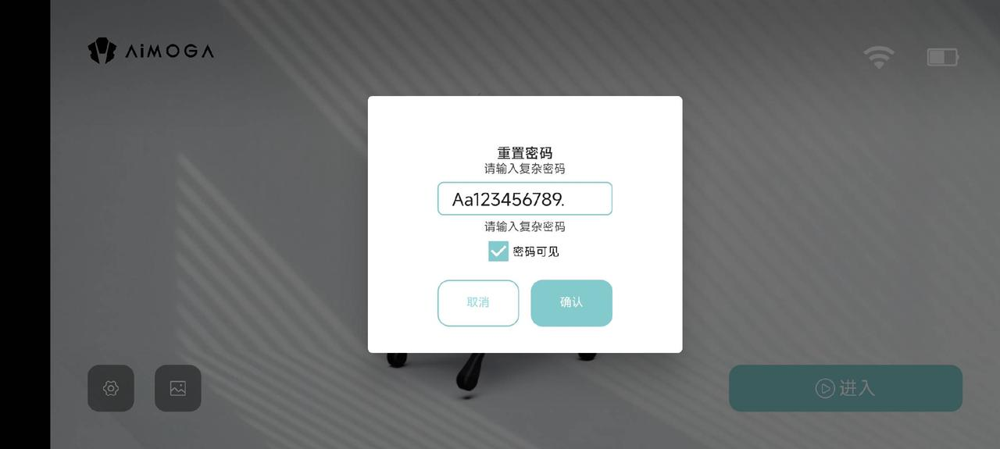

> **适用产品**：Argos X1 机器狗 本文覆盖设备已被其他设备绑定的故障现象、原因分析与处理措施。

## 1 故障现象

机器狗提示“当前狗已被其他设备绑定”，新手机无法连接或控制机器狗。

> 

## 2 原因分析

机器狗绑定手机 APP 后，设备与账号建立唯一配对关系。当用户更换手机或切换控制设备时，原绑定关系未解除，新设备无法建立连接。需通过硬件重置操作解绑原手机并恢复出厂网络配置，再由新手机重新绑定并设置密码。

## 3 处理措施

### 3.1 硬件重置解绑

同时触摸机器狗两只耳朵，保持约 10 秒，直至听见狗叫提示音与眼睛 LED 指示灯闪烁，完成密码重置与设备解绑。

> **【说明】** 该操作会清除原手机绑定关系及原 Wi-Fi 密码，恢复为默认出厂网络配置。

> <video src="/videos/20260506-151112.mp4" controls />

### 3.2 连接默认 Wi-Fi

- 在手机 Wi-Fi 列表中找到机器狗热点（名称位于机器狗下方的标签）。
- 关闭手机移动数据（防止流量干扰，确保仅通过 Wi-Fi 通信）。
- 使用默认密码 `AiMOGA_Argos001` 连接该 Wi-Fi 热点。
- 打开机器狗 APP。

### 3.3 修改连接密码

进入 APP 后，将 Wi-Fi 连接密码修改为 `Aa123456789.`（注意末尾包含英文句点“.”）。

修改完成后退出 APP。

> 

### 3.4 重新认证连接

- 进入手机 Wi-Fi 设置，将之前的机器狗 Wi-Fi 热点选择“忘记网络”。
- 重新搜索并连接该机器狗 Wi-Fi 热点。
- 输入新密码 `Aa123456789.` 完成连接认证。

### 3.5 APP 正常使用

重新打开 APP，此时新手机已完成绑定与密码配置，可正常进入使用。
