> **适用产品**：墨茵机器人 本文覆盖角色使用、流程使用、对话控制与设置及注意事项。

## 1 角色使用

### 1.1 进入角色界面

- 在 APP 顶部导航栏点击【任务】→“角色管理”。

> 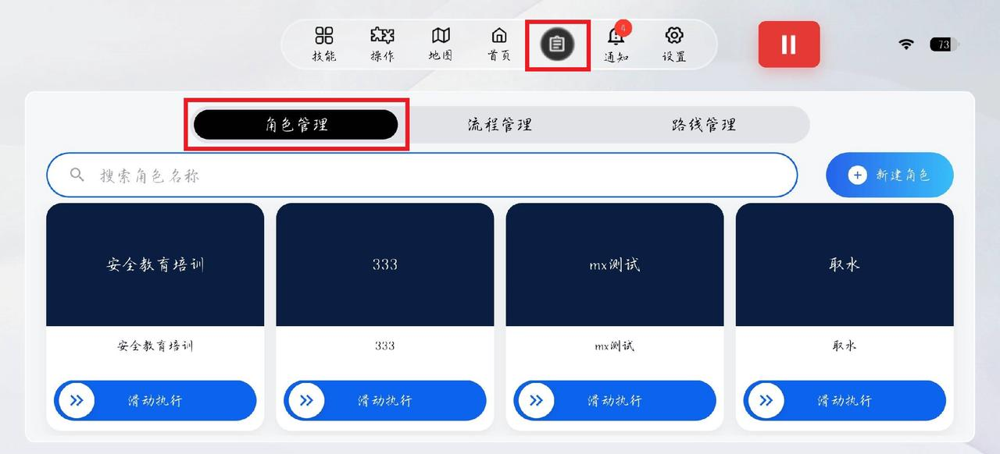

### 1.2 运行角色

- 找到相应目标角色向右滑动运行。

> 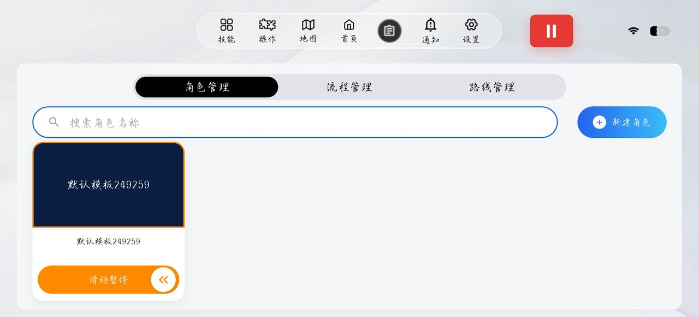

- 角色运行后，机器人按该角色设定进行交互。
- 角色运行状态下点击一下相应角色会进入角色监控看板。角色运行监控界面下，可以查看到语音识别与语音播报的信息。

> 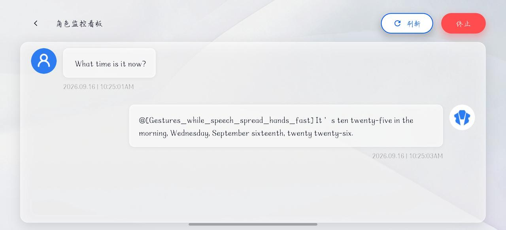

### 1.3 角色管理

- 点击未运行状态下的角色会进入角色编辑界面。

> 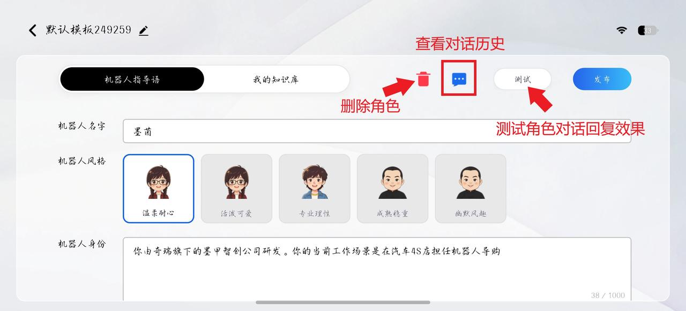

## 2 流程使用

### 2.1 进入流程界面

- 在 APP 顶部导航栏点击【任务】→“流程管理”。

> 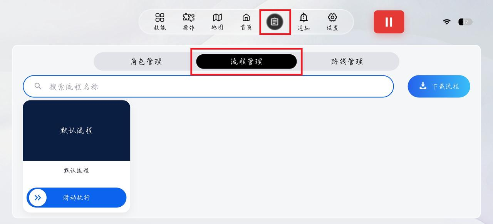

### 2.2 下载流程

- 点击“下载流程”。

> 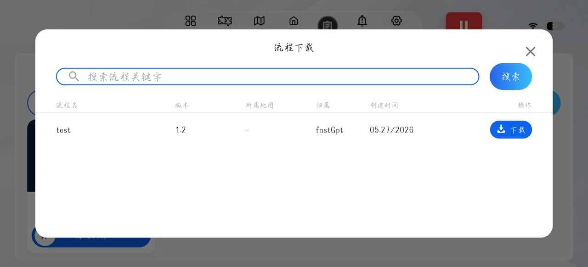

- 查看流程列表（流程名、版本、归属、创建时间）。
- 点击下载图标下载所需流程。

> **【注意】** 若流程涉及导航任务，需提前激活对应地图。

### 2.3 激活流程

- 下载完成后返回流程管理界面。
- 向右滑动流程开关，激活流程。
- 激活成功后流程处于启用状态。

> 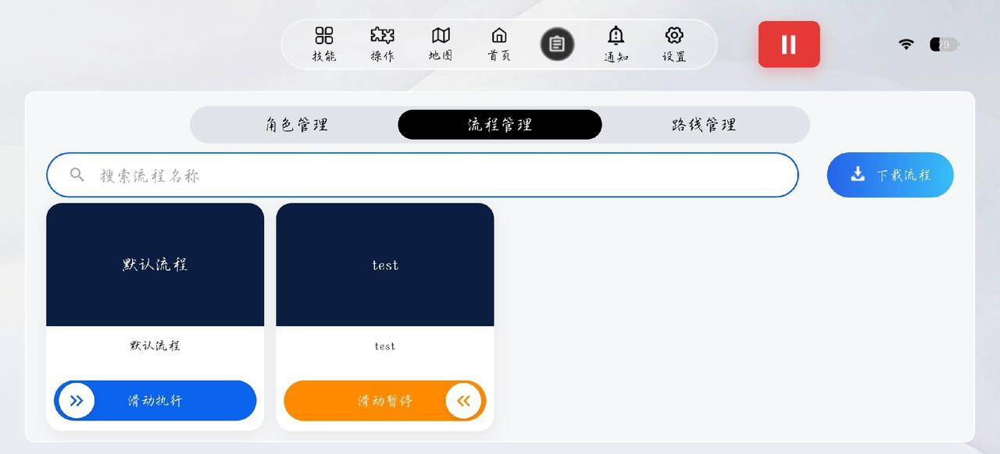

### 2.4 运行流程

- 流程激活后，机器人根据所选流程可以进行自主对话。

> **【注意】** 若需要机器人支持通过语音对话触发执行动作、自主导航、路线执行等功能，还需要：
>
> - 机器人切换到直腿行走模式。
> - 机器人打开自主动作开关。
> - 机器人激活对应的地图。

> 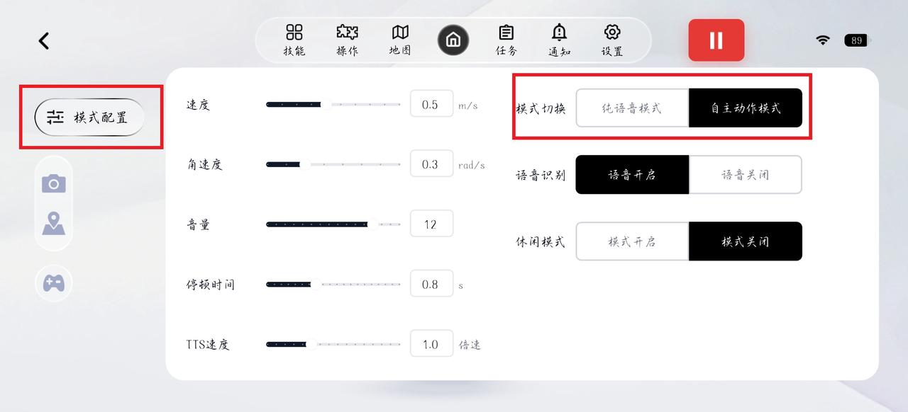

## 3 对话控制与设置

### 3.1 打断对话

<table>
  <colgroup>
    <col width="160" />
    <col width="551" />
  </colgroup>
  <thead>
    <tr>
      <th>方式</th>
      <th>操作</th>
    </tr>
  </thead>
  <tbody>
    <tr>
      <td>触摸耳朵</td>
      <td>触摸机器人耳朵部位（触摸线感应），立即打断当前对话</td>
    </tr>
    <tr>
      <td>关闭流程或角色</td>
      <td>找到正在运行中的角色或流程，向左滑动关闭</td>
    </tr>
  </tbody>
</table>

### 3.2 重新开启对话

<table>
  <colgroup>
    <col width="167" />
    <col width="528" />
  </colgroup>
  <thead>
    <tr>
      <th>功能</th>
      <th>操作路径</th>
    </tr>
  </thead>
  <tbody>
    <tr>
      <td>开启 ASR</td>
      <td>确保语音识别功能处于开启状态</td>
    </tr>
    <tr>
      <td>重新激活角色或流程</td>
      <td>任务 → 角色管理/流程管理 → 向右滑动开启</td>
    </tr>
  </tbody>
</table>

### 3.3 对话参数设置

点击 APP“模式配置”进行以下设置：

| 参数 | 设置项 | 说明 |
| --- | --- | --- |
| 音量 | `0`—`15` | 调整机器人语音播报音量大小 |
| TTS 速度 | `0.5`—`2.0` | 调整机器人语音播报速度 |
| 模式切换 | 纯语音模式 / 自主动作模式 | 纯语音模式下机器人不支持自主执行动作；若需要机器人支持通过语音对话触发执行动作、自主导航、路线执行等功能，需要打开自主动作模式 |
| 语音识别 | 开启 / 关闭 | 控制 ASR 功能开关 |
| 停顿时间 | `0.1`—`2.0` 秒 | 设置语音活动检测（VAD）最大静音间隔 |

> 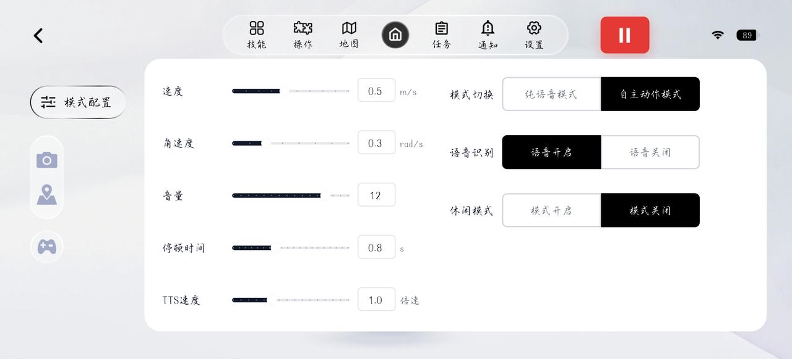

### 3.4 对话模式配置

- 机器人在对话过程中支持免唤醒和语音打断，可根据场景灵活选择。
- 在 APP 顶部导航栏点击【设置】→“功能设置”→“语音设置”。

> 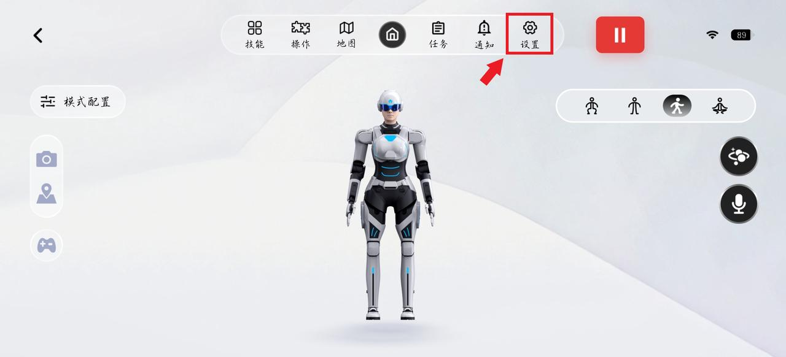
>
> 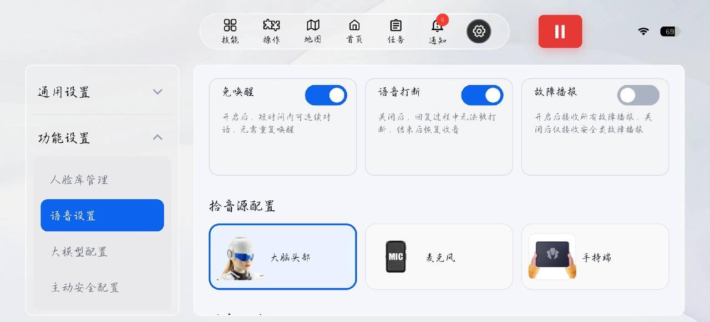

- 通用 APP 新增支持将拾音源切换至手持端，切换至手持端后返回首页，打开手持端对话输入按钮，可直接通过手机端 APP 与机器人对话（可手动输入文字或语音转文字）。

> 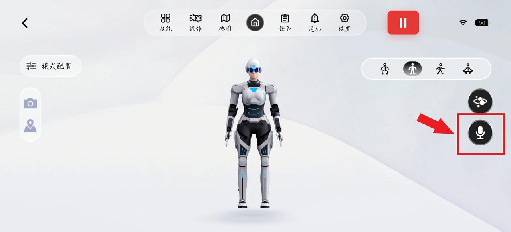
>
> 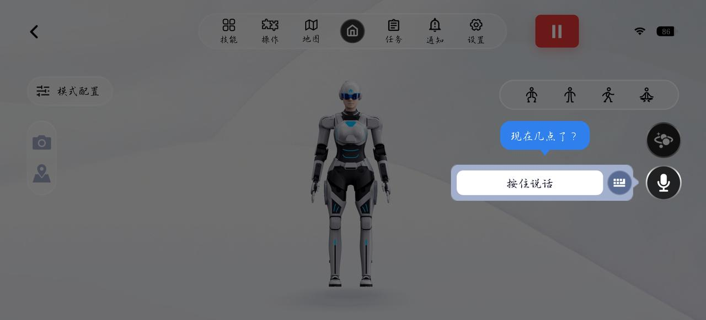
>
> 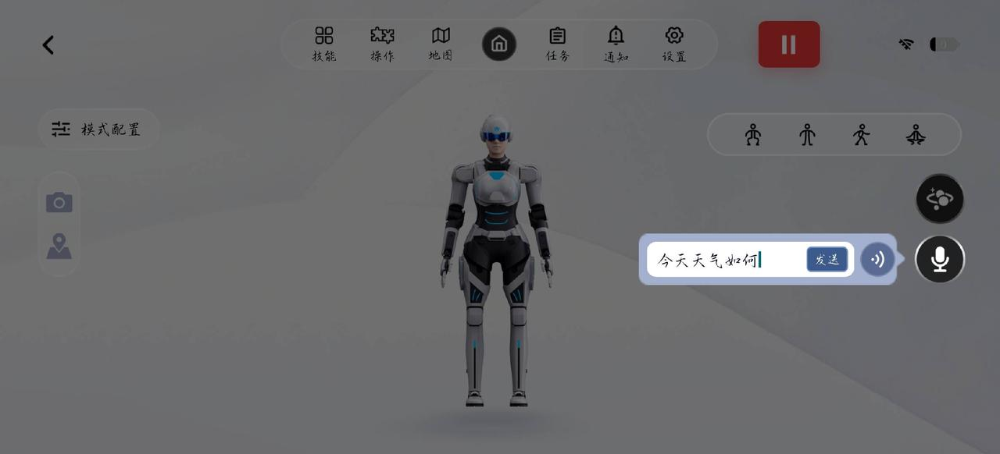

## 4 注意事项

> **【注意】** 离线模式不可使用角色、流程；流程编辑、角色创建等配置操作需在云平台网页端完成。

> 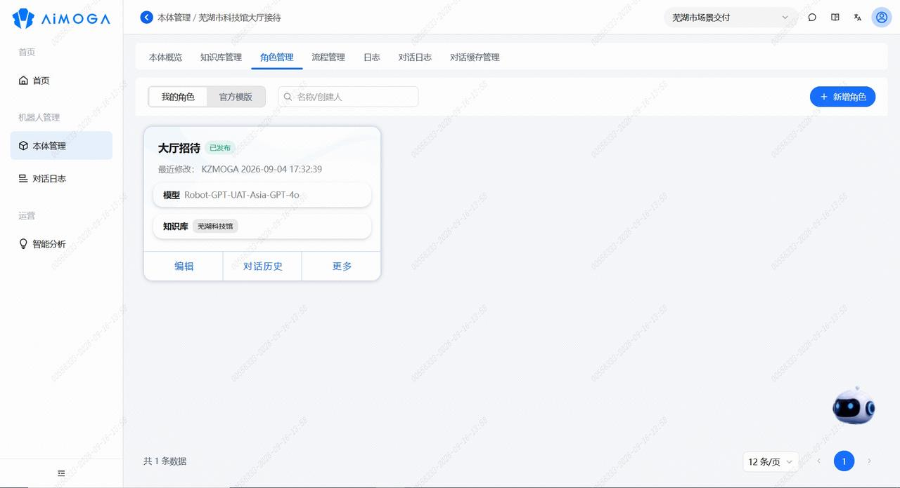
