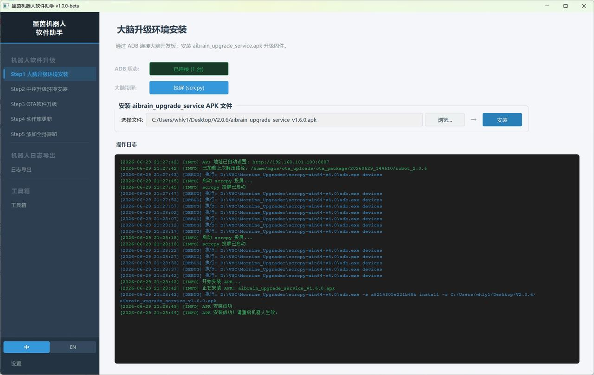
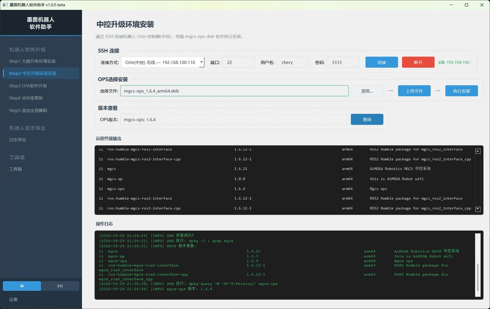
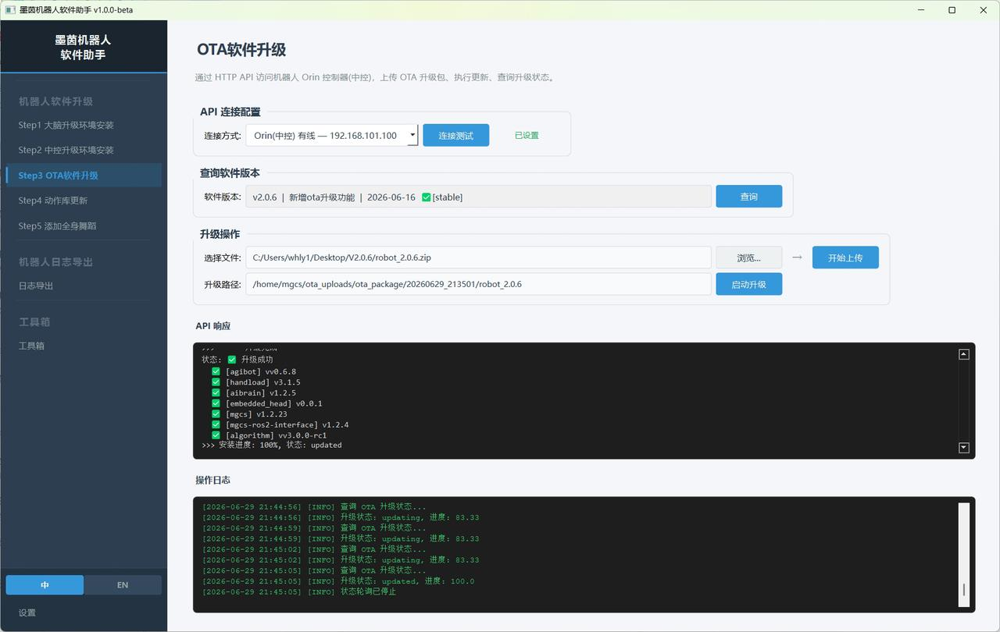
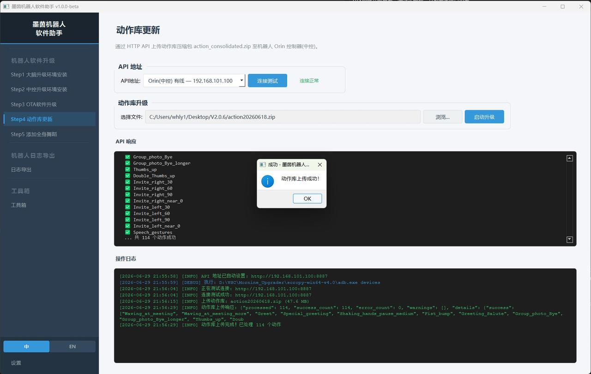
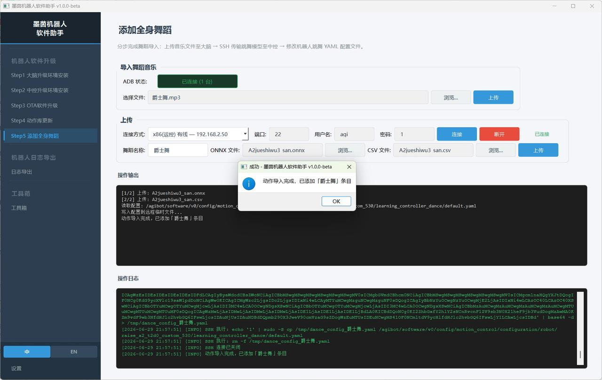

> **适用产品**：墨茵机器人 本文覆盖使用软件升级助手实现大脑升级、中控升级、OTA 软件升级、动作库更新、全身舞蹈添加与重启测试验证。

## 1 大脑（AIBrain）`upgrade`升级

- 适用对象：机器人大脑（AI Brain）模块。
- 升级文件：`aibrain_upgrade_service_v1.7.5_20261104_132105.apk`。
- 连接方式：ADB 调试线（USB 连接）。

操作步骤：

- 先机器人开机并连接网络，使用 ADB 调试线连接机器人大脑（USB 接口）。
- 再在升级工具中选择升级文件 `aibrain_upgrade_service_v1.7.5_20261104_132105.apk`。
- 然后点击“升级”按钮，开始执行升级。
- 最后等待工具提示“升级完成”，确认大脑升级成功。

> 

## 2 中控（ORIN 控制器）OPS升级

- 适用对象：机器人中控系统（ORIN 控制器）。
- 升级文件：`mgcs-ops_1.6.4_arm64.deb`。

连接方式：

| 连接方式 | 物理接口位置 | 电脑 IP 配置 |
| --- | --- | --- |
| 有线网口（推荐） | 机器人右侧 ORIN 控制器调试网口 | `192.168.101.xxx`（同网段即可） |
| 无线 WiFi | 机器人 WiFi 热点 | 自动获取（DHCP） |

操作步骤：

- 先选择连接方式（有线网口或 WiFi），建立 SSH 通讯。
- 再在升级工具中选择文件 `mgcs-ops_1.6.4_arm64.deb`。
- 然后点击“上传”将文件传输至中控系统。
- 执行安装命令，等待安装完成。
- 点击“版本查看”进行确认，核对版本号是否为 `1.6.4`。
- 确认无误后，执行“关机重启”，等待系统生效。

> 

<Warning>
  注意：重启后请等待系统完全启动（约 2—3 分钟），再进行下一步操作。
</Warning>

## 3 OTA 软件升级

- 适用对象：机器人整体软件系统（OTA 全量升级）。
- 升级文件：`robot_2.0.6.zip`。
- 前置条件：已完成大脑升级、中控升级，OPS-API 通讯正常。

操作步骤：

- 先选择连接方式，点击“测试”验证 OPS-API 连接状态。
- 再点击“查询”查看当前已安装的版本信息（用于升级前后对比）。
- 然后选择 OTA 升级包 `robot_2.0.6.zip`，点击“上传”。
- 等待进度条完成，系统将自动执行解压缩及升级路径更新。
- 解压缩完成后，点击“启动升级”，等待升级执行完毕。
- 升级完成后，系统将反馈各模块升级成功/失败状态，请逐一核对。

> 

## 4 动作库更新

- 适用对象：机器人动作数据库。
- 升级文件：`action20260618.zip`。
- 前置条件：OPS-API 连接正常。

操作步骤：

- 先选择连接方式，点击“测试”验证 OPS-API 连接状态。
- 再选择动作库文件 `action20260618.zip`。
- 然后点击“启动升级”，等待动作库更新完成。
- 导入完成后，可通过动作测试功能验证关键动作是否正常加载。

> 

## **5 全身舞蹈添加**

- 适用对象：自定义全身舞蹈动作。
- 所需文件：舞蹈音乐文件、动作 `.onnx` 文件、动作 `.csv` 文件。

### **5.1 舞蹈音乐上传（大脑端）**

- 使用 ADB 调试线连接机器人大脑。
- 选择对应的舞蹈音乐文件，点击“上传”。

### **5.2 舞蹈动作配置（Agibot 控制器端）**

> 

连接方式：

| **连接方式** | **物理接口位置** | **电脑 IP 配置** |
| :-- | :-- | :-- |
| 有线网口（推荐） | 机器人左侧 Agibot 控制器调试网口 | `192.168.2.xxx`（同网段即可） |
| 无线 WiFi | 机器人 WiFi 热点 | 自动获取（DHCP） |

操作步骤：

- 先选择连接方式，点击“连接”，建立 SSH 通讯。
- 再输入舞蹈动作的名称（建议英文或拼音，避免特殊字符）。
- 然后分别选择对应舞蹈动作的 `.onnx` 文件和 `.csv` 文件。
- 最后点击“上传”，系统将自动完成配置文件修改。

## 6 重启与测试验证

完成以上全部步骤后，执行以下操作：

- 先执行机器人“关机重启”。
- 再等待系统完全启动（约 2—3 分钟）。
- 最后执行测试工作，验证机器人功能使用是否正常。
