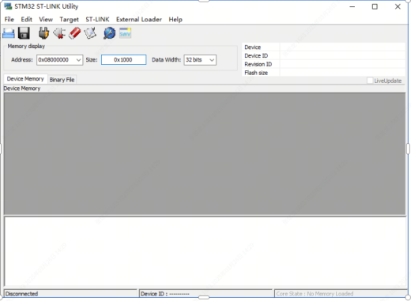
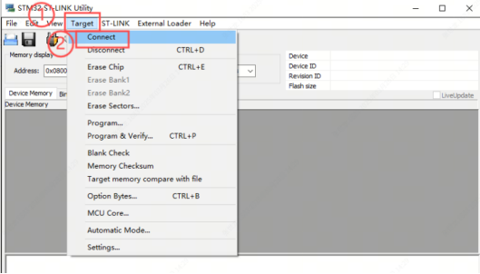
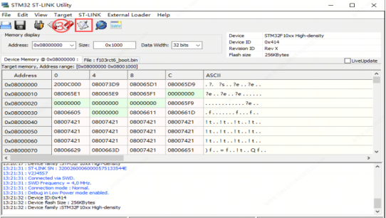
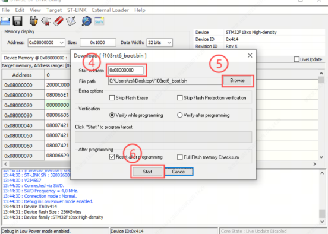
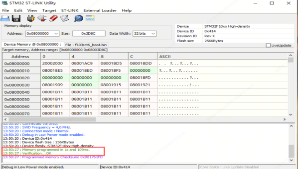

> **适用产品**：墨茵机器人 本文覆盖工具准备、适用场景、灵巧手外壳拆卸、控制板固件烧录、舵机复位标定与功能校验。

## 1 工具准备

- 笔记本电脑。
- 十字螺丝刀。
- ST-Link V2 工具：一头是 ST-Link 的标准接口（20-Pin 或 10-Pin JTAG/SWD），另一头是 4 根并排的杜邦线（通常对应 SWCLK、SWDIO、GND、3.3V），然后这 4 根线焊接到一个自制的端子上，能插进主控板的 5 针插座。而 ST-Link 本身自带的 USB 线直接连电脑。

>    src="/images/image-246.png"
>   alt="Image"
>   title="Image"
>   style={{ width:"81%" }}
> />

## 2 适用场景

- 新的灵巧手，控制板无固件。
- 新版本的固件下发。
- 在客户现场灵巧手指示灯亮度异常、灵巧手不工作。

## 3 灵巧手外壳拆卸

- 用十字螺丝刀拆开灵巧手背壳的固定螺丝，一侧两个螺丝，共四个螺丝，露出灵巧手控制板。

<Note>
  说明：妥善保管螺丝，避免遗失。
</Note>

>    src="/images/image-247.png"
>   alt="Image"
>   title="Image"
>   style={{ width:"66%" }}
> />

## 4 灵巧手控制板固件烧录

### 4.1 准备资料与软件安装

- [资料下载链接](https://drive.weixin.qq.com/s?k=AHYAsQcTADcs0HW47X)
- 安装后如下所示。

>    src="/images/image-248.png"
>   alt="Image"
>   title="Image"
>   style={{ width:"33%" }}
> />

- 文档获取：解压后即可有下图所示文件。

>    src="/images/image-249.png"
>   alt="Image"
>   title="Image"
>   style={{ width:"33%" }}
> />

### 4.2 硬件接线准备

- 将 ST-LINK 烧录器 USB 端连接笔记本，烧录调试端对接灵巧手控制板。
- 拔下控制板 485 通讯线束，控制板保持通电状态。

>    src="/images/image-250.png"
>   alt="Image"
>   title="Image"
>   style={{ width:"44%" }}
> />

### 4.3 固件烧录操作

- 先打开 STM32 ST-LINK Utility 软件，点击 Target → Connect 建立设备连接。

> 
>
> 

- 连接成功显示如下所示，之后点击报纸图标。

> 

- 首先将 Start address 的地址设置为 `0x08000000`；然后点击 Browse，导入烧录所需的 `.bin` 文件；最后点击 Start。

>    src="/images/image-254.png"
>   alt="Image"
>   title="Image"
>   style={{ width:"20%" }}
> />
>
> 

- 界面输出 `Verification...OK` 代表固件烧录完成，断开烧录器。

> 

## 5 控制板舵机复位标定

### 5.1 标定原因

灵巧手的控制板固件烧录之后，会导致对应的各个舵机的零点丢失，此时需要对灵巧手进行控制板复位，重新进行量程标定。

### 5.2 标定步骤

- 先整机上电，短按控制板 CHK 按键，再长按 CHK 按键，直至 LED1 闪烁、LED3 常亮，未进入状态则重复操作。
- 再按下 RST 复位按键，设备自动执行舵机复位标定，全程无需手动干预。

>    src="/images/image-257.png"
>   alt="Image"
>   title="Image"
>   style={{ width:"49%" }}
> />

## 6 功能校验

- 标定完成后整机重启，观察灵巧手指示灯亮度是否正常，测试手指弯曲、交互动作无卡顿、无失效即修复完成。
- 若出现黄灯异常，关机重启设备即可恢复。
- 整机多次动作循环测试，确认灵巧手所有功能稳定，作业完成。
