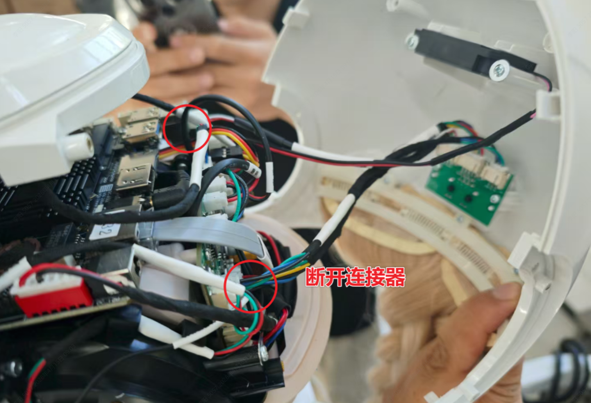
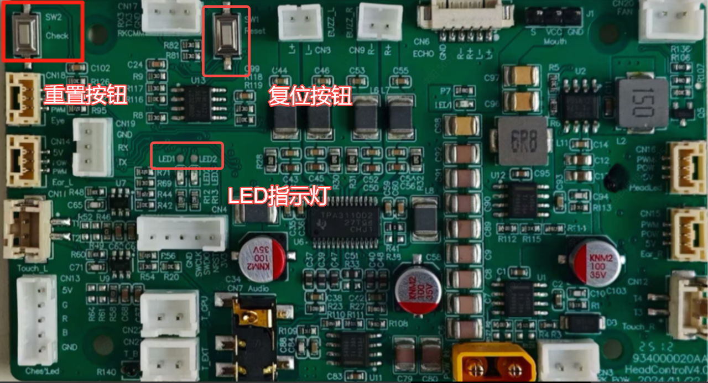

> **适用产品**：墨茵机器人 本文覆盖嘴部舵机复位的适用场景、操作步骤与注意事项。

## 1 适用场景

当机器人执行以下维修操作后，必须进行嘴部舵机复位：

- 更换嘴部舵机。
- 更换头部单片机控制板。

未复位可能导致的异常：

- 机器人说话时嘴部无动作。
- 机器人说话时碰撞异响。

## 2 操作步骤

### 2.1 拆除头部后壳

- 参考《墨茵机器人维修手册》拆除机器人头部后壳。
- 拆除后可看见头部单片机控制板，位置如下。

> 
>
> 

### 2.2 机器人通电

- 为机器人接通电源。
- 手动将机器人嘴部轻轻合拢至闭合状态。

### 2.3 执行舵机复位

#### 2.3.1 检查指示灯状态

- 观察头部单片机控制板的 LED 指示灯，正常状态为 2 个 LED 同步闪烁。

#### 2.3.2 触发复位程序

- 长按头部控制板上的 CHECK 重置按钮，直至 LED 指示灯状态改变为循环闪烁模式。
- 然后按下板子上的 RESET 按键或断电重启，执行复位流程。

#### 2.3.3 确认复位完成

等待嘴部自动完成以下动作序列：

- 嘴部自动张开。
- 嘴部自动闭合。

此时嘴部舵机位置标定完成。

### 2.4 还原头部后壳

- 参考《墨茵机器人维修手册》，按相反顺序还原机器人头部后壳。

## 3 注意事项

- 复位过程中请勿触碰嘴部舵机，避免干扰自动标定。
- 若 LED 指示灯无响应，检查电源连接后重新从机器人通电步骤开始。
- 多次复位失败请联系我司技术支持。
