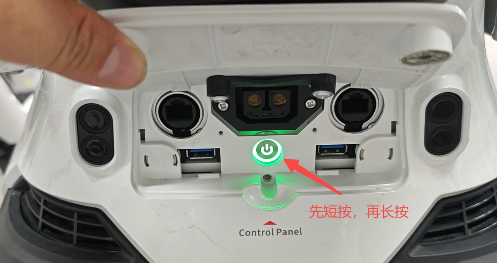

> **适用产品**：墨茵机器人 本文覆盖机器人无法关机的故障现象与处理步骤。

## 1 故障现象

机器人通电状态下，先短按再长按电源按钮后无响应，多次重复操作仍无法关机。

## 2 处理步骤

### 2.1 检查充电接口

- 确认是否有插入充电线，建议拔出后重新尝试。

### 2.2 等待保护时间

- 每次无效操作后等待 10—15 秒，避免连续触发系统保护机制，再进行“短按 + 长按”的关机操作。

### 2.3 联系技术支持

- 上述操作均无效时，联系 AIMoga 售后服务团队。
